# agentic-sdlc

> **BLUF** — Enterprise-grade Agentic Software Development Lifecycle (SDLC) governance.
> Seven stages take a feature from natural language intent to production, with governance
> **enforced by deterministic gates**, not by hope. Built on [OpenSpec](https://openspec.dev)
> and [Graphify](https://github.com/safishamsi/graphify); the governance plane is yours.

---

## Contents

- [What problem this solves](#what-problem-this-solves)
- [Three-Plane Architecture](#three-plane-architecture)
- [Bundled Out-of-the-Box Skills](#bundled-out-of-the-box-skills)
- [Install & Setup](#install--setup)
- [The Seven Stages](#the-seven-stages)
- [What `asdlc verify` Checks](#what-asdlc-verify-checks)
- [Governance Principles](#governance-principles)
- [Documentation Hub](#documentation-hub)
- [Development & Verification](#development--verification)

---

## What problem this solves

Spec-driven development works — until you scale it past one team or turn AI agents loose on production code. OpenSpec manages spec documents, but it **enforces nothing** at runtime. Nothing stops a developer or an autonomous agent from merging code that contradicts the approved spec, shipping without tests, or silently editing the spec after the fact.

`asdlc` closes that gap. It adds a deterministic governance plane *on top of* the engines:

- **Intent-Driven Start**: Developers start with natural language requirements (`asdlc new "i want to build..."`), not artificial ticket IDs. Canonical slugs are automatically derived, and knowledge graph queries are seeded with real domain terms.
- **High-Efficiency Batch Grilling**: A bundled interview engine (**`batch-grill-me`**) stress-tests the entire decision frontier in 1-2 structured batches with recommended defaults *before* writing specs. Decisions are recorded in `clarifications.md`.
- **The Spec is the Authority**: Merged to the protected branch, the spec is immutable. If reality diverges during implementation, the Converge protocol halts affected work (`SPEC_GAP`) — you never silently mutate an approved spec.
- **Enforced Task-Level TDD**: Unlocking implementation (`asdlc apply`) requires approved spec commits, while `asdlc verify` deterministically checks `test-presence` (rejects code changes without test changes in diff) and `tdd-evidence` (validates recorded test outputs).
- **Player ≠ Referee**: Independent AI verification uses a different model and a fresh context than the authoring agent.

---

## Three-Plane Architecture

```
┌─────────────────────────────────────────────────────────────────────────────┐
│ PLANE 3: Agentic IDE Skills & Commands (.agents/skills, .claude/skills, ...)│
│  ● asdlc:new  ● asdlc:lint  ● asdlc:review  ● asdlc:apply  ● asdlc:verify  │
│  ● Bundled Engines: grilling (batch-grill-me), asdlc-apply (TDD Red-Green)  │
└──────────────────────────────────────┬──────────────────────────────────────┘
                                       │ runs CLI with --json
┌──────────────────────────────────────▼──────────────────────────────────────┐
│ PLANE 2: Governance CLI & CI Gate (asdlc init/new/lint/approve/apply/verify)│
│  ● Path-limited approval evidence  ● Deterministic BDD/AC linters           │
│  ● Diff-based test presence gate   ● Schema version pin & override guard    │
└──────────────────────────────────────┬──────────────────────────────────────┘
                                       │ calls pure functions
┌──────────────────────────────────────▼──────────────────────────────────────┐
│ PLANE 1: Core Library (src/lib/ — zero side-effects, fully unit-tested)     │
│  ● speclint  ● tdd  ● prtype  ● policy  ● graphify  ● schema  ● agents      │
└─────────────────────────────────────────────────────────────────────────────┘
```

For complete technical specifications of each plane, see [docs/architecture.md](docs/architecture.md).

---

## Bundled Out-of-the-Box Skills

`asdlc` does not assume or require external user-level skills to be pre-installed. All critical agent harnesses are **packaged inside `asdlc` and installed automatically upon `asdlc init`**:

| Stage & Skill | Purpose & Behavior |
| :--- | :--- |
| **Stage 1 · Init**<br>[`asdlc-init`](assets/skills/asdlc-init/SKILL.md) | Bootstraps repo: installs OpenSpec, Graphify AST engine, governance schema, policies, git hooks, and bundled skills. |
| **Stage 2 · New**<br>[`asdlc-new`](assets/skills/asdlc-new/SKILL.md) | Transforms natural language intent into change directory, grounded in Graphify AST code queries. |
| **Stage 2 · Grilling**<br>[`grilling`](assets/skills/grilling/SKILL.md) | High-throughput **`batch-grill-me`** interview engine: settles the entire decision tree in 1-2 structured batches. |
| **Stage 3 · Lint**<br>[`asdlc-lint`](assets/skills/asdlc-lint/SKILL.md) | Deterministic BDD & Acceptance Criteria verification (R0–R8). Zero LLM jitter. |
| **Stage 3 · Review**<br>[`asdlc-review`](assets/skills/asdlc-review/SKILL.md) | *(CI-Managed)* Independent 6-dimension spec evaluation. Runs automatically on Spec PR. |
| **Stage 3.5 · Spec PR**<br>[`asdlc-pr`](assets/skills/asdlc-pr/SKILL.md) | 3-tier Spec PR engine (CLI → REST API → 1-click Web URL) with auto-labels and branch target tracking. |
| **Stage 4 · Approve**<br>[`asdlc-approve`](assets/skills/asdlc-approve/SKILL.md) | Recognizes Spec PR merge on target branch; records immutable `specSha` + `READY_FOR_IMPL`. |
| **Stage 5 · Apply**<br>[`asdlc-apply`](assets/skills/asdlc-apply/SKILL.md) | Enforces multi-tenant zero-diff guard; executes strict **Red -> Green -> Refactor -> Evidence -> Converge** TDD loop. |
| **Stage 6 · Verify**<br>[`asdlc-verify`](assets/skills/asdlc-verify/SKILL.md) | 12-gate implementation verification: test presence, task evidence, AC test mapping, and independent AI verifier. |
| **Stage 7 · Archive**<br>[`asdlc-archive`](assets/skills/asdlc-archive/SKILL.md) | Deliberate closeout: syncs specs, refreshes code AST graph on HEAD, and updates `AGENTS.md`. |
| **Diagnostics**<br>[`asdlc-doctor`](assets/skills/asdlc-doctor/SKILL.md) | Evaluates 12 toolchain/governance invariants; provides automated 1-click remediation (`--fix`). |
| **Orientation**<br>[`asdlc-status`](assets/skills/asdlc-status/SKILL.md) | Shows change stage progress, active artifacts, next command, or full portfolio dashboard. |

---

## Install & Setup

`asdlc` supports multiple installation methods depending on your environment:

```bash
# Option A: Directly from remote Git repository
npm install -g git+https://github.com/akjamie/agentic-sdlc.git

# Option B: Internal artifact store / tarball
npm install -g https://internal-artifactory/asdlc/asdlc-<version>.tgz

# Option C: Local development repository
npm install -g .

# Initialize repository (installs OpenSpec engine, Graphify, policy, and bundled skills)
asdlc init --ci jenkins
```

Verify setup health at any time:

```bash
asdlc doctor
```

---

## The Seven Stages

```mermaid
flowchart LR
    S1["1 · init<br/>setup + skills"] --> S2["2 · new<br/>intent + graph"]
    S2 --> G["grill<br/>batch-grill-me"] --> S3["3 · lint<br/>BDD + AC"]
    S3 --> PR["Spec PR<br/>CI AI Review"] --> S4["4 · approve<br/>merge = approval"]
    S4 --> S5["5 · apply<br/>TDD loop"] --> PR2["Impl PR"]
    PR2 --> S6["6 · verify<br/>12 gates"] --> S7["7 · archive<br/>sync + graph"]

    style S1 fill:#e8f4fd,stroke:#2196f3
    style S2 fill:#e8f4fd,stroke:#2196f3
    style S3 fill:#e8f4fd,stroke:#2196f3
    style S4 fill:#fff3e0,stroke:#ff9800
    style S5 fill:#e8f5e9,stroke:#4caf50
    style S6 fill:#fff3e0,stroke:#ff9800
    style S7 fill:#f3e5f5,stroke:#9c27b0
```



| Stage & Command | Lifecycle Action & Governance Guard |
| :--- | :--- |
| **1 · Init**<br>`asdlc init [--ci jenkins]` | Bootstraps OpenSpec + Graphify, governance schema, policy, and 8+ agent tools. |
| **2 · New**<br>`asdlc new "<requirement>"` | Derives canonical slug, queries code graph, and seeds `clarifications.md`. |
| **3 · Lint**<br>`asdlc lint <ID>` | Pure deterministic lint: verifies BDD scenarios, AC-to-test mappings (R0–R8). |
| **3.5 · PR**<br>`asdlc pr <ID> <targetBranch>` | Pushes spec branch, opens PR with labels, tracks target branch in metadata. |
| **4 · Approve**<br>`asdlc approve <ID>` | Validates spec merge; records path-limited `specSha` + `READY_FOR_IMPL`. *(Auto-recognized by apply)* |
| **5 · Apply**<br>`asdlc apply <ID>` | Path-isolated zero-diff guard; launches `/asdlc:apply` task-level TDD Red-Green engine. |
| **6 · Verify**<br>`asdlc verify <ID>` | Verifies 12 deterministic gates: test-presence, tdd-evidence, AC mappings, external tests, AI referee. |
| **7 · Archive**<br>`asdlc archive <ID>` | Syncs delta to `openspec/specs/`, refreshes knowledge graph, updates `AGENTS.md` system status. |

**Navigation & Diagnostics:**
- `asdlc status <ID>`: Instant orientation on current stage and exact next command.
- `asdlc doctor [--fix]`: Comprehensive toolchain and policy health diagnostics with auto-remediation.

---

## What `asdlc verify` Checks

`asdlc verify` executes in local developer terminals and on CI (Jenkins) without drift:

```mermaid
flowchart TB
    V["asdlc verify"] --> C1["pr-type<br/>paths only discrimination"]
    V --> C2["artifacts<br/>proposal + review + tasks + explore + spec"]
    V --> C3["approved-spec<br/>git log verification on target branch"]
    V --> C3b["spec-tamper<br/>locked spec paths unmodified in impl PR"]
    V --> C4["flow-state<br/>READY_FOR_IMPL verification"]
    V --> C5["tasks-complete<br/>all checkboxes resolved"]
    V --> C6["test-presence<br/>code diff mandates test diff"]
    V --> C7["tdd-evidence<br/>verified task output annotations"]
    V --> C8["BDD + AC<br/>GIVEN/WHEN/THEN + AC→test mapping"]
    V --> C9["openspec validate<br/>--all --strict"]
    V --> C10["schema-managed<br/>central install + version pin"]
    V --> C11["external<br/>unit tests · contract · security"]
    V --> C12["AI verification<br/>independent referee model"]
```



---

## Governance Principles

1. **Adopt the engines, own the governance plane.** OpenSpec and Graphify are adopted, not forked.
2. **Approval is git.** A merged spec PR *is* the human approval; the gate proves it with a path-limited `git log`.
3. **Fail-closed.** Any verification without an approved commit fails.
4. **Deterministic first.** Linters, diff analyzers, and schema validators are pure functions (no LLM jitter).
5. **Enforced TDD.** Implementation diffs touching production code without tests are rejected by `test-presence`.
6. **Ground specs in code.** Graphify AST queries ground specifications in real code structure.
7. **One front door.** Everything runs through `asdlc` — no raw escape hatches.

---

## Documentation Hub

| Document | Purpose |
|---|---|
| [docs/usage.md](docs/usage.md) | Practical command-line and developer walkthrough. |
| [docs/architecture.md](docs/architecture.md) | Complete 3-Plane Architecture & IDE Skill design specification. |
| [docs/solution-review.md](docs/solution-review.md) | Solution review, gap analysis, and architectural evaluation. |
| [docs/glossary.md](docs/glossary.md) | Formally locked domain model and SDLC vocabulary. |
| [docs/blueprint.html](docs/blueprint.html) | Enterprise Agentic SDLC Blueprint (English). |
| [docs/blueprint.zh.html](docs/blueprint.zh.html) | Enterprise Agentic SDLC Blueprint (Chinese). |

---

## Development & Verification

```bash
npm install
npm test        # 55 unit and integration tests (100% pass)
```

---

## License

[MIT](LICENSE)