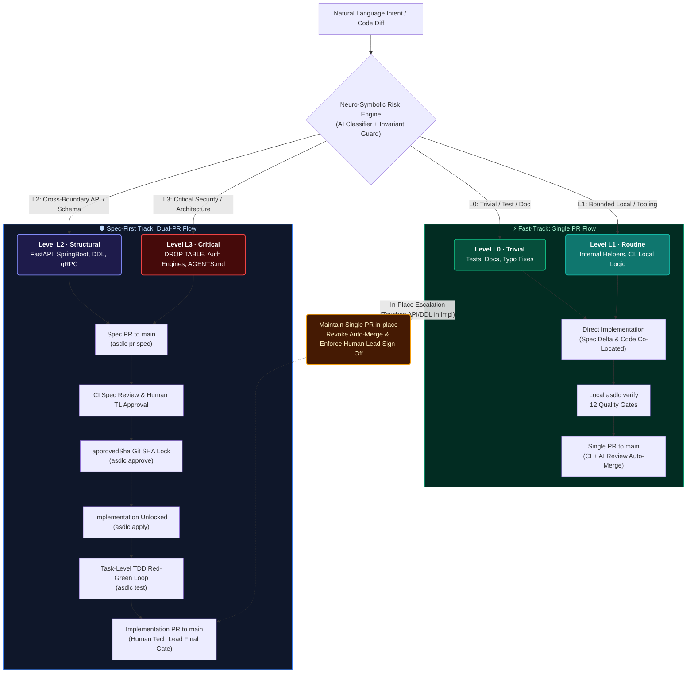
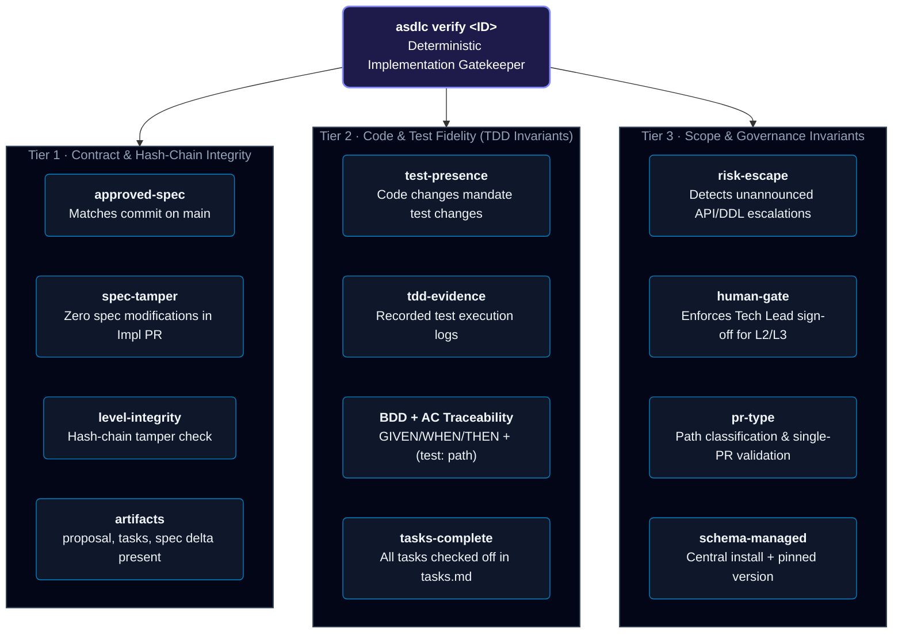

# agentic-sdlc

[](https://www.npmjs.com/package/@akjamie/agentic-sdlc)
[](LICENSE)
[](https://nodejs.org/)
[](#development--verification)
[](#adaptive-risk-tiered-governance-l0l3)

> **The Intelligent Governance Engine for Autonomous AI Coding.**
> Move fast on routine tasks. Lock down APIs, schemas, and security.
> Never let an autonomous agent wander into production unverified.
>
> Built on [OpenSpec](https://openspec.dev) and [Graphify](https://github.com/safishamsi/graphify).
> The spec is the contract. The gate is the law. Humans stay in control.

---

## ⚡ The Practical Bottlenecks of Autonomous AI Coding

AI coding agents (Claude Code, Cursor, OpenCode, Codex) write hundreds of lines of code in seconds. However, as code generation velocity increases, enterprise engineering teams encounter **three practical bottlenecks in real-world delivery**:

```
                  THE PRACTICAL BOTTLENECKS OF AUTONOMOUS CODING
 ┌───────────────────────────┐  ┌───────────────────────────┐  ┌───────────────────────────┐
 │ 1. Review Bandwidth       │  │ 2. Verification Bias      │  │ 3. Boundary & Assumptions │
 ├───────────────────────────┤  ├───────────────────────────┤  ├───────────────────────────┤
 │ Generation throughput has │  │ When the same agent writes│  │ Natural language leaves   │
 │ outpaced human review     │  │ both code and tests, tests│  │ scope implicit. Agents may│
 │ capacity, risking review  │  │ risk validating own bias  │  │ overstep boundaries and   │
 │ depth dilution.           │  │ rather than actual specs. │  │ cause cascading breaks.   │
 └───────────────────────────┘  └───────────────────────────┘  └───────────────────────────┘
```

1. **Review Bandwidth Asymmetry**: Code generation throughput has scaled by an order of magnitude, but human cognitive capacity for deep architectural comprehension remains constant. When teams are inundated with frequent multi-file PRs, line-by-line review becomes unsustainable, inadvertently diluting review depth on critical paths.
2. **Shared-Context Verification Bias (The "Player == Referee" Dilemma)**: When an agent implements code and writes unit tests within the same reasoning context, tests naturally inherit the agent’s internal interpretations. Passing tests confirm that code aligns with the agent’s own understanding, which can mask divergence from actual system contracts.
3. **Implicit Assumptions & Boundary Spillover**: Natural language prompts are inherently concise, stating localized intent while leaving architectural boundaries, blast-radius limits, and edge behaviors unspecified. Autonomous agents resolve these ambiguities independently and frequently modify high fan-in shared modules, common middleware, or public contracts to satisfy a localized prompt. Without early alignment on scope and contracts, unverified boundary crossovers trigger unintended cascading regressions across dependent components.

> **Why prompts alone (`AGENTS.md`, `CLAUDE.md`) cannot fix this:**  
> Prompts are **guidelines**, not deterministic gates. Under complex task and token constraints, agents prioritize code completion over subtle governance boundaries. Robust governance requires **deterministic exit-coded gates, Git-anchored contracts, and independent verification**.

### The Solution: Adaptive Dual-Track SDLC (`asdlc`)

`agentic-sdlc` bridges these bottlenecks with a **practical, Git-native governance plane**:
- 🚀 **Frictionless Agility for Routine Work (L0 / L1)**: Pure test additions, documentation updates, and bounded local refactors run in a streamlined **Single-PR** mode with automated validation and zero red tape.
- 🛡️ **Structured Rigor for High-Impact Changes (L2 / L3)**: Cross-boundary APIs (Spring Boot, FastAPI, Go, NestJS), database schemas, security tokens, and constitutional rules enforce **Dual-PR Spec-First** contracts with human sign-off on intent.
- 🔍 **Player ≠ Referee Verification**: Automated CI gates evaluate implementations against locked specifications using an independent model instance, eliminating shared-context verification bias.
- 🤝 **Humane In-Place Scope Escalation**: If scope expands or crosses boundaries during implementation, the system **never punishes the engineer** by tearing branches apart. It preserves the single PR in-place, revokes auto-merge, and routes to a Tech Lead for approval.

---

## 🧭 Adaptive Risk-Tiered Governance (L0–L3)

Every change evaluated by `asdlc` is continuously assessed along its lifecycle across core risk vectors (Task Intent, Security/Data Boundaries, and AST Topology/Architecture).



### Governance Tier Matrix

| Tier | Typical Scope | Workflow Mode | Spec-First Block? | Implementation Review | Auto-Merge |
| :---: | :--- | :---: | :---: | :---: | :---: |
| **L0** | Test additions, fixtures, docs, typos, comments | **Single PR** | ❌ None | None (Pass) |  **Enabled** (once CI passes) |
| **L1** | Internal utils, CI workflows, git hooks, local refactors | **Single PR** | ❌ None | AI Review |  **Enabled** (once AI passes) |
| **L2** | Public APIs (FastAPI/Spring/Go), schemas, shared libs | **Dual PR** |  **Enforced** | AI + Human Lead | 🚫 **Denied** (Lead Approval required) |
| **L3** | Destructive DDL (`DROP`), auth engines, `AGENTS.md` | **Dual PR** |  **Enforced** | AI + Human Lead | 🚫 **Denied** (Lead Approval required) |

---

## 🛡️ Non-Negotiable Engineering Invariants

Enterprise teams rely on deterministic code, not agent compliance or prompt enthusiasm. Every invariant is backed by Git-anchored proofs, hash-chain integrity, or exit-coded engines:

| # | Enterprise Invariant | How `asdlc` Enforces It | Failure Mode |
| :-: | :--- | :--- | :--- |
| **1** | **No Apply Before Spec Approval (L2/L3)** | `asdlc apply` physically inspects path-limited Git history for `approvedSha` on `main`. | 🚫 **Hard Refusal** — Zero production code allowed without an approved spec. |
| **2** | **Git-Anchored Anti-Tamper (`spec-tamper`)** | Implementation diffs must NOT modify locked spec files once approved on `main`. | 🚫 **Instant Rejection** — Agents cannot alter requirements to make failing tests pass. |
| **3** | **Anti-Gaming Hash Chain** | Every level transition is sealed in an append-only, SHA-256 hash-chained `risk-history.jsonl`. | 🚫 **Integrity Breach** — Manual downgrades (`L2 -> L1`) are detected and blocked. |
| **4** | **AI Classifier Invariant Defense** | AI semantic classifier output is validated against hard mathematical expectations. | 🚫 **Evasion Shield** — Prompts claiming a `DROP TABLE` is "just a test" are vetoed to L3. |
| **5** | **Zero Untested Code (`test-presence`)** | Any change touching production source code (`src/**`, `app/**`) requires test diffs. | 🚫 **Rejection** — Stops AI "code dumps" without corresponding test coverage. |
| **6** | **Deterministic AC Assertions (`asdlc test`)** | Parses `- [ ] ACn: (test: <path>)` annotations and runs native test suites. | 🚫 **Fake Claim Gate** — Unimplemented acceptance criteria immediately fail CI. |
| **7** | **Player ≠ Referee Isolation** | CI runs independent verification with a fresh LLM instance outside the author agent context. | 🚫 **Audit Integrity** — Authoring agents can never grade their own exam. |
| **8** | **Humane In-Place Scope Escalation** | If an L1 change touches an API during implementation, single PR is preserved with mandatory human sign-off. |  **Safe Convergence** — No messy branch rebases; human stays in control. |

---

## 📦 Architecture: The Three Planes

`agentic-sdlc` strictly decouples interface, governance rules, and core execution:

```
┌────────────────────────────────────────────────────────────────────────┐
│ PLANE 3 · Conversational Agent Surface (.agents/skills/)               │
│ Bundled out-of-the-box skills for Claude Code, Cursor, OpenCode, etc.  │
│ Coordinates multi-turn flows, interviews, TDD loops, and reviews.      │
└──────────────────────────────────┬─────────────────────────────────────┘
                                   │ Invokes commands with --json
┌──────────────────────────────────▼─────────────────────────────────────┐
│ PLANE 2 · Governance CLI & Hard CI Gates (bin/asdlc.js)                │
│ Deterministic CLI exit codes (0 = pass, 1 = fail). No LLM fuzziness.   │
│ init · new · lint · approve · apply · test · verify · pr · archive     │
└──────────────────────────────────┬─────────────────────────────────────┘
                                   │ Pure function calls
┌──────────────────────────────────▼─────────────────────────────────────┐
│ PLANE 1 · Core Library & Engines (src/lib/, src/assess/)               │
│ Pure functions, 100% tested, zero side-effects.                       │
│ ├─ assess/    Neuro-symbolic risk evaluation & hash-chain history     │
│ ├─ speclint/  R0–R8 BDD/AC linting & scenario coverage traceability   │
│ ├─ graphify/  Knowledge graph & code AST topology discovery           │
│ └─ verify/    12 deterministic & structural quality gates              │
└────────────────────────────────────────────────────────────────────────┘
```

---

## 🚀 Quickstart: 5-Minute Walkthrough

> 🧭 **New to Agentic SDLC?**  
> Follow our hands-on [**30-Minute Getting Started Guide (docs/getting-started.md)**](docs/getting-started.md) for a step-by-step walkthrough with copy-paste examples, AI grilling guidance, and expected CLI outputs from zero install to your first verified Spec PR!

### 1. Installation

```bash
# Install globally via npm
npm install -g @akjamie/agentic-sdlc

# Initialize your repository with OpenSpec, Graphify, and bundled skills
asdlc init

# Verify environment & toolchain health
asdlc doctor
```

### 2. Scenario A: Agile Routine Change (Level L1 · Single-PR)

```bash
# 1. Start a routine change (automatically inferred as L1)
asdlc new "add memory cache helper with TTL eviction"

# 2. Directly implement using the task-level TDD loop (no Spec PR needed!)
asdlc apply memory-cache-helper

# 3. Verify locally against 12 quality gates
asdlc verify memory-cache-helper

# 4. Open Single PR (co-locates spec delta and code)
asdlc pr memory-cache-helper main
# → Auto-merge eligible once CI & AI checks pass!
```

### 3. Scenario B: High-Impact API Change (Level L2 · Dual-PR Spec-First)

```bash
# 1. Start an API change (automatically detected as L2 Spec-First)
asdlc new "create FastAPI user authentication router"

# 2. Agent runs conversational grill-me to settle design in clarifications.md
#    Drafts proposal.md, design.md, and specs/

# 3. Open Spec PR (triggers CI AI Spec Review)
asdlc pr user-auth main

# 4. Human Tech Lead reviews & merges Spec PR to main.
#    asdlc approve locks the specSha!

# 5. Implementation is now unlocked
asdlc apply user-auth

# 6. Execute TDD loop and verify code + test presence
asdlc test user-auth
asdlc verify user-auth

# 7. Open Implementation PR (attaches asdlc:impl-review)
asdlc pr user-auth main
# → Mandatory Human Tech Lead approval required before trunk merge!
```

---

## 🧰 Bundled Out-of-the-Box Skills

`asdlc` includes production-grade agent skills installed automatically into `.agents/skills/`. Your AI assistant (Claude Code, Cursor, OpenCode, Antigravity IDE) immediately gains enterprise SDLC capabilities:

| Skill | Role in Agentic SDLC |
| :--- | :--- |
| [`asdlc-init`](assets/skills/asdlc-init/SKILL.md) | One-command bootstrapping of OpenSpec, Graphify AST, policies, and git hooks. |
| [`asdlc-new`](assets/skills/asdlc-new/SKILL.md) | Scaffolds change, queries AST hubs, runs conversational anti-fatigue `grill-me`. |
| [`asdlc-lint`](assets/skills/asdlc-lint/SKILL.md) | Enforces deterministic BDD GIVEN/WHEN/THEN and R5 scenario-to-AC coverage. |
| [`asdlc-pr`](assets/skills/asdlc-pr/SKILL.md) | Smart PR dispatcher: automatically handles Spec PR vs. Implementation PR. |
| [`asdlc-approve`](assets/skills/asdlc-approve/SKILL.md) | Stamps Git `specSha` lock upon Spec PR merge. |
| [`asdlc-apply`](assets/skills/asdlc-apply/SKILL.md) | Strict task-level TDD engine (`Red -> Green -> Refactor -> Evidence -> Converge`). |
| [`asdlc-verify`](assets/skills/asdlc-verify/SKILL.md) | Pre-flight audit across 12 gates (test presence, evidence, tamper guard, schema). |
| [`asdlc-spec-review`](assets/skills/asdlc-spec-review/SKILL.md) | Independent review agent: 6-dimensional spec review before human lead approval. |
| [`asdlc-impl-review`](assets/skills/asdlc-impl-review/SKILL.md) | Independent review agent: Player ≠ Referee verification with test execution and Anthropic convergence rules. |
| [`asdlc-archive`](assets/skills/asdlc-archive/SKILL.md) | Syncs specs to living catalog, refreshes AST graph, and updates system status. |
| [`asdlc-doctor`](assets/skills/asdlc-doctor/SKILL.md) | 12-invariant diagnostic engine with 1-click automated remediation (`--fix`). |
| [`asdlc-status`](assets/skills/asdlc-status/SKILL.md) | Real-time change lifecycle dashboard and next actionable command guidance. |

---

## 🔍 What `asdlc verify` Checks (12 Local & CI Gates)

Every implementation diff must pass the 12 deterministic gates in `asdlc verify`:



---

## 🛠️ CLI Reference

```bash
asdlc init [--ci jenkins|github]   # Scaffold repository with OpenSpec, Graphify, and skills
asdlc new "<intent>"               # Scaffold change with AST explore + grill-me interview
asdlc lint <ID>                    # Validate BDD scenarios, AC rules, and coverage (docs/spec-format.md)
asdlc pr <ID> <target-branch>      # Smart PR creator (auto-handles Spec PR vs Impl PR)
asdlc approve <ID>                 # Record approvedSha and transition to ready_for_impl
asdlc apply <ID>                   # Guarded implementation launcher (checks approvedSha)
asdlc test <ID> [--json]           # Execute real test runners mapped to AC annotations
asdlc verify <ID>                  # Audit diff against all 12 quality gates
asdlc archive <ID>                 # Sync delta to living specs and refresh code graph
asdlc doctor [--fix]               # 12-point toolchain & governance health check
asdlc status [<ID>]                # Change progress orientation or portfolio dashboard
asdlc upgrade [--global]           # Seamless upgrade of CLI, engine, and schemas
```

---

## 🧪 Development & Verification

`agentic-sdlc` is built to enterprise testing standards. Every feature is backed by rigorous unit, integration, and simulation tests:

```bash
git clone https://github.com/akjamie/agentic-sdlc.git
cd agentic-sdlc
npm install

# Run complete test suite (128 tests passing, 100% pass rate)
npm test

# Run end-to-end multi-language simulation tests
node --test test/simulation.test.js
```

---

## 📚 Documentation Center
 
Explore the complete documentation in the [`docs/`](docs/) directory:
 
- ⏱️ [**30-Minute Getting Started Guide**](docs/getting-started.md): Frictionless step-by-step tutorial from install to first Spec PR.
- 📐 [**Spec Format & Lint Reference**](docs/spec-format.md): Human-readable guide to R0–R8 lint rules with pass/fail examples.
- 🌐 [**Quickstart Guide (Bilingual)**](docs/quickstart.md): End-to-end walkthrough covering the complete 7-stage lifecycle.
- 🏛️ [**System Architecture & Whitepaper**](docs/about.md): Why Agentic SDLC, L0–L3 governance, and Git SHA anti-tamper locks.
- 🩺 [**Environment Doctor Manual**](docs/doctor.md): Diagnostic reference for all 12 health checks and `--fix` automated healing.
- ⌨️ [**CLI Command Reference**](docs/usage.md): Full flag, option, and exit code reference for all `asdlc` commands.
- 📖 [**Standard Glossary**](docs/glossary.md): Authoritative lexicon for living specs, spec SHAs, and architectural god nodes.
 
---
 
## 🤝 Community & Contributing
 
We welcome contributions from developers, architects, and researchers advancing the state of Agentic Software Engineering!
 
- **Contributing Guide**: Check out [CONTRIBUTING.md](CONTRIBUTING.md) for local setup, development conventions, and PR expectations.
- **Specification & Linting Reference**: Read [docs/spec-format.md](docs/spec-format.md) for R0–R8 pass/fail examples, BDD rules, and troubleshooting remedies.
- **IDE Slash-Command Parity**: First-class slash commands (`/asdlc-*`) across Claude Code, OpenCode, Pi, Antigravity, GitHub Copilot, Cursor, Trae, and Windsurf (see [docs/usage.md](docs/usage.md)).
- **Architectural Specs**: Read [docs/architecture.md](docs/architecture.md) for deep dives on the 3-plane model.
- **Enterprise Blueprint**: Browse [docs/blueprint.md](docs/blueprint.md) (or [Chinese version](docs/blueprint.zh.md)) for enterprise deployment patterns.
- **Documentation Index**: See [docs/README.md](docs/README.md) for the active documentation catalog.

---

## 📄 License & Attribution

Distributed under the **Apache-2.0 License**. See [LICENSE](LICENSE) and [NOTICE](NOTICE) for details.

```markdown
Project: agentic-sdlc (Enterprise Agentic SDLC Governance)
Author: Jamie Zhang (@akjamie)
Repository: https://github.com/akjamie/agentic-sdlc
```