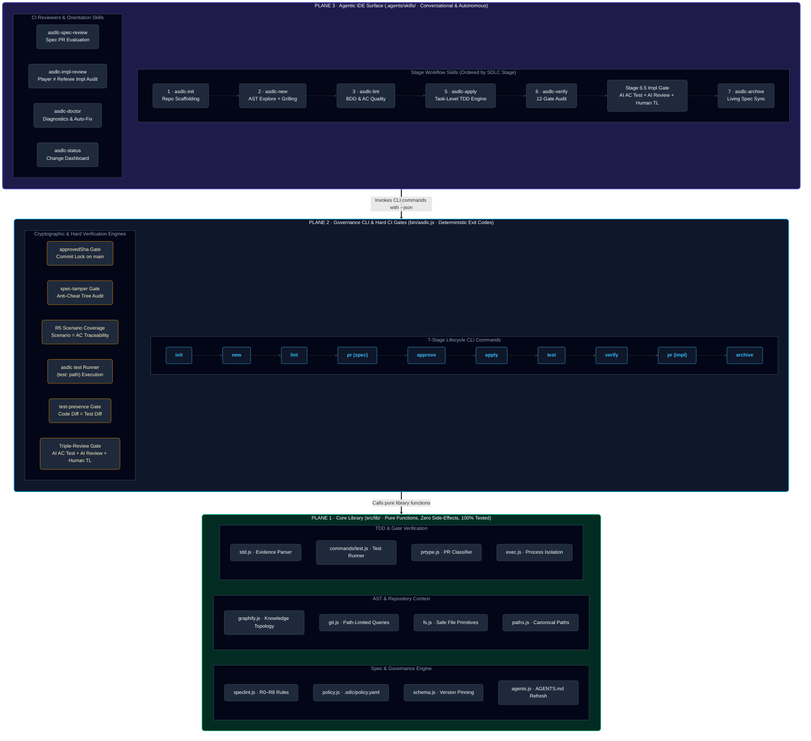
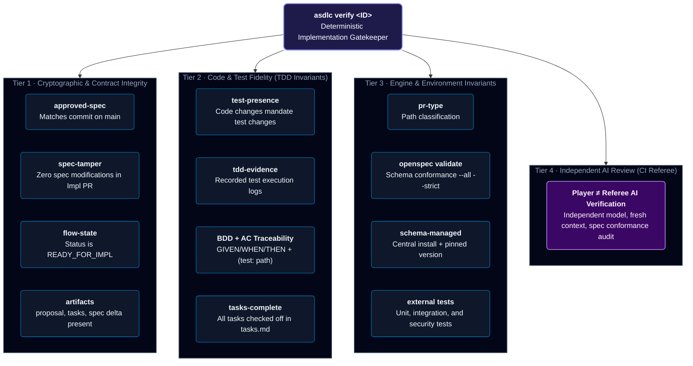

# agentic-sdlc

[](https://www.npmjs.com/package/@akjamie/agentic-sdlc)
[](LICENSE)
[](https://nodejs.org/)
[](#development--verification)

> **Enterprise-grade Agentic SDLC governance.** Seven deterministic stages take a feature from natural-language intent to production — with every quality gate enforced by code, not by convention.
>
> Built on [OpenSpec](https://openspec.dev) and [Graphify](https://github.com/safishamsi/graphify).
> The spec is the authority. The gate is the law. Humans stay in control.

---

## Contents

- [What problem this solves](#what-problem-this-solves)
- [Enterprise Quality Gates & Non-Negotiable Invariants](#-enterprise-quality-gates--non-negotiable-invariants)
- [Three-Plane Architecture](#three-plane-architecture)
- [Bundled Out-of-the-Box Skills](#bundled-out-of-the-box-skills)
- [Install & Setup](#install--setup)
- [The Seven Stages](#the-seven-stages)
- [What `asdlc verify` Checks](#what-asdlc-verify-checks)
- [Governance Principles](#governance-principles)
- [Documentation Hub](#documentation-hub)
- [Development & Verification](#development--verification)

---

## What Problem This Solves

Spec-driven development works — until you scale it past one team or turn AI agents loose on a production codebase.

OpenSpec manages spec documents, but it **enforces nothing** at runtime. Nothing stops an autonomous agent from:

- Writing code that contradicts the approved spec
- Shipping without tests
- Silently editing the spec after the fact to make failing tests pass
- Grading its own implementation (agent acts as both player and referee)

`asdlc` closes every one of those gaps by adding a **deterministic governance plane** on top of the spec engine:

| What agents can't do | How `asdlc` enforces it |
| :--- | :--- |
| Write production code before spec approval | `asdlc apply` physically refuses via path-limited `git log` check |
| Silently alter an approved spec | `spec-tamper` gate computes and compares path-limited SHA |
| Ship code without tests | `test-presence` gate rejects diffs missing test changes |
| Write ACs not mapped to test files | `(test: <path>)` annotation required per AC |
| Self-certify their own implementation | CI runs independent `asdlc-impl-review` with fresh LLM context |
| Declare success without recorded test evidence | `tdd-evidence` gate validates actual test output logs |

### Five Core Principles

- **Intent-Driven Start** — `asdlc new "i want to build..."` derives a canonical slug; no artificial ticket IDs.
- **Conversational Grilling Before Specs** — high-signal **`grill-me`** interview (or **`batch-grill-me`** via `--batch-grill`) stress-tests the decision frontier *before* any spec is written, with strict anti-fatigue guardrails. Decisions are recorded in `clarifications.md`.
- **The Spec is Immutable** — once merged to the protected branch, the spec is locked. If reality diverges, the Converge protocol halts work (`SPEC_GAP`) and requires human re-approval via a fresh spec delta.
- **Enforced Task-Level TDD** — `asdlc apply` requires an approved spec commit; `asdlc verify` enforces `test-presence` and `tdd-evidence` on every diff.
- **Player ≠ Referee** — the authoring agent can never certify its own work; CI uses a separate model with fresh context.

---

## 🛡️ Enterprise Quality Gates & Non-Negotiable Invariants

These are the hard invariants enterprise engineering leads require when deploying autonomous agents on production repositories.
Every invariant is enforced by deterministic code — not by convention, documentation, or hope.

| # | Quality Gate | Enforcement | Failure Mode |
| :--: | :--- | :--- | :--- |
| **1** | **No Apply Before Spec PR Merge** | `asdlc apply <ID>` verifies path-limited Git commit (`approvedSha`) on `main` touching `proposal.md` + `specs/**` | 🚫 **Hard Refusal** — zero production code on unapproved drafts |
| **2** | **Cryptographic Anti-Tampering** (`spec-tamper`) | `asdlc verify` computes path-limited SHA of locked spec files in the impl diff against `approvedSha` | 🚫 **PR Rejection** — agents cannot move the goalposts to pass failing tests |
| **3** | **Full Scenario-to-AC Traceability** (`R5-scenario-coverage`) | `asdlc lint` enforces `scens.length <= acs.length` — every scenario needs ≥1 AC | 🚫 **Pre-flight Blocker** — prevents single happy-path ACs for complex scenario sets |
| **4** | **Deterministic AC Test Gate** (`asdlc test`) | Parses all `- [ ] ACn: ... (test: <path>)` mappings and executes real assertions via native runners | 🚫 **Dual Harness** — local TDD driver + independent CI gate; fake claims fail |
| **5** | **Player ≠ Referee Isolation** | CI impl review runs with fresh LLM context; independent of author agent `tasks.md` declarations | 🚫 **Audit Integrity** — authoring agents cannot grade their own exam |
| **6** | **Diff-Based Test Presence** (`test-presence`) | `asdlc verify` checks every `src/**` change is accompanied by `test/**` changes | 🚫 **Zero Untested Code** — shuts down AI "code dumps" with no test coverage |
| **7** | **Immutable Converge Protocol** (`SPEC_GAP`) | If implementation exposes invalid spec assumptions, agent must halt and file a `SPEC_GAP` report | 🚫 **Anti-Drift** — silent spec mutations blocked; human re-approves fresh delta |
| **8** | **Triple-Gated Trunk Merge** | Impl PR merge requires: ① CI AC Tests, ② AI Impl Review (Player ≠ Referee), ③ Human Tech Lead sign-off | 🚫 **Blast Radius Defense** — unreviewed agent code never reaches `main` |

---

## Three-Plane Architecture

The system is structured across three distinct planes, each with a clear responsibility boundary:



> **Rule**: Core reads and validates — it never prints and rarely writes. CLI is the thin shell (parse → call core → format → exit code). Skills are conversational coordinators — they call the CLI, interpret output, and guide multi-step flows.

For complete technical specifications of each plane, see [docs/architecture.md](docs/architecture.md).

---

## Bundled Out-of-the-Box Skills

`asdlc` ships all critical agent harnesses inside the package. They are installed automatically into `.agents/skills/` on `asdlc init` — no manual skill setup required.

| **Stage & Skill** | **Purpose & Behavior** |
| :--- | :--- |
| **Stage 1 · Init**<br>[`asdlc-init`](assets/skills/asdlc-init/SKILL.md) | Bootstraps repository: OpenSpec, Graphify AST engine, governance schema, policies, git hooks, and agent skills. |
| **Stage 2 · New**<br>[`asdlc-new`](assets/skills/asdlc-new/SKILL.md) | Grounds intent in Graphify AST queries, seeds `clarifications.md`, runs conversational `grill-me` (or `--batch-grill`), and generates `design.md` with `archify`, `api-design`, and `frontend-design`. |
| **API Design**<br>[`api-design`](assets/skills/api-design/SKILL.md) | Enforces enterprise RESTful standards: plural noun URLs, RFC 7807 error envelopes, cursor pagination, `Idempotency-Key` headers, and rate-limiting resilience. |
| **UI/UX Design**<br>[`frontend-design`](assets/skills/frontend-design/SKILL.md) | Enforces Anthropic official `frontend-design` & Vercel Web Interface Guidelines: anti-AI slop, bespoke 4–6 hex palettes, typography pairings, hero moments, and 5 mandatory states. |
| **Stage 3 · Spec PR**<br>[`asdlc-pr`](assets/skills/asdlc-pr/SKILL.md) | Enforces deterministic BDD/AC linting (R0–R8) and opens Spec PR (CLI → REST API → 1-click Web URL) with auto-labels. |
| **Stage 3.5 · Spec AI Review**<br>[`asdlc-spec-review`](assets/skills/asdlc-spec-review/SKILL.md) | CI-triggered independent 6-dimension spec evaluation; posts structured findings and traceability matrix as PR comments. |
| **Stage 4 · Approve**<br>[`asdlc-approve`](assets/skills/asdlc-approve/SKILL.md) | Explicit audit stamp after PR merge (`specSha` + `READY_FOR_IMPL`). Auto-recognized by `apply`. |
| **Stage 5 · Apply**<br>[`asdlc-apply`](assets/skills/asdlc-apply/SKILL.md) | Path-isolated zero-diff guard; executes strict **Red -> Green -> Refactor -> Evidence -> Converge** TDD loop. |
| **Stage 6 · Verify**<br>[`asdlc-verify`](assets/skills/asdlc-verify/SKILL.md) | 12-gate implementation verification: test presence, task evidence, AC test mapping, and independent AI verifier. |
| **Stage 6.5 · Impl AI Review**<br>[`asdlc-impl-review`](assets/skills/asdlc-impl-review/SKILL.md) | CI-triggered independent implementation evaluation (AC conformance matrix, code quality, TDD evidence); posts markdown findings as PR comments via `gh`. |
| **Stage 7 · Archive**<br>[`asdlc-archive`](assets/skills/asdlc-archive/SKILL.md) | Deliberate closeout: syncs specs to master catalog, refreshes code AST graph, and updates system status. |
| **Diagnostics**<br>[`asdlc-doctor`](assets/skills/asdlc-doctor/SKILL.md) | Evaluates 12 toolchain/governance invariants; provides automated 1-click remediation (`--fix`). |
| **Orientation**<br>[`asdlc-status`](assets/skills/asdlc-status/SKILL.md) | Shows change stage progress, active artifacts, next command, or full portfolio dashboard. |

---

## Install & Setup

```bash
# Recommended: install from npm
npm install -g @akjamie/agentic-sdlc

# Or directly from GitHub (npm ≥12 requires --allow-git=all)
npm install -g --allow-git=all git+https://github.com/akjamie/agentic-sdlc.git

# Initialize a repository (installs OpenSpec, Graphify, policy, and bundled skills)
asdlc init --ci jenkins

# Verify toolchain health at any time
asdlc doctor
```

> **One-liner health check**: `asdlc doctor` evaluates 12 invariants across your toolchain and governance setup, with `--fix` for automated remediation.

---

## The Seven Stages

The lifecycle is divided into three phases. Human approval gates are explicit; the CI automation pipeline is non-bypassable.

```mermaid
flowchart TD
    subgraph PHASE1 ["Phase A · Specification & Alignment (Intent to Contract)"]
        direction LR
        S1["1 · init<br/><b>Toolchain Setup</b><br/>OpenSpec + Graphify"] --> S2["2 · new<br/><b>Scaffold + Batch-Grill-Me</b><br/>AST explore.md + clarifications.md"]
        S2 --> S3["3 · lint<br/><b>BDD/AC Gate</b><br/>R0–R8 + Scenario Coverage"]
        S3 --> PR1{{"<b>Spec PR (Stage 3.5)</b><br/>CI Spec AI Review"}}
        PR1 -->|"Human TL Approves & Merges"| S4["4 · approve<br/><b>Cryptographic Lock</b><br/>approvedSha & ready_for_impl"]
    end

    subgraph PHASE2 ["Phase B · Implementation & Hard Gate TDD (Contract to Verified Code)"]
        direction LR
        S4 -.->|"Guarded Unlock"| S5["5 · apply<br/><b>Apply Guard Check</b><br/>Refuses unapproved specs"]
        S5 --> S5_TDD["<b>TDD Red-Green Loop</b><br/>Red -> Green -> Refactor"]
        S5_TDD --> S5_TEST["5.5 · test<br/><b>Acceptance Tests</b><br/>Runs mapped AC assertions"]
        S5_TEST --> S6["6 · verify<br/><b>12 Local Gates</b><br/>spec-tamper + test-presence"]
        S6 --> PR2{{"<b>Impl PR (Stage 6.5)</b><br/>asdlc pr (impl)"}}
    end

    subgraph PHASE_GATE ["Stage 6.5 Quality Gate · Triple-Verification Peer Review"]
        direction LR
        G_AC["<b>1 · CI Acceptance Test</b><br/>asdlc test --json"] --> G_AI["<b>2 · AI Impl Review</b><br/>Player ≠ Referee Audit"]
        G_AI --> G_HUMAN{{"<b>3 · Human Final Review</b><br/>Tech Lead Sign-off"}}
    end

    subgraph PHASE3 ["Phase C · Closeout & Living Catalog (Trunk Archive)"]
        direction LR
        S7["7 · archive<br/><b>Living Spec Sync</b><br/>openspec/specs/ + AST Refresh"]
    end

    PR2 ==> G_AC
    G_HUMAN -.->|"Approved & Merged to main"| S7

    classDef stageBox fill:#0f172a,stroke:#38bdf8,stroke-width:1.5px,color:#f8fafc,rx:6px,ry:6px;
    classDef prBox fill:#312e81,stroke:#a855f7,stroke-width:2px,color:#ffffff,rx:10px,ry:10px;
    classDef lockBox fill:#451a03,stroke:#f59e0b,stroke-width:2px,color:#ffffff,rx:6px,ry:6px;
    classDef closeBox fill:#064e3b,stroke:#10b981,stroke-width:2px,color:#ffffff,rx:6px,ry:6px;
    classDef gateBox fill:#1e293b,stroke:#f59e0b,stroke-width:1.5px,color:#fef3c7,rx:6px,ry:6px;
    classDef humanBox fill:#4c1d95,stroke:#c084fc,stroke-width:2px,color:#ffffff,rx:10px,ry:10px;
    classDef subStyle fill:#020617,stroke:#334155,stroke-width:1.5px,color:#94a3b8;

    class S1,S2,S3,S5,S5_TDD,S5_TEST,S6 stageBox;
    class PR1,PR2 prBox;
    class G_AC,G_AI gateBox;
    class G_HUMAN humanBox;
    class S4 lockBox;
    class S7 closeBox;
    class PHASE1,PHASE2,PHASE_GATE,PHASE3 subStyle;
```



### Stage Reference

| Stage & Command | What It Does |
| :--- | :--- |
| **1 · Init**<br>`asdlc init [--ci jenkins]` | Bootstraps OpenSpec + Graphify, governance schema, policy, and 8+ bundled agent skills. |
| **2 · New**<br>`asdlc new "<requirement>" [--batch-grill] [--no-grill]` | Derives slug, queries code AST graph, seeds `design.md` for UI/API systems, and interviews author (conversational `grill-me` or `--batch-grill`). |
| **3 · Spec PR**<br>`asdlc pr <ID> <branch>` | Runs `asdlc lint` (R0–R8 + `R5-scenario-coverage`), pushes spec branch, attaches `asdlc:spec-review` label, triggers CI Spec AI Review. |
| **4 · Approve**<br>`asdlc approve <ID>` | Spec PR merge to `main` **is** the approval: records path-limited `specSha` and sets `READY_FOR_IMPL`. CI mode auto-detects merged PRs. |
| **5 · Apply**<br>`asdlc apply <ID>` | **Hard guard**: verifies `approvedSha` on `main`, **refuses** unapproved specs, then launches the task-level TDD Red-Green loop. |
| **5.5 · Acceptance Tests**<br>`asdlc test <ID> [--json]` | Parses `- [ ] ACn: ... (test: <path>)` mappings and runs real assertions. Local TDD driver + deterministic CI gate. |
| **6 · Verify**<br>`asdlc verify <ID>` | 12-gate local pre-flight: `spec-tamper`, `test-presence`, `tdd-evidence`, AC mappings, task completion, schema, and more. |
| **6.5 · Impl PR**<br>`asdlc pr <ID> <branch>` | Runs `asdlc verify`, pushes impl branch, attaches `asdlc:impl-review`, triggers ① CI `asdlc test --json` + ② CI AI Impl Review (Player ≠ Referee). |
| **7 · Archive**<br>`asdlc archive <ID>` | After Tech Lead merges Impl PR to `main`: syncs specs to `openspec/specs/`, refreshes AST graph, updates `AGENTS.md` system status. |

### Dual-PR Governance & Label Dispatch

`asdlc pr` auto-detects Spec vs. Implementation PR from lifecycle state — zero extra flags needed.

| PR Type | Pre-flight Check | Labels Applied | CI Pipeline | Human Gate |
| :--- | :--- | :--- | :--- | :--- |
| **Spec PR** (Stage 3.5) | `asdlc lint` — 0 blockers, R5 coverage | `asdlc:spec-review` · `spec` | Spec AI Review (6 dimensions) | TL / Domain Lead approves & merges to `main` |
| **Impl PR** (Stage 6.5) | `asdlc verify` — 12 gates | `asdlc:impl-review` · `impl` | ① `asdlc test --json` (AC gate) → ② `asdlc-impl-review` (Player ≠ Referee) | Tech Lead verifies AI review + AC results, then approves & merges |

### Utility Commands

| Command | Purpose |
| :--- | :--- |
| `asdlc status <ID>` | Instant orientation: current stage, active artifacts, exact next command. |
| `asdlc doctor [--fix]` | 12-invariant toolchain health check with automated remediation. |
| `asdlc update` | Refreshes `.agents/skills`, rebuilds AST graph at `HEAD`, updates `AGENTS.md` hubs and git hooks. |
| `asdlc upgrade [--global]` | Upgrades `asdlc` CLI, OpenSpec engine, Graphify, and managed schema. `--global` updates user-level skills. |
| `asdlc skills list` | Lists all bundled skills available in the package. |
| `asdlc skills install --global` | Injects skills into global agent dirs (`~/.agents`, `~/.opencode`, etc.) for CI VMs. |

---

## What `asdlc verify` Checks

`asdlc verify` runs identically in developer terminals and CI (Jenkins / GitHub Actions). It is deterministic and exit-coded — no drift between local and remote.



---

## Governance Principles

These are the design philosophy decisions behind the hard invariants — the *why* behind each gate:

1. **Approval is Git, not process** — A merged Spec PR on the protected branch (`main`) *is* the human approval. `asdlc apply` proves it via path-limited `git log` and physically halts if the spec is unapproved. There is no approval bypass.

2. **Cryptographic anti-tampering** — Once merged to the protected branch, the spec is locked. An Implementation PR that modifies any locked spec path is immediately rejected by `spec-tamper`, blocking the oldest agent trick in the book.

3. **Deterministic acceptance testing** — Every requirement must carry test-mapped Acceptance Criteria (`ACn: ... (test: <path>)`). `asdlc test` runs real code assertions — both a local TDD driver and an independent CI gate that can't be faked.

4. **Player ≠ Referee isolation** — The authoring agent cannot act as its own quality gate. CI independently runs the test runner and invokes a separate AI review model with fresh context. Authoring agents cannot grade their own exams.

5. **Full scenario-to-AC coverage** — The spec linter (`R5-scenario-coverage`) enforces that every declared scenario has at least one corresponding Acceptance Criterion. You can't describe complex failure modes and then only test the happy path.

6. **Enforced TDD via test presence** — Implementation diffs that touch production code (`src/**`) without corresponding test modifications (`test/**`) are rejected at the `test-presence` gate. No code without tests.

7. **Specs grounded in code AST** — Graphify AST knowledge graph queries ground specifications in real code structure, architectural hubs, and module topology *before* drafting. Specs reflect the codebase, not aspirations.

8. **One front door, fail-closed** — Everything routes through `asdlc` wrappers. There are no raw escape hatches. Any missing approval or broken invariant fails closed — never silently passes.

---

## Documentation Hub

| Document | Purpose |
|---|---|
| [docs/usage.md](docs/usage.md) | Practical command-line and developer walkthrough. |
| [docs/architecture.md](docs/architecture.md) | Complete 3-Plane Architecture & IDE Skill design specification. |
| [docs/solution-review.md](docs/solution-review.md) | Solution review, gap analysis, and architectural evaluation. |
| [docs/glossary.md](docs/glossary.md) | Formally locked domain model and SDLC vocabulary. |
| [docs/blueprint.html](docs/blueprint.html) | Enterprise Agentic SDLC Blueprint (English). |
| [docs/blueprint.zh.html](docs/blueprint.zh.html) | Enterprise Agentic SDLC Blueprint (Chinese). |

---

## Development & Verification

```bash
npm install
npm test        # 89 unit and integration tests — 100% pass rate
```

The test suite covers the core governance library (`src/lib/`), all CLI commands, acceptance test execution, spec linting rules (R0–R8 + R5 scenario coverage), and verify gate logic (including `spec-tamper`, `test-presence`, and `tdd-evidence`).

---

## License

[MIT](LICENSE)