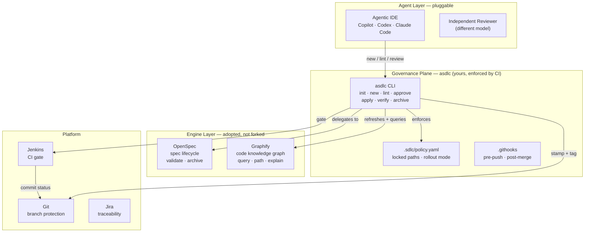
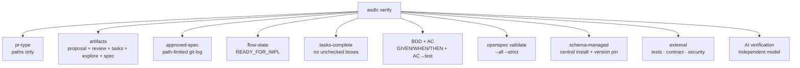

# agentic-sdlc

> **BLUF** — One command installs an enterprise-grade, spec-driven development
> flow. Seven stages take a Jira story from idea to production, with governance
> **enforced by CI**, not by hope. Built on [OpenSpec](https://openspec.dev) and
> [Graphify](https://github.com/safishamsi/graphify); the governance plane is yours.

---

## Contents

- [What problem this solves](#what-problem-this-solves)
- [Architecture](#architecture)
- [Install](#install)
- [The seven stages](#the-seven-stages)
- [What `asdlc verify` checks](#what-asdlc-verify-checks)
- [Governance principles](#governance-principles)
- [Documentation](#documentation)
- [Development](#development)

---

## What problem this solves

Spec-driven development works — until you scale it past one team. OpenSpec
manages spec artifacts beautifully, but it **enforces nothing**. Nothing stops a
developer from merging code that contradicts an approved spec, skipping the
review, or silently editing the spec to match the code.

`asdlc` closes that gap. It adds a governance plane *on top of* the engine:

- **The spec is the authority.** Once approved and merged, it is immutable. If
  reality disagrees, you supersede the change — you never edit the spec.
- **CI enforces; agents suggest.** `asdlc lint` and `asdlc verify` run the *same*
  checks locally and in CI. AI verification uses a different model than the
  authoring agent (player ≠ referee).
- **The knowledge graph is a compass, not the territory.** Graphify builds a
  deterministic code graph (AST, no LLM) so specs are grounded in the real
  system. It is rebuilt on demand — never trusted blindly.

---

## Architecture



**What `asdlc` owns vs. what it doesn't:**

| Layer | Owner | Surface |
|---|---|---|
| Authoring (propose, continue, apply, archive) | **OpenSpec** | `/opsx-*` |
| Governance (lint, approve, verify) | **asdlc** | `asdlc …` |
| Code knowledge graph | **Graphify** | behind the scenes |
| Navigation & health | **asdlc** | `asdlc status / doctor` |

`asdlc` deliberately does **not** re-implement OpenSpec's authoring: it wraps the
governance *around* it. Graphify and the managed schema run behind the scenes —
there are no `graph` or `schema` commands.

---

## Install

`asdlc` is **not published to the public npm registry**. Two supported paths
(v10 §3):

| Path | Command | When |
|---|---|---|
| **Internal tarball** (start here) | `npm install -g https://internal-artifactory/asdlc/asdlc-<version>.tgz` | Phase 0–2 |
| **Private registry** | `npm install -g asdlc` (with `.npmrc` pointed at your internal registry) | Phase 3+ |

> `asdlc init` then installs the *engines* for you — OpenSpec (as a pinned
> devDependency) and Graphify (via uv/pip) — so the developer never needs to
> install them by hand.

Verify:

```bash
asdlc --version
```

---

## The seven stages

```mermaid
flowchart LR
    S1["1 · init<br/>set up repo"] --> S2["2 · new<br/>scaffold + explore.md"]
    S2 --> G["grill<br/>grilling skill"] --> S3["3 · lint<br/>BDD + AC + review"]
    S3 --> PR["Spec PR<br/>merge = approval"] --> S4["4 · approve<br/>record SHA + READY"]
    S4 --> S5["5 · apply<br/>TDD + converge"] --> PR2["Impl PR"]
    PR2 --> S6["6 · verify<br/>full check + AI"] --> S7["7 · archive<br/>refresh graph + AGENTS.md"]

    style S1 fill:#e8f4fd,stroke:#2196f3
    style S2 fill:#e8f4fd,stroke:#2196f3
    style S3 fill:#e8f4fd,stroke:#2196f3
    style S4 fill:#fff3e0,stroke:#ff9800
    style S5 fill:#e8f5e9,stroke:#4caf50
    style S6 fill:#fff3e0,stroke:#ff9800
    style S7 fill:#f3e5f5,stroke:#9c27b0
```



| Stage | Command | What it does |
|---|---|---|
| 1 · init | `asdlc init --ci jenkins` | install OpenSpec + Graphify, write schema/config/policy/hooks/CI |
| 2 · new | `asdlc new <ID>` | scaffold the change + refresh the knowledge graph + write `explore.md` + seed `clarifications.md` |
| 3 · lint | `asdlc lint <ID>` | check artifacts + review record + BDD/acceptance criteria |
| 4 · approve | `asdlc approve <ID>` | record the path-limited approved SHA + `READY_FOR_IMPL` (run on main after the spec PR merges) |
| 5 · apply | `asdlc apply <ID>` | guard, then `/opsx-apply` (the spec must be approved) |
| 6 · verify | `asdlc verify <ID> --repo <R>` | full check: approved SHA, artifacts, tasks complete, BDD/AC, `openspec validate`, AI verification |
| 7 · archive | `asdlc archive <ID>` | finish: refresh the graph + `AGENTS.md` |

**Navigation & health** (not stages):

| Command | What it does |
|---|---|
| `asdlc status <ID>` | where a change is in the seven stages + the next command |
| `asdlc doctor` | environment + repo setup health check |

A spec that needs authoring starts with:

1. `asdlc new TECH-1234` — scaffold + graph + `explore.md` + `clarifications.md`
2. **Grill** the author (the `grilling` skill — a relentless design-tree interview,
   in rounds) and record settled decisions in `clarifications.md`
3. Author `proposal.md` → `specs/**` → `review.md`, grounded in `explore.md`
4. `asdlc lint TECH-1234` — then open the spec PR

Spec requirements must carry:

- a **GIVEN/WHEN/THEN** scenario,
- an **Acceptance Criteria** block: `- [ ] AC1: concrete assertion (test: path)`,
- a **Test Strategy** section,
- a **Constraints & NFRs** section (performance/security/compliance as verifiable
  statements, not adjectives),
- an **Out of Scope** section.

---

## What `asdlc verify` checks



---

## Governance principles

1. **Adopt the engines, own the governance plane.** OpenSpec and Graphify are
   adopted, not forked. Approvals, gates, and evidence are ours.
2. **Approval is git.** A merged spec PR *is* the human approval; the gate proves
   it with a path-limited `git log`.
3. **Fail-closed.** A verify without an approved commit fails.
4. **Deterministic where possible.** The linter is pure (no LLM) so it can be a
   hard check; semantics stay with the independent reviewer.
5. **Ground specs in a code map.** Graphify (code-only AST, HEAD-bound, gitignored)
   is a BU-standard authoring aid — advisory, never a gate.
6. **Pin CI tool versions.** Never `@latest`.
7. **Untrusted PRs must not reach secrets.** External checks run in a scrubbed
   environment.
8. **A bad spec is never edited.** Close it and start fresh.

---

## Documentation

| Document | Content |
|---|---|
| [USAGE.md](USAGE.md) | concrete step-by-step user guide |
| [V10-PLAN.html](V10-PLAN.html) | the full enterprise design (v10) |
| [GLOSSARY.md](GLOSSARY.md) | locked terminology |

---

## Development

```bash
npm install
npm test        # 35 tests
```

## License

[MIT](LICENSE)