```mermaid
flowchart TB
    V["asdlc verify"] --> C1["pr-type<br/>paths only discrimination"]
    V --> C2["artifacts<br/>proposal + review + tasks + explore + spec"]
    V --> C3["approved-spec<br/>git log verification on target branch"]
    V --> C3b["spec-tamper<br/>locked spec paths unmodified in impl PR"]
    V --> C4["flow-state<br/>READY_FOR_IMPL verification"]
    V --> C5["tasks-complete<br/>all checkboxes resolved"]
    V --> C6["test-presence<br/>code diff mandates test diff"]
    V --> C7["tdd-evidence<br/>verified task output annotations"]
    V --> C8["BDD + AC<br/>GIVEN/WHEN/THEN + AC→test mapping"]
    V --> C9["openspec validate<br/>--all --strict"]
    V --> C10["schema-managed<br/>central install + version pin"]
    V --> C11["external<br/>unit tests · contract · security"]
    V --> C12["AI verification<br/>independent referee model"]
```

# agentic-sdlc

> **BLUF** — Enterprise-grade Agentic Software Development Lifecycle (SDLC) governance.
> Seven stages take a feature from natural language intent to production, with governance
> **enforced by deterministic gates**, not by hope. Built on [OpenSpec](https://openspec.dev)
> and [Graphify](https://github.com/safishamsi/graphify); the governance plane is yours.

---

## Contents

- [What problem this solves](#what-problem-this-solves)
- [Enterprise Quality Gates & Non-Negotiable Invariants](#-enterprise-quality-gates--non-negotiable-invariants)
- [Three-Plane Architecture](#three-plane-architecture)
- [Bundled Out-of-the-Box Skills](#bundled-out-of-the-box-skills)
- [Install & Setup](#install--setup)
- [The Seven Stages](#the-seven-stages)
- [What `asdlc verify` Checks](#what-asdlc-verify-checks)
- [Governance Principles](#governance-principles)
- [Documentation Hub](#documentation-hub)
- [Development & Verification](#development--verification)

---

## What problem this solves

Spec-driven development works — until you scale it past one team or turn AI agents loose on production code. OpenSpec manages spec documents, but it **enforces nothing** at runtime. Nothing stops a developer or an autonomous agent from merging code that contradicts the approved spec, shipping without tests, or silently editing the spec after the fact.

`asdlc` closes that gap. It adds a deterministic governance plane *on top of* the engines:

- **Intent-Driven Start**: Developers start with natural language requirements (`asdlc new "i want to build..."`), not artificial ticket IDs. Canonical slugs are automatically derived, and knowledge graph queries are seeded with real domain terms.
- **High-Efficiency Batch Grilling**: A bundled interview engine (**`batch-grill-me`**) stress-tests the entire decision frontier in 1-2 structured batches with recommended defaults *before* writing specs. Decisions are recorded in `clarifications.md`.
- **The Spec is the Authority**: Merged to the protected branch, the spec is immutable. If reality diverges during implementation, the Converge protocol halts affected work (`SPEC_GAP`) — you never silently mutate an approved spec.
- **Enforced Task-Level TDD**: Unlocking implementation (`asdlc apply`) requires approved spec commits, while `asdlc verify` deterministically checks `test-presence` (rejects code changes without test changes in diff) and `tdd-evidence` (validates recorded test outputs).
- **Player ≠ Referee**: Independent AI verification uses a different model and a fresh context than the authoring agent.

---

## 🛡️ Enterprise Quality Gates & Non-Negotiable Invariants

What enterprise engineering leaders and platform architects care about most when deploying autonomous or pair-programming AI agents into production repositories:

| Quality Gate / Invariant | Enforcement Mechanism | Failure Mode & Blast Radius Protection |
| :--- | :--- | :--- |
| **1. No Apply Before Approval & Spec PR Merge** | `asdlc apply <ID>` verifies path-limited Git commit (`approvedSha`) touching `proposal.md` and `specs/**` on the protected branch (`main`). | **Hard Refusal**: Agents cannot write a single line of production code on an unapproved spec draft. |
| **2. Cryptographic Anti-Tampering (`spec-tamper`)** | `asdlc verify` computes path-limited SHA of locked spec files in the implementation diff against `approvedSha`. | **PR Rejection**: Agents are barred from silently altering specs or moving the goalposts to make failing tests pass. |
| **3. Full Scenario-to-AC Traceability (`R5-scenario-coverage`)** | `asdlc lint` enforces that every scenario declared under a requirement has at least one corresponding Acceptance Criterion (`scens.length <= acs.length`). | **Pre-flight Blocker**: Prevents agents from specifying complex failure/edge-case scenarios while only providing a single happy-path AC. |
| **4. Deterministic Acceptance Test Gate (`asdlc test`)** | `asdlc test <ID>` parses all `- [ ] ACn: ... (test: <path>)` mappings and executes real test assertions via native runners. | **Dual-Harness Defense**: Empowers local TDD red-to-green iterations, while CI independently executes `asdlc test <ID> --json` to fail fake claims. |
| **5. Player ≠ Referee Isolation** | CI implementation review runs independently with fresh LLM context; does not rely on author agent self-declarations in `tasks.md`. | **Audit Integrity**: The authoring agent can never grade its own exam. CI independent execution is the ground truth. |
| **6. Diff-Based Test Presence Gate (`test-presence`)** | `asdlc verify` diff analyzer checks that any change to production code (`src/**`) includes matching test files (`test/**`). | **Zero Untested Code**: Shuts down AI "code dumps" that ship features without unit or integration tests. |
| **7. Immutable Converge Protocol (`SPEC_GAP`)** | If real-world implementation exposes unworkable assumptions in the approved spec, the agent must halt. | **Anti-Drift Protection**: Silent spec mutations are blocked. The agent files a `SPEC_GAP` report; human leads re-approve via a fresh spec delta. |

## Three-Plane Architecture

```
┌─────────────────────────────────────────────────────────────────────────────┐
│ PLANE 3: Agentic IDE Skills & Commands (.agents/skills, .claude/skills, ...)│
│  ● asdlc:new  ● asdlc:lint  ● asdlc:review  ● asdlc:apply  ● asdlc:verify  │
│  ● Bundled Engines: grilling (batch-grill-me), asdlc-apply (TDD Red-Green)  │
└──────────────────────────────────────┬──────────────────────────────────────┘
                                       │ runs CLI with --json
┌──────────────────────────────────────▼──────────────────────────────────────┐
│ PLANE 2: Governance CLI & CI Gate (asdlc init/new/lint/approve/apply/verify)│
│  ● Path-limited approval evidence  ● Deterministic BDD/AC linters           │
│  ● Diff-based test presence gate   ● Schema version pin & override guard    │
└──────────────────────────────────────┬──────────────────────────────────────┘
                                       │ calls pure functions
┌──────────────────────────────────────▼──────────────────────────────────────┐
│ PLANE 1: Core Library (src/lib/ — zero side-effects, fully unit-tested)     │
│  ● speclint  ● tdd  ● prtype  ● policy  ● graphify  ● schema  ● agents      │
└─────────────────────────────────────────────────────────────────────────────┘
```

For complete technical specifications of each plane, see [docs/architecture.md](docs/architecture.md).

---

## Bundled Out-of-the-Box Skills

`asdlc` does not assume or require external user-level skills to be pre-installed. All critical agent harnesses are **packaged inside `asdlc` and installed automatically upon `asdlc init`**:

| Stage & Skill | Purpose & Behavior |
| :--- | :--- |
| **Stage 1 · Init**<br>[`asdlc-init`](assets/skills/asdlc-init/SKILL.md) | Bootstraps repository: OpenSpec, Graphify AST engine, governance schema, policies, git hooks, and agent skills. |
| **Stage 2 · New**<br>[`asdlc-new`](assets/skills/asdlc-new/SKILL.md) | Grounds intent in Graphify AST queries, seeds `clarifications.md`, and runs bundled **`batch-grill-me`** interview. |
| **Stage 3 · Spec PR**<br>[`asdlc-pr`](assets/skills/asdlc-pr/SKILL.md) | Enforces deterministic BDD/AC linting (R0–R8) and opens Spec PR (CLI → REST API → 1-click Web URL) with auto-labels. |
| **Stage 3 · Spec AI Review**<br>[`asdlc-spec-review`](assets/skills/asdlc-spec-review/SKILL.md) | CI-triggered independent 6-dimension spec evaluation; posts structured markdown findings and traceability matrix as PR comments via `gh`. |
| **Stage 4 · Approve (Optional)**<br>[`asdlc-approve`](assets/skills/asdlc-approve/SKILL.md) | *(Optional)* Explicit audit stamp after PR merge (`specSha` + `READY_FOR_IMPL`). Auto-recognized by `apply`. |
| **Stage 5 · Apply**<br>[`asdlc-apply`](assets/skills/asdlc-apply/SKILL.md) | Path-isolated zero-diff guard; executes strict **Red -> Green -> Refactor -> Evidence -> Converge** TDD loop. |
| **Stage 6 · Verify**<br>[`asdlc-verify`](assets/skills/asdlc-verify/SKILL.md) | 12-gate implementation verification: test presence, task evidence, AC test mapping, and independent AI verifier. |
| **Stage 6.5 · Impl AI Review**<br>[`asdlc-impl-review`](assets/skills/asdlc-impl-review/SKILL.md) | CI-triggered independent implementation evaluation (AC conformance matrix, code quality, TDD evidence); posts markdown findings as PR comments via `gh`. |
| **Stage 7 · Archive**<br>[`asdlc-archive`](assets/skills/asdlc-archive/SKILL.md) | Deliberate closeout: syncs specs to master catalog, refreshes code AST graph, and updates system status. |
| **Diagnostics**<br>[`asdlc-doctor`](assets/skills/asdlc-doctor/SKILL.md) | Evaluates 12 toolchain/governance invariants; provides automated 1-click remediation (`--fix`). |
| **Orientation**<br>[`asdlc-status`](assets/skills/asdlc-status/SKILL.md) | Shows change stage progress, active artifacts, next command, or full portfolio dashboard. |

---

## Install & Setup

`asdlc` supports multiple installation methods depending on your environment:

```bash
# Option A: From npm registry (Recommended)
npm install -g @akjamie/agentic-sdlc

# Option B: Directly from GitHub repository (npm v12+ requires --allow-git=all)
npm install -g --allow-git=all git+https://github.com/akjamie/agentic-sdlc.git

# Option C: Local development repository
npm install -g .

# Initialize repository (installs OpenSpec engine, Graphify, policy, and bundled skills)
asdlc init --ci jenkins
```

Verify setup health at any time:

```bash
asdlc doctor
```

---

## The Seven Stages

```mermaid
flowchart LR
    S1["1 · init<br/>setup + skills"] --> S2["2 · new<br/>intent + grill"]
    S2 --> S3["3 · spec pr<br/>lint + open Spec PR"]
    S3 --> S4["4 · approve<br/>Spec PR merge (main)"]
    S4 --> S5["5 · apply<br/>guard + TDD loop"]
    S5 --> S5b["5.5 · test<br/>acceptance tests"]
    S5b --> S6["6 · verify<br/>12 gates (local)"]
    S6 --> PR2["Impl PR<br/>asdlc pr (CI AI Review)"]
    PR2 --> S7["7 · archive<br/>sync + graph"]

    style S1 fill:#e8f4fd,stroke:#2196f3
    style S2 fill:#e8f4fd,stroke:#2196f3
    style S3 fill:#e8f4fd,stroke:#2196f3
    style S4 fill:#fff3e0,stroke:#ff9800
    style S5 fill:#e8f5e9,stroke:#4caf50
    style S5b fill:#e8f5e9,stroke:#4caf50
    style S6 fill:#fff3e0,stroke:#ff9800
    style PR2 fill:#e8f5e9,stroke:#4caf50
    style S7 fill:#f3e5f5,stroke:#9c27b0
```



| Stage & Command | Lifecycle Action & Governance Guard |
| :--- | :--- |
| **1 · Init**<br>`asdlc init [--ci jenkins]` | Bootstraps OpenSpec + Graphify, governance schema, policy, and 8+ agent tools. |
| **2 · New**<br>`asdlc new "<requirement>" [--design]` | Derives slug, auto-seeds `design.md` for UI/API systems, queries code graph, guides 3rd-party research with offline degradation, and interviews author via `batch-grill-me`. |
| **3 · Spec PR**<br>`asdlc pr <ID> <targetBranch>` | Pre-flight BDD/AC linting (`asdlc lint` enforcing scenario-to-AC coverage `R5-scenario-coverage`), attaches `asdlc:spec-review` label, triggers CI Spec AI Review before human approval. |
| **4 · Approve**<br>`asdlc approve <ID>` | **Spec PR merge to main is the approval**: records path-limited commit SHA (`specSha`) + unlocks `READY_FOR_IMPL`. `asdlc apply` auto-detects merged PRs if approve was run in CI. |
| **5 · Apply**<br>`asdlc apply <ID>` | **Hard Approval Guard**: physically checks `approvedSha` on `main`; **strictly refuses** execution if the spec is unapproved. Launches task-level TDD Red-Green loop (`/asdlc:apply`). |
| **5.5 · Acceptance Tests**<br>`asdlc test <ID> [--json]` | Runs code acceptance tests mapped from specs (`- [ ] ACn: ... (test: <path>)`). Drives local TDD red-to-green transitions, and serves as the deterministic CI execution gate. |
| **6 · Verify (Local)**<br>`asdlc verify <ID>` | Local pre-flight self-check across 12 deterministic gates: anti-tampering (`spec-tamper`), test presence, task evidence, AC mappings, external tests. |
| **6.5 · Impl PR**<br>`asdlc pr <ID> <targetBranch>` | Pre-flight implementation verification, pushes impl branch, attaches `asdlc:impl-review` label, triggers CI Code AI Review + independent `asdlc test` execution (**Player ≠ Referee**). |
| **7 · Archive**<br>`asdlc archive <ID>` | Syncs delta to `openspec/specs/`, creates `AGENTS.md` if missing, refreshes knowledge graph, and updates `AGENTS.md` system status. |

### Dual-PR Governance & Label Dispatch

`asdlc pr` automatically detects whether you are submitting a **Spec PR** (Stage 3) or an **Implementation PR** (Stage 6.5) based on lifecycle state, branch, and approval history — completely autonomous with zero extra flags:

| PR Phase | Trigger Moment & Pre-flight | PR Labels | CI Automation Trigger | Human Action |
| :--- | :--- | :--- | :--- | :--- |
| **Spec PR** | After spec drafting; runs **`asdlc lint`** (0 blockers, R5 scenario coverage) | `asdlc:spec-review`<br>`spec` | Runs `asdlc lint` + triggers **Spec AI Review** (clarity, BDD scenarios, architecture alignment) | TL / Domain Lead approves & merges to `main` |
| **Impl PR** | After TDD implementation; runs **`asdlc verify`** (12 gates) | `asdlc:impl-review`<br>`impl` | Runs `asdlc verify` + executes **`asdlc test --json`** + triggers **Code AI Review** (**Player ≠ Referee**) | Lead / Peer reviews code & merges |

**Navigation, Diagnostics & Workspace Maintenance:**
- `asdlc status <ID>`: Instant orientation on current stage and exact next command.
- `asdlc doctor [--fix]`: Comprehensive toolchain and policy health diagnostics with auto-remediation.
- `asdlc update`: Synchronizes repository SDLC state in seconds: refreshes repo-level agent skills (`.agents/skills`), rebuilds codebase AST knowledge graph (`graphify-out/` bound to `HEAD`), updates `AGENTS.md` system status & architectural hubs, and verifies git hooks. Fails fast with guidance if run outside an initialized repository.
- `asdlc upgrade [--global]`: Upgrades the machine toolchain (`asdlc` CLI, OpenSpec engine, Graphify, managed schema) and automatically updates the current repository if inside one, or global user skills (`~/.agents`) with `--global`.
- `asdlc skills list`: Lists all bundled skills available in agentic-sdlc.
- `asdlc skills install --global`: One-click setup on CI Linux VMs to inject skills into global agent directories (`~/.agents`, `~/.opencode`, `~/.pi`, `~/.dsh`) without polluting developer workspaces.

---

## What `asdlc verify` Checks

`asdlc verify` executes in local developer terminals and on CI (Jenkins/GitHub Actions) without drift:



---

## Governance Principles

1. **Approval is Git (No Apply Before PR Merge)**: A merged Spec PR on the protected branch (`main`) *is* the human approval. The `asdlc apply` guard proves it via path-limited `git log` and physically halts if the spec is unapproved.
2. **Cryptographic Anti-Tampering (`spec-tamper`)**: Merged to the protected branch, the spec is immutable. In an Implementation PR, any unauthorized modification to locked spec paths is immediately blocked.
3. **Deterministic Acceptance Testing (`asdlc test`)**: Every requirement must specify test-mapped Acceptance Criteria. `asdlc test` runs code assertions — enabling local TDD red-to-green iterations and deterministic CI gates.
4. **Player ≠ Referee Isolation**: The authoring agent can never act as its own quality gate. CI independently runs the test runner and invokes separate AI reviews with fresh context.
5. **Full Scenario AC Coverage (`R5-scenario-coverage`)**: Spec linter enforces that every scenario declared under a requirement has at least one corresponding Acceptance Criterion (`scens.length <= acs.length`).
6. **Enforced TDD via Test Presence (`test-presence`)**: Implementation diffs touching production code without corresponding test modifications are rejected at the gate.
7. **Ground Specs in Code AST (Graphify)**: Graphify AST code knowledge graph queries ground specifications in real code structure and architectural hubs before drafting.
8. **One Front Door & Fail-Closed**: Everything runs through `asdlc` wrappers — no raw escape hatches. Any missing approval or broken invariant fails closed.

---

## Documentation Hub

| Document | Purpose |
|---|---|
| [docs/usage.md](docs/usage.md) | Practical command-line and developer walkthrough. |
| [docs/architecture.md](docs/architecture.md) | Complete 3-Plane Architecture & IDE Skill design specification. |
| [docs/solution-review.md](docs/solution-review.md) | Solution review, gap analysis, and architectural evaluation. |
| [docs/glossary.md](docs/glossary.md) | Formally locked domain model and SDLC vocabulary. |
| [docs/blueprint.html](docs/blueprint.html) | Enterprise Agentic SDLC Blueprint (English). |
| [docs/blueprint.zh.html](docs/blueprint.zh.html) | Enterprise Agentic SDLC Blueprint (Chinese). |

---

## Development & Verification

```bash
npm install
npm test        # 86 unit and integration tests (100% pass)
```

---

## License

[MIT](LICENSE)