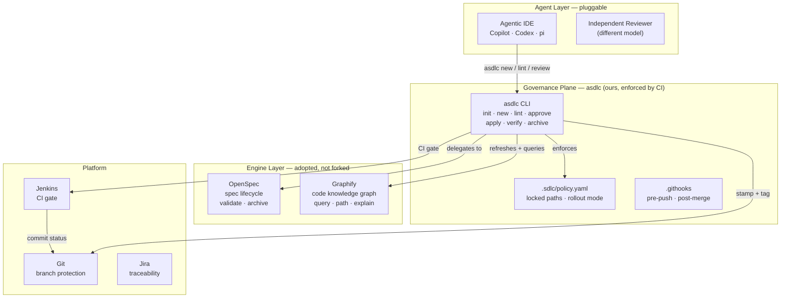
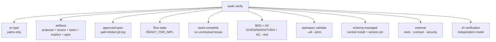

# agentic-sdlc

> **BLUF**: One command installs the whole spec-driven development flow.
> Seven stages take a Jira story from idea to production — with governance
> enforced by CI, not by hope. Built on [OpenSpec](https://openspec.dev) and
> [Graphify](https://github.com/safishamsi/graphify); owned by you.

<br>



<br>

## Why this exists

Spec-driven development works — until you try to scale it past one team. The
engine (OpenSpec) is excellent at managing spec artifacts, but it doesn't
enforce anything. Nothing stops a developer from merging code that contradicts
an approved spec, skipping the review, or silently editing the spec to match
the code.

**asdlc closes that gap.** It adds a governance plane *on top of* the engine:

- **The spec is the authority.** Once approved and merged, it's immutable.
  If reality disagrees, you supersede the change — you don't edit the spec.
- **CI enforces, agents suggest.** `asdlc lint` and `asdlc verify` run the same
  checks locally and in CI. LLM verification uses a different model than the
  authoring agent (player ≠ referee).
- **The knowledge graph is a compass, not the territory.** Graphify builds a
  deterministic code graph (AST, no LLM) so specs are grounded in the real
  system. It's rebuilt, not trusted.

## The 7 stages

```mermaid
flowchart LR
    S1["1 · init<br/>set up repo"] --> S2["2 · new<br/>scaffold + explore.md"]
    S2 --> S3["3 · lint<br/>BDD + AC + review"]
    S3 --> PR["Spec PR<br/>merge = approval"]
    PR --> S4["4 · approve<br/>record SHA + READY"]
    S4 --> S5["5 · apply<br/>TDD + converge"]
    S5 --> PR2["Impl PR"]
    PR2 --> S6["6 · verify<br/>full check + AI"]
    S6 --> S7["7 · archive<br/>refresh graph + AGENTS.md"]

    style S1 fill:#e8f4fd,stroke:#2196f3
    style S2 fill:#e8f4fd,stroke:#2196f3
    style S3 fill:#e8f4fd,stroke:#2196f3
    style S4 fill:#fff3e0,stroke:#ff9800
    style S5 fill:#e8f5e9,stroke:#4caf50
    style S6 fill:#fff3e0,stroke:#ff9800
    style S7 fill:#f3e5f5,stroke:#9c27b0
```



| Stage | Command | What it does |
|---|---|---|
| 1 · init | `asdlc init` | install OpenSpec + Graphify, write schema/config/policy/hooks/CI |
| 2 · new | `asdlc new <ID>` | scaffold the change + refresh the knowledge graph + write `explore.md` + seed `clarifications.md` |
| 3 · lint | `asdlc lint <ID>` | check artifacts + review record + BDD/acceptance criteria |
| 4 · approve | `asdlc approve <ID>` | record the path-limited approved SHA + `READY_FOR_IMPL` (run on main after spec PR merges) |
| 5 · apply | `asdlc apply <ID>` | guard, then `/opsx-apply` (the spec must be approved) |
| 6 · verify | `asdlc verify <ID> --repo <R>` | full check: approved SHA, artifacts, tasks complete, BDD/AC, `openspec validate`, AI verification |
| 7 · archive | `asdlc archive <ID>` | finish: refresh the graph + `AGENTS.md` |

## Requirements

- Node.js >= 20.19.0
- OpenSpec CLI (installed by `asdlc init` as a pinned devDependency)
- Graphify (installed by `asdlc init` via uv/pip)

## Install

```bash
npm i -D agentic-sdlc @fission-ai/openspec
```

No global install needed — not even on the Jenkins agent. See [USAGE.md](USAGE.md)
for CI integration (project dependency or SCM checkout).

## What asdlc owns (and what it doesn't)

| Layer | Owner | Surface |
|---|---|---|
| Authoring (propose, continue, apply, archive) | **OpenSpec** | `/opsx-*` |
| Governance (lint, verify, approve, gate) | **asdlc** | `asdlc …` |
| Code knowledge graph | **Graphify** | behind the scenes |
| Navigation + health | **asdlc** | `asdlc status / doctor` |

`asdlc` deliberately does **not** wrap OpenSpec's authoring commands as raw
pass-throughs — it wraps them with governance guards. The full OpenSpec CLI is
still available via `asdlc openspec <args...>` for power users.

## What `asdlc verify` checks



## Design principles

- **Adopt the engines, own the governance plane.** OpenSpec and Graphify are
  adopted, not forked. The governance plane (approvals, gates, evidence) is ours.
- **Approval is git.** A merged spec PR *is* the human approval; the gate proves
  it with a path-limited `git log`.
- **Fail-closed.** A gate without an approved commit fails.
- **Deterministic where possible.** The linter is pure (no LLM); semantics stay
  with the independent reviewer.
- **Ground specs in a code map.** Graphify (code-only AST, HEAD-bound, gitignored)
  is a BU-standard authoring aid; advisory, never a gate.
- **Pin CI tool versions.** Never `@latest`.
- **Untrusted PRs must not reach secrets.** External checks run in a scrubbed
  environment.
- **A bad spec is never edited.** Close it and start a fresh one.

## Documentation

| Document | Content |
|---|---|
| [USAGE.md](USAGE.md) | concrete step-by-step user guide |
| [V10-PLAN.html](V10-PLAN.html) | the full enterprise design document (v10) |
| [ADOPTION-GAPS.md](ADOPTION-GAPS.md) | design vs implementation gap tracking |
| [GLOSSARY.md](GLOSSARY.md) | locked terminology |

## Development

```bash
npm install
npm test        # 35 tests
```

## License

[MIT](LICENSE)
