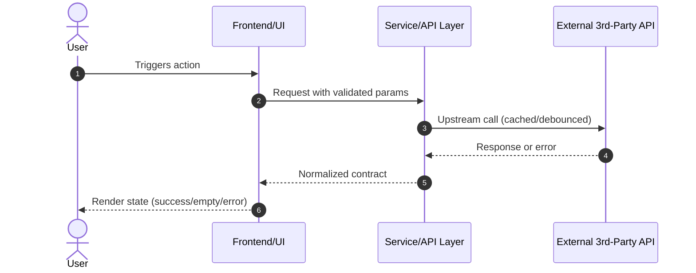

# Technical Design: <!-- change id -->

> Requirement: "<!-- requirement summary -->"
> Purpose: Concrete architecture, interface contracts, external integration models, and UI/UX specifications.
> NOTE: This document guides implementation (HOW). Do NOT duplicate behavioral BDD requirements from spec.md.

## 1. Context & Background
<!-- Current state, existing architectural patterns, dependencies, and constraints needed to ground the approach. -->

## 2. System Architecture & Component Interaction
<!--
Component breakdown, responsibilities, data flow, and lifecycles.

Option A (Recommended): Archify Standalone Interactive Diagram
Use the `archify` skill to generate a validated, standalone interactive HTML diagram:
- Diagram Type: `architecture` (components/boundaries) | `workflow` (pipelines/processes) | `sequence` (API chains) | `dataflow` (ETL/lineage) | `lifecycle` (state transitions)
- Output Artifact: `architecture.html` (saved in change directory alongside design.md)
- Delivery Command: `node bin/archify.mjs deliver <type> <candidate.json> architecture.html --quality showcase`
- Link below: [Interactive Architecture Diagram](./architecture.html)

Option B: Embedded Mermaid Diagram
Where a quick inline visual is sufficient, include a Mermaid flowchart, sequenceDiagram, or stateDiagram:

-->

## 3. Interface Contracts & Data Models
<!--
Specify exact TypeScript interfaces, JSON schemas, or DTO structures.
Define request, response, and domain models to eliminate ambiguity during implementation.
-->

## 4. External Services & 3rd-Party API Integration
<!--
MANDATORY if this change integrates external vendor APIs or services.
- Endpoints & Authentication: Exact URLs, parameters, headers, and secret management.
- Rate Limiting & Quotas: Upstream limit constraints (e.g. 100 req/min, 5,000/day).
- Client Lifecycle & Caching Strategy:
  - Cache type: in-memory Map / TTL cache / Redis.
  - Cache key formulation, TTL duration, eviction policy.
  - Lifecycle: Reuse client instance (singleton/service pool); NEVER re-instantiate clients per request.
- Error Taxonomy & Degradation/Fallback:
  - Ambiguous input: Candidate list returned, never wrong guess.
  - Upstream 4xx/5xx / Quota exhaustion: User-friendly error message, fallback cache, retry with exponential backoff.
  - Offline/Network failure: Clear degradation banner without unhandled rejections.
  - Unverified endpoints/limits: Tag with [UNVERIFIED: <reason>] for explicit human review.
-->

## 5. UI/UX Design, Visual Hierarchy & Aesthetics
<!--
MANDATORY if this change adds or modifies user interfaces (Web, Mobile, Desktop).
Zero tolerance for unstyled, raw, or generic "AI slop" HTML!
Follow the `frontend-design` skill (Anthropic official) and Vercel Web Interface Guidelines.

🚫 Anti-AI Slop Mandate:
- NO generic glowing borders or arbitrary purple-on-black cards.
- NO arbitrary gradient text wrapping a single word in a headline.
- NO uniform pill buttons everywhere; align button variants with visual hierarchy.
- NO monotonous 3-card grids without spatial rhythm.
-->

### 5.1 Design Direction & Subject Grounding (REQUIRED)
<!--
Ground the design in the domain's real vernacular and audience (e.g., high-density analytical dashboard vs playful consumer app).
- Mockup link / Figma URL: <url or file path>
- Brand styleguide / design tokens: <reference or existing CSS tokens file>
- Reference application / URL: <benchmark url>
- Design Thesis: <1-2 sentences on tone, hero moment, and personality (e.g., editorial, brutalist-clean, Swiss modern)>
-->
- Reference: <!-- insert link, file, or brand token reference -->
- Design Thesis: <!-- e.g., high-density devtools, restrained palette, monospace accents -->

### 5.2 Visual Theme & Design Tokens
<!-- Derive 4-6 concrete, deliberate Hex codes: -->
- Color Palette:
  - `--color-primary`: <!-- deliberate brand hue, e.g. #4f46e5 -->
  - `--color-background`: <!-- deep canvas base, e.g. #0b0f19 or #fafafa -->
  - `--color-surface`: <!-- card/surface elevation, e.g. #111827 or #ffffff -->
  - `--color-border`: <!-- subtle boundary, e.g. #1f2937 or #e5e7eb -->
  - `--color-accent`: <!-- high-contrast secondary accent for badges/active -->
  - `--color-text-primary`: <!-- WCAG AA/AAA compliant contrast -->
  - `--color-text-muted`: <!-- secondary reading text -->
- Typography Hierarchy:
  - Heading / Display Font: <!-- e.g. 'Plus Jakarta Sans', 'Outfit', 'Syne' -->
  - Body / UI Font: <!-- e.g. 'Inter', 'Geist', system-ui -->
  - Monospace / Numbers: <!-- e.g. 'JetBrains Mono', tabular-nums -->
  - Scale: hero (32px-48px, bold, -0.02em), section (20px-24px), body (14px-16px), micro (12px)
- Spacing & Radii:
  - `--radius`: <!-- e.g. 8px / 12px -->
  - `--spacing-unit`: <!-- e.g. 8px -->

### 5.3 Hero Moment & Component Layout
- Hero Treatment: <!-- what first-screen element anchors the page? live preview, search bar, metrics overview -->
- Breakpoints:
  - Mobile (<= 640px): single-column, tap targets >= 44px.
  - Tablet (641px - 1024px): 2-column adaptive grid.
  - Desktop (> 1024px): 3-column / sidebar + main grid with sticky navigation.

### 5.4 Mandatory Interactive States (Vercel Guidelines)
Every UI component must specify all 5 states:
1. Default: Token-governed styling.
2. Hover / Focus: Purposeful micro-transitions (150ms-200ms ease); visible focus rings (`:focus-visible`).
3. Loading State: Content-shaped skeleton cards or spinners (never blank screens or layout shifts).
4. Empty State: Domain icon/illustration, empathetic copy, and single obvious action prompt.
5. Error State: Inline non-blocking banner with actionable message and retry button.

## 6. Security Architecture & Operational NFRs (Optional / When Applicable)
<!--
Document this section when the change introduces public interfaces, handles sensitive/user data,
integrates external rate-limited services, or has explicit latency/resource constraints.
For changes without external dependencies or strict SLAs, omit this section or mark as (N/A).
Do NOT invent arbitrary default values.
-->

### 6.1 Security & Threat Mitigation (If Applicable)
<!-- Detail concrete defense mechanisms if the change touches auth, inputs, or secrets: -->
- Authentication & Authorization: <!-- Caller identity verification, role/scope enforcement, or N/A -->
- Input Validation & Boundaries: <!-- Schema constraints, bounds, sanitization, or N/A -->
- Secret & Credential Lifecycle: <!-- Injected via environment variables, never logged, or N/A -->
- Data Privacy & PII Protection: <!-- Data classification, retention policies, or N/A -->

### 6.2 Performance Budgets & Operational NFRs (If Applicable)
<!-- Document operational constraints only when required by architecture, scale, or SLAs: -->
- Latency Budgets & SLAs: <!-- Target p95/p99 latency or response time bounds, if applicable -->
- Resource Bounds & Lifecycles: <!-- Cache size caps, TTL expiration, memory guards, if applicable -->
- Upstream Quota & Rate Limit Protection: <!-- Singleton client reuse, exponential backoff, if applicable -->
- Graceful Degradation: <!-- Downstream timeout bounds, stale/offline fallback, if applicable -->

## 7. Key Decisions & Alternatives
<!--
Document technical decisions made during grilling:
- Decision 1: [Choice] vs [Alternative] -> Rationale.
- Decision 2: ...
-->

## 8. Migration, Rollout & Rollback
<!--
Database migrations, deployment steps, feature flags, or rollback procedures (if applicable).
-->
