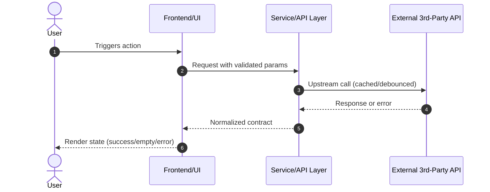

# Technical Design: <!-- change id -->

> Requirement: "<!-- requirement summary -->"
> Purpose: Concrete architecture, interface contracts, external integration models, and UI/UX specifications.
> NOTE: This document guides implementation (HOW). Do NOT duplicate behavioral BDD requirements from spec.md.

## 1. Context & Background
<!-- Current state, existing architectural patterns, dependencies, and constraints needed to ground the approach. -->

## 2. System Architecture & Component Interaction
<!--
Component breakdown, responsibilities, data flow, and lifecycles.
Include a Mermaid flowchart or sequence diagram where components interact:

-->

## 3. Interface Contracts & Data Models
<!--
Specify exact TypeScript interfaces, JSON schemas, or DTO structures.
Define both request, response, and domain models to eliminate ambiguity during implementation.
-->

## 4. External Services & 3rd-Party API Integration
<!--
MANDATORY if this change integrates external vendor APIs or services.
- Endpoints & Authentication: Exact URLs, parameters, headers, and secret management.
- Rate Limiting & Quotas: Upstream limit constraints (e.g. 100 req/min, 5,000/day).
- Client Lifecycle & Caching Strategy:
  - Cache type: in-memory Map / TTL cache / Redis.
  - Cache key formulation, TTL duration, eviction policy.
  - Lifecycle: Reuse client instance (singleton/service pool); NEVER re-instantiate clients per request.
- Error Taxonomy & Degradation/Fallback:
  - Ambiguous input: Candidate list returned, never wrong guess.
  - Upstream 4xx/5xx / Quota exhaustion: User-friendly error message, fallback cache, retry with exponential backoff.
  - Offline/Network failure: Clear degradation banner without unhandled rejections.
-->

## 5. UI/UX Design, Visual Hierarchy & Aesthetics
<!--
MANDATORY if this change adds or modifies user interfaces (Web, Mobile, Desktop).
Zero tolerance for unstyled, raw, or toy HTML!
- Visual Theme & Design Tokens:
  - Color palette (primary, secondary, background, surface, text-primary, text-muted, border, error/warning/success).
  - Typography: Modern Google Fonts (e.g. Inter, Outfit, Plus Jakarta Sans), font sizes, weights.
  - Spacing & Radius: Consistent CSS variables (--radius: 8px/12px, --spacing: 4px/8px/16px/24px).
- Layout & Component Hierarchy:
  - Top Bar / Hero Section: branding, search bar with debounce, language toggle.
  - Main Workspace / Content Grid: cards, filters, sidebar, list view.
  - Responsive Breakpoints: Mobile (<=640px), Tablet (<=1024px), Desktop (>1024px).
- Interactive States:
  - Default: Polished, professional styling.
  - Hover / Focus: Micro-interactions, transitions (e.g. 0.2s ease).
  - Loading State: Skeleton loaders or subtle spinners (no blocking blank screens).
  - Empty State: Friendly illustration/icon, clear title, and actionable prompt (e.g. "Try searching for Beijing").
  - Error State: Contextual error banner with retry button.
-->

## 6. Security, Performance & NFR Mitigations
<!--
- Security: Input validation, sanitization, path traversal defense (e.g. path.normalize/sibling checks), CORS/CSP.
- Performance: Response latency budget (e.g. p99 < 300ms for cache hits), debouncing search queries, bundle size considerations.
- Resource bounds: Maximum cache entries, payload size limits.
-->

## 7. Key Decisions & Alternatives
<!--
Document technical decisions made during grilling:
- Decision 1: [Choice] vs [Alternative] -> Rationale.
- Decision 2: ...
-->

## 8. Migration, Rollout & Rollback
<!--
Database migrations, deployment steps, feature flags, or rollback procedures (if applicable).
-->
