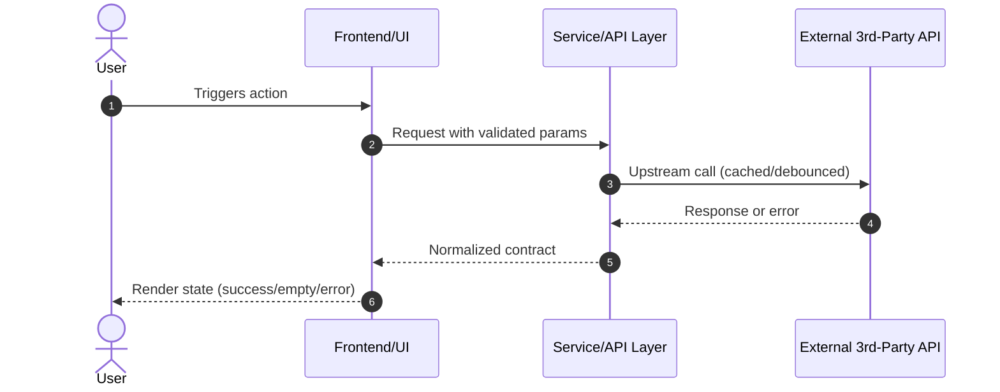

# Technical Design: <!-- change id -->

> Requirement: "<!-- requirement summary -->"
> Purpose: Concrete architecture, interface contracts, external integration models, and UI/UX specifications.
> NOTE: This document guides implementation (HOW). Do NOT duplicate behavioral BDD requirements from spec.md.

## 1. Context & Background
<!-- Current state, existing architectural patterns, dependencies, and constraints needed to ground the approach. -->

## 2. System Architecture & Component Interaction
<!--
Component breakdown, responsibilities, data flow, and lifecycles.
Include a Mermaid flowchart or sequence diagram where components interact:

-->

## 3. Interface Contracts & Data Models
<!--
Specify exact TypeScript interfaces, JSON schemas, or DTO structures.
Define request, response, and domain models to eliminate ambiguity during implementation.
-->

## 4. External Services & 3rd-Party API Integration
<!--
MANDATORY if this change integrates external vendor APIs or services.
- Endpoints & Authentication: Exact URLs, parameters, headers, and secret management.
- Rate Limiting & Quotas: Upstream limit constraints (e.g. 100 req/min, 5,000/day).
- Client Lifecycle & Caching Strategy:
  - Cache type: in-memory Map / TTL cache / Redis.
  - Cache key formulation, TTL duration, eviction policy.
  - Lifecycle: Reuse client instance (singleton/service pool); NEVER re-instantiate clients per request.
- Error Taxonomy & Degradation/Fallback:
  - Ambiguous input: Candidate list returned, never wrong guess.
  - Upstream 4xx/5xx / Quota exhaustion: User-friendly error message, fallback cache, retry with exponential backoff.
  - Offline/Network failure: Clear degradation banner without unhandled rejections.
  - Unverified endpoints/limits: Tag with [UNVERIFIED: <reason>] for explicit human review.
-->

## 5. UI/UX Design, Visual Hierarchy & Aesthetics
<!--
MANDATORY if this change adds or modifies user interfaces (Web, Mobile, Desktop).
Zero tolerance for unstyled, raw, or toy HTML!
-->

### 5.1 Design Reference Ground Truth (REQUIRED)
<!--
Do NOT invent design tokens or palettes in isolation.
Specify the concrete human-provided design ground truth:
- Mockup link / Figma URL: <url or file path>
- Brand styleguide / design tokens: <reference or existing CSS tokens file>
- Reference application / URL: <benchmark url>
- Key visual style notes: <e.g., modern dark card-based dashboard, rounded corners, subtle glassmorphism>
-->
- Reference: <!-- insert link, file, or brand token reference -->
- Style summary: <!-- 1-2 sentences on visual direction -->

### 5.2 Visual Theme & Design Tokens
<!-- Derive concrete variables from the reference above: -->
- Color Palette:
  - `--color-primary`: <!-- e.g. #2563eb -->
  - `--color-background`: <!-- e.g. #0f172a -->
  - `--color-surface`: <!-- e.g. #1e293b -->
  - `--color-text-primary`: <!-- e.g. #f8fafc -->
  - `--color-text-muted`: <!-- e.g. #94a3b8 -->
  - `--color-border`: <!-- e.g. #334155 -->
  - `--color-accent`: <!-- e.g. #38bdf8 -->
- Typography:
  - Font family: <!-- e.g. 'Plus Jakarta Sans', system-ui -->
  - Scale: base (16px), heading (24px/32px)
- Spacing & Radii:
  - `--radius`: <!-- e.g. 12px -->
  - `--spacing-unit`: <!-- e.g. 8px -->

### 5.3 Component Hierarchy & Responsive Breakpoints
- Layout: Topbar/Hero, Search with debounce, Content Cards Grid, Detail Panel.
- Breakpoints:
  - Mobile (<= 640px): single-column, stacked layout.
  - Tablet (<= 1024px): 2-column grid.
  - Desktop (> 1024px): 3-column / sidebar + main grid.

### 5.4 Mandatory Interactive States
Every UI component must specify all 5 states:
1. Default: Polished styling adhering to design tokens.
2. Hover/Active: Micro-transitions (0.2s ease).
3. Loading State: Skeleton cards or subtle spinners (no blank screens).
4. Empty State: Friendly icon/illustration, descriptive message, actionable prompt.
5. Error State: Banner with clear explanation and retry action.

## 6. Security, Performance & NFR Mitigations
<!--
- Security: Input validation, sanitization, path traversal defense (e.g. path.normalize/sibling checks), CORS/CSP.
- Performance: Response latency budget (e.g. p99 < 300ms for cache hits), debouncing search queries, bundle size considerations.
- Resource bounds: Maximum cache entries, payload size limits.
-->

## 7. Key Decisions & Alternatives
<!--
Document technical decisions made during grilling:
- Decision 1: [Choice] vs [Alternative] -> Rationale.
- Decision 2: ...
-->

## 8. Migration, Rollout & Rollback
<!--
Database migrations, deployment steps, feature flags, or rollback procedures (if applicable).
-->
