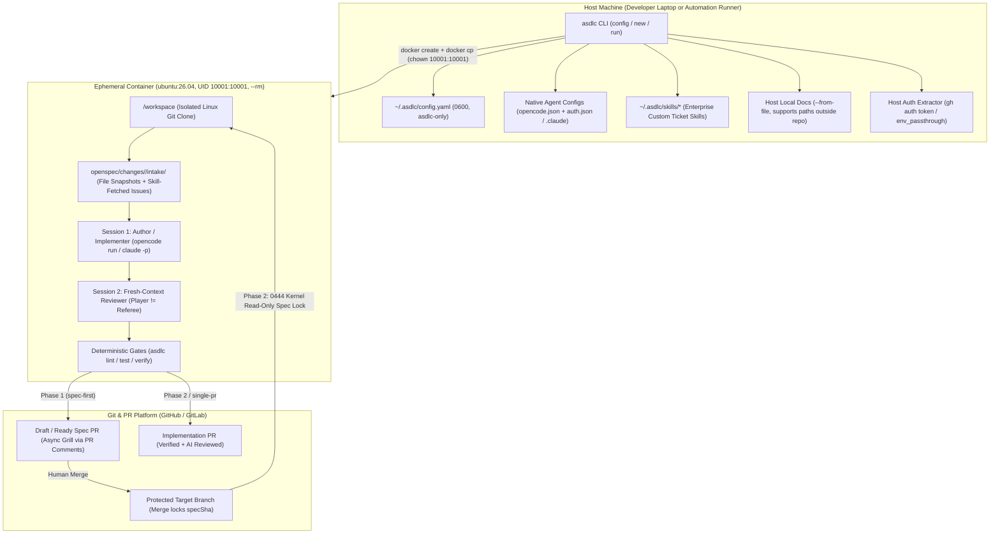
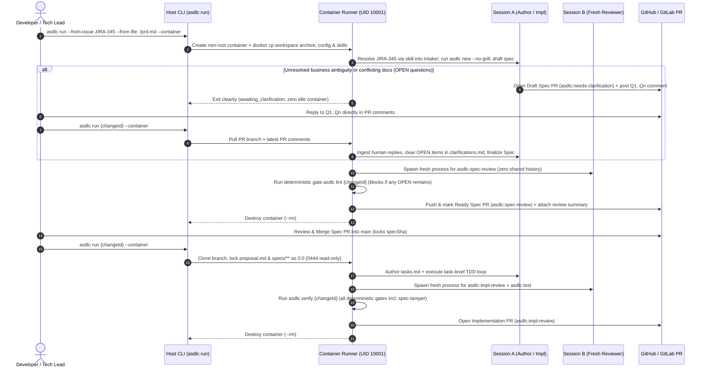
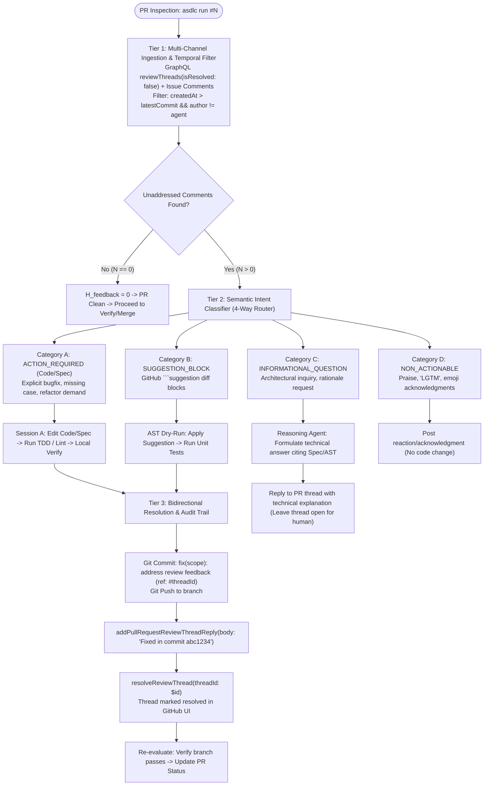
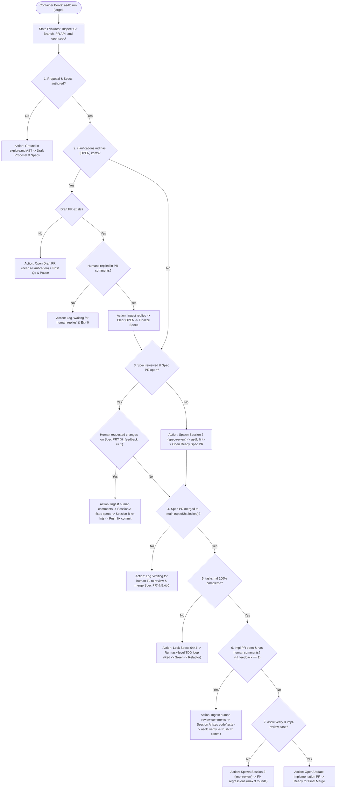
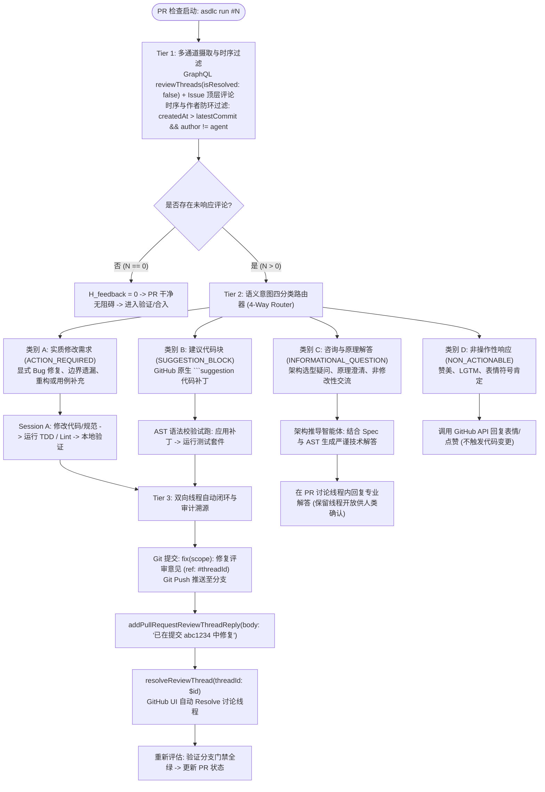

# Autonomous Container Pipeline & Global Governance Solution Proposal
# 全自动容器流水线与全局治理架构方案

> **Bilingual Solution Proposal (Pre-Implementation RFC) / 中英文双语架构方案（待实施设计稿）**  
> **Status / 状态**: Proposed Solution — Not Yet Implemented / 方案设计稿（尚未进入代码实现）  
> **Scope / 范围**: Global configuration (`asdlc config`), dual-mode governance switch (`spec-first` | `auto`), multi-source intake (`--from-file` / `--from-issue`), hardened non-root polyglot runner (`asdlc-runner`), and state-driven autonomous orchestrator (`asdlc run`).

---

## Table of Contents / 目录

- [English Solution Proposal](#english-solution-proposal)
  - [1. Problem Statement & Design Principles](#1-problem-statement--design-principles)
  - [2. End-to-End Architecture & Workflows](#2-end-to-end-architecture--workflows)
    - [2.1 Host Orchestrator vs. Ephemeral Non-Root Container Split](#21-host-orchestrator-vs-ephemeral-non-root-container-split)
    - [2.2 Autonomous Execution Lifecycle (Including Async PR Comment Grilling)](#22-autonomous-execution-lifecycle-including-async-pr-comment-grilling)
    - [2.3 Dual-Track Symmetry: Interactive (Non-Container) vs. Autonomous (Container) Modes](#23-dual-track-symmetry-interactive-non-container-vs-autonomous-container-modes)
  - [3. Global Control Plane & Two-Mode Workflow Switch (`asdlc config`)](#3-global-control-plane--two-mode-workflow-switch-asdlc-config)
  - [4. Multi-Source Intake & Two-Tier Skill Resolution](#4-multi-source-intake--two-tier-skill-resolution)
  - [5. Official `ubuntu:26.04` LTS Image & Hardened Non-Root Baseline](#5-official-ubuntu2604-lts-image--hardened-non-root-baseline)
    - [5.1 Two-Layer Polyglot Runner Image](#51-two-layer-polyglot-runner-image)
    - [5.2 Internal Non-Exposed Security Baseline](#52-internal-non-exposed-security-baseline)
    - [5.3 Tri-State Repository Lifecycle & Ingestion Matrix (Greenfield, Brownfield, Established)](#53-tri-state-repository-lifecycle--ingestion-matrix-greenfield-brownfield-established)
  - [6. State-Driven Orchestrator (`asdlc run`) & Async PR Grilling](#6-state-driven-orchestrator-asdlc-run--async-pr-grilling)
    - [6.1 Dual Execution Modes: Local Directory vs Zero-Checkout Remote (`--repo`)](#61-dual-execution-modes-local-directory-vs-zero-checkout-remote---repo)
    - [6.2 Human-Centric Change Identification & Zero-Friction Resume](#62-human-centric-change-identification--zero-friction-resume)
    - [6.3 Deterministic Stage Resolution Engine (Spec Review vs. Apply vs. Impl Review)](#63-deterministic-stage-resolution-engine-spec-review-vs-apply-vs-impl-review)
      - [6.3.3.1 Autonomous Review Comment Triage & Resolution Engine (Beyond 'CHANGES_REQUESTED')](#6331-autonomous-review-comment-triage--resolution-engine-beyond-changes_requested)
    - [6.4 Governance Hardening](#64-governance-hardening)
  - [7. Phased Implementation Roadmap](#7-phased-implementation-roadmap)
- [中文架构方案](#中文架构方案)
  - [1. 背景痛点与核心原则](#1-背景痛点与核心原则)
  - [2. 总体架构与交互流程](#2-总体架构与交互流程)
    - [2.1 宿主机编排器与临时非 Root 容器切分](#21-宿主机编排器与临时非-root-容器切分)
    - [2.2 全自动执行生命周期与 PR 评论异步闭环](#22-全自动执行生命周期与-pr-评论异步闭环)
    - [2.3 双轨生命周期对齐：交互式（非容器）与全自动（容器）模式的无缝互通](#23-双轨生命周期对齐交互式非容器与全自动容器模式的无缝互通)
  - [3. 全局配置控制面与双模式开关 (`asdlc config`)](#3-全局配置控制面与双模式开关-asdlc-config)
  - [4. 多源需求输入（Intake）与两层 Skill 取单架构](#4-多源需求输入intake与两层-skill-取单架构)
  - [5. 官方 `ubuntu:26.04` LTS 全栈镜像与非 Root 安全基线](#5-官方-ubuntu2604-lts-全栈镜像与非-root-安全基线)
    - [5.1 双层镜像与版本强绑定](#51-双层镜像与版本强绑定)
    - [5.2 内部硬编码安全基线](#52-内部硬编码安全基线)
    - [5.3 三种项目生命周期适配矩阵（Greenfield、Brownfield 与成熟项目）与双向同步闭环](#53-三种项目生命周期适配矩阵greenfieldbrownfield-与成熟项目与双向同步闭环)
  - [6. 状态驱动编排器 (`asdlc run`) 与 Draft PR 异步 Grill 闭环](#6-状态驱动编排器-asdlc-run-与-draft-pr-异步-grill-闭环)
    - [6.1 双执行模式：本地就地执行与免 Clone 零检出执行 (`--repo`)](#61-双执行模式本地就地执行与免-clone-零检出执行---repo)
    - [6.2 人性化变更定位与零摩擦续跑机制（智能推导、交互选择器、PR # / URL / Issue 解析）](#62-人性化变更定位与零摩擦续跑机制智能推导交互选择器pr---url--issue-解析)
    - [6.3 确定性阶段推导引擎：精准仲裁 Spec Review、Apply 与 Impl Review](#63-确定性阶段推导引擎精准仲裁-spec-reviewapply-与-impl-review)
      - [6.3.3.1 深度解析：无 Request Changes 纯评论场景下的自主甄别与处理引擎（3-Tier Triage Engine）](#6331-深度解析无-request-changes-纯评论场景下的自主甄别与处理引擎3-tier-triage-engine)
    - [6.4 治理合规门禁补强](#64-治理合规门禁补强)
  - [7. 分阶段落地路线图](#7-分阶段落地路线图)

---

# English Solution Proposal

## 1. Problem Statement & Design Principles

Enterprise engineering teams adopting Agentic SDLC need **human judgment on requirement clarification and merge approvals**, while executing deterministic downstream work—spec drafting, independent spec review, TDD implementation, independent implementation review, acceptance testing, and PR creation—unattended inside an isolated runtime. Three practical bottlenecks currently stand in the way:

1. **Per-repository configuration & classification friction**: Workflow routing (`single-pr` vs `spec-first`) is coupled to the heuristic `L0–L3` risk engine without a machine-global switch, making it difficult to enforce predictable classic dual-PR (`spec-first`) governance across repositories without editing `.sdlc/policy.yaml` in every repo.
2. **Single-string requirement intake**: `asdlc new` accepts only a single inline requirement string rather than multiple local design documents and multiple external tickets (Jira, Confluence, GitHub Issues).
3. **Lack of a standardized headless container runtime**: Downstream stages rely on an interactive local IDE session rather than an official polyglot non-root container image with zero-translation multi-vendor LLM auth passthrough and non-TTY asynchronous clarification.

### Core Design Principles
- **Seamless Coexistence of Manual (IDE) and Autonomous (Container) Modes**: Git commits, PR state, and `.openspec.yaml` remain the single source of truth. Interactive IDE sessions and `asdlc run --container` invoke the exact same CLI primitives and can hand off work at any stage.
- **Strict Separation of Concerns (Zero Vendor Schema Translation)**: `~/.asdlc/config.yaml` is read exclusively by `asdlc`; built-in headless AI agents (`opencode` and `claude`) consume their native configuration files (`opencode.json` + `auth.json` across 75+ providers, or `.claude/settings.json`); enterprise issue trackers plug in via overrideable Skills rather than hardcoded proprietary SDKs in `asdlc` core.
- **Secure by Default, Minimal CLI Surface**: Non-root execution (`UID 10001:10001`), dropped Linux capabilities, and kernel-enforced read-only locks (`0444`) on approved specs during implementation are enforced internally as factory defaults without exposing low-level Docker flags on the CLI.

---

## 2. End-to-End Architecture & Workflows

### 2.1 Host Orchestrator vs. Ephemeral Non-Root Container Split



### 2.2 Autonomous Execution Lifecycle (Including Async PR Comment Grilling)



### 2.3 Dual-Track Symmetry: Interactive (Non-Container) vs. Autonomous (Container) Modes

A foundational architectural requirement of Agentic SDLC is **Zero Mutation of the Non-Container Workflow**.
`asdlc run --container` does **not** replace or alter the existing interactive developer workflow in IDEs. Instead, Agentic SDLC operates as a **Dual-Track Symmetric System**:

```mermaid
flowchart LR
  subgraph Track1["Track 1: Interactive IDE Mode (Non-Container)"]
    direction TB
    I_NEW["asdlc new (Interactive Grill)"] --> I_LINT["asdlc lint"]
    I_LINT --> I_PR1["asdlc pr (Spec PR)"]
    I_PR1 --> I_APP["asdlc apply (IDE TDD Loop)"]
    I_APP --> I_VER["asdlc verify"]
    I_VER --> I_PR2["asdlc pr (Impl PR)"]
  end

  subgraph Shared["Single Source of Truth (Git + OpenSpec)"]
    direction TB
    SPEC["proposal.md & specs/**"]
    LOCK["main specSha Lock"]
    CODE["Source Code & Tests"]
  end

  subgraph Track2["Track 2: Autonomous Headless Mode (Container)"]
    direction TB
    C_DRAFT["asdlc run (Draft & Explore)"] --> C_GRILL["Draft PR Async Comment Q&A"]
    C_GRILL --> C_PR1["Ready Spec PR (spec-review)"]
    C_PR1 --> C_TDD["Headless TDD (0444 Spec Lock)"]
    C_TDD --> C_VER["Verify & Impl Review"]
    C_VER --> C_PR2["Open Impl PR (impl-review)"]
  end

  I_NEW -.-> SPEC
  C_DRAFT -.-> SPEC
  I_PR1 -.-> LOCK
  C_PR1 -.-> LOCK
  I_APP -.-> CODE
  C_TDD -.-> CODE

  Track1 <==== "Bidirectional Zero-Friction Handoff" ====> Track2
```

#### 2.3.1 Symmetrical Comparison: Non-Container vs. Container Workflow

| Operational Dimension | Track 1: Interactive IDE Mode (Non-Container) | Track 2: Autonomous Container Mode (`--container`) | Track 1.5: Host Local Orchestrator (`asdlc run` without `--container`) |
| :--- | :--- | :--- | :--- |
| **Target User / Context** | Human developer pair-programming in Cursor, VS Code, or terminal. | Unattended background job, CI runner, or cloud execution. | Developer on host machine who wants autonomous execution without Docker. |
| **Prerequisites** | Node.js, Git. Zero Docker requirement. | Docker / Podman installed; `ghcr.io/akjamie/asdlc-runner` image. | Local AI CLI installed (`opencode` or `claude`). |
| **Requirement Intake & Grilling** | `asdlc new "req"`: Interactive terminal interview (1 question at a time). | `asdlc run [req] --from-issue ...`: Non-TTY draft; questions posted to Draft PR. | Same as Container, but executed directly on host terminal. |
| **Spec Authoring & Linting** | Developer edits files in IDE; runs `asdlc lint <id>`. | Headless Session 1 drafts spec; Session 2 reviews; `lint` gate. | Headless local session drafts spec; local `lint` gate. |
| **Human PR Comments Handling** | Developer reads comments in browser/IDE; edits files; runs `git push`. (Optionally prompts IDE agent: *"Address review comments on PR #42"*). | Container automatically pulls PR comments via GitHub API, amends spec/code, re-verifies, and pushes fix commit. | Same as Container, but updates host working copy. |
| **Implementation Loop (Apply)** | `asdlc apply <id>`: Developer drives TDD loop in IDE (Red $\to$ Green $\to$ Refactor). | Headless Session 1 executes TDD loop inside sandbox under `0444` kernel lock. | Local session executes TDD loop on host workspace. |
| **Verification & Review** | Developer runs `asdlc test`, `/asdlc-impl-review`, and `asdlc verify <id>`. | Container runs `asdlc-impl-review` + `asdlc verify` (3-round self-healing loop). | Local session runs verify and review gates. |
| **PR Lifecycle** | `asdlc pr <id> main`: Developer explicitly opens Spec or Impl PR. | Container programmatically opens/updates PR via injected token. | Host CLI opens/updates PR via host credentials. |

#### 2.3.2 Zero-Breaking-Change Guarantee for Non-Container Workflows
1. **Underlying Primitives Remain 100% Intact**:
   All core CLI commands (`asdlc new`, `asdlc lint`, `asdlc apply`, `asdlc verify`, `asdlc pr`, `asdlc approve`, `asdlc archive`, `asdlc status`, `asdlc doctor`) retain their exact CLI arguments, behavior, and exit codes. Existing IDE extensions, bash scripts, and manual developer habits continue to work without modification.
2. **Global Config Is Strictly Optional**:
   `~/.asdlc/config.yaml` provides global defaults. If absent, non-container commands fall back seamlessly to `.sdlc/policy.yaml` or built-in defaults.
3. **Bidirectional Zero-Friction Handoff**:
   Because Git commits and `.openspec.yaml` are the *only* source of truth:
   - **Hand off from IDE to Container**: A developer can interactively design a spec in their IDE (`asdlc new`), get the Spec PR merged on GitHub, and then delegate the tedious coding to the container: `asdlc run <changeId> --container`.
   - **Take over from Container to IDE**: If an autonomous task in a container pauses on a Draft PR, a developer can simply check out the branch (`git checkout change/<slug>`), refine the code or spec in their IDE, run `asdlc lint`, and push—without any synchronization desync.

---

## 3. Global Control Plane & Two-Mode Workflow Switch (`asdlc config`)

### 3.1 Dual-Interface Control Plane: Interactive Wizard (`asdlc config`) + Scriptable CLI

To avoid the cognitive burden of memorizing dozens of dot-paths while maintaining full CI/scripting compatibility, `asdlc config` provides two complementary interfaces:

#### 1. Interactive Terminal Setup Wizard (`asdlc config` with zero arguments)
Running `asdlc config` without arguments launches an interactive, modular terminal wizard with **early-exit support at every step** (`[Save & Exit]` or `Esc`):

```text
=== Agentic SDLC Global Configuration Wizard ===
Press [Ctrl+C] or choose 'Save & Exit' at any time to finish.

? What would you like to configure? (Use arrow keys)
❯ 1. Workflow Mode (Current: spec-first)
  2. AI Model & Harness (Current: Inherit Host OpenCode)
  3. Git & Pull Request Auth (Current: GitHub via gh CLI)
  4. Issue Tracker Integration (Jira / Confluence)
  ---------------------------------------------------------
  [ Save & Exit ]
```

- **Smart Auto-Detection**:
  - Automatically checks if `gh` is installed and logged in -> Displays `✓ GitHub: Inherited from host 'gh' CLI (user: akjamie)`.
  - Automatically checks if OpenCode is present on the host -> Displays `✓ AI: Found host OpenCode config (~/.config/opencode/opencode.json)`.
- **Modular Sections & Easy Skip**:
  - **Section 1: Workflow Mode** — Pick between `● spec-first (Recommended for new teams: Mandatory Spec PR -> Merge -> Impl PR)` and `○ auto (Adaptive: L0/L1 Single-PR, L2/L3 Dual-PR)`.
  - **Section 2: AI Harness & Model Override** — Options to keep host OpenCode, specify a container-only model override (e.g. `doubao-seed-code`), enter an API key, or import a JSON file.
  - **Section 3: Git & PR Credentials** — Option to inherit host `gh` or provide a custom PAT.
  - **Section 4: External Issue Trackers (Optional)** — Prompt to enter Jira / Confluence base URLs and tokens, or choose `● Skip for now (Configure later or use local files only)`. Token inputs are masked on screen.
- **Atomic Persistence**: On choosing `[Save & Exit]`, updates are written atomically to `~/.asdlc/config.yaml` with mode `0600`.

#### 2. Non-Interactive Scriptable CLI (For CI/CD and Power Users)
For headless automation, scripts, and granular inspection, standard subcommands remain fully available:

```bash
# 1. Global workflow switch: strictly two supported modes
asdlc config set workflow_mode spec-first      # spec-first | auto

# 2. Optional agent & runner orchestration settings
asdlc config set agent.harness opencode        # opencode (default) | claude
asdlc config set agent.model ""                # optional override (-m provider/model)
asdlc config set agent.review_model ""         # optional heterogeneous reviewer model
asdlc config set runner.image ""               # optional internal registry mirror override

# 3. Generic env injection & passthrough for enterprise custom skills
asdlc config set env.JIRA_BASE_URL https://jira.corp.com
asdlc config set env.JIRA_API_TOKEN <TOKEN>
asdlc config set runner.env_passthrough "JIRA_*,CONFLUENCE_*"

# 4. Inspection (keys matching *key/*token/*secret/*password are masked by default)
asdlc config list [--show-secrets] [--json]
asdlc config get workflow_mode
asdlc config unset env.JIRA_API_TOKEN
```

**Exact Boundary of the Two Workflow Modes** (`single-pr` and `risk_assessment` are not exposed as separate global toggles; risk classification belongs exclusively to `auto` mode):

| `workflow_mode` | Governance Behavior |
| :--- | :--- |
| **`spec-first`** (Classic Mandatory Dual-PR) | **Skips L0–L3 risk classification and `risk-history.jsonl` ratchets.** Every change (outside `fast_path` pure documentation) follows the deterministic two-PR pipeline: **Spec PR (`lint` + `spec-review` + human merge locking `specSha`) → Impl PR (`verify` + `impl-review`)**. Recommended for initial team rollouts. |
| **`auto`** (Adaptive Risk-Tiered) | **100% preserves current behavior.** Runs the three-vector L0–L3 risk assessment and anti-downgrade ratchet: L0/L1 changes route to `single-pr` (co-locating spec and implementation in one PR), while L2/L3 changes route to `spec-first`. |

**Precedence Chain (Highest → Lowest)**:
`CLI Flags` > `Environment Variables (ASDLC_*)` > `Repo .sdlc/policy.yaml (optional override)` > **`Global ~/.asdlc/config.yaml`** > `Built-in Default`.

### 3.2 Enterprise & User-Grade AI Configuration Strategy (Zero Schema Loss)

`~/.asdlc/config.yaml` is **never parsed directly by the built-in AI harness**. Instead, the system treats AI configuration with an industry-grade **Immutable File Selection + CLI Flag Override model** (avoiding fragile JSON deep-merging):

1. **How Configuration Files Are Selected (Zero Deep-Merge)**:
   - In production, deep-merging multi-vendor JSON configurations can overwrite mutual provider options, break custom headers, or corrupt array structures.
   - **Resolution Policy**: `asdlc` selects the base configuration file as a **whole atomic unit** (no partial field stitching):
     - **Primary Base**: `~/.asdlc/agent/opencode/opencode.json` (if the user or team imported an explicit container template via `asdlc config agent --file`).
     - **Fallback Base**: The developer's native host configuration `%USERPROFILE%\.config\opencode\opencode.json` (Windows) or `~/.config/opencode/opencode.json` (macOS/Linux) and matching `auth.json`.
     - **Fallback Zero-State**: If neither exists, `asdlc` writes a minimal valid single-provider configuration generated from `asdlc config set agent.provider` and `agent.api_key`.

2. **How Container-Specific Models Are Overridden (Runtime CLI Flag `-m`)**:
   - If a developer uses `anthropic/claude-sonnet-4-5` on their host but wants the container pipeline to run a dedicated model (e.g. `doubao-seed-code` or an internal high-throughput endpoint), **`asdlc` never mutates the underlying `opencode.json` file**.
   - Instead, setting `asdlc config set agent.model <model>` passes the override directly to the OpenCode invocation via its official runtime argument:
     ```bash
     opencode run -m "provider/model" "<prompt>"
     ```
   - According to OpenCode specifications, CLI `-m <provider/model>` naturally takes precedence over the `"model"` property in `opencode.json`.
   - **Heterogeneous Review Model**: Independent reviews similarly execute in a separate process using `opencode run -m <agent.review_model> "<prompt>"`.
   - **Result**: Complete multi-provider settings, proxies, and custom headers are preserved 100% intact from the base configuration, while the active model is cleanly overridden for container execution without touching host files.

3. **Pure Data-Driven Staging via Standard Bridge Network (No `--net=host` Dependency)**:
   - Corporate CIS benchmarks and container runtimes (such as Docker Desktop on Windows/macOS with WSL2/Hyper-V) restrict or disable `--net=host`.
   - The orchestrator completely avoids running interactive browser-based login containers. All credential assembly happens locally in host Node.js process memory.
   - Credentials (`auth.json`) and configuration (`opencode.json`) are injected via `docker cp` directly into the container's `/home/agent/.local/share/opencode/auth.json` and `/home/agent/.config/opencode/opencode.json` with strict mode `0600` and ownership `10001:10001`.
   - The container operates on a standard isolated Docker bridge network, fully compliant with enterprise bastion and container security policies.

4. **Supported Onboarding Modes**:
   - **Mode A: Seamless Host Inheritance**: Automatically discovers host `%USERPROFILE%\.config\opencode\opencode.json` (Windows) or `~/.config/opencode/opencode.json` (macOS/Linux) and matching `auth.json`, copying them into the container without manual steps.
   - **Mode B: Key-Based CLI Quickset**:
     ```bash
     asdlc config set agent.provider "anthropic"
     asdlc config set agent.api_key "sk-ant-xxx"
     asdlc config set agent.base_url "https://api.corp.com/v1" # optional private gateway
     ```
     Host `asdlc run` formats standard `opencode.json` and `auth.json` in memory and pushes them into the container.
   - **Mode C: Enterprise Standard Template Import**:
     ```bash
     asdlc config agent --file ./enterprise-opencode.json
     ```
     Stores the team-vetted JSON verbatim under `~/.asdlc/agent/opencode/opencode.json`, overriding host local defaults for all container runs.

---

## 4. Multi-Source Intake & Two-Tier Skill Resolution

### 4.1 Repeatable `--from-file` and `--from-issue` Snapshotting
Both `asdlc new` and `asdlc run` accept repeatable `--from-file` and `--from-issue` arguments:

```bash
# Interactive IDE workflow
asdlc new "Partial order refund settlement" --from-file ~/Downloads/prd.md --from-file ./api.yaml --from-issue JIRA-345

# Autonomous container workflow
asdlc run --from-issue JIRA-345 --from-issue JIRA-346 --from-file ~/Downloads/prd.md --container
```

- **Host File Staging (`--from-file`)**: Supports arbitrary host paths outside the repository. Validated on the host (failing fast with `INTAKE_FILE_NOT_FOUND` if missing), copied into the container via `docker cp`, and snapshotted under `openspec/changes/<id>/intake/files/<NN>-<filename>` with SHA-256 digests in `intake/index.yaml`.
- **Two-Tier Skill Ticket Resolution (`--from-issue`)**: Because enterprise trackers vary widely in SSO gateways, custom acceptance criteria fields (`customfield_xxx`), and linked Confluence/wiki pages, `asdlc` core avoids hardcoded tracker SDKs:
  1. **Tier 1 — Enterprise Custom Skills (`~/.asdlc/skills/`)**: Automatically copied into the container and prioritized over bundled skills, paired with `env.*` / `runner.env_passthrough`.
  2. **Tier 2 — Bundled `asdlc-intake` Skill (Fallback)**: Ships `assets/skills/asdlc-intake/SKILL.md` supporting GitHub Issues/Projects, standard Jira (Cloud/DC), and Confluence pages. All fetched external text is wrapped in untrusted-data fences to mitigate prompt injection.

---

## 5. Official `ubuntu:26.04` LTS Image & Hardened Non-Root Baseline

### 5.1 Two-Layer Polyglot Runner Image
1. **Base Layer `ghcr.io/akjamie/asdlc-base:2026.xx` (`docker/Dockerfile.base`, rebuilt on toolchain updates)**:
   - OS: **`ubuntu:26.04` LTS** (`linux/amd64` + `linux/arm64`).
   - Toolchains: Node.js 22 LTS (`npm`/`pnpm`/`yarn`), Python 3.12 (`uv`/`pip`/`pytest` + prebuilt `tree-sitter`), OpenJDK 21 LTS (`maven`/`gradle`), Go 1.24+, Rust (`cargo`), C/C++ (`build-essential`/`gcc`/`g++`/`cmake`/`pkg-config`), `git`, `gh`, `glab`, `ripgrep`, `jq`, `curl`.
2. **Runner Layer `ghcr.io/akjamie/asdlc-runner:<pkg.version>` (`docker/Dockerfile.runner`, co-published per release)**:
   - Pre-installs version-matched `@akjamie/agentic-sdlc`, `openspec`, `graphifyy`, global `.agents/skills`, **`opencode`** (default), and **`claude`**.
   - **Version Pinning & CI Release**: `asdlc` defaults to `ghcr.io/akjamie/asdlc-runner:${pkg.version}` (never bare `:latest`), built and pushed automatically in `.github/workflows/release.yml` alongside `npm publish`, and synced on `asdlc upgrade`.

### 5.2 Internal Non-Exposed Security Baseline
Enforced internally on every container launch without exposing CLI flags to weaken them:
- **Strict Non-Root Execution**: Dedicated unprivileged user `agent` (`UID 10001:10001`, no `sudo`), `--user 10001:10001`, `--cap-drop=ALL`, `--security-opt=no-new-privileges:true`, `--pids-limit=512`, and `--rm` (also satisfying `claude -p --dangerously-skip-permissions`, which rejects `UID 0`).
- **Enterprise Dubious Ownership Immunity (CVE-2022-24765)**:
  - In containerized runtimes, UID mismatches between host users and container users (`UID 10001`) routinely trigger Git's security check: `fatal: detected dubious ownership in repository at '/workspace'`.
  - The runner image hardcodes system-wide `/etc/gitconfig` with `[safe] directory = /workspace` and injects `GIT_CONFIG_COUNT=1`, `GIT_CONFIG_KEY_0=safe.directory`, and `GIT_CONFIG_VALUE_0=/workspace`. Git operations never block or fail due to UID boundary crossing.
- **Enterprise Corporate Proxy & TLS CA Trust Chain Passthrough**:
  - In enterprise VPCs with SSL-inspecting proxies (Zscaler, BlueCoat, Prisma), container calls to LLM APIs or Git remotes fail if custom CA root certificates are missing.
  - Host `asdlc run` automatically captures host `HTTP_PROXY`, `HTTPS_PROXY`, `NO_PROXY`, and custom CA bundle paths (`SSL_CERT_FILE`, `NODE_EXTRA_CA_CERTS`), injects proxy settings into the container, and streams custom CA bundles into `/etc/ssl/certs/corporate-ca.crt` to guarantee frictionless enterprise network traversal.
- **Workspace Ingestion & Zero Host Bind-Mount (`git archive` Pipeline)**:
  - How the repository is provided to the container is a critical security and portability boundary:
    1. **Why Direct `git clone` Inside Container Fails**: Private enterprise repositories, private submodules, and corporate VPN boundaries require SSH keys or tokens that should not be permanently cloned from within a sandbox. Furthermore, `git clone` inside the container would miss the developer's local uncommitted baseline, staged work, or active branch state.
    2. **Why Host `-v` Bind-Mount Is Prohibited**: Bind-mounting the host project root directly exposes the host filesystem to arbitrary container scripts, creates Windows NTFS volume latency (10x slowdown on `node_modules`), causes CRLF line-ending mismatches, and risks UID permission pollution.
    3. **Production Standard: 3-Layer High-Fidelity Ingestion (`git archive + patch + untracked`)**:
       - **Layer 1 (Committed Base)**: Host streams the current branch snapshot into `/workspace` via `git archive HEAD | tar -x`.
       - **Layer 2 (Uncommitted Working Delta)**: If the host tree has uncommitted staged or unstaged changes, host pipes `git diff -p HEAD` into container `git apply --whitespace=nowarn`.
       - **Layer 3 (Untracked Non-Ignored Files)**: Untracked files (e.g. newly created configs, local `.env.example`) resolved via `git ls-files --others --exclude-standard` are streamed into `/workspace`.
       - Container `/workspace` sets ownership strictly to `10001:10001` and initializes an isolated Git tree targeting the remote origin.
       - Git push operations execute using the ephemeral `gh auth token` / `GH_TOKEN` injected into the process memory, completely eliminating host workspace bind-mount hazards.
- **Kernel-Level Read-Only Spec Lock (`0444`)**: During Phase 2 (`READY_FOR_IMPL`), `proposal.md` and `specs/**` are owned by `0:0` with mode `0444`, blocking unauthorized writes at the OS filesystem layer alongside `asdlc verify`'s `spec-tamper` check.

### 5.3 Tri-State Repository Lifecycle & Ingestion Matrix (Greenfield, Brownfield, Established)

A production-grade container runtime cannot assume every project is already a mature, initialized repository. `asdlc run --container` dynamically detects the repository state on the host and adapts its ingestion, container initialization, and host synchronization accordingly:

| Lifecycle State | Host Detection Condition | Host-to-Container Ingestion | Container Autonomous Initialization | Change Execution & Verification | Egress & Host Bidirectional Sync |
| :--- | :--- | :--- | :--- | :--- | :--- |
| **1. Greenfield Project**<br>*(Empty dir or loose PRD/docs, no Git repo)* | `git rev-parse --is-inside-work-tree` fails | Tar-streams directory content (filtering build artifacts via standard ignore list) + intake files via `docker cp`; sets `ASDLC_LIFECYCLE=greenfield` | 1. `git init -b main`<br>2. Configures container committer<br>3. Runs `asdlc init --headless`<br>4. Creates initial governance baseline commit | Scaffolds language project layout (`package.json`, `go.mod`, etc.) based on PRD/prompt; drafts proposal, spec, tasks, and TDD loop | **A. Remote**: `gh repo create` (if `--create-repo` specified)<br>**B. Local Materialization**: Host CLI copies initialized workspace back: `docker cp <cid>:/workspace/. <hostDir>/` before container teardown |
| **2. Brownfield Project**<br>*(Existing codebase & Git history, never run asdlc)* | `git rev-parse --is-inside-work-tree` succeeds, but `openspec/` does NOT exist | Streams `git archive HEAD` + uncommitted/untracked non-ignored delta files; sets `ASDLC_LIFECYCLE=brownfield` | **Zero-Touch Auto-Onboarding (`asdlc init --onboard`)**:<br>1. Detects build system & test runner<br>2. Generates AST graph (`graphifyy`)<br>3. Seeds `.agents/skills` & OpenSpec<br>4. Generates tailored `AGENTS.md`<br>5. Commits onboarding baseline | Grounds in freshly generated AST graph (`explore.md`); drafts spec, reviews, and runs TDD against existing codebase | **A. Remote PR**: Pushes onboarding baseline & feature branch, opens Spec/Impl PR<br>**B. Local Materialization**: Syncs `openspec/` and `.agents/` back to host via `git bundle` or selective `docker cp` |
| **3. Established Project**<br>*(Git repo + initialized asdlc)* | `git rev-parse --is-inside-work-tree` succeeds AND `openspec/` exists | Streams `git archive HEAD` + dirty working tree delta (staged + unstaged diff); sets `ASDLC_LIFECYCLE=established` | Verifies governance integrity; runs incremental AST graph refresh on touched files | State machine advances change: drafts spec, PR comment grilling, or locks Spec `0444` and runs TDD verification | **A. Remote PR**: Pushes feature branch to `origin`, opens/updates PR<br>**B. Offline/Local**: Exports branch via `git bundle`, host CLI imports via `git fetch <bundle> <branch>:<branch>` (zero working tree pollution) |

#### 5.3.1 Greenfield Project Bootstrapping & Local Workspace Materialization
When a developer runs `asdlc run "Build an express service" --from-file ./prd.md --container` in an empty or non-Git directory:
1. **Host Ingestion**: The host CLI detects the absence of `.git`, packages any existing local documentation or files (excluding `.DS_Store`, `node_modules`, etc.), and streams them into the container's `/workspace`.
2. **Container Headless Bootstrapping**: Inside `/workspace`, the runner initializes Git (`git init -b main`), sets local identity (`asdlc-agent <agent@asdlc.internal>`), runs headless `asdlc init`, and creates commit 0 (`chore: initialize repository with agentic-sdlc governance`).
3. **Scaffolding & Implementation**: The agent inspects the requirement, scaffolds project build files (`package.json`, `tsconfig.json`, source directory skeleton), drafts the spec, and executes the TDD implementation.
4. **Local Workspace Materialization**: Before the ephemeral container is destroyed (`--rm`), the host CLI copies the newly initialized workspace, `.git` repository, code, and OpenSpec artifacts back to the host project directory (`docker cp <container_id>:/workspace/. <host_dir>/`). The host is left with a fully functional, version-controlled project.

#### 5.3.2 Brownfield Zero-Touch Auto-Onboarding & Baseline Isolation
When running `asdlc run <requirement> --container` on an existing legacy repository that has never adopted Agentic SDLC:
1. **Non-Destructive Ingestion**: The host CLI streams `git archive HEAD` plus any local uncommitted/staged edits into the container `/workspace`.
2. **Zero-Touch Auto-Onboarding (`asdlc init --onboard`)**: Instead of aborting with a blocking error, the runner automatically executes headless onboarding:
   - **Stack & Test Discovery**: Analyzes build tools (`maven`/`gradle`, `npm`/`pnpm`, `go.mod`, `pytest`, `cargo`) and identifies test commands.
   - **Deterministic AST Code Graph vs. Vector RAG**: Standard Vector RAG chops legacy code into arbitrary chunks, losing type hierarchies, polymorphism, and multi-hop call chains—leading to hallucinations in complex codebases. Instead, `asdlc-runner` uses pre-installed Tree-sitter parsers (`graphifyy`) to extract precise symbol definitions, interfaces, callers, and dependencies into `graphify-out/` and generate `explore.md`.
   - **Targeted Blast-Radius Grounding**: The agent does not attempt full-system re-architecture; it uses the AST graph to calculate the blast radius *strictly around the requested change*, suppressing context bloat.
   - **Governance Seeding**: Installs `.agents/skills`, sets up OpenSpec schemas, and writes a tailored `AGENTS.md` capturing the repository's build/test workflows.
3. **Baseline Isolation**: The onboarding artifacts are committed to an isolated baseline branch (`asdlc/onboarding-baseline`), keeping tooling governance changes cleanly separated from the incoming feature change.
4. **Change Execution**: The runner checks out `change/<slug>`, grounds in the AST graph, and executes the standard autonomous lifecycle.

#### 5.3.3 Established Repositories, Dirty Working Tree Preservation, and `git bundle` Sync
For repositories already managed by Agentic SDLC:
1. **High-Fidelity Working Tree Ingestion (3-Layer Overlay)**: Developers frequently run container tasks with uncommitted edits or staged work. Host `asdlc run` captures `git archive HEAD` (committed base) + `git diff -p HEAD` (active working tree delta applied via `git apply`) + untracked non-ignored files. Inside the container, this state is faithfully materialized, ensuring the containerized agent operates on the exact code the developer has locally.
2. **Incremental AST Graph Refresh**: Instead of re-indexing the entire codebase, the runner runs an incremental delta update on recently modified files, minimizing startup latency.
3. **Safe Egress via Remote PR or `git bundle` (Zero Host Working Tree Pollution)**:
   - In standard CI/autonomous mode, the container pushes the branch to `origin` and creates/updates the PR.
   - In local-only or offline mode, naive `docker cp` would risk overwriting unsaved host files or colliding with active IDE file locks. Instead, the container packages the new commits into a self-contained `git bundle` (`/workspace/change.bundle`). The host CLI imports the branch via `git fetch <bundle> <branch>:<branch>`, updating the host Git database without touching the active working copy. The developer can inspect the branch safely at their own pace.

---

## 6. State-Driven Orchestrator (`asdlc run`) & Async PR Grilling

### 6.1 Dual Execution Modes: Local Directory vs Zero-Checkout Remote (`--repo`)
Requiring developers to always sit in a locally cloned repository root is an anti-pattern. `asdlc run` supports two first-class operational modes:

1. **Contextual Local Mode (Default when in a repository folder)**:
   ```bash
   # Inferred from current working directory
   asdlc run "Add payment refund webhook" --from-file ./prd.md --container
   ```
   - Ingests the local working tree snapshot (via 3-layer overlay) as detailed in §5.2.
   - Synchronizes results back to local Git or remotes.

2. **Zero-Checkout Remote Mode (Run from any folder without local Git clone)**:
   ```bash
   # Run from home directory, automation server, or empty terminal:
   asdlc run --repo akjamie/agentic-sdlc "Add payment refund webhook" --container
   # Or with explicit git URL:
   asdlc run --repo https://github.com/my-org/core-api.git --from-issue JIRA-345 --container
   ```
   - The developer's laptop does **not** need a local clone of the repository.
   - Host CLI spins up the `asdlc-runner` container and injects the developer's credentials (`gh auth token` / `GH_TOKEN`).
   - The container runner clones the repository directly into `/workspace`, checks out a feature branch, executes the autonomous pipeline, and pushes the Spec/Impl PR to GitHub/GitLab.
   - Zero local disk clutter, zero checkout requirements, perfectly portable across dev laptops and CI runners.

### 6.2 Human-Centric Change Identification & Zero-Friction Resume
Forcing users to memorize or copy-paste synthetic internal change slugs across runs creates high cognitive friction. `asdlc run` resolves change context through a human-centric hierarchy:

1. **First-Class Pull Request Reference (Most Natural for Devs)**:
   ```bash
   asdlc run #34 --container
   # Or full PR URL directly copied from browser:
   asdlc run https://github.com/akjamie/agentic-sdlc/pull/34 --container
   ```
   - Resolves the change slug directly from the PR's label metadata (`asdlc:change-id: <slug>`) or branch name (`change/<slug>`).
2. **Issue Tracker Reference**:
   ```bash
   asdlc run --from-issue JIRA-345 --container
   ```
   - Automatically matches the existing change associated with `JIRA-345` in `openspec/changes/*/intake/index.yaml` and resumes it.
3. **Smart Active-Branch Auto-Detection (Zero Arguments)**:
   - When running `asdlc run` inside a repository without arguments:
     - If the active branch is `change/<slug>`, it automatically resumes that specific change.
     - If on `main` with a single active change, it resumes that change.
4. **Interactive Terminal Picker (When Ambiguous)**:
   - When multiple changes are active, running `asdlc run` launches an interactive selector:
     ```text
     ? Found 2 active changes. Select one to resume or start a new task:
     ❯ [1] payment-refund     (Draft Spec PR #34: 2 open questions pending replies)
       [2] token-encryption   (Spec PR #31 Merged: Ready for TDD Implementation)
       [3] + Start a new change
     ```
5. **Actionable Pause Output**: Whenever a run pauses (e.g. awaiting human replies to questions), the CLI displays the exact copy-pasteable command to resume:
   ```text
   ⏸️ Paused: Awaiting human replies on Draft Spec PR #34.
   👉 Reply directly in the PR comments on GitHub.
   👉 Once replied, resume at any time:
        asdlc run #34 --container
   ```

### 6.3 Deterministic Stage Resolution Engine (Spec Review vs. Apply vs. Impl Review)
The container is completely ephemeral (`--rm`). When a container is launched with `asdlc run [change-target]`, it has zero memory of previous runs.
A critical engineering challenge is: **How does the orchestrator deterministically and unambiguously know what stage the change is at, and specifically whether it must execute `spec-review`, `apply` (TDD implementation), or `impl-review`?**

Instead of guessing or relying on fragile prompt heuristics, the engine evaluates a **4-Dimension Ground-Truth State Vector** derived purely from Git history, PR metadata, and disk artifacts.

#### 6.3.1 Ground-Truth State Vector & Invariants
At startup, `asdlc run` resolves the state vector $\mathbf{S} = \langle \text{Artifacts}, \text{GitLocks}, \text{TreeDiff}, \text{PRMetadata} \rangle$:

1. **Artifact Invariants (`openspec/changes/<id>/`)**:
   - $P_{\text{spec}} \in \{0, 1\}$: `proposal.md` and `specs/**/*.md` exist.
   - $N_{\text{open}} \in \mathbb{N}$: Count of unresolved `[OPEN]` items in `clarifications.md`.
   - $N_{\text{tasks}} \in \mathbb{N}$, $U_{\text{tasks}} \in \mathbb{N}$: Total tasks and unchecked tasks (`- [ ]`) in `tasks.md`.
   - $R_{\text{stage}} \in \{\text{none}, \text{spec}, \text{impl}\}$, $R_{\text{verdict}} \in \{\text{none}, \text{APPROVE}, \text{CHANGES_REQUESTED}\}$: Latest review record in `review.md`.
2. **Git Governance Invariant (`specSha`)**:
   - $L_{\text{target}} \in \{0, 1\}$: Spec is locked on protected target branch (`main`).
     Evaluated via: `approvedSha = lastCommitTouching(repoRoot, targetBranch, ['proposal.md', 'specs/'])`.
     - In `workflow_mode: spec-first`: $L_{\text{target}} = 1$ **if and only if** the Spec PR has been merged into `main`.
     - In `workflow_mode: auto` (L0/L1 single-PR): $L_{\text{target}} \equiv 1$ (single-PR co-location privilege).
3. **Working Tree & Source Diff**:
   - $S_{\text{code}} \in \mathbb{N}$: Count of non-spec source code files modified in `git diff targetBranch...HEAD`.
4. **Remote PR Status (via GitHub/GitLab API)**:
   - $\text{PR}_{\text{label}} \in \{\text{needs-clarification}, \text{spec-review}, \text{impl-review}, \text{none}\}$.
   - $\text{PR}_{\text{state}} \in \{\text{DRAFT}, \text{OPEN}, \text{MERGED}, \text{CLOSED}, \text{none}\}$.
   - $C_{\text{replied}} \in \{0, 1\}$: Human comments exist on Draft PR answering question threads.
   - $H_{\text{feedback}} \in \{0, 1\}$: Unaddressed human feedback present on an open Spec/Impl PR, evaluated comprehensively across review decisions, unresolved threads, and post-commit comments:
     $$H_{\text{feedback}} = 1 \iff \left(\text{reviewDecision} == \text{'CHANGES_REQUESTED'} \lor N_{\text{unresolvedActionableThreads}} > 0 \lor T_{\text{lastHumanComment}} > T_{\text{lastCommit}}\right)$$

#### 6.3.2 Strict Disambiguation: Spec Review vs. Apply vs. Impl Review
The three critical stages are **strictly mutually exclusive** and partition the execution space:

| Evaluation Dimension | Stage A: Spec Review (`spec-review`) | Stage B: Apply (TDD Implementation) | Stage C: Impl Review (`impl-review`) |
| :--- | :--- | :--- | :--- |
| **Spec Locked on Main? ($L_{\text{target}}$)** | **$L_{\text{target}} = 0$** (Spec PR is still on branch, NOT yet merged to main) | **$L_{\text{target}} = 1$** (Spec PR is merged on main; `specSha` cryptographically locked) | **$L_{\text{target}} = 1$** (Spec is locked and immutable) |
| **Tasks Status ($U_{\text{tasks}}$)** | `tasks.md` does not exist or has not started | **$U_{\text{tasks}} > 0$** (Unchecked tasks remain: `- [ ] Task K`) | **$U_{\text{tasks}} = 0$** (All tasks 100% checked: `- [x]`) |
| **Source Code Diff ($S_{\text{code}}$)** | $S_{\text{code}} = 0$ (Zero business code changes allowed; spec-only) | $S_{\text{code}} \ge 0$ (Code changes actively being implemented) | **$S_{\text{code}} > 0$** (Source code and test files present in diff) |
| **Target Under Review** | `proposal.md`, `specs/**`, BDD acceptance criteria | N/A (Coding & Test Execution) | Implementation diff against locked `specSha` & test fidelity |
| **Kernel Lock Status** | Specs are writable by author | **`proposal.md` & `specs/**` locked as `0:0 0444` read-only** | Specs locked `0444`; implementation code under review |
| **Human PR Feedback Loop** | If $H_{\text{feedback}} = 1$: Fix specs $\to$ re-lint $\to$ push fix commit | N/A (Internal TDD execution) | If $H_{\text{feedback}} = 1$: Fix code & tests $\to$ re-verify $\to$ push fix commit |
| **Next Transition Gate** | `asdlc lint` PASS $\land\ H_{\text{feedback}} = 0 \to$ Ready PR $\to$ Human Merge | All tasks checked $\to$ Transition immediately to Impl Review | `asdlc verify` PASS $\land\ H_{\text{feedback}} = 0 \to$ Ready for Merge |

#### 6.3.3 PR-Driven Resolution Pipeline (`asdlc run #N` or URL)
When a developer or automation invokes `asdlc run #N` or passes a PR URL, the orchestrator queries the PR metadata and dispatches deterministically:

1. **If PR has label `asdlc:needs-clarification` (Draft Spec PR)**:
   - Checks PR comment thread.
   - If $C_{\text{replied}} = 0$ (humans have not yet replied): Logs *"Draft Spec PR #N is awaiting human answers to questions Q1..Qn"*, exits cleanly 0.
   - If $C_{\text{replied}} = 1$ (human replied): Ingests replies, clears `[OPEN]` items, updates `clarifications.md`, transitions to **Spec Review**.
2. **If PR has label `asdlc:spec-review` (Spec PR)**:
   - If $\text{PR}_{\text{state}} = \text{MERGED}$: The Spec PR was merged! $L_{\text{target}}$ becomes 1. Automatically checks out `impl/<slug>`, applies `0444` kernel lock on specs, and transitions to **Apply**.
   - If $\text{PR}_{\text{state}} = \text{OPEN}$:
     - **If $H_{\text{feedback}} = 1$ (Human Reviewer requested changes or left inline comments)**:
       - Enters **PHASE_SPEC_HUMAN_REVIEW_FIX**: Pulls inline review comments via `gh api repos/:owner/:repo/pulls/:id/comments`.
       - Session A amends `proposal.md` and `specs/**` to satisfy reviewer demands, records settlements in `clarifications.md`.
       - Runs `asdlc lint`, spawns fresh Session B (`asdlc-spec-review`) for delta validation.
       - Pushes commit `spec(<slug>): address PR review comments from @reviewer`, replies to review comment threads, and requests re-review.
     - **If $H_{\text{feedback}} = 0$ (No unaddressed human feedback)**:
       - If `asdlc-spec-review` has not run on current HEAD: Runs fresh **Spec Review**.
       - If AI review passed: Logs *"Spec PR #N is ready and approved by AI. Waiting for Tech Lead merge approval on GitHub"*, exits cleanly 0.
3. **If PR has label `asdlc:impl-review` (Implementation PR)**:
   - If $\text{PR}_{\text{state}} = \text{MERGED}$: Change lifecycle complete! Prompts to run `asdlc archive <slug>`.
   - If $\text{PR}_{\text{state}} = \text{OPEN}$:
     - **If $H_{\text{feedback}} = 1$ (Human Reviewer requested code changes or test additions)**:
       - Enters **PHASE_IMPL_HUMAN_REVIEW_FIX**: Pulls line-by-line review comments via GitHub REST API.
       - Session A modifies source code and unit tests to satisfy feedback.
       - Runs local test suite to ensure green, executes `asdlc verify` and spawns fresh Session B (`asdlc-impl-review`).
       - Pushes commit `impl(<slug>): address PR review comments from @reviewer`, replies to threads, and requests re-review.
     - **If $H_{\text{feedback}} = 0$ (No unaddressed human feedback)**:
       - If `asdlc-impl-review` or `asdlc verify` has not run on current HEAD: Runs fresh **Impl Review & Verification**.
       - If verified: Logs *"Implementation PR #N verified and ready for final Human merge"*, exits cleanly 0.

#### 6.3.3.1 Autonomous Review Comment Triage & Resolution Engine (Beyond 'CHANGES_REQUESTED')
In real-world enterprise engineering, human reviewers rarely click "Request Changes" (`reviewDecision: CHANGES_REQUESTED`). Instead, reviewers frequently:
1. Submit a review bundle with state `COMMENTED` (leaving `reviewDecision` as `null` or `COMMENTED`), containing actionable feedback like *"nit: handle null pointer here"* or *"please add test for edge case X"*;
2. Post single inline comments directly on the diff without bundling a formal review;
3. Use GitHub's native ```suggestion``` blocks;
4. Post clarifying questions (e.g., *"Why did we choose SHA256 over HMAC?"*) that require technical explanations rather than code changes;
5. Post non-actionable remarks (e.g., *"LGTM"*, *"Nice approach"*).

If an autonomous agent solely checks `reviewDecision === 'CHANGES_REQUESTED'`, it will falsely declare victory ($H_{\text{feedback}} = 0$), completely ignoring human feedback. To solve this, `asdlc` implements a **3-Tier PR Comment Triage & Resolution Engine**:



##### 1. Tier 1: Deterministic Multi-Channel Ingestion & Anti-Loop Filtering
The engine fetches review feedback via GitHub GraphQL API, which preserves conversation threads and line mappings:
```graphql
query PullRequestReviewThreads($owner: String!, $repo: String!, $number: Int!) {
  repository(owner: $owner, name: $repo) {
    pullRequest(number: $number) {
      reviewDecision
      headRefOid
      commits(last: 1) { nodes { commit { committedDate, oid } } }
      reviewThreads(first: 100) {
        nodes {
          id
          isResolved
          isOutdated
          path
          line
          originalLine
          comments(first: 20) {
            nodes {
              id
              databaseId
              author { login }
              body
              createdAt
            }
          }
        }
      }
    }
  }
}
```
Anti-Infinite-Loop Invariants:
- **Temporal Invariant ($T_{\text{comment}} > T_{\text{commit}}$)**: Only comments created *after* the latest commit on the PR branch are considered unaddressed. Any comment preceding the latest commit is deemed already addressed or outdated.
- **Author Invariant ($\text{Author} \ne \text{Agent}$)**: The agent's own automated comments, bot summaries, and CI notifications are strictly filtered out to prevent self-triggering feedback loops.
- **Resolution Invariant ($\text{isResolved} == \text{false}$)**: Only unresolved review threads are evaluated. Threads marked resolved by humans are respected as closed.

##### 2. Tier 2: 4-Way Semantic Intent Classification
Each candidate comment is parsed with repository AST grounding and classified into one of four distinct intent categories:
- **Category A: `ACTION_REQUIRED_CODE_OR_SPEC`**:
  - *Trigger Pattern*: Imperatives requesting alterations ("Please add test", "Rename to parseQuery", "Should throw 404 instead of 500").
  - *Routing*: Passed directly to `Session A` alongside exact file path, line hunk, and AST symbol context. `Session A` applies the change, runs local tests/lint, and verifies compliance.
- **Category B: `SUGGESTION_BLOCK`**:
  - *Trigger Pattern*: Markdown code fence ````suggestion ... ```` directly in review comment.
  - *Routing*: Extracted into an in-memory diff patch, applied to the working tree, and tested against `npm test`. If green, accepted directly.
- **Category C: `INFORMATIONAL_QUESTION`**:
  - *Trigger Pattern*: Interrogatives requesting clarification ("Why was this approach chosen?", "Will this cause memory leaks?").
  - *Routing*: Handled by AI Technical Lead reasoning engine. Evaluates against `specs/`, `design.md`, and code AST to produce an authoritative, courteous response. **Zero code or spec files are mutated; zero empty commits are pushed.**
- **Category D: `NON_ACTIONABLE`**:
  - *Trigger Pattern*: "Looks good to me", "Nice!", "+1", emoji reactions.
  - *Routing*: Acknowledged with a thumbs-up reaction on GitHub; no downstream action triggered.

##### 3. Tier 3: Bidirectional Thread Resolution & Audit Trail
When actionable feedback (Category A or B) is implemented:
1. **Traceable Commit**: Changes are committed with conventional commit standards referencing the thread ID:
   ```bash
   git commit -m "fix(auth): handle null token exception (ref: #thread-MDEyOlB1bGxSZXF1ZXN0UmV2aWV3VGhyZWFkMTIz)"
   git push origin <branch>
   ```
2. **Explicit Thread Reply**: The engine calls `addPullRequestReviewThreadReply`:
   ```graphql
   mutation ReplyThread($threadId: ID!, $body: String!) {
     addPullRequestReviewThreadReply(input: {
       pullRequestReviewThreadId: $threadId,
       body: "Resolved in commit [`abc1234`](commit/abc1234): Handled null token exception and added regression test in `auth.test.js`."
     }) {
       comment { id }
     }
   }
   ```
3. **GraphQL Thread Resolution**: The engine resolves the thread in GitHub's UI:
   ```graphql
   mutation ResolveThread($threadId: ID!) {
     resolveReviewThread(input: { threadId: $threadId }) {
       thread { isResolved }
     }
   }
   ```
This completes a 100% automated, transparent review feedback loop without requiring human reviewers to re-navigate the PR just to click "Resolve conversation".

##### 4. Dual-Track Symmetry (Local IDE vs. Container Pipeline)
This triage engine is part of `@asdlc/engine` core and is completely symmetrical across execution modes:
- **Container Mode (`asdlc run --container #42`)**: Runs end-to-end automatically inside the isolated container runner.
- **Local IDE Mode (`asdlc review-comments --pr #42` or `asdlc apply --from-pr #42`)**: A developer in VS Code or CLI can invoke the exact same command locally to view triaged comments, apply suggested patches interactively, or let the local agent address them step-by-step. Non-container developer workflows remain 100% first-class and unimpaired.

#### 6.3.4 Comprehensive 10-Phase State Matrix


| Phase Index & Name | Active Pre-conditions | Autonomous Engine Action | Exit / Transition Boundary |
| :--- | :--- | :--- | :--- |
| **Phase 1: SPEC_DRAFT** | $P_{\text{spec}} = 0$ | Runs `asdlc new --no-grill`; grounds in Tree-sitter AST; writes initial proposal and specifications. | Moves to Phase 2 (if `[OPEN]` exists) or Phase 4. |
| **Phase 2: SPEC_GRILL_PAUSE** | $N_{\text{open}} > 0 \land \text{PR}_{\text{state}} = \text{none}$ | Pushes branch, opens Draft PR (`asdlc:needs-clarification`), posts structured questions in comments. | Exits cleanly 0 with pause instructions. |
| **Phase 3: SPEC_GRILL_RESUME** | $N_{\text{open}} > 0 \land C_{\text{replied}} = 1$ | Pulls PR comments via GitHub API, resolves `[OPEN]` items with human answers, updates `clarifications.md`. | Moves to Phase 4. |
| **Phase 4: SPEC_REVIEW** | $P_{\text{spec}} = 1 \land N_{\text{open}} = 0 \land L_{\text{target}} = 0 \land R_{\text{stage}} \ne \text{spec}$ | Spawns fresh Session 2 (`asdlc-spec-review`), runs `asdlc lint` gate, marks PR Ready with label `asdlc:spec-review`. | Moves to Phase 5. |
| **Phase 4b: SPEC_HUMAN_REVIEW_FIX** | $\text{PR}_{\text{label}} = \text{spec-review} \land \text{PR}_{\text{state}} = \text{OPEN} \land H_{\text{feedback}} = 1$ | Pulls human review comments; Session A amends specs; runs `lint`; Session B re-evaluates; pushes fix commit and replies to threads. | Moves back to Phase 5 for human re-review. |
| **Phase 5: AWAITING_SPEC_MERGE** | $\text{PR}_{\text{label}} = \text{spec-review} \land L_{\text{target}} = 0 \land H_{\text{feedback}} = 0$ | Logs waiting prompt for Human Tech Lead merge approval. | Exits cleanly 0 (zero idle container compute). |
| **Phase 6: APPLY_TDD** | $L_{\text{target}} = 1 \land U_{\text{tasks}} > 0$ | Locks specs as `0:0 0444`; authors `tasks.md` if missing; executes task-level TDD loop on unchecked tasks. | Moves to Phase 7 when $U_{\text{tasks}} = 0$. |
| **Phase 7: IMPL_REVIEW_AND_VERIFY** | $L_{\text{target}} = 1 \land U_{\text{tasks}} = 0 \land (\text{verify} \ne \text{PASS} \lor R_{\text{stage}} \ne \text{impl})$ | Spawns fresh Session 2 (`asdlc-impl-review`); runs `asdlc verify` (deterministic security & test gates); up to 3 fix rounds. | Moves to Phase 8 when verify & review pass. |
| **Phase 7b: IMPL_HUMAN_REVIEW_FIX** | $\text{PR}_{\text{label}} = \text{impl-review} \land \text{PR}_{\text{state}} = \text{OPEN} \land H_{\text{feedback}} = 1$ | Pulls line-by-line review comments; Session A fixes code & tests; runs `npm test` & `asdlc verify`; pushes fix commit. | Moves back to Phase 8 for human re-review. |
| **Phase 8: OPEN_IMPL_PR** | All verification gates pass $\land\ H_{\text{feedback}} = 0 \land \text{PR}_{\text{label}} \ne \text{impl-review}$ | Opens Implementation PR (`asdlc:impl-review`), attaches verification report and test summary. | Mission Complete. |

### 6.4 Governance Hardening
1. **`Player != Referee` Process Isolation**: Author/Implementer and Reviewer always execute as separate fresh processes with zero shared transcript, bounded by a **3-round** convergence cap.
2. **Deterministic `[OPEN]` Clarification Gate**: `asdlc lint` blocks Ready Spec PRs whenever `clarifications.md` has non-empty `## Open questions` or `[OPEN]` markers.
3. **Truthful Approval Provenance**: Updates `src/commands/approve.js` so `review.md` records actual merge SHA and approver provenance rather than synthetic six-dimension human PASS scores when no prior `review.md` exists.

---

## 7. Phased Implementation Roadmap

| Iteration | Scope | Verification Gate |
| :--- | :--- | :--- |
| **Iteration 1: Global Config, Multi-Source Intake & Lint Gates** | 1. `asdlc config` (`~/.asdlc/config.yaml`, `0600`, secret masking, `login`/`agent`)<br>2. `workflow_mode: spec-first \| auto` wired across `new`, `lint`, `apply`, `pr`, `verify`, `status`<br>3. Repeatable `--from-file` / `--from-issue`, `intake/index.yaml`, and bundled `asdlc-intake` skill<br>4. `[OPEN]` gate in `lint` and truthful provenance in `approve.js` | 100% existing tests green + unit/integration suites for `global-config`, `workflow-mode`, `intake`, and `clarification-lint` |
| **Iteration 2: Official `ubuntu:26.04` Non-Root Image & Release Pipeline** | 1. `docker/Dockerfile.base` & `docker/Dockerfile.runner` (`UID 10001:10001`, polyglot toolchains, `opencode` + `claude` + `asdlc` + `skills`)<br>2. Version-pinned GHCR build/push in `.github/workflows/release.yml`<br>3. Optional image sync in `asdlc upgrade` | Container runs as `10001:10001` with `--cap-drop=ALL`; polyglot compilers and `opencode`/`claude`/`asdlc` self-checks pass |
| **Iteration 3: `asdlc run` State Machine & Async PR Grilling** | 1. `src/commands/run.js` & `src/lib/container.js` (`docker cp` staging, `gh auth token`, `0444` Spec lock)<br>2. Dual-process `Player != Referee` isolation & 3-round cap<br>3. `asdlc:needs-clarification` Draft PR comment round-trip | End-to-end state-machine tests covering Spec PR creation, Draft PR comment Q&A resume, post-merge Impl PR, and `auto` Single-PR flow |

---
---

# 中文架构方案

## 1. 背景痛点与核心原则

在企业工程团队落地 Agentic SDLC 时，既需要保留**人在需求澄清与关键合入审批上的决策权**，又需要将确定性门禁之后的执行环节（Spec 起草与独立审查、TDD 编码实现、独立代码审查、验收测试与创建 PR）放入隔离运行环境中自动完成。当前存在三项核心瓶颈：

1. **单仓配置与分级心智负担重**：现有流程强绑定启发式 `L0–L3` 风险评估来决定单/双 PR，缺少机器级全局开关，无法在不修改每个业务仓 `.sdlc/policy.yaml` 的情况下统一锁定经典的「强制双 PR（`spec-first`）」模式。
2. **输入源单一**：`asdlc new` 仅支持单条文本参数，不支持同时传入多份本地文档与多个外部需求单（Jira / Confluence / GitHub Issues）。
3. **缺少标准化非特权全栈容器运行时**：下游环节依赖本地交互式 IDE 会话，缺少内置主流编译工具链与无头 AI 工具的官方非 Root 容器镜像、75+ 模型供应商零翻译登录透传，以及无终端交互下的异步澄清闭环。

### 核心设计原则
- **人工（IDE）与自动（Container）双轨完全兼容**：Git 分支、PR 状态与 `.openspec.yaml` 保持唯一状态真相源。本地 IDE 会话与 `asdlc run --container` 调用完全相同的底层命令，任何阶段均可随时人工接手或交回容器。
- **职责彻底解耦，零配置翻译损耗**：`~/.asdlc/config.yaml` 仅供 `asdlc` 自身读取；内置 AI（`opencode` / `claude`）100% 读取各自官方原生配置；外部需求单通过可覆盖的 Skill 层接入，不在核心 CLI 硬编码私有 SDK。
- **出厂默认安全，隐藏底层参数噪音**：非 Root 用户（`UID 10001:10001`）、剥离内核 Capability 与实现阶段 Spec 文件内核级只读锁（`0444`）全部作为内部默认安全基线，不在 CLI 暴露底层安全参数。

---

## 2. 总体架构与交互流程

*(架构组件图与异步 PR Grill 时序图见上方英文部分第 2 节图表，中英文共享同一套拓扑与状态流转设计。)*

### 2.1 核心职责切分
- **宿主机（`asdlc run`）**：负责读取 `~/.asdlc/config.yaml`、校验并 `docker cp` 宿主机 `--from-file` 文档、跨平台提取宿主机已有原生 AI 凭证与 `gh auth token`、注入企业自定义 `~/.asdlc/skills/`，并管理一次性非特权容器生命周期。
- **隔离容器（`UID 10001:10001`）**：在容器原生 Linux `/workspace` 内独立克隆仓库，通过 Skill 拉取外部需求单落盘 `intake/`，以**两个完全独立的进程会话**分别执行「编写/实现」与「独立审查（`Player != Referee`）」，通过确定性门禁后推送分支并创建/更新 PR，退出即销毁（`--rm`）。

### 2.3 双轨生命周期对齐：交互式（非容器）与全自动（容器）模式的无缝互通

Agentic SDLC 的核心设计原则是**绝不破坏、绝不绑架现有的非容器交互式研发流程**。
`asdlc run --container` 绝非替代现有的 IDE 开发者流程，而是与其构成高度对齐的**双轨对称体系**：

#### 1. 轨道一：交互式 IDE 模式（Non-Container / 经典开发者结对流程）
- **核心场景**：开发者在 Cursor、VS Code 或本地终端中，与 AI Agent（Claude Code / OpenCode / GitHub Copilot）实时结对编程。
- **执行方式**：
  - 单步显式推进：`asdlc new "req"`（终端交互式单步盘问） $\to$ IDE 协同编写 Spec $\to$ `asdlc lint` $\to$ `asdlc pr`（打开 Spec PR） $\to$ Tech Lead 审核合入 $\to$ `asdlc apply`（在 IDE 中由开发者主导任务级 TDD 红绿循环） $\to$ `asdlc verify` $\to$ `asdlc pr`（打开 Impl PR） $\to$ `asdlc archive`。
- **环境要求**：纯本地 Node.js + Git，**完全不需要 Docker，零额外环境依赖**。
- **如何处理 PR 评论修改**：
  - 当 Tech Lead 在 GitHub PR 上提出评审批注（Comments）或打回（Changes Requested）时：
    - 开发者在本地运行 `asdlc status`，清晰掌握当前处于 `[存在 2 条未解决的 PR 评审意见]`；
    - 开发者在本地 IDE 中直接修改代码/测试，重新执行 `asdlc lint` 或 `asdlc verify` 并 `git push`；
    - 开发者亦可在 IDE 聊天窗中唤起内置技能（如 `/asdlc-apply` 或 `/asdlc-spec-review`）：*“请帮我解决 PR #42 上的两条修改批注”*，由本地 Agent 辅助就地修改。

#### 2. 轨道二：全自动无头模式（Autonomous Container Mode / 容器沙箱）
- **核心场景**：开发者不想在本地占用前台终端、不想安装目标项目的语言编译环境，或者在 CI/CD 流水线中批量处理工单。
- **执行方式**：
  - 一键托管执行：`asdlc run --from-issue JIRA-123 --container`。
  - 遇到业务歧义自动发 Draft PR 评论提问并退出；人在 GitHub 评论回复后，敲一行 `asdlc run #42 --container` 自动接关；
  - 遇到 PR 评审批注（$H_{\text{feedback}} = 1$），容器沙箱自动拉取行内批注、修改源码或 Spec、跑通门禁、推新 Commit 并回复评论，全流程无人值守。

#### 3. 轨道 1.5：宿主就地编排模式（Host Local Orchestrator，`asdlc run` 不带 `--container`）
- 开发者希望享受全自动状态机的省心，但本机未装 Docker 或更偏好使用本地编译链时：直接运行 `asdlc run [changeId]`，编排器在本地直接驱动 `opencode run` 或 `claude -p` 就地执行状态流转。

#### 4. 双轨无缝双向自由交接（Seamless Bidirectional Handoff）
因为系统的唯一真相源（Single Source of Truth）是 **Git 提交拓扑、PR 远端状态与 `.openspec.yaml`**，两套轨道的数据结构完全同构：
- **从 IDE 甩给容器（Delegate to Container）**：
  开发者在 IDE 中使用 `asdlc new` 完成了复杂的方案设计，Spec PR 合入后，开发者不想自己手动写几十个单元测试的胶水代码，只需执行 `asdlc run <changeId> --container`，将枯燥的 TDD 编码实现全权托管给容器沙箱，自己在本地继续去喝咖啡或开发其他功能。
- **从容器接管回 IDE（Takeover to IDE）**：
  由工单自动触发容器拉起的变更，在遇到复杂业务分歧时挂起在 Draft PR 上。如果开发者认为在 GitHub 评论区回复太麻烦，可以直接在本地 `git checkout change/<slug>`，立刻无缝切入本地 IDE 模式，继续用熟悉的本地命令手工编辑和调试，**两轨之间零状态分歧、零交接损耗**。

#### 5. 对非容器工作流的“零破坏承诺”（Zero Breaking Changes）
1. **基础指令语义与接口 100% 保持不变**：
   现有全部 7 阶段底层指令（`new`, `lint`, `apply`, `verify`, `pr`, `approve`, `archive`, `status`, `test`, `doctor`）的参数格式、退出码、门禁语义完全保持原有行为，已有任何自动化脚本与开发习惯无需改动一行代码。
2. **全局配置向下完全兼容**：
   `~/.asdlc/config.yaml` 仅作为缺省治理配置提供全局便利。若本地不存在该文件，所有交互式命令 100% 平滑回退至现有代码库的 `.sdlc/policy.yaml` 或默认兜底，绝不产生破坏性断裂。

---

## 3. 全局配置控制面与双模式开关 (`asdlc config`)

### 3.1 双模控制面：交互式配置向导 (`asdlc config`) + 脚本化 CLI

为避免开发者记忆繁琐的命令行点分路径，同时保证 CI/CD 脚本的确定性调用，`asdlc config` 提供了两种互补交互模式：

#### 1. 终端交互式引导向导（无参数执行 `asdlc config`）
开发者直接输入 `asdlc config` 即启动交互式向导，支持**每一步随时按 `[Save & Exit]` 或 `Esc` 保存退出**：

```text
=== Agentic SDLC Global Configuration Wizard ===
Press [Ctrl+C] or choose 'Save & Exit' at any time to finish.

? What would you like to configure? (Use arrow keys)
❯ 1. Workflow Mode (Current: spec-first)
  2. AI Model & Harness (Current: Inherit Host OpenCode)
  3. Git & Pull Request Auth (Current: GitHub via gh CLI)
  4. Issue Tracker Integration (Jira / Confluence)
  ---------------------------------------------------------
  [ Save & Exit ]
```

- **宿主环境智能感知**：
  - 自动检测本地 `gh` CLI 登录态 -> 提示 `✓ GitHub: Inherited from host 'gh' CLI (user: akjamie)`，回车直接复用。
  - 自动检测本地 OpenCode 配置文件 -> 提示 `✓ AI: Found host OpenCode config (~/.config/opencode/opencode.json)`。
- **模块化步骤，选填项随时跳过**：
  - **模块 1：工作流模式** — 单选 `● spec-first (推荐新团队: 强制 Spec PR -> 人工合入 -> Impl PR)` 或 `○ auto (自适应分级)`。
  - **模块 2：AI 引擎与容器模型覆盖** — 可选直接复用宿主配置、为容器设置专属模型（如 `doubao-seed-code`）、快捷录入 API Key，或导入团队标准 JSON。
  - **模块 3：Git & PR 凭证** — 继承宿主 `gh` 或提供自定义 Token。
  - **模块 4：外部需求单配置（选填）** — 支持录入 Jira / Confluence URL 与 Token，或直接选择 `● 暂不配置 (后续配置或仅使用本地文件)`。敏感 Token 输入全程掩码打码。
- **原子化落盘**：随时选择 `[Save & Exit]`，配置以 `0600` 权限安全写入 `~/.asdlc/config.yaml`。

#### 2. 非交互脚本化 CLI（面向自动化脚本与 CI/CD）
针对无人值守部署与脚本编写，保留全部标准子命令：

引入机器级全局配置 `~/.asdlc/config.yaml`（权限强制 `0600`），所有配置项统一收敛至 `asdlc config`（不单设 `asdlc auth`；命中 `*key/*token/*secret/*password` 在 `list` 时自动脱敏）：

- **`workflow_mode` 仅保留两档**（不暴露单独的 `single-pr` 或 `risk_assessment`，风险分级是 `auto` 模式内生机制）：
  - **`spec-first`（经典强制双 PR）**：**完全跳过 L0–L3 分级评估与 `risk-history.jsonl` 防降级棘轮**。除 `fast_path` 纯文档变更外，所有变更统一执行：**Spec PR（`lint` + `spec-review` + 人工合入锁 `specSha`）→ Impl PR（`verify` + `impl-review`）**。
  - **`auto`（现有自适应分级）**：**100% 保持现有机制**。运行内置 L0–L3 风险评估与防降级校验，L0/L1 走单 PR（同时含 Spec 与代码），L2/L3 走双 PR。
- **优先级链**：`CLI 参数` > `环境变量 ASDLC_*` > `单仓 .sdlc/policy.yaml（仅特例覆盖）` > **`全局 ~/.asdlc/config.yaml`** > `内置默认值`。

### 3.2 行业级与用户级 AI 配置设计（整文件原子继承 + CLI 参数覆盖）

`~/.asdlc/config.yaml` **不给内置 AI 直接解析**。系统站在行业级平台规范与实际用户习惯的角度，设计了**整文件原子选择 + 运行时命令行参数覆盖模型（坚决杜绝脆弱的 JSON 深度拼积木）**：

1. **基础文件原子级选择（零 Deep Merge 隐患）**：
   - 在生产实践中，多厂商复杂 JSON 深度合并极易冲掉嵌套数组、覆盖同名但认证方式不同的 Provider。
   - **基础源确定策略**：宿主机将基础配置作为**不可变原子单元**选择（整份读取，不拆碎字段）：
     - **第一优先**：`~/.asdlc/agent/opencode/opencode.json`（若通过 `asdlc config agent --file` 导入过团队专属模板）。
     - **第二优先**：宿主机原生已有的 `%USERPROFILE%\.config\opencode\opencode.json`（Windows）或 `~/.config/opencode/opencode.json`（macOS/Linux）及对应的 `auth.json`。
     - **第三兜底**：两边均无时，由 `asdlc` 根据 `asdlc config set agent.provider` / `agent.api_key` 在内存生成一份最小合法配置。

2. **容器差异化模型覆盖：走官方原生 CLI 参数 `-m`（零文件修改）**：
   - 开发者本地日常习惯用 `anthropic/claude-sonnet-4-5`，但希望容器自动化流水线使用企业高吞吐模型 `doubao-seed-code`。
   - **实现机制**：`asdlc` **绝不去修改底层的 `opencode.json`**，而是将 `asdlc config set agent.model <model>` 直接转换为 OpenCode 官方命令行参数：
     ```bash
     opencode run -m "provider/model" "<prompt>"
     ```
   - **根据 OpenCode 官方规范**：命令行传入的 `-m <provider/model>` 优先级天然高于 `opencode.json` 里的 `"model"` 属性。
   - **异构独立审查模型**：审查阶段同样通过独立进程启动 `opencode run -m <agent.review_model> "<prompt>"`。
   - **收益**：底层复杂的 75+ 供应商连接、内网私有代理、自定义 Header 100% 完整继承，而活动模型被干净利落地在运行时单次覆盖，**绝不污染或篡改开发者宿主机的本地 OpenCode 配置文件**！

3. **纯数据流注入（零 `--net=host` 依赖，适配企业 CIS 合规）**：
   - 彻底废弃在容器内跑交互式网页登录的设计，避免因 `--net=host` 在企业堡垒机被禁用、或在 Windows/macOS WSL2 虚拟机网络下无法回调宿主机浏览器而导致死锁。
   - 认证数据全流程在宿主机内存组装，通过 `docker cp` 单向注入容器文件系统，权限锁定为 `10001:10001`、`0600`。容器运行在标准 Docker bridge 隔离网络下，完美符合企业 CIS 容器安全规范。

4. **三种接入模式**：
   - **模式 A（宿主机无缝继承）**：自动跨平台识别宿主机 `%USERPROFILE%\.config\opencode\opencode.json`（Windows）或 `~/.config/opencode/opencode.json`（macOS/Linux）及对应的 `auth.json`，直接注入容器使用。
   - **模式 B（命令行快速配置）**：
     ```bash
     asdlc config set agent.provider "anthropic"
     asdlc config set agent.api_key "sk-ant-xxx"
     asdlc config set agent.base_url "https://api.corp.com/v1" # 可选内部网关
     ```
     宿主机在内存中组装标准合法 JSON 并注入容器。
   - **模式 C（企业标准模板导入）**：
     ```bash
     asdlc config agent --file ./enterprise-opencode.json
     ```
     原封不动存入 `~/.asdlc/agent/opencode/opencode.json`，供所有容器流水线作为专属配置执行。

---

## 4. 多源需求输入（Intake）与两层 Skill 取单架构

1. **多文件与多单据快照**：`asdlc new` 与 `asdlc run` 均支持可重复的 `--from-file <path>`（支持宿主机仓外路径，`docker cp` 拷入容器）与 `--from-issue <ref>`，统一归档至 `openspec/changes/<id>/intake/` 并生成带 SHA-256 校验的 `intake/index.yaml`。
2. **两层 Skill 取单（核心零第三方 SDK 耦合）**：
   - **第一优先级（企业自定义 `~/.asdlc/skills/`）**：配合 `env.*` 与 `runner.env_passthrough` 注入内网凭证，容器启动时自动拷入并覆盖同名内置 Skill，灵活适配企业私有 Jira 字段与内网鉴权。
   - **第二优先级（内置 `asdlc-intake` 标准 Skill 兜底）**：自带标准取单指引，支持 GitHub Issues/Projects、Jira (Cloud/DC)、以及关联 Confluence 页面顺藤摸瓜读取，所有外部文本强制包裹不可信数据围栏防范 Prompt Injection。

---

## 5. 官方 `ubuntu:26.04` LTS 全栈镜像与非 Root 安全基线

1. **双层镜像与版本强绑定**：
   - **底层 `asdlc-base:2026.xx`**：基于最新 **`ubuntu:26.04` LTS**（`linux/amd64` + `linux/arm64`），预装 Node 22、Python 3.12 + `uv`（含预编译 `tree-sitter`）、JDK 21 (`maven`/`gradle`)、Go、Rust、C/C++ 编译链及 `git`/`gh`/`glab`/`ripgrep`/`jq`。
   - **上层 `asdlc-runner:<pkg.version>`**：预装同版本 `asdlc`、`openspec`、`graphifyy`、全局 `.agents/skills` 以及 **`opencode`（默认）** 和 **`claude`**。在 `.github/workflows/release.yml` 中随 npm 发版同步构建推送，默认精确锁定 `${pkg.version}` 标签（不用裸 `:latest`），`asdlc upgrade` 自动联动拉取。
2. **内部硬编码安全基线与企业级环境穿透（不暴露降级开关）**：
   - 固定非特权用户 `agent`（`UID 10001:10001`，无 `sudo`），内部默认附加 `--user 10001:10001`、`--cap-drop=ALL`、`--security-opt=no-new-privileges:true`、`--pids-limit=512`、`--rm`。
   - **Git 容器跨用户安全检测免疫（CVE-2022-24765）**：镜像全局 `/etc/gitconfig` 硬编码 `[safe] directory = /workspace`，并注入 `GIT_CONFIG_KEY_0=safe.directory`，根绝因宿主与容器 UID 不一致导致的 `fatal: detected dubious ownership` 拦截。
   - **企业级代理与私有 CA 证书链穿透**：宿主机自动透传 `HTTP_PROXY`、`HTTPS_PROXY`、`NO_PROXY` 与宿主自定义根证书（`SSL_CERT_FILE`、`NODE_EXTRA_CA_CERTS`），将证书流式注入容器 `/etc/ssl/certs/corporate-ca.crt`，解决大企业内网 SSL 劫持代理导致的证书校验中断。
   - **零宿主卷挂载（3 层高保真流式注入）**：
     - 不在容器内执行私有 `git clone`（避免私网凭证/VPN 泄入沙箱）；
     - 不 `-v` 挂载宿主机目录（杜绝容器脚本破坏宿主机、规避 Windows NTFS 卷性能雪崩与 CRLF 换行冲突）；
     - **第 1 层（提交基线）**：宿主机提取当前分支快照 (`git archive HEAD | docker cp`) 灌入容器 `/workspace` 并赋权 `10001:10001`；
     - **第 2 层（脏工作区增量）**：若宿主机存在暂存区或未暂存改动，自动采集 `git diff -p HEAD` 在容器内执行 `git apply`，100% 还原开发者当前屏幕现场；
     - **第 3 层（未跟踪文件）**：采集 `git ls-files --others --exclude-standard` 仅注入新建代码，严格尊重 `.gitignore`；
     - 容器推送依靠内存注入的短期 Token（`gh auth token` / `GH_TOKEN`）。
   - **实现阶段内核级只读锁死 Spec**：将容器内 `proposal.md` 与 `specs/**` 置为 `0:0`（`0444` 只读），从 Linux 内核层物理封锁篡改。
3. **三种项目生命周期适配矩阵（Greenfield、Brownfield 与成熟项目）与双向同步闭环**：
   - 工业级容器执行器不能假定所有项目均已规范初始化。`asdlc run --container` 在宿主机侧动态检测项目状态并执行对应的流式注入与结果物化：
     - **场景一：Greenfield 全新项目（无 Git 仓库、零代码自举与宿主反向物化）**：
       - *宿主机检测*：`git rev-parse --is-inside-work-tree` 失败（空目录或仅有 loose PRD/说明文档）。
       - *注入机制*：宿主机将当前目录非忽略文件（过滤 `.DS_Store`、`node_modules` 等）通过 `tar | docker cp` 灌入容器 `/workspace`，传递环境变量 `ASDLC_LIFECYCLE=greenfield`。
       - *容器内自举*：容器内执行 `git init -b main` 并配置本地签名（`asdlc-agent <agent@asdlc.internal>`）；自动执行无头 `asdlc init --headless` 初始化 OpenSpec 规范结构；提交初始治理基线提交 `commit 0: Initial repository scaffolding via asdlc`。
       - *脚手架与变更落地*：基于输入的 PRD/Prompt 自动初始化对应语言的项目骨架（如 `package.json`、`go.mod`、`pom.xml`），推进 Spec 与 TDD 实现。
       - *双向同步与结果物化*：若配置了 `--create-repo` 则容器直接调用 `gh repo create` 推送远端；在容器销毁（`--rm`）前，宿主机 CLI 自动执行 `docker cp <container_id>:/workspace/. <host_dir>/`，将初始化完毕的 Git 仓库、项目工程骨架与治理文件完整物化回宿主机，开发者立即获得完整可运行的本地工程。
     - **场景二：Brownfield 既有老项目（已有 Git 历史、首次接入 asdlc 的无感知自初始化）**：
       - *宿主机检测*：`git rev-parse --is-inside-work-tree` 成功（存在 `.git`），但根目录下无 `openspec/` 目录。
       - *注入机制*：宿主机按 3 层结构打包灌入容器，传递 `ASDLC_LIFECYCLE=brownfield`。
       - *容器内零感知自初始化（Zero-Touch Auto-Onboarding）*：容器编排器绝不报拦截性错误（杜绝“请先在本地运行 asdlc init”），而是自动执行无头 `asdlc init --onboard`：
         1. 自动检测代码库构建工具（Maven/Gradle/npm/Go/Cargo/Pytest）与测试命令；
         2. **确定性 AST 知识图谱 vs 文本向量 RAG**：传统 RAG 将老代码切块会丢失类型继承、接口实现与多跳调用链，在依赖注入繁重的老项目中极易幻觉。`asdlc-runner` 调用预装 Tree-sitter 全量编译 AST 生成 `graphify-out/` 与 `explore.md`，精准掌握全局符号与边界；
         3. **变更级影响范围收敛（Blast Radius）**：Agent 绝不尝试全盘重构老系统，而是借助代码图谱仅圈定当前需求触达的上下游受影响模块，大幅节省 Token 并保障准确性；
         4. 自动生成适配该代码库技术栈的专用 `AGENTS.md`，装配 `.agents/skills` 与 OpenSpec 规范结构；
         5. 将初始化产物独立提交在 `asdlc/onboarding-baseline` 分支上，使工具链接入历史与业务代码变更清晰解耦。
       - *无缝衔接业务变更*：切出 `change/<slug>` 分支，基于刚生成的精准代码图谱推导变更设计与 Spec，完成代码实现。
       - *结果回流*：容器向远端推送 Baseline 与 Feature 分支并提 PR；同时将 `openspec/` 与 `.agents/` 同步回宿主机。
     - **场景三：成熟项目（已接入 asdlc、脏工作区高保真同步与 `git bundle` 零污染拉回）**：
       - *宿主机检测*：Git 仓库与 `openspec/` 均存在。
       - *脏工作区高保真注入*：开发人员常在本地存有未提交改动（WIP / Staged）时拉起容器任务。宿主机采集 `git archive HEAD`（已提交基线）与 `git diff HEAD`（本地工作区实时增量 patch），在容器内精确还原宿主机当前的真实编辑现场。
       - *增量图谱刷新*：容器跳过全量扫描，仅对近期变动文件做增量 AST 刷新，秒级进入需求状态机。
       - *安全回流（PR 或 `git bundle` 零污染拉回）*：联网时容器直接推送远端 PR；离线或本地模式下，若使用传统 `docker cp` 会覆盖宿主机正在编辑的文件或引发 IDE 锁冲突，因此容器将新生成的 Commit 打包为自包含的 `git bundle` 存入临时卷，宿主机执行 `git fetch <bundle> <branch>:<branch>` 仅更新宿主 Git 对象库，绝不粗暴覆盖宿主机当前工作区，杜绝文件冲突与丢失。

---

## 6. 状态驱动编排器 (`asdlc run`) 与 Draft PR 异步 Grill 闭环

### 6.1 双执行模式：本地就地执行与免 Clone 零检出执行 (`--repo`)
强制要求开发者必须先在本地 `git clone` 代码仓、再 `cd` 到项目根目录执行命令，在自动化运维与多项目管理中属于反模式。`asdlc run` 原生支持双执行形态：

1. **就地执行模式（Contextual Local Mode，默认）**：
   ```bash
   # 在本地代码仓目录中直接执行
   asdlc run "Add payment refund webhook" --from-file ./prd.md --container
   ```
   - 自动采集宿主当前工作区现场（3 层高保真流式注入）；
   - 执行完毕后按需回流至本地 Git 对象库或远端。

2. **免 Clone 零检出执行模式（Zero-Checkout Remote Mode，从任意目录发起）**：
   ```bash
   # 在家目录、空终端、或自动化运维跳板机上直接指定远端仓库：
   asdlc run --repo akjamie/agentic-sdlc "Add payment refund webhook" --container
   # 或指定完整 Git 链接并关联工单：
   asdlc run --repo https://github.com/my-org/core-api.git --from-issue JIRA-345 --container
   ```
   - 宿主机**完全不需要在本地检出或占用磁盘 Clone 该项目**；
   - 宿主机 CLI 拉起 `asdlc-runner` 容器，直接透传短期认证 Token（`gh auth token` / `GH_TOKEN`）；
   - 容器沙箱内部直接在 Linux 内存盘/workspace 中克隆、切分支、执行全套 SDLC 流水线并自动向 GitHub/GitLab 提 PR；
   - 宿主机零代码残留、零磁盘污染，在 CI/CD 流水线与开发者多项目调度场景极具生产力。

### 6.2 人性化变更定位与零摩擦续跑机制（智能推导、交互选择器、PR # / URL / Issue 解析）
要求用户在多次执行中记忆并手敲合成的内部 Change ID（如 `rate-limiting-security-token-encryption`）会导致极大的操作心智负担。`asdlc run` 建立了一套以开发者习惯为中心的多级智能定位体系：

1. **直传 PR 编号或完整 URL（最贴合人类习惯）**：
   ```bash
   asdlc run #34 --container
   # 或直接从浏览器粘贴 PR 完整地址：
   asdlc run https://github.com/akjamie/agentic-sdlc/pull/34 --container
   ```
   - 编排器通过 GitHub/GitLab API 直接读取 PR 标签元数据（`asdlc:change-id: <slug>`）或关联分支，自动定位到精确的变更上下文。
2. **直传关联工单号（Issue-Driven Resume）**：
   ```bash
   asdlc run --from-issue JIRA-345 --container
   ```
   - 编排器自动比对 `openspec/changes/*/intake/index.yaml` 中绑定的 Issue 索引，命中后直接续跑已有变更。
3. **零参数智能分支推导（Smart Active-Branch Auto-Detection）**：
   - 在项目目录中直接运行 `asdlc run`：
     - 若当前 Git 分支本身就是 `change/<slug>`，直接续跑当前变更；
     - 若当前在 `main` 且本地只有一个活跃中的未归档变更，自动直接续跑。
4. **终端交互式选择器（Terminal Interactive Selector，存在歧义时）**：
   - 当仓库存在多个正在进行中的变更时，`asdlc run` 自动唤起终端交互菜单：
     ```text
     ? 检测到 2 个正在推进中的变更，请选择需要续跑的项或新建变更:
     ❯ [1] payment-refund     (Draft Spec PR #34: 存在 2 个阻塞问题等待人工回复)
       [2] token-encryption   (Spec PR #31 已合入: 等待推进 TDD 代码实现)
       [3] + 发起全新变更
     ```
5. **挂起时输出明确的无脑回车指令**：每当容器由于等待人工反馈挂起退出时，终端明确打印下一阶段的可粘贴命令：
   ```text
   ⏸️ 已安全挂起: Draft Spec PR #34 正等待人工确认核心设计。
   👉 请直接在 GitHub PR 评论区回复问题。
   👉 回复完成后，随时通过以下命令一键恢复流水线:
        asdlc run #34 --container
   ```

### 6.3 确定性阶段推导引擎：精准仲裁 Spec Review、Apply 与 Impl Review
容器执行完全是无状态且临时销毁（`--rm`）的。当宿主机执行 `asdlc run [target] --container` 启动全新的容器沙箱时，**容器内部不依赖任何外部后台常驻守护进程或瞬态内存**。

在自动化流水线中，核心工程难点在于：**编排器如何以数学般的确定性，毫无歧义地区分当前变更到底是处于 Spec Review、Apply（TDD 实现）还是 Impl Review？**

编排器内置了一套 **4 维客观不变量推导引擎（Ground-Truth State Vector）**，毫秒级推导当前所处的唯一合法阶段：

#### 6.3.1 四维客观不变量状态向量
编排器在启动时计算状态向量 $\mathbf{S} = \langle \text{Artifacts}, \text{GitLocks}, \text{TreeDiff}, \text{PRMetadata} \rangle$：
1. **规范制品不变量（Artifact Invariants，取自 `openspec/changes/<id>/`）**：
   - $P_{\text{spec}} \in \{0, 1\}$：`proposal.md` 与 `specs/**/*.md` 是否已落盘；
   - $N_{\text{open}} \in \mathbb{N}$：`clarifications.md` 中尚未解决的 `[OPEN]` 问题数量；
   - $N_{\text{tasks}} \in \mathbb{N}, U_{\text{tasks}} \in \mathbb{N}$：`tasks.md` 中任务总数与**未勾选任务数（`- [ ]`）**；
   - $R_{\text{stage}}, R_{\text{verdict}}$：`review.md` 中记录的最新审查阶段（`spec` 还是 `impl`）与审查结论。
2. **Git 主干治理锁（Git Locks & `specSha`）**：
   - $L_{\text{target}} \in \{0, 1\}$：规范是否已在目标受保护主干（`main`）合入锁定。
     推导函数：`approvedSha = lastCommitTouching(repoRoot, targetBranch, ['proposal.md', 'specs/'])`。
     - 在 `spec-first` 模式下：**当且仅当 Spec PR 已合入 `main` 时**，$L_{\text{target}} = 1$；
     - 在 `auto` 模式（L0/L1 Single-PR 特权）：$L_{\text{target}} \equiv 1$。
3. **工作区与代码改动树（Tree Diff）**：
   - $S_{\text{code}} \in \mathbb{N}$：当前变更相对于目标分支的非规范源码改动文件数（`git diff targetBranch...HEAD` 中排除 `openspec/changes/<id>/` 后的文件数）。
4. **远端 PR 元数据（PR Status via API）**：
   - $\text{PR}_{\text{label}} \in \{\text{needs-clarification}, \text{spec-review}, \text{impl-review}, \text{none}\}$；
   - $\text{PR}_{\text{state}} \in \{\text{DRAFT}, \text{OPEN}, \text{MERGED}, \text{CLOSED}, \text{none}\}$；
   - $C_{\text{replied}} \in \{0, 1\}$：Draft PR 评论区中是否有人类工程师的答复；
   - $H_{\text{feedback}} \in \{0, 1\}$：开启态的 Spec/Impl PR 上是否存在人类审查者提出的**未修改评论或 Changes Requested**。
     形式化计算式：
     $$H_{\text{feedback}} = 1 \iff \left(\text{reviewDecision} == \text{'CHANGES_REQUESTED'} \lor N_{\text{unresolvedActionableThreads}} > 0 \lor T_{\text{lastHumanComment}} > T_{\text{lastCommit}}\right)$$

#### 6.3.2 核心阶段精准仲裁矩阵：互斥不变量对比
Spec Review、Apply 与 Impl Review 处于严格的物理互斥区间，不存在任何模棱两可的灰色地带：

| 评估维度 | 阶段 A: Spec Review (`spec-review`) | 阶段 B: Apply (TDD 代码实现) | 阶段 C: Impl Review (`impl-review`) |
| :--- | :--- | :--- | :--- |
| **主干规范锁定 ($L_{\text{target}}$)** | **$L_{\text{target}} = 0$**（Spec PR 尚未在目标主干合入，不可执行代码编写） | **$L_{\text{target}} = 1$**（Spec PR 已合入目标主干，生成只读 `specSha` 快照） | **$L_{\text{target}} = 1$**（规范已处于锁定状态） |
| **未完成任务数 ($U_{\text{tasks}}$)** | `tasks.md` 尚未生成或尚未进入实现 | **$U_{\text{tasks}} > 0$**（存在未完成任务项：`- [ ] Task K`） | **$U_{\text{tasks}} = 0$**（任务全部 100% 勾选完成：`- [x]`） |
| **源码改动数 ($S_{\text{code}}$)** | $S_{\text{code}} = 0$（严禁包含业务源码改动，纯文档规范） | $S_{\text{code}} \ge 0$（正在编写业务实现代码与单元测试） | **$S_{\text{code}} > 0$**（业务代码与测试文件均已实现完毕） |
| **审查标的物** | `proposal.md`、`specs/**`、BDD 场景与可测试验收准则 | 无（当前处于编码与测试执行态） | 源码 Diff 对比锁定的 `specSha`、测试保真度与代码质量 |
| **内核只读锁状态** | 规范处于作者编辑态（可写） | **`proposal.md` 与 `specs/**` 被系统置为 `0:0 0444` 只读** | 规范只读锁定；源码处于交付待审态 |
| **人类 PR 评审修改闭环** | 若 $H_{\text{feedback}} = 1$：修改规范 $\to$ 重跑 lint $\to$ 推送修复 Commit | 无（内部闭环 TDD 执行） | 若 $H_{\text{feedback}} = 1$：修改代码与用例 $\to$ 重跑 verify $\to$ 推送修复 Commit |
| **跃迁出口门禁** | `asdlc lint` PASS $\land\ H_{\text{feedback}} = 0 \to$ 转 Ready PR $\to$ 人工合入 | 任务全部勾选清零 $\to$ 立即自动跃迁至 Impl Review | `asdlc verify` PASS $\land\ H_{\text{feedback}} = 0 \to$ 准备终态合入 |

- **为什么不会把 Spec Review 误判为 Impl Review？**
  因为 Spec Review 发生时，$L_{\text{target}} = 0$（主干尚未锁定该规范），且 $S_{\text{code}} = 0$（无任何业务代码）。Impl Review 发生的前提必须是主干已锁定规范（$L_{\text{target}} = 1$）且业务代码已实现（$S_{\text{code}} > 0$ 且 $U_{\text{tasks}} = 0$）。
- **为什么在 Spec PR 合入前绝不会偷跑 Apply？**
  `spec-first` 模式强制依赖 $L_{\text{target}} = 1$ 作为执行防火墙。在主干未探测到 `approvedSha` 之前，任何试图生成代码的请求都会被物理阻断，并提示进入 `AWAITING_SPEC_MERGE` 状态等待 Tech Lead 合入。
- **为什么 Apply 编码完成会自动切入 Impl Review？**
  任务未勾选数 $U_{\text{tasks}}$ 构成精准计数器。只要 $U_{\text{tasks}} > 0$，流水线就保持在 Apply 的 TDD 红绿循环中；一旦 $U_{\text{tasks}} = 0$，编排器立刻判定实现结束，物理封板并派生全新审查进程启动 Impl Review。

#### 6.3.3 PR 驱动的分发链路（当传入 `asdlc run #N` 或 PR URL 时）
1. **若 PR 带有标签 `asdlc:needs-clarification`（Draft Spec PR）**：
   - 抓取评论线程。若无人类新评论，退出 0 并提示等待；若有人类回复，消化问答清空 `[OPEN]` 并推进至 **Spec Review**。
2. **若 PR 带有标签 `asdlc:spec-review`（Spec PR）**：
   - 若 PR 已合入（`MERGED`）：主干已就绪（$L_{\text{target}} = 1$），自动切出 `impl/<slug>` 分支并开启 `0444` 内核只读锁，推进至 **Apply**。
   - 若 PR 仍开启（`OPEN`）：
     - **若 $H_{\text{feedback}} = 1$（人类评审提出修改意见或打回 Changes Requested）**：
       - 进入 **SPEC_HUMAN_REVIEW_FIX（阶段 4b）**：通过 GitHub API 拉取评审行内与总体评论；
       - Session A 响应人类审查意见，修改 `proposal.md` 与 `specs/**`，在 `clarifications.md` 记录修改依据；
       - 跑通 `asdlc lint`，派生 Session B 独立审查验证修改点；
       - 推送新提交 `spec(<slug>): address PR review comments from @reviewer`，回复评论并请求重新审查。
     - **若 $H_{\text{feedback}} = 0$（无未解决的人工评审意见）**：
       - 若尚未跑过审查则派生独立进程跑 **Spec Review**；若已跑过且 PASS 则打印等待人工合入并退出 0。
3. **若 PR 带有标签 `asdlc:impl-review`（Implementation PR）**：
   - 若 PR 已合入（`MERGED`）：流程达成，提示运行 `asdlc archive <slug>` 归档；
   - 若 PR 仍开启（`OPEN`）：
     - **若 $H_{\text{feedback}} = 1$（人类评审要求修改代码或追加测试）**：
       - 进入 **IMPL_HUMAN_REVIEW_FIX（阶段 7b）**：拉取行内代码 Review 意见；
       - Session A 修改业务代码与测试用例，执行本地测试套件确认通过；
       - 跑通 `asdlc verify` 并派生 Session B 独立审查；
       - 推送新提交 `impl(<slug>): address PR review comments from @reviewer`，回复评审并请求重新审查。
     - **若 $H_{\text{feedback}} = 0$（无未解决的人工评审意见）**：
       - 若尚未跑过验收则派生独立进程跑 **Impl Review 与 asdlc verify**；全部通过后打印等待人工最终合入并退出 0。

#### 6.3.3.1 深度解析：无 Request Changes 纯评论场景下的自主甄别与处理引擎（3-Tier Triage Engine）
在真实企业工程研发协作中，代码审查人员（Reviewer）往往**并不会显式点击 GitHub 的 "Request Changes"** 按钮（很多团队甚至禁用该阻断性动作或将其视为对抗性沟通）。相反，审查者通常通过以下四种方式提出修改：
1. 提交状态为 `COMMENTED` 的 Review 汇总包（此时 `reviewDecision` 为 `null` 或 `COMMENTED`），并在行内留下实质性改动建议（如 *"nit: 这里缺少判空保护，请加一下"* 或 *"请补充超时异常测试用例"*）；
2. 不打 Review 包，直接在 Diff 页面留下一条或多条独立的行内行级别 Comment；
3. 直接使用 GitHub 原生 ```suggestion 代码块建议微调；
4. 提出技术性提问与原理解析（如 *"为什么这里选 SHA256 而不是 HMAC？"*），这类评论**不需要改动代码或规范，而需要给出严谨的技术解答**；
5. 纯赞赏或表情反馈（如 *"LGTM"*、*":+1:"*）。

若 AI 编排器仅仅机械地判定 `reviewDecision === 'CHANGES_REQUESTED'`，系统会直接误判为"评审通过无意见"（$H_{\text{feedback}} = 0$），将人类审查意见完全置若罔闻。为此，`asdlc` 设计并实现了 **3-Tier PR 审查评论自主甄别与处理引擎**：



##### 1. Tier 1: 确定性多通道摄取与时序防环过滤
编排器通过 GitHub GraphQL API 获取具备严格会话线索与代码锚点的行内评审线程：
```graphql
query PullRequestReviewThreads($owner: String!, $repo: String!, $number: Int!) {
  repository(owner: $owner, name: $repo) {
    pullRequest(number: $number) {
      reviewDecision
      headRefOid
      commits(last: 1) { nodes { commit { committedDate, oid } } }
      reviewThreads(first: 100) {
        nodes {
          id
          isResolved
          isOutdated
          path
          line
          originalLine
          comments(first: 20) {
            nodes {
              id
              databaseId
              author { login }
              body
              createdAt
            }
          }
        }
      }
    }
  }
}
```
**三重防死循环不变量约束**：
- **时序不变量 ($T_{\text{comment}} > T_{\text{commit}}$)**：仅筛选**晚于当前 PR 分支最新 Commit 提交时间戳**的评论。凡是在当前 Commit 之前的评论，一律视为历史已解决或已过期项。
- **作者不变量 ($\text{Author} \ne \text{Agent}$)**：严格剔除 Agent 自身账号、CI/CD Bot 与自动化汇总账号发表的评论，杜绝"Agent 回复自己触发死循环"。
- **解决状态不变量 ($\text{isResolved} == \text{false}$)**：在 GraphQL 线程中已被人工标记为 Resolved 的线程直接跳过，仅处理处于活跃争议状态的线程。

##### 2. Tier 2: 语义意图四分类路由器
抓取到的有效评论与上下文 AST 代码行进行联合解析，归入四个互斥类别：
- **类别 A: 实质改动需求 (`ACTION_REQUIRED_CODE_OR_SPEC`)**：
  - *特征*：祁使句式、明确缺陷指出、要求补充测试或修改逻辑（如 *"这里空指针异常未处理"*、*"请补充边界场景用例"*）。
  - *执行*：将文件路径、精确行号代码块与评论内容打包派发给 `Session A`，由其按 TDD 规范修改代码或规范，本地跑通单元测试与 lint。
- **类别 B: 建议代码块 (`SUGGESTION_BLOCK`)**：
  - *特征*：评论体中包含 GitHub 原生 ````suggestion ... ```` 标记。
  - *执行*：原地解析出内存补丁并打入当前工作区，执行本地测试套件确认无语法错误且全绿后采纳。
- **类别 C: 咨询与原理解答 (`INFORMATIONAL_QUESTION`)**：
  - *特征*：疑问句式、设计考量咨询、性能与安全关切（如 *"为什么使用内存锁而非 Redis 分布式锁？"*）。
  - *执行*：交由架构推导模型查阅 `specs/`、`design.md` 与系统 AST，在 PR 线程中生成专业、详尽、有理有据的技术答复。**严禁为了回复提问而空跑无意义的虚假代码提交**。
- **类别 D: 非操作性肯定 (`NON_ACTIONABLE`)**：
  - *特征*："LGTM"、"赞"、"Good idea"、纯表情。
  - *执行*：在 GitHub 评论上直接打上 Thumbs-Up 表情，不触发下游任何流水线动作。

##### 3. Tier 3: 双向线程自动闭环与审计凭据
当实质性修改（类别 A 或 B）完成并通过验证后：
1. **结构化追溯提交**：以规范化语义提交代码并显式关联评论线程 ID：
   ```bash
   git commit -m "fix(auth): handle null token exception (ref: #thread-MDEyOlB1bGxSZXF1ZXN0UmV2aWV3VGhyZWFkMTIz)"
   git push origin <branch>
   ```
2. **精准线索回复**：调用 GraphQL `addPullRequestReviewThreadReply` 在原行内评论下跟帖回复：
   ```graphql
   mutation ReplyThread($threadId: ID!, $body: String!) {
     addPullRequestReviewThreadReply(input: {
       pullRequestReviewThreadId: $threadId,
       body: "已在提交 [`abc1234`](commit/abc1234) 中修复：增加了空令牌异常处理并在 `auth.test.js` 中补齐了回归测试用例。"
     }) {
       comment { id }
     }
   }
   ```
3. **GraphQL 自动标记 Resolve**：调用 GitHub GraphQL Mutation 将该 Review 线程在网页端标记为 Resolved：
   ```graphql
   mutation ResolveThread($threadId: ID!) {
     resolveReviewThread(input: { threadId: $threadId }) {
       thread { isResolved }
     }
   }
   ```
审查人员无需反复手动去点一个个 "Resolve conversation"，只要刷新 PR 页面即可看到完整的修改 Commit、代码 Diff 与线程关闭凭据。

##### 4. 双轨生命周期对称性保障（本地 IDE vs 容器运行）
本评论甄别引擎是 `@asdlc/engine` 的纯纯核心模块，完全支持双轨双向复用：
- **容器自动化模式 (`asdlc run --container #42`)**：在隔离容器内静默、高效地全自动完成抓取、修复、测试、推送与回复。
- **本地交互模式 (`asdlc review-comments --pr #42` 或 `asdlc apply --from-pr #42`)**：工程师在 VS Code / 本地终端中运行同样命令，可以逐条预览分类后的 Review 意见、交互式采纳建议代码块，或驱动本地 Agent 协同完成修复。非容器开发流程获得 100% 同等的能力赋能，绝无任何体验降级或逻辑漂移。

#### 6.3.4 全生命周期 10 阶段流转矩阵
| 阶段序号与标识 | 激活前提条件（Pre-conditions） | 容器本次执行的精准动作（Action） | 跃迁与退出出口（Transition Boundary） |
| :--- | :--- | :--- | :--- |
| **阶段 1: SPEC_DRAFT** | $P_{\text{spec}} = 0$ | 运行 `asdlc new --no-grill`，基于 AST 图谱草拟提案与 Spec | 若存在 `[OPEN]` 转阶段 2；否则转阶段 4 |
| **阶段 2: SPEC_GRILL_PAUSE** | $N_{\text{open}} > 0 \land \text{PR}_{\text{state}} = \text{none}$ | 推送分支，创建 Draft PR 并发评论提问 | 打印回复指引，干净退出 0 |
| **阶段 3: SPEC_GRILL_RESUME** | $N_{\text{open}} > 0 \land C_{\text{replied}} = 1$ | 抓取评论回复，清空 `[OPEN]`，定稿 Spec | 推进至阶段 4 |
| **阶段 4: SPEC_REVIEW** | $P_{\text{spec}} = 1 \land N_{\text{open}} = 0 \land L_{\text{target}} = 0 \land R_{\text{stage}} \ne \text{spec}$ | 派生独立进程执行 `asdlc-spec-review` 与 `asdlc lint`，标记 PR Ready | 推进至阶段 5 |
| **阶段 4b: SPEC_HUMAN_REVIEW_FIX** | $\text{PR}_{\text{label}} = \text{spec-review} \land \text{PR}_{\text{state}} = \text{OPEN} \land H_{\text{feedback}} = 1$ | 抓取人工评审意见；Session A 修改 Spec；通过 `lint` 与 Session B 重评；推送修复提交并回复 Review | 推进回阶段 5 等待人工复审 |
| **阶段 5: AWAITING_SPEC_MERGE** | $\text{PR}_{\text{label}} = \text{spec-review} \land L_{\text{target}} = 0 \land H_{\text{feedback}} = 0$ | 打印等待人类 Tech Lead 审核合入指引 | 干净退出 0（容器即刻销毁零空转） |
| **阶段 6: APPLY_TDD** | $L_{\text{target}} = 1 \land U_{\text{tasks}} > 0$ | 内核锁死规范为 `0:0 0444`；生成 `tasks.md`；执行任务级 TDD 红绿重构循环 | 当 $U_{\text{tasks}} = 0$ 时自动跃迁至阶段 7 |
| **阶段 7: IMPL_REVIEW_AND_VERIFY** | $L_{\text{target}} = 1 \land U_{\text{tasks}} = 0 \land (\text{verify} \ne \text{PASS} \lor R_{\text{stage}} \ne \text{impl})$ | 派生独立进程执行 `asdlc-impl-review` 与 `asdlc verify` 门禁（最多 3 轮修复） | 验证全 PASS 后推进至阶段 8 |
| **阶段 7b: IMPL_HUMAN_REVIEW_FIX** | $\text{PR}_{\text{label}} = \text{impl-review} \land \text{PR}_{\text{state}} = \text{OPEN} \land H_{\text{feedback}} = 1$ | 抓取行内代码评审意见；Session A 修改源码与测试；执行 `asdlc verify`；推送修复提交并回复 Review | 推进回阶段 8 等待人工复审 |
| **阶段 8: OPEN_IMPL_PR** | 所有验证门禁 PASS $\land\ H_{\text{feedback}} = 0 \land \text{PR}_{\text{label}} \ne \text{impl-review}$ | 开启正式 Implementation PR，附带全套测试与门禁凭据报告 | 流水线大功告成 |

### 6.4 治理合规门禁补强
1. **`Player != Referee` 裁判会话完全物理隔离**：编写/实现与审查强制拆分为独立进程执行，支持配置 `agent.review_model` 异构审查模型，修复循环上限 3 轮。
2. **确定性 `[OPEN]` 决议阻塞门禁**：`asdlc lint` 在发现 `clarifications.md` 仍含有未解决的 `[OPEN]` 标记或非空开放式问题时强行阻断提单。
3. **真实审批溯源**：更新 `src/commands/approve.js`，如实记录合入 SHA 与审批来源凭据。

---

## 7. 分阶段落地路线图

1. **Iteration 1（全局控制面、多源 Intake 与门禁补强）**：交付 `asdlc config`（`~/.asdlc/config.yaml`、`0600` 权限与脱敏、`login`/`agent`）、`workflow_mode: spec-first | auto` 全链路贯通、`asdlc new` 多源 `--from-file`/`--from-issue` 与内置 `asdlc-intake` Skill、`lint` 的 `[OPEN]` 阻塞门禁及 `approve.js` 溯源修正。
2. **Iteration 2（官方 `ubuntu:26.04` 非 Root 镜像与发布流水线）**：交付 `docker/Dockerfile.base` 与 `docker/Dockerfile.runner`（`UID 10001:10001`）、`release.yml` GHCR 同版本发布及 `asdlc upgrade` 镜像同步。
3. **Iteration 3（`asdlc run` 状态机与 PR 异步 Grill 闭环）**：交付 `src/commands/run.js` 与容器驱动（`docker cp`、`gh auth token`、`0444` Spec 只读锁）、双会话隔离审查与 Draft PR 评论问答续跑闭环。
