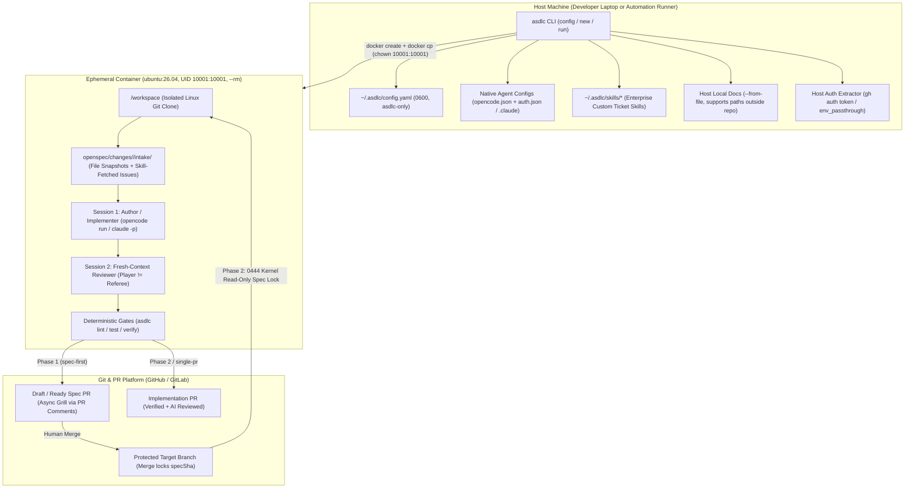
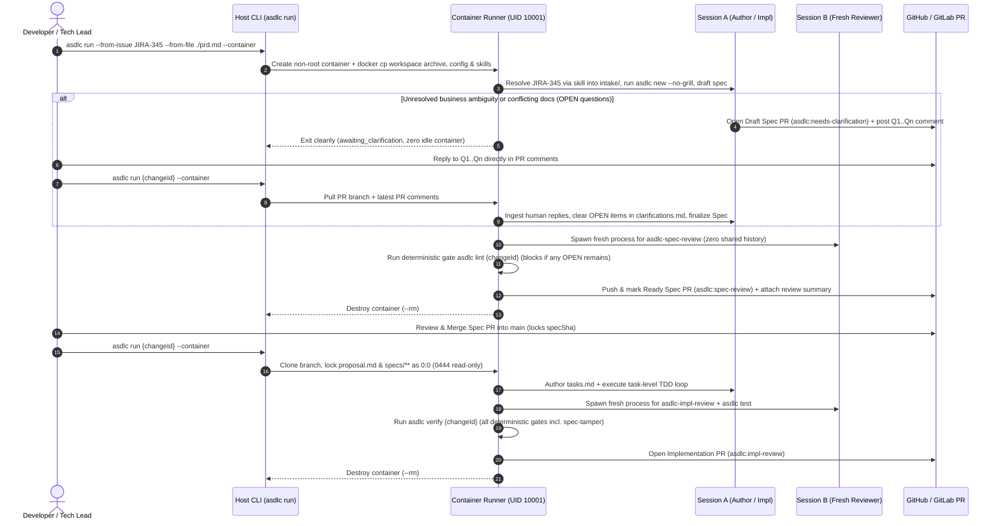
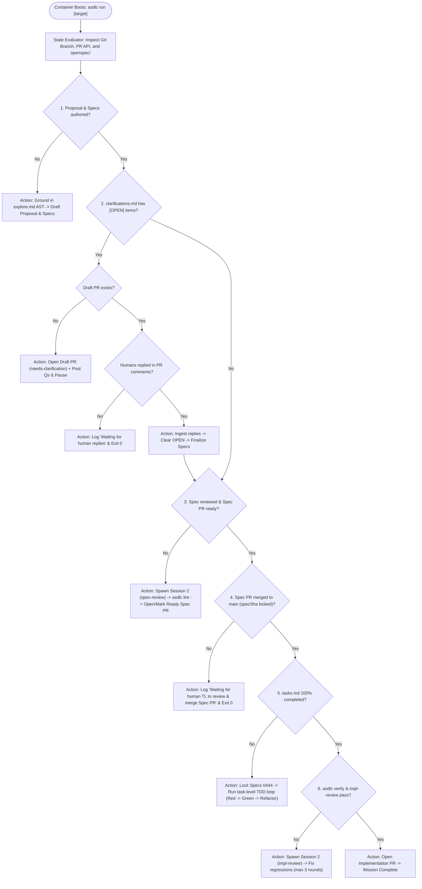

# Autonomous Container Pipeline & Global Governance Solution Proposal
# 全自动容器流水线与全局治理架构方案

> **Bilingual Solution Proposal (Pre-Implementation RFC) / 中英文双语架构方案（待实施设计稿）**  
> **Status / 状态**: Proposed Solution — Not Yet Implemented / 方案设计稿（尚未进入代码实现）  
> **Scope / 范围**: Global configuration (`asdlc config`), dual-mode governance switch (`spec-first` | `auto`), multi-source intake (`--from-file` / `--from-issue`), hardened non-root polyglot runner (`asdlc-runner`), and state-driven autonomous orchestrator (`asdlc run`).

---

## Table of Contents / 目录

- [English Solution Proposal](#english-solution-proposal)
  - [1. Problem Statement & Design Principles](#1-problem-statement--design-principles)
  - [2. End-to-End Architecture & Workflows](#2-end-to-end-architecture--workflows)
  - [3. Global Control Plane & Two-Mode Workflow Switch (`asdlc config`)](#3-global-control-plane--two-mode-workflow-switch-asdlc-config)
  - [4. Multi-Source Intake & Two-Tier Skill Resolution](#4-multi-source-intake--two-tier-skill-resolution)
  - [5. Official `ubuntu:26.04` LTS Image & Hardened Non-Root Baseline](#5-official-ubuntu2604-lts-image--hardened-non-root-baseline)
    - [5.1 Two-Layer Polyglot Runner Image](#51-two-layer-polyglot-runner-image)
    - [5.2 Internal Non-Exposed Security Baseline](#52-internal-non-exposed-security-baseline)
    - [5.3 Tri-State Repository Lifecycle & Ingestion Matrix (Greenfield, Brownfield, Established)](#53-tri-state-repository-lifecycle--ingestion-matrix-greenfield-brownfield-established)
  - [6. State-Driven Orchestrator (`asdlc run`) & Async PR Grilling](#6-state-driven-orchestrator-asdlc-run--async-pr-grilling)
    - [6.1 Dual Execution Modes: Local Directory vs Zero-Checkout Remote (`--repo`)](#61-dual-execution-modes-local-directory-vs-zero-checkout-remote---repo)
    - [6.2 Human-Centric Change Identification & Zero-Friction Resume](#62-human-centric-change-identification--zero-friction-resume)
    - [6.3 Declarative Finite State Machine: How the Container Deduces the Active Task](#63-declarative-finite-state-machine-how-the-container-deduces-the-active-task)
    - [6.4 Governance Hardening](#64-governance-hardening)
  - [7. Phased Implementation Roadmap](#7-phased-implementation-roadmap)
- [中文架构方案](#中文架构方案)
  - [1. 背景痛点与核心原则](#1-背景痛点与核心原则)
  - [2. 总体架构与交互流程](#2-总体架构与交互流程)
  - [3. 全局配置控制面与双模式开关 (`asdlc config`)](#3-全局配置控制面与双模式开关-asdlc-config)
  - [4. 多源需求输入（Intake）与两层 Skill 取单架构](#4-多源需求输入intake与两层-skill-取单架构)
  - [5. 官方 `ubuntu:26.04` LTS 全栈镜像与非 Root 安全基线](#5-官方-ubuntu2604-lts-全栈镜像与非-root-安全基线)
    - [5.1 双层镜像与版本强绑定](#51-双层镜像与版本强绑定)
    - [5.2 内部硬编码安全基线](#52-内部硬编码安全基线)
    - [5.3 三种项目生命周期适配矩阵（Greenfield、Brownfield 与成熟项目）与双向同步闭环](#53-三种项目生命周期适配矩阵greenfieldbrownfield-与成熟项目与双向同步闭环)
  - [6. 状态驱动编排器 (`asdlc run`) 与 Draft PR 异步 Grill 闭环](#6-状态驱动编排器-asdlc-run-与-draft-pr-异步-grill-闭环)
    - [6.1 双执行模式：本地就地执行与免 Clone 零检出执行 (`--repo`)](#61-双执行模式本地就地执行与免-clone-零检出执行---repo)
    - [6.2 人性化变更定位与零摩擦续跑机制（智能推导、交互选择器、PR # / URL / Issue 解析）](#62-人性化变更定位与零摩擦续跑机制智能推导交互选择器pr---url--issue-解析)
    - [6.3 声明式有限状态机：无头容器如何确定当前该执行什么](#63-声明式有限状态机无头容器如何确定当前该执行什么)
    - [6.4 治理合规门禁补强](#64-治理合规门禁补强)
  - [7. 分阶段落地路线图](#7-分阶段落地路线图)

---

# English Solution Proposal

## 1. Problem Statement & Design Principles

Enterprise engineering teams adopting Agentic SDLC need **human judgment on requirement clarification and merge approvals**, while executing deterministic downstream work—spec drafting, independent spec review, TDD implementation, independent implementation review, acceptance testing, and PR creation—unattended inside an isolated runtime. Three practical bottlenecks currently stand in the way:

1. **Per-repository configuration & classification friction**: Workflow routing (`single-pr` vs `spec-first`) is coupled to the heuristic `L0–L3` risk engine without a machine-global switch, making it difficult to enforce predictable classic dual-PR (`spec-first`) governance across repositories without editing `.sdlc/policy.yaml` in every repo.
2. **Single-string requirement intake**: `asdlc new` accepts only a single inline requirement string rather than multiple local design documents and multiple external tickets (Jira, Confluence, GitHub Issues).
3. **Lack of a standardized headless container runtime**: Downstream stages rely on an interactive local IDE session rather than an official polyglot non-root container image with zero-translation multi-vendor LLM auth passthrough and non-TTY asynchronous clarification.

### Core Design Principles
- **Seamless Coexistence of Manual (IDE) and Autonomous (Container) Modes**: Git commits, PR state, and `.openspec.yaml` remain the single source of truth. Interactive IDE sessions and `asdlc run --container` invoke the exact same CLI primitives and can hand off work at any stage.
- **Strict Separation of Concerns (Zero Vendor Schema Translation)**: `~/.asdlc/config.yaml` is read exclusively by `asdlc`; built-in headless AI agents (`opencode` and `claude`) consume their native configuration files (`opencode.json` + `auth.json` across 75+ providers, or `.claude/settings.json`); enterprise issue trackers plug in via overrideable Skills rather than hardcoded proprietary SDKs in `asdlc` core.
- **Secure by Default, Minimal CLI Surface**: Non-root execution (`UID 10001:10001`), dropped Linux capabilities, and kernel-enforced read-only locks (`0444`) on approved specs during implementation are enforced internally as factory defaults without exposing low-level Docker flags on the CLI.

---

## 2. End-to-End Architecture & Workflows

### 2.1 Host Orchestrator vs. Ephemeral Non-Root Container Split



### 2.2 Autonomous Execution Lifecycle (Including Async PR Comment Grilling)



---

## 3. Global Control Plane & Two-Mode Workflow Switch (`asdlc config`)

### 3.1 Dual-Interface Control Plane: Interactive Wizard (`asdlc config`) + Scriptable CLI

To avoid the cognitive burden of memorizing dozens of dot-paths while maintaining full CI/scripting compatibility, `asdlc config` provides two complementary interfaces:

#### 1. Interactive Terminal Setup Wizard (`asdlc config` with zero arguments)
Running `asdlc config` without arguments launches an interactive, modular terminal wizard with **early-exit support at every step** (`[Save & Exit]` or `Esc`):

```text
=== Agentic SDLC Global Configuration Wizard ===
Press [Ctrl+C] or choose 'Save & Exit' at any time to finish.

? What would you like to configure? (Use arrow keys)
❯ 1. Workflow Mode (Current: spec-first)
  2. AI Model & Harness (Current: Inherit Host OpenCode)
  3. Git & Pull Request Auth (Current: GitHub via gh CLI)
  4. Issue Tracker Integration (Jira / Confluence)
  ---------------------------------------------------------
  [ Save & Exit ]
```

- **Smart Auto-Detection**:
  - Automatically checks if `gh` is installed and logged in -> Displays `✓ GitHub: Inherited from host 'gh' CLI (user: akjamie)`.
  - Automatically checks if OpenCode is present on the host -> Displays `✓ AI: Found host OpenCode config (~/.config/opencode/opencode.json)`.
- **Modular Sections & Easy Skip**:
  - **Section 1: Workflow Mode** — Pick between `● spec-first (Recommended for new teams: Mandatory Spec PR -> Merge -> Impl PR)` and `○ auto (Adaptive: L0/L1 Single-PR, L2/L3 Dual-PR)`.
  - **Section 2: AI Harness & Model Override** — Options to keep host OpenCode, specify a container-only model override (e.g. `doubao-seed-code`), enter an API key, or import a JSON file.
  - **Section 3: Git & PR Credentials** — Option to inherit host `gh` or provide a custom PAT.
  - **Section 4: External Issue Trackers (Optional)** — Prompt to enter Jira / Confluence base URLs and tokens, or choose `● Skip for now (Configure later or use local files only)`. Token inputs are masked on screen.
- **Atomic Persistence**: On choosing `[Save & Exit]`, updates are written atomically to `~/.asdlc/config.yaml` with mode `0600`.

#### 2. Non-Interactive Scriptable CLI (For CI/CD and Power Users)
For headless automation, scripts, and granular inspection, standard subcommands remain fully available:

```bash
# 1. Global workflow switch: strictly two supported modes
asdlc config set workflow_mode spec-first      # spec-first | auto

# 2. Optional agent & runner orchestration settings
asdlc config set agent.harness opencode        # opencode (default) | claude
asdlc config set agent.model ""                # optional override (-m provider/model)
asdlc config set agent.review_model ""         # optional heterogeneous reviewer model
asdlc config set runner.image ""               # optional internal registry mirror override

# 3. Generic env injection & passthrough for enterprise custom skills
asdlc config set env.JIRA_BASE_URL https://jira.corp.com
asdlc config set env.JIRA_API_TOKEN <TOKEN>
asdlc config set runner.env_passthrough "JIRA_*,CONFLUENCE_*"

# 4. Inspection (keys matching *key/*token/*secret/*password are masked by default)
asdlc config list [--show-secrets] [--json]
asdlc config get workflow_mode
asdlc config unset env.JIRA_API_TOKEN
```

**Exact Boundary of the Two Workflow Modes** (`single-pr` and `risk_assessment` are not exposed as separate global toggles; risk classification belongs exclusively to `auto` mode):

| `workflow_mode` | Governance Behavior |
| :--- | :--- |
| **`spec-first`** (Classic Mandatory Dual-PR) | **Skips L0–L3 risk classification and `risk-history.jsonl` ratchets.** Every change (outside `fast_path` pure documentation) follows the deterministic two-PR pipeline: **Spec PR (`lint` + `spec-review` + human merge locking `specSha`) → Impl PR (`verify` + `impl-review`)**. Recommended for initial team rollouts. |
| **`auto`** (Adaptive Risk-Tiered) | **100% preserves current behavior.** Runs the three-vector L0–L3 risk assessment and anti-downgrade ratchet: L0/L1 changes route to `single-pr` (co-locating spec and implementation in one PR), while L2/L3 changes route to `spec-first`. |

**Precedence Chain (Highest → Lowest)**:
`CLI Flags` > `Environment Variables (ASDLC_*)` > `Repo .sdlc/policy.yaml (optional override)` > **`Global ~/.asdlc/config.yaml`** > `Built-in Default`.

### 3.2 Enterprise & User-Grade AI Configuration Strategy (Zero Schema Loss)

`~/.asdlc/config.yaml` is **never parsed directly by the built-in AI harness**. Instead, the system treats AI configuration with an industry-grade **Immutable File Selection + CLI Flag Override model** (avoiding fragile JSON deep-merging):

1. **How Configuration Files Are Selected (Zero Deep-Merge)**:
   - In production, deep-merging multi-vendor JSON configurations can overwrite mutual provider options, break custom headers, or corrupt array structures.
   - **Resolution Policy**: `asdlc` selects the base configuration file as a **whole atomic unit** (no partial field stitching):
     - **Primary Base**: `~/.asdlc/agent/opencode/opencode.json` (if the user or team imported an explicit container template via `asdlc config agent --file`).
     - **Fallback Base**: The developer's native host configuration `%USERPROFILE%\.config\opencode\opencode.json` (Windows) or `~/.config/opencode/opencode.json` (macOS/Linux) and matching `auth.json`.
     - **Fallback Zero-State**: If neither exists, `asdlc` writes a minimal valid single-provider configuration generated from `asdlc config set agent.provider` and `agent.api_key`.

2. **How Container-Specific Models Are Overridden (Runtime CLI Flag `-m`)**:
   - If a developer uses `anthropic/claude-sonnet-4-5` on their host but wants the container pipeline to run a dedicated model (e.g. `doubao-seed-code` or an internal high-throughput endpoint), **`asdlc` never mutates the underlying `opencode.json` file**.
   - Instead, setting `asdlc config set agent.model <model>` passes the override directly to the OpenCode invocation via its official runtime argument:
     ```bash
     opencode run -m "provider/model" "<prompt>"
     ```
   - According to OpenCode specifications, CLI `-m <provider/model>` naturally takes precedence over the `"model"` property in `opencode.json`.
   - **Heterogeneous Review Model**: Independent reviews similarly execute in a separate process using `opencode run -m <agent.review_model> "<prompt>"`.
   - **Result**: Complete multi-provider settings, proxies, and custom headers are preserved 100% intact from the base configuration, while the active model is cleanly overridden for container execution without touching host files.

3. **Pure Data-Driven Staging via Standard Bridge Network (No `--net=host` Dependency)**:
   - Corporate CIS benchmarks and container runtimes (such as Docker Desktop on Windows/macOS with WSL2/Hyper-V) restrict or disable `--net=host`.
   - The orchestrator completely avoids running interactive browser-based login containers. All credential assembly happens locally in host Node.js process memory.
   - Credentials (`auth.json`) and configuration (`opencode.json`) are injected via `docker cp` directly into the container's `/home/agent/.local/share/opencode/auth.json` and `/home/agent/.config/opencode/opencode.json` with strict mode `0600` and ownership `10001:10001`.
   - The container operates on a standard isolated Docker bridge network, fully compliant with enterprise bastion and container security policies.

4. **Supported Onboarding Modes**:
   - **Mode A: Seamless Host Inheritance**: Automatically discovers host `%USERPROFILE%\.config\opencode\opencode.json` (Windows) or `~/.config/opencode/opencode.json` (macOS/Linux) and matching `auth.json`, copying them into the container without manual steps.
   - **Mode B: Key-Based CLI Quickset**:
     ```bash
     asdlc config set agent.provider "anthropic"
     asdlc config set agent.api_key "sk-ant-xxx"
     asdlc config set agent.base_url "https://api.corp.com/v1" # optional private gateway
     ```
     Host `asdlc run` formats standard `opencode.json` and `auth.json` in memory and pushes them into the container.
   - **Mode C: Enterprise Standard Template Import**:
     ```bash
     asdlc config agent --file ./enterprise-opencode.json
     ```
     Stores the team-vetted JSON verbatim under `~/.asdlc/agent/opencode/opencode.json`, overriding host local defaults for all container runs.

---

## 4. Multi-Source Intake & Two-Tier Skill Resolution

### 4.1 Repeatable `--from-file` and `--from-issue` Snapshotting
Both `asdlc new` and `asdlc run` accept repeatable `--from-file` and `--from-issue` arguments:

```bash
# Interactive IDE workflow
asdlc new "Partial order refund settlement" --from-file ~/Downloads/prd.md --from-file ./api.yaml --from-issue JIRA-345

# Autonomous container workflow
asdlc run --from-issue JIRA-345 --from-issue JIRA-346 --from-file ~/Downloads/prd.md --container
```

- **Host File Staging (`--from-file`)**: Supports arbitrary host paths outside the repository. Validated on the host (failing fast with `INTAKE_FILE_NOT_FOUND` if missing), copied into the container via `docker cp`, and snapshotted under `openspec/changes/<id>/intake/files/<NN>-<filename>` with SHA-256 digests in `intake/index.yaml`.
- **Two-Tier Skill Ticket Resolution (`--from-issue`)**: Because enterprise trackers vary widely in SSO gateways, custom acceptance criteria fields (`customfield_xxx`), and linked Confluence/wiki pages, `asdlc` core avoids hardcoded tracker SDKs:
  1. **Tier 1 — Enterprise Custom Skills (`~/.asdlc/skills/`)**: Automatically copied into the container and prioritized over bundled skills, paired with `env.*` / `runner.env_passthrough`.
  2. **Tier 2 — Bundled `asdlc-intake` Skill (Fallback)**: Ships `assets/skills/asdlc-intake/SKILL.md` supporting GitHub Issues/Projects, standard Jira (Cloud/DC), and Confluence pages. All fetched external text is wrapped in untrusted-data fences to mitigate prompt injection.

---

## 5. Official `ubuntu:26.04` LTS Image & Hardened Non-Root Baseline

### 5.1 Two-Layer Polyglot Runner Image
1. **Base Layer `ghcr.io/akjamie/asdlc-base:2026.xx` (`docker/Dockerfile.base`, rebuilt on toolchain updates)**:
   - OS: **`ubuntu:26.04` LTS** (`linux/amd64` + `linux/arm64`).
   - Toolchains: Node.js 22 LTS (`npm`/`pnpm`/`yarn`), Python 3.12 (`uv`/`pip`/`pytest` + prebuilt `tree-sitter`), OpenJDK 21 LTS (`maven`/`gradle`), Go 1.24+, Rust (`cargo`), C/C++ (`build-essential`/`gcc`/`g++`/`cmake`/`pkg-config`), `git`, `gh`, `glab`, `ripgrep`, `jq`, `curl`.
2. **Runner Layer `ghcr.io/akjamie/asdlc-runner:<pkg.version>` (`docker/Dockerfile.runner`, co-published per release)**:
   - Pre-installs version-matched `@akjamie/agentic-sdlc`, `openspec`, `graphifyy`, global `.agents/skills`, **`opencode`** (default), and **`claude`**.
   - **Version Pinning & CI Release**: `asdlc` defaults to `ghcr.io/akjamie/asdlc-runner:${pkg.version}` (never bare `:latest`), built and pushed automatically in `.github/workflows/release.yml` alongside `npm publish`, and synced on `asdlc upgrade`.

### 5.2 Internal Non-Exposed Security Baseline
Enforced internally on every container launch without exposing CLI flags to weaken them:
- **Strict Non-Root Execution**: Dedicated unprivileged user `agent` (`UID 10001:10001`, no `sudo`), `--user 10001:10001`, `--cap-drop=ALL`, `--security-opt=no-new-privileges:true`, `--pids-limit=512`, and `--rm` (also satisfying `claude -p --dangerously-skip-permissions`, which rejects `UID 0`).
- **Enterprise Dubious Ownership Immunity (CVE-2022-24765)**:
  - In containerized runtimes, UID mismatches between host users and container users (`UID 10001`) routinely trigger Git's security check: `fatal: detected dubious ownership in repository at '/workspace'`.
  - The runner image hardcodes system-wide `/etc/gitconfig` with `[safe] directory = /workspace` and injects `GIT_CONFIG_COUNT=1`, `GIT_CONFIG_KEY_0=safe.directory`, and `GIT_CONFIG_VALUE_0=/workspace`. Git operations never block or fail due to UID boundary crossing.
- **Enterprise Corporate Proxy & TLS CA Trust Chain Passthrough**:
  - In enterprise VPCs with SSL-inspecting proxies (Zscaler, BlueCoat, Prisma), container calls to LLM APIs or Git remotes fail if custom CA root certificates are missing.
  - Host `asdlc run` automatically captures host `HTTP_PROXY`, `HTTPS_PROXY`, `NO_PROXY`, and custom CA bundle paths (`SSL_CERT_FILE`, `NODE_EXTRA_CA_CERTS`), injects proxy settings into the container, and streams custom CA bundles into `/etc/ssl/certs/corporate-ca.crt` to guarantee frictionless enterprise network traversal.
- **Workspace Ingestion & Zero Host Bind-Mount (`git archive` Pipeline)**:
  - How the repository is provided to the container is a critical security and portability boundary:
    1. **Why Direct `git clone` Inside Container Fails**: Private enterprise repositories, private submodules, and corporate VPN boundaries require SSH keys or tokens that should not be permanently cloned from within a sandbox. Furthermore, `git clone` inside the container would miss the developer's local uncommitted baseline, staged work, or active branch state.
    2. **Why Host `-v` Bind-Mount Is Prohibited**: Bind-mounting the host project root directly exposes the host filesystem to arbitrary container scripts, creates Windows NTFS volume latency (10x slowdown on `node_modules`), causes CRLF line-ending mismatches, and risks UID permission pollution.
    3. **Production Standard: 3-Layer High-Fidelity Ingestion (`git archive + patch + untracked`)**:
       - **Layer 1 (Committed Base)**: Host streams the current branch snapshot into `/workspace` via `git archive HEAD | tar -x`.
       - **Layer 2 (Uncommitted Working Delta)**: If the host tree has uncommitted staged or unstaged changes, host pipes `git diff -p HEAD` into container `git apply --whitespace=nowarn`.
       - **Layer 3 (Untracked Non-Ignored Files)**: Untracked files (e.g. newly created configs, local `.env.example`) resolved via `git ls-files --others --exclude-standard` are streamed into `/workspace`.
       - Container `/workspace` sets ownership strictly to `10001:10001` and initializes an isolated Git tree targeting the remote origin.
       - Git push operations execute using the ephemeral `gh auth token` / `GH_TOKEN` injected into the process memory, completely eliminating host workspace bind-mount hazards.
- **Kernel-Level Read-Only Spec Lock (`0444`)**: During Phase 2 (`READY_FOR_IMPL`), `proposal.md` and `specs/**` are owned by `0:0` with mode `0444`, blocking unauthorized writes at the OS filesystem layer alongside `asdlc verify`'s `spec-tamper` check.

### 5.3 Tri-State Repository Lifecycle & Ingestion Matrix (Greenfield, Brownfield, Established)

A production-grade container runtime cannot assume every project is already a mature, initialized repository. `asdlc run --container` dynamically detects the repository state on the host and adapts its ingestion, container initialization, and host synchronization accordingly:

| Lifecycle State | Host Detection Condition | Host-to-Container Ingestion | Container Autonomous Initialization | Change Execution & Verification | Egress & Host Bidirectional Sync |
| :--- | :--- | :--- | :--- | :--- | :--- |
| **1. Greenfield Project**<br>*(Empty dir or loose PRD/docs, no Git repo)* | `git rev-parse --is-inside-work-tree` fails | Tar-streams directory content (filtering build artifacts via standard ignore list) + intake files via `docker cp`; sets `ASDLC_LIFECYCLE=greenfield` | 1. `git init -b main`<br>2. Configures container committer<br>3. Runs `asdlc init --headless`<br>4. Creates initial governance baseline commit | Scaffolds language project layout (`package.json`, `go.mod`, etc.) based on PRD/prompt; drafts proposal, spec, tasks, and TDD loop | **A. Remote**: `gh repo create` (if `--create-repo` specified)<br>**B. Local Materialization**: Host CLI copies initialized workspace back: `docker cp <cid>:/workspace/. <hostDir>/` before container teardown |
| **2. Brownfield Project**<br>*(Existing codebase & Git history, never run asdlc)* | `git rev-parse --is-inside-work-tree` succeeds, but `openspec/` does NOT exist | Streams `git archive HEAD` + uncommitted/untracked non-ignored delta files; sets `ASDLC_LIFECYCLE=brownfield` | **Zero-Touch Auto-Onboarding (`asdlc init --onboard`)**:<br>1. Detects build system & test runner<br>2. Generates AST graph (`graphifyy`)<br>3. Seeds `.agents/skills` & OpenSpec<br>4. Generates tailored `AGENTS.md`<br>5. Commits onboarding baseline | Grounds in freshly generated AST graph (`explore.md`); drafts spec, reviews, and runs TDD against existing codebase | **A. Remote PR**: Pushes onboarding baseline & feature branch, opens Spec/Impl PR<br>**B. Local Materialization**: Syncs `openspec/` and `.agents/` back to host via `git bundle` or selective `docker cp` |
| **3. Established Project**<br>*(Git repo + initialized asdlc)* | `git rev-parse --is-inside-work-tree` succeeds AND `openspec/` exists | Streams `git archive HEAD` + dirty working tree delta (staged + unstaged diff); sets `ASDLC_LIFECYCLE=established` | Verifies governance integrity; runs incremental AST graph refresh on touched files | State machine advances change: drafts spec, PR comment grilling, or locks Spec `0444` and runs TDD verification | **A. Remote PR**: Pushes feature branch to `origin`, opens/updates PR<br>**B. Offline/Local**: Exports branch via `git bundle`, host CLI imports via `git fetch <bundle> <branch>:<branch>` (zero working tree pollution) |

#### 5.3.1 Greenfield Project Bootstrapping & Local Workspace Materialization
When a developer runs `asdlc run "Build an express service" --from-file ./prd.md --container` in an empty or non-Git directory:
1. **Host Ingestion**: The host CLI detects the absence of `.git`, packages any existing local documentation or files (excluding `.DS_Store`, `node_modules`, etc.), and streams them into the container's `/workspace`.
2. **Container Headless Bootstrapping**: Inside `/workspace`, the runner initializes Git (`git init -b main`), sets local identity (`asdlc-agent <agent@asdlc.internal>`), runs headless `asdlc init`, and creates commit 0 (`chore: initialize repository with agentic-sdlc governance`).
3. **Scaffolding & Implementation**: The agent inspects the requirement, scaffolds project build files (`package.json`, `tsconfig.json`, source directory skeleton), drafts the spec, and executes the TDD implementation.
4. **Local Workspace Materialization**: Before the ephemeral container is destroyed (`--rm`), the host CLI copies the newly initialized workspace, `.git` repository, code, and OpenSpec artifacts back to the host project directory (`docker cp <container_id>:/workspace/. <host_dir>/`). The host is left with a fully functional, version-controlled project.

#### 5.3.2 Brownfield Zero-Touch Auto-Onboarding & Baseline Isolation
When running `asdlc run <requirement> --container` on an existing legacy repository that has never adopted Agentic SDLC:
1. **Non-Destructive Ingestion**: The host CLI streams `git archive HEAD` plus any local uncommitted/staged edits into the container `/workspace`.
2. **Zero-Touch Auto-Onboarding (`asdlc init --onboard`)**: Instead of aborting with a blocking error, the runner automatically executes headless onboarding:
   - **Stack & Test Discovery**: Analyzes build tools (`maven`/`gradle`, `npm`/`pnpm`, `go.mod`, `pytest`, `cargo`) and identifies test commands.
   - **Deterministic AST Code Graph vs. Vector RAG**: Standard Vector RAG chops legacy code into arbitrary chunks, losing type hierarchies, polymorphism, and multi-hop call chains—leading to hallucinations in complex codebases. Instead, `asdlc-runner` uses pre-installed Tree-sitter parsers (`graphifyy`) to extract precise symbol definitions, interfaces, callers, and dependencies into `graphify-out/` and generate `explore.md`.
   - **Targeted Blast-Radius Grounding**: The agent does not attempt full-system re-architecture; it uses the AST graph to calculate the blast radius *strictly around the requested change*, suppressing context bloat.
   - **Governance Seeding**: Installs `.agents/skills`, sets up OpenSpec schemas, and writes a tailored `AGENTS.md` capturing the repository's build/test workflows.
3. **Baseline Isolation**: The onboarding artifacts are committed to an isolated baseline branch (`asdlc/onboarding-baseline`), keeping tooling governance changes cleanly separated from the incoming feature change.
4. **Change Execution**: The runner checks out `change/<slug>`, grounds in the AST graph, and executes the standard autonomous lifecycle.

#### 5.3.3 Established Repositories, Dirty Working Tree Preservation, and `git bundle` Sync
For repositories already managed by Agentic SDLC:
1. **High-Fidelity Working Tree Ingestion (3-Layer Overlay)**: Developers frequently run container tasks with uncommitted edits or staged work. Host `asdlc run` captures `git archive HEAD` (committed base) + `git diff -p HEAD` (active working tree delta applied via `git apply`) + untracked non-ignored files. Inside the container, this state is faithfully materialized, ensuring the containerized agent operates on the exact code the developer has locally.
2. **Incremental AST Graph Refresh**: Instead of re-indexing the entire codebase, the runner runs an incremental delta update on recently modified files, minimizing startup latency.
3. **Safe Egress via Remote PR or `git bundle` (Zero Host Working Tree Pollution)**:
   - In standard CI/autonomous mode, the container pushes the branch to `origin` and creates/updates the PR.
   - In local-only or offline mode, naive `docker cp` would risk overwriting unsaved host files or colliding with active IDE file locks. Instead, the container packages the new commits into a self-contained `git bundle` (`/workspace/change.bundle`). The host CLI imports the branch via `git fetch <bundle> <branch>:<branch>`, updating the host Git database without touching the active working copy. The developer can inspect the branch safely at their own pace.

---

## 6. State-Driven Orchestrator (`asdlc run`) & Async PR Grilling

### 6.1 Dual Execution Modes: Local Directory vs Zero-Checkout Remote (`--repo`)
Requiring developers to always sit in a locally cloned repository root is an anti-pattern. `asdlc run` supports two first-class operational modes:

1. **Contextual Local Mode (Default when in a repository folder)**:
   ```bash
   # Inferred from current working directory
   asdlc run "Add payment refund webhook" --from-file ./prd.md --container
   ```
   - Ingests the local working tree snapshot (via 3-layer overlay) as detailed in §5.2.
   - Synchronizes results back to local Git or remotes.

2. **Zero-Checkout Remote Mode (Run from any folder without local Git clone)**:
   ```bash
   # Run from home directory, automation server, or empty terminal:
   asdlc run --repo akjamie/agentic-sdlc "Add payment refund webhook" --container
   # Or with explicit git URL:
   asdlc run --repo https://github.com/my-org/core-api.git --from-issue JIRA-345 --container
   ```
   - The developer's laptop does **not** need a local clone of the repository.
   - Host CLI spins up the `asdlc-runner` container and injects the developer's credentials (`gh auth token` / `GH_TOKEN`).
   - The container runner clones the repository directly into `/workspace`, checks out a feature branch, executes the autonomous pipeline, and pushes the Spec/Impl PR to GitHub/GitLab.
   - Zero local disk clutter, zero checkout requirements, perfectly portable across dev laptops and CI runners.

### 6.2 Human-Centric Change Identification & Zero-Friction Resume
Forcing users to memorize or copy-paste synthetic internal change slugs across runs creates high cognitive friction. `asdlc run` resolves change context through a human-centric hierarchy:

1. **First-Class Pull Request Reference (Most Natural for Devs)**:
   ```bash
   asdlc run #34 --container
   # Or full PR URL directly copied from browser:
   asdlc run https://github.com/akjamie/agentic-sdlc/pull/34 --container
   ```
   - Resolves the change slug directly from the PR's label metadata (`asdlc:change-id: <slug>`) or branch name (`change/<slug>`).
2. **Issue Tracker Reference**:
   ```bash
   asdlc run --from-issue JIRA-345 --container
   ```
   - Automatically matches the existing change associated with `JIRA-345` in `openspec/changes/*/intake/index.yaml` and resumes it.
3. **Smart Active-Branch Auto-Detection (Zero Arguments)**:
   - When running `asdlc run` inside a repository without arguments:
     - If the active branch is `change/<slug>`, it automatically resumes that specific change.
     - If on `main` with a single active change, it resumes that change.
4. **Interactive Terminal Picker (When Ambiguous)**:
   - When multiple changes are active, running `asdlc run` launches an interactive selector:
     ```text
     ? Found 2 active changes. Select one to resume or start a new task:
     ❯ [1] payment-refund     (Draft Spec PR #34: 2 open questions pending replies)
       [2] token-encryption   (Spec PR #31 Merged: Ready for TDD Implementation)
       [3] + Start a new change
     ```
5. **Actionable Pause Output**: Whenever a run pauses (e.g. awaiting human replies to questions), the CLI displays the exact copy-pasteable command to resume:
   ```text
   ⏸️ Paused: Awaiting human replies on Draft Spec PR #34.
   👉 Reply directly in the PR comments on GitHub.
   👉 Once replied, resume at any time:
        asdlc run #34 --container
   ```

### 6.3 Declarative Finite State Machine: How the Container Deduces the Active Task
The container is ephemeral (`--rm`). When a container is launched with `asdlc run [change-target]`, it has zero memory of previous container runs.
Instead, the orchestrator evaluates a **100% Declarative, Self-Describing Finite State Machine (FSM)** derived purely from Git history, PR metadata, and disk artifacts:



| Evaluated Invariants (Disk & Git State) | Inferred State Machine Phase | Autonomous Container Action |
| :--- | :--- | :--- |
| `openspec/changes/<id>/proposal.md` is absent | **PHASE_DRAFT_SPEC** | Runs `asdlc new --no-grill`; grounds in Tree-sitter AST; writes initial proposal and specifications. |
| `clarifications.md` has `[OPEN]` AND no PR exists | **PHASE_GRILL_PAUSE** | Pushes branch, opens Draft PR (`asdlc:needs-clarification`), posts structured questions in comments, exits cleanly. |
| `clarifications.md` has `[OPEN]` AND Draft PR has human comments | **PHASE_GRILL_RESUME** | Pulls PR comments via GitHub API, resolves `[OPEN]` items with human answers, updates `clarifications.md`, finalizes specs. |
| `specs/**` exists, 0 `[OPEN]`, but `review.md` is absent | **PHASE_SPEC_REVIEW** | Spawns fresh Session 2 for independent AI review (`asdlc-spec-review`), executes `asdlc lint` gate, marks PR Ready. |
| Spec PR is open, not merged on target branch | **PHASE_AWAITING_SPEC_MERGE** | Logs waiting prompt for Human Tech Lead merge approval, exits cleanly (zero idle container compute). |
| Target branch contains locked `specSha` AND tasks incomplete | **PHASE_TDD_IMPLEMENTATION** | Locks specs as `0:0` mode `0444` (OS kernel lock); authors `tasks.md`; executes task-level TDD Red-Green-Refactor loop. |
| All tasks checked AND `verify.json` absent or failing | **PHASE_VERIFY_AND_IMPL_REVIEW** | Spawns fresh Session 2 for independent AI review (`asdlc-impl-review`); runs `asdlc verify` (deterministic security & test gates). |
| All verification gates pass AND Impl PR absent | **PHASE_OPEN_IMPL_PR** | Opens Implementation PR (`asdlc:impl-review`), attaches verification report and test summary, mission complete. |

### 6.4 Governance Hardening
1. **`Player != Referee` Process Isolation**: Author/Implementer and Reviewer always execute as separate fresh processes with zero shared transcript, bounded by a **3-round** convergence cap.
2. **Deterministic `[OPEN]` Clarification Gate**: `asdlc lint` blocks Ready Spec PRs whenever `clarifications.md` has non-empty `## Open questions` or `[OPEN]` markers.
3. **Truthful Approval Provenance**: Updates `src/commands/approve.js` so `review.md` records actual merge SHA and approver provenance rather than synthetic six-dimension human PASS scores when no prior `review.md` exists.

---

## 7. Phased Implementation Roadmap

| Iteration | Scope | Verification Gate |
| :--- | :--- | :--- |
| **Iteration 1: Global Config, Multi-Source Intake & Lint Gates** | 1. `asdlc config` (`~/.asdlc/config.yaml`, `0600`, secret masking, `login`/`agent`)<br>2. `workflow_mode: spec-first \| auto` wired across `new`, `lint`, `apply`, `pr`, `verify`, `status`<br>3. Repeatable `--from-file` / `--from-issue`, `intake/index.yaml`, and bundled `asdlc-intake` skill<br>4. `[OPEN]` gate in `lint` and truthful provenance in `approve.js` | 100% existing tests green + unit/integration suites for `global-config`, `workflow-mode`, `intake`, and `clarification-lint` |
| **Iteration 2: Official `ubuntu:26.04` Non-Root Image & Release Pipeline** | 1. `docker/Dockerfile.base` & `docker/Dockerfile.runner` (`UID 10001:10001`, polyglot toolchains, `opencode` + `claude` + `asdlc` + `skills`)<br>2. Version-pinned GHCR build/push in `.github/workflows/release.yml`<br>3. Optional image sync in `asdlc upgrade` | Container runs as `10001:10001` with `--cap-drop=ALL`; polyglot compilers and `opencode`/`claude`/`asdlc` self-checks pass |
| **Iteration 3: `asdlc run` State Machine & Async PR Grilling** | 1. `src/commands/run.js` & `src/lib/container.js` (`docker cp` staging, `gh auth token`, `0444` Spec lock)<br>2. Dual-process `Player != Referee` isolation & 3-round cap<br>3. `asdlc:needs-clarification` Draft PR comment round-trip | End-to-end state-machine tests covering Spec PR creation, Draft PR comment Q&A resume, post-merge Impl PR, and `auto` Single-PR flow |

---
---

# 中文架构方案

## 1. 背景痛点与核心原则

在企业工程团队落地 Agentic SDLC 时，既需要保留**人在需求澄清与关键合入审批上的决策权**，又需要将确定性门禁之后的执行环节（Spec 起草与独立审查、TDD 编码实现、独立代码审查、验收测试与创建 PR）放入隔离运行环境中自动完成。当前存在三项核心瓶颈：

1. **单仓配置与分级心智负担重**：现有流程强绑定启发式 `L0–L3` 风险评估来决定单/双 PR，缺少机器级全局开关，无法在不修改每个业务仓 `.sdlc/policy.yaml` 的情况下统一锁定经典的「强制双 PR（`spec-first`）」模式。
2. **输入源单一**：`asdlc new` 仅支持单条文本参数，不支持同时传入多份本地文档与多个外部需求单（Jira / Confluence / GitHub Issues）。
3. **缺少标准化非特权全栈容器运行时**：下游环节依赖本地交互式 IDE 会话，缺少内置主流编译工具链与无头 AI 工具的官方非 Root 容器镜像、75+ 模型供应商零翻译登录透传，以及无终端交互下的异步澄清闭环。

### 核心设计原则
- **人工（IDE）与自动（Container）双轨完全兼容**：Git 分支、PR 状态与 `.openspec.yaml` 保持唯一状态真相源。本地 IDE 会话与 `asdlc run --container` 调用完全相同的底层命令，任何阶段均可随时人工接手或交回容器。
- **职责彻底解耦，零配置翻译损耗**：`~/.asdlc/config.yaml` 仅供 `asdlc` 自身读取；内置 AI（`opencode` / `claude`）100% 读取各自官方原生配置；外部需求单通过可覆盖的 Skill 层接入，不在核心 CLI 硬编码私有 SDK。
- **出厂默认安全，隐藏底层参数噪音**：非 Root 用户（`UID 10001:10001`）、剥离内核 Capability 与实现阶段 Spec 文件内核级只读锁（`0444`）全部作为内部默认安全基线，不在 CLI 暴露底层安全参数。

---

## 2. 总体架构与交互流程

*(架构组件图与异步 PR Grill 时序图见上方英文部分第 2 节图表，中英文共享同一套拓扑与状态流转设计。)*

核心职责切分：
- **宿主机（`asdlc run`）**：负责读取 `~/.asdlc/config.yaml`、校验并 `docker cp` 宿主机 `--from-file` 文档、跨平台提取宿主机已有原生 AI 凭证与 `gh auth token`、注入企业自定义 `~/.asdlc/skills/`，并管理一次性非特权容器生命周期。
- **隔离容器（`UID 10001:10001`）**：在容器原生 Linux `/workspace` 内独立克隆仓库，通过 Skill 拉取外部需求单落盘 `intake/`，以**两个完全独立的进程会话**分别执行「编写/实现」与「独立审查（`Player != Referee`）」，通过确定性门禁后推送分支并创建/更新 PR，退出即销毁（`--rm`）。

---

## 3. 全局配置控制面与双模式开关 (`asdlc config`)

### 3.1 双模控制面：交互式配置向导 (`asdlc config`) + 脚本化 CLI

为避免开发者记忆繁琐的命令行点分路径，同时保证 CI/CD 脚本的确定性调用，`asdlc config` 提供了两种互补交互模式：

#### 1. 终端交互式引导向导（无参数执行 `asdlc config`）
开发者直接输入 `asdlc config` 即启动交互式向导，支持**每一步随时按 `[Save & Exit]` 或 `Esc` 保存退出**：

```text
=== Agentic SDLC Global Configuration Wizard ===
Press [Ctrl+C] or choose 'Save & Exit' at any time to finish.

? What would you like to configure? (Use arrow keys)
❯ 1. Workflow Mode (Current: spec-first)
  2. AI Model & Harness (Current: Inherit Host OpenCode)
  3. Git & Pull Request Auth (Current: GitHub via gh CLI)
  4. Issue Tracker Integration (Jira / Confluence)
  ---------------------------------------------------------
  [ Save & Exit ]
```

- **宿主环境智能感知**：
  - 自动检测本地 `gh` CLI 登录态 -> 提示 `✓ GitHub: Inherited from host 'gh' CLI (user: akjamie)`，回车直接复用。
  - 自动检测本地 OpenCode 配置文件 -> 提示 `✓ AI: Found host OpenCode config (~/.config/opencode/opencode.json)`。
- **模块化步骤，选填项随时跳过**：
  - **模块 1：工作流模式** — 单选 `● spec-first (推荐新团队: 强制 Spec PR -> 人工合入 -> Impl PR)` 或 `○ auto (自适应分级)`。
  - **模块 2：AI 引擎与容器模型覆盖** — 可选直接复用宿主配置、为容器设置专属模型（如 `doubao-seed-code`）、快捷录入 API Key，或导入团队标准 JSON。
  - **模块 3：Git & PR 凭证** — 继承宿主 `gh` 或提供自定义 Token。
  - **模块 4：外部需求单配置（选填）** — 支持录入 Jira / Confluence URL 与 Token，或直接选择 `● 暂不配置 (后续配置或仅使用本地文件)`。敏感 Token 输入全程掩码打码。
- **原子化落盘**：随时选择 `[Save & Exit]`，配置以 `0600` 权限安全写入 `~/.asdlc/config.yaml`。

#### 2. 非交互脚本化 CLI（面向自动化脚本与 CI/CD）
针对无人值守部署与脚本编写，保留全部标准子命令：

引入机器级全局配置 `~/.asdlc/config.yaml`（权限强制 `0600`），所有配置项统一收敛至 `asdlc config`（不单设 `asdlc auth`；命中 `*key/*token/*secret/*password` 在 `list` 时自动脱敏）：

- **`workflow_mode` 仅保留两档**（不暴露单独的 `single-pr` 或 `risk_assessment`，风险分级是 `auto` 模式内生机制）：
  - **`spec-first`（经典强制双 PR）**：**完全跳过 L0–L3 分级评估与 `risk-history.jsonl` 防降级棘轮**。除 `fast_path` 纯文档变更外，所有变更统一执行：**Spec PR（`lint` + `spec-review` + 人工合入锁 `specSha`）→ Impl PR（`verify` + `impl-review`）**。
  - **`auto`（现有自适应分级）**：**100% 保持现有机制**。运行内置 L0–L3 风险评估与防降级校验，L0/L1 走单 PR（同时含 Spec 与代码），L2/L3 走双 PR。
- **优先级链**：`CLI 参数` > `环境变量 ASDLC_*` > `单仓 .sdlc/policy.yaml（仅特例覆盖）` > **`全局 ~/.asdlc/config.yaml`** > `内置默认值`。

### 3.2 行业级与用户级 AI 配置设计（整文件原子继承 + CLI 参数覆盖）

`~/.asdlc/config.yaml` **不给内置 AI 直接解析**。系统站在行业级平台规范与实际用户习惯的角度，设计了**整文件原子选择 + 运行时命令行参数覆盖模型（坚决杜绝脆弱的 JSON 深度拼积木）**：

1. **基础文件原子级选择（零 Deep Merge 隐患）**：
   - 在生产实践中，多厂商复杂 JSON 深度合并极易冲掉嵌套数组、覆盖同名但认证方式不同的 Provider。
   - **基础源确定策略**：宿主机将基础配置作为**不可变原子单元**选择（整份读取，不拆碎字段）：
     - **第一优先**：`~/.asdlc/agent/opencode/opencode.json`（若通过 `asdlc config agent --file` 导入过团队专属模板）。
     - **第二优先**：宿主机原生已有的 `%USERPROFILE%\.config\opencode\opencode.json`（Windows）或 `~/.config/opencode/opencode.json`（macOS/Linux）及对应的 `auth.json`。
     - **第三兜底**：两边均无时，由 `asdlc` 根据 `asdlc config set agent.provider` / `agent.api_key` 在内存生成一份最小合法配置。

2. **容器差异化模型覆盖：走官方原生 CLI 参数 `-m`（零文件修改）**：
   - 开发者本地日常习惯用 `anthropic/claude-sonnet-4-5`，但希望容器自动化流水线使用企业高吞吐模型 `doubao-seed-code`。
   - **实现机制**：`asdlc` **绝不去修改底层的 `opencode.json`**，而是将 `asdlc config set agent.model <model>` 直接转换为 OpenCode 官方命令行参数：
     ```bash
     opencode run -m "provider/model" "<prompt>"
     ```
   - **根据 OpenCode 官方规范**：命令行传入的 `-m <provider/model>` 优先级天然高于 `opencode.json` 里的 `"model"` 属性。
   - **异构独立审查模型**：审查阶段同样通过独立进程启动 `opencode run -m <agent.review_model> "<prompt>"`。
   - **收益**：底层复杂的 75+ 供应商连接、内网私有代理、自定义 Header 100% 完整继承，而活动模型被干净利落地在运行时单次覆盖，**绝不污染或篡改开发者宿主机的本地 OpenCode 配置文件**！

3. **纯数据流注入（零 `--net=host` 依赖，适配企业 CIS 合规）**：
   - 彻底废弃在容器内跑交互式网页登录的设计，避免因 `--net=host` 在企业堡垒机被禁用、或在 Windows/macOS WSL2 虚拟机网络下无法回调宿主机浏览器而导致死锁。
   - 认证数据全流程在宿主机内存组装，通过 `docker cp` 单向注入容器文件系统，权限锁定为 `10001:10001`、`0600`。容器运行在标准 Docker bridge 隔离网络下，完美符合企业 CIS 容器安全规范。

4. **三种接入模式**：
   - **模式 A（宿主机无缝继承）**：自动跨平台识别宿主机 `%USERPROFILE%\.config\opencode\opencode.json`（Windows）或 `~/.config/opencode/opencode.json`（macOS/Linux）及对应的 `auth.json`，直接注入容器使用。
   - **模式 B（命令行快速配置）**：
     ```bash
     asdlc config set agent.provider "anthropic"
     asdlc config set agent.api_key "sk-ant-xxx"
     asdlc config set agent.base_url "https://api.corp.com/v1" # 可选内部网关
     ```
     宿主机在内存中组装标准合法 JSON 并注入容器。
   - **模式 C（企业标准模板导入）**：
     ```bash
     asdlc config agent --file ./enterprise-opencode.json
     ```
     原封不动存入 `~/.asdlc/agent/opencode/opencode.json`，供所有容器流水线作为专属配置执行。

---

## 4. 多源需求输入（Intake）与两层 Skill 取单架构

1. **多文件与多单据快照**：`asdlc new` 与 `asdlc run` 均支持可重复的 `--from-file <path>`（支持宿主机仓外路径，`docker cp` 拷入容器）与 `--from-issue <ref>`，统一归档至 `openspec/changes/<id>/intake/` 并生成带 SHA-256 校验的 `intake/index.yaml`。
2. **两层 Skill 取单（核心零第三方 SDK 耦合）**：
   - **第一优先级（企业自定义 `~/.asdlc/skills/`）**：配合 `env.*` 与 `runner.env_passthrough` 注入内网凭证，容器启动时自动拷入并覆盖同名内置 Skill，灵活适配企业私有 Jira 字段与内网鉴权。
   - **第二优先级（内置 `asdlc-intake` 标准 Skill 兜底）**：自带标准取单指引，支持 GitHub Issues/Projects、Jira (Cloud/DC)、以及关联 Confluence 页面顺藤摸瓜读取，所有外部文本强制包裹不可信数据围栏防范 Prompt Injection。

---

## 5. 官方 `ubuntu:26.04` LTS 全栈镜像与非 Root 安全基线

1. **双层镜像与版本强绑定**：
   - **底层 `asdlc-base:2026.xx`**：基于最新 **`ubuntu:26.04` LTS**（`linux/amd64` + `linux/arm64`），预装 Node 22、Python 3.12 + `uv`（含预编译 `tree-sitter`）、JDK 21 (`maven`/`gradle`)、Go、Rust、C/C++ 编译链及 `git`/`gh`/`glab`/`ripgrep`/`jq`。
   - **上层 `asdlc-runner:<pkg.version>`**：预装同版本 `asdlc`、`openspec`、`graphifyy`、全局 `.agents/skills` 以及 **`opencode`（默认）** 和 **`claude`**。在 `.github/workflows/release.yml` 中随 npm 发版同步构建推送，默认精确锁定 `${pkg.version}` 标签（不用裸 `:latest`），`asdlc upgrade` 自动联动拉取。
2. **内部硬编码安全基线与企业级环境穿透（不暴露降级开关）**：
   - 固定非特权用户 `agent`（`UID 10001:10001`，无 `sudo`），内部默认附加 `--user 10001:10001`、`--cap-drop=ALL`、`--security-opt=no-new-privileges:true`、`--pids-limit=512`、`--rm`。
   - **Git 容器跨用户安全检测免疫（CVE-2022-24765）**：镜像全局 `/etc/gitconfig` 硬编码 `[safe] directory = /workspace`，并注入 `GIT_CONFIG_KEY_0=safe.directory`，根绝因宿主与容器 UID 不一致导致的 `fatal: detected dubious ownership` 拦截。
   - **企业级代理与私有 CA 证书链穿透**：宿主机自动透传 `HTTP_PROXY`、`HTTPS_PROXY`、`NO_PROXY` 与宿主自定义根证书（`SSL_CERT_FILE`、`NODE_EXTRA_CA_CERTS`），将证书流式注入容器 `/etc/ssl/certs/corporate-ca.crt`，解决大企业内网 SSL 劫持代理导致的证书校验中断。
   - **零宿主卷挂载（3 层高保真流式注入）**：
     - 不在容器内执行私有 `git clone`（避免私网凭证/VPN 泄入沙箱）；
     - 不 `-v` 挂载宿主机目录（杜绝容器脚本破坏宿主机、规避 Windows NTFS 卷性能雪崩与 CRLF 换行冲突）；
     - **第 1 层（提交基线）**：宿主机提取当前分支快照 (`git archive HEAD | docker cp`) 灌入容器 `/workspace` 并赋权 `10001:10001`；
     - **第 2 层（脏工作区增量）**：若宿主机存在暂存区或未暂存改动，自动采集 `git diff -p HEAD` 在容器内执行 `git apply`，100% 还原开发者当前屏幕现场；
     - **第 3 层（未跟踪文件）**：采集 `git ls-files --others --exclude-standard` 仅注入新建代码，严格尊重 `.gitignore`；
     - 容器推送依靠内存注入的短期 Token（`gh auth token` / `GH_TOKEN`）。
   - **实现阶段内核级只读锁死 Spec**：将容器内 `proposal.md` 与 `specs/**` 置为 `0:0`（`0444` 只读），从 Linux 内核层物理封锁篡改。
3. **三种项目生命周期适配矩阵（Greenfield、Brownfield 与成熟项目）与双向同步闭环**：
   - 工业级容器执行器不能假定所有项目均已规范初始化。`asdlc run --container` 在宿主机侧动态检测项目状态并执行对应的流式注入与结果物化：
     - **场景一：Greenfield 全新项目（无 Git 仓库、零代码自举与宿主反向物化）**：
       - *宿主机检测*：`git rev-parse --is-inside-work-tree` 失败（空目录或仅有 loose PRD/说明文档）。
       - *注入机制*：宿主机将当前目录非忽略文件（过滤 `.DS_Store`、`node_modules` 等）通过 `tar | docker cp` 灌入容器 `/workspace`，传递环境变量 `ASDLC_LIFECYCLE=greenfield`。
       - *容器内自举*：容器内执行 `git init -b main` 并配置本地签名（`asdlc-agent <agent@asdlc.internal>`）；自动执行无头 `asdlc init --headless` 初始化 OpenSpec 规范结构；提交初始治理基线提交 `commit 0: Initial repository scaffolding via asdlc`。
       - *脚手架与变更落地*：基于输入的 PRD/Prompt 自动初始化对应语言的项目骨架（如 `package.json`、`go.mod`、`pom.xml`），推进 Spec 与 TDD 实现。
       - *双向同步与结果物化*：若配置了 `--create-repo` 则容器直接调用 `gh repo create` 推送远端；在容器销毁（`--rm`）前，宿主机 CLI 自动执行 `docker cp <container_id>:/workspace/. <host_dir>/`，将初始化完毕的 Git 仓库、项目工程骨架与治理文件完整物化回宿主机，开发者立即获得完整可运行的本地工程。
     - **场景二：Brownfield 既有老项目（已有 Git 历史、首次接入 asdlc 的无感知自初始化）**：
       - *宿主机检测*：`git rev-parse --is-inside-work-tree` 成功（存在 `.git`），但根目录下无 `openspec/` 目录。
       - *注入机制*：宿主机按 3 层结构打包灌入容器，传递 `ASDLC_LIFECYCLE=brownfield`。
       - *容器内零感知自初始化（Zero-Touch Auto-Onboarding）*：容器编排器绝不报拦截性错误（杜绝“请先在本地运行 asdlc init”），而是自动执行无头 `asdlc init --onboard`：
         1. 自动检测代码库构建工具（Maven/Gradle/npm/Go/Cargo/Pytest）与测试命令；
         2. **确定性 AST 知识图谱 vs 文本向量 RAG**：传统 RAG 将老代码切块会丢失类型继承、接口实现与多跳调用链，在依赖注入繁重的老项目中极易幻觉。`asdlc-runner` 调用预装 Tree-sitter 全量编译 AST 生成 `graphify-out/` 与 `explore.md`，精准掌握全局符号与边界；
         3. **变更级影响范围收敛（Blast Radius）**：Agent 绝不尝试全盘重构老系统，而是借助代码图谱仅圈定当前需求触达的上下游受影响模块，大幅节省 Token 并保障准确性；
         4. 自动生成适配该代码库技术栈的专用 `AGENTS.md`，装配 `.agents/skills` 与 OpenSpec 规范结构；
         5. 将初始化产物独立提交在 `asdlc/onboarding-baseline` 分支上，使工具链接入历史与业务代码变更清晰解耦。
       - *无缝衔接业务变更*：切出 `change/<slug>` 分支，基于刚生成的精准代码图谱推导变更设计与 Spec，完成代码实现。
       - *结果回流*：容器向远端推送 Baseline 与 Feature 分支并提 PR；同时将 `openspec/` 与 `.agents/` 同步回宿主机。
     - **场景三：成熟项目（已接入 asdlc、脏工作区高保真同步与 `git bundle` 零污染拉回）**：
       - *宿主机检测*：Git 仓库与 `openspec/` 均存在。
       - *脏工作区高保真注入*：开发人员常在本地存有未提交改动（WIP / Staged）时拉起容器任务。宿主机采集 `git archive HEAD`（已提交基线）与 `git diff HEAD`（本地工作区实时增量 patch），在容器内精确还原宿主机当前的真实编辑现场。
       - *增量图谱刷新*：容器跳过全量扫描，仅对近期变动文件做增量 AST 刷新，秒级进入需求状态机。
       - *安全回流（PR 或 `git bundle` 零污染拉回）*：联网时容器直接推送远端 PR；离线或本地模式下，若使用传统 `docker cp` 会覆盖宿主机正在编辑的文件或引发 IDE 锁冲突，因此容器将新生成的 Commit 打包为自包含的 `git bundle` 存入临时卷，宿主机执行 `git fetch <bundle> <branch>:<branch>` 仅更新宿主 Git 对象库，绝不粗暴覆盖宿主机当前工作区，杜绝文件冲突与丢失。

---

## 6. 状态驱动编排器 (`asdlc run`) 与 Draft PR 异步 Grill 闭环

### 6.1 双执行模式：本地就地执行与免 Clone 零检出执行 (`--repo`)
强制要求开发者必须先在本地 `git clone` 代码仓、再 `cd` 到项目根目录执行命令，在自动化运维与多项目管理中属于反模式。`asdlc run` 原生支持双执行形态：

1. **就地执行模式（Contextual Local Mode，默认）**：
   ```bash
   # 在本地代码仓目录中直接执行
   asdlc run "Add payment refund webhook" --from-file ./prd.md --container
   ```
   - 自动采集宿主当前工作区现场（3 层高保真流式注入）；
   - 执行完毕后按需回流至本地 Git 对象库或远端。

2. **免 Clone 零检出执行模式（Zero-Checkout Remote Mode，从任意目录发起）**：
   ```bash
   # 在家目录、空终端、或自动化运维跳板机上直接指定远端仓库：
   asdlc run --repo akjamie/agentic-sdlc "Add payment refund webhook" --container
   # 或指定完整 Git 链接并关联工单：
   asdlc run --repo https://github.com/my-org/core-api.git --from-issue JIRA-345 --container
   ```
   - 宿主机**完全不需要在本地检出或占用磁盘 Clone 该项目**；
   - 宿主机 CLI 拉起 `asdlc-runner` 容器，直接透传短期认证 Token（`gh auth token` / `GH_TOKEN`）；
   - 容器沙箱内部直接在 Linux 内存盘/workspace 中克隆、切分支、执行全套 SDLC 流水线并自动向 GitHub/GitLab 提 PR；
   - 宿主机零代码残留、零磁盘污染，在 CI/CD 流水线与开发者多项目调度场景极具生产力。

### 6.2 人性化变更定位与零摩擦续跑机制（智能推导、交互选择器、PR # / URL / Issue 解析）
要求用户在多次执行中记忆并手敲合成的内部 Change ID（如 `rate-limiting-security-token-encryption`）会导致极大的操作心智负担。`asdlc run` 建立了一套以开发者习惯为中心的多级智能定位体系：

1. **直传 PR 编号或完整 URL（最贴合人类习惯）**：
   ```bash
   asdlc run #34 --container
   # 或直接从浏览器粘贴 PR 完整地址：
   asdlc run https://github.com/akjamie/agentic-sdlc/pull/34 --container
   ```
   - 编排器通过 GitHub/GitLab API 直接读取 PR 标签元数据（`asdlc:change-id: <slug>`）或关联分支，自动定位到精确的变更上下文。
2. **直传关联工单号（Issue-Driven Resume）**：
   ```bash
   asdlc run --from-issue JIRA-345 --container
   ```
   - 编排器自动比对 `openspec/changes/*/intake/index.yaml` 中绑定的 Issue 索引，命中后直接续跑已有变更。
3. **零参数智能分支推导（Smart Active-Branch Auto-Detection）**：
   - 在项目目录中直接运行 `asdlc run`：
     - 若当前 Git 分支本身就是 `change/<slug>`，直接续跑当前变更；
     - 若当前在 `main` 且本地只有一个活跃中的未归档变更，自动直接续跑。
4. **终端交互式选择器（Terminal Interactive Selector，存在歧义时）**：
   - 当仓库存在多个正在进行中的变更时，`asdlc run` 自动唤起终端交互菜单：
     ```text
     ? 检测到 2 个正在推进中的变更，请选择需要续跑的项或新建变更:
     ❯ [1] payment-refund     (Draft Spec PR #34: 存在 2 个阻塞问题等待人工回复)
       [2] token-encryption   (Spec PR #31 已合入: 等待推进 TDD 代码实现)
       [3] + 发起全新变更
     ```
5. **挂起时输出明确的无脑回车指令**：每当容器由于等待人工反馈挂起退出时，终端明确打印下一阶段的可粘贴命令：
   ```text
   ⏸️ 已安全挂起: Draft Spec PR #34 正等待人工确认核心设计。
   👉 请直接在 GitHub PR 评论区回复问题。
   👉 回复完成后，随时通过以下命令一键恢复流水线:
        asdlc run #34 --container
   ```

### 6.3 声明式有限状态机：无头容器如何确定当前该执行什么
容器执行完全是无状态且临时销毁（`--rm`）的。当宿主机执行 `asdlc run [target] --container` 启动一个全新的容器沙箱时，**容器内部不依赖任何外部后台常驻守护进程或瞬态内存**。

编排器内置了一套 **100% 声明式、自描述的有限状态机（Durable Finite State Machine）**，仅通过检视 Git 历史、PR API 状态与工作区规范制品，在毫秒级内准确推导当前所处的唯一合法阶段：

| 磁盘与 Git 关键客观不变量（Evaluated Invariants） | 推导出的状态机阶段 | 容器本次执行的精准动作（Action） |
| :--- | :--- | :--- |
| `openspec/changes/<id>/proposal.md` 尚不存在 | **阶段 1: 草拟 Spec** | 运行 `asdlc new --no-grill`，基于 AST 图谱探索代码上下文，撰写提案与初始 Spec |
| `clarifications.md` 存在 `[OPEN]` 且**尚未建 PR** | **阶段 2: 挂起发问** | 推送分支，打开带 `asdlc:needs-clarification` 的 Draft PR，在评论区发布结构化问题，干净退出 0 |
| `clarifications.md` 存在 `[OPEN]` 且**PR 评论区有人工回复** | **阶段 3: 消化问答** | 通过 API 抓取评论回复，自动清空 `[OPEN]` 问题并更新决议，定稿 Spec |
| `specs/**` 完整、0 个 `[OPEN]`，但**尚无 `review.md`** | **阶段 4: 独立评审** | 派生全新无历史的独立审查进程（`asdlc-spec-review`），执行 `asdlc lint` 门禁，将 PR 转为 Ready for Review |
| Spec PR 处于开启状态，尚未在 Target 分支合入 | **阶段 5: 等待合入** | 输出等待人类 Tech Lead 评审合入的指引，干净退出 0（杜绝容器常驻空转产生费用） |
| 目标主干已包含锁定的 `specSha`，且 `tasks.md` 存在未勾选项 | **阶段 6: TDD 实现** | 将规范置为 `0:0 0444` 内核级只读锁定；author `tasks.md`；进入严格 TDD 红绿重构循环 |
| `tasks.md` 任务全部勾选，`verify.json` 不存在或未通过 | **阶段 7: 验收门禁** | 派生独立审查进程执行 `asdlc-impl-review` 与全套 `asdlc verify` 门禁（最多自愈循环 3 轮） |
| 所有自动化验收门禁全部 PASS，且 Impl PR 尚未打开 | **阶段 8: 交付提单** | 开启 Implementation PR（带 `asdlc:impl-review` 标签），附带完整自动化验证报告与测试用例凭据，流程达成 |

### 6.4 治理合规门禁补强
1. **`Player != Referee` 裁判会话完全物理隔离**：编写/实现与审查强制拆分为独立进程执行，支持配置 `agent.review_model` 异构审查模型，修复循环上限 3 轮。
2. **确定性 `[OPEN]` 决议阻塞门禁**：`asdlc lint` 在发现 `clarifications.md` 仍含有未解决的 `[OPEN]` 标记或非空开放式问题时强行阻断提单。
3. **真实审批溯源**：更新 `src/commands/approve.js`，如实记录合入 SHA 与审批来源凭据。

---

## 7. 分阶段落地路线图

1. **Iteration 1（全局控制面、多源 Intake 与门禁补强）**：交付 `asdlc config`（`~/.asdlc/config.yaml`、`0600` 权限与脱敏、`login`/`agent`）、`workflow_mode: spec-first | auto` 全链路贯通、`asdlc new` 多源 `--from-file`/`--from-issue` 与内置 `asdlc-intake` Skill、`lint` 的 `[OPEN]` 阻塞门禁及 `approve.js` 溯源修正。
2. **Iteration 2（官方 `ubuntu:26.04` 非 Root 镜像与发布流水线）**：交付 `docker/Dockerfile.base` 与 `docker/Dockerfile.runner`（`UID 10001:10001`）、`release.yml` GHCR 同版本发布及 `asdlc upgrade` 镜像同步。
3. **Iteration 3（`asdlc run` 状态机与 PR 异步 Grill 闭环）**：交付 `src/commands/run.js` 与容器驱动（`docker cp`、`gh auth token`、`0444` Spec 只读锁）、双会话隔离审查与 Draft PR 评论问答续跑闭环。
