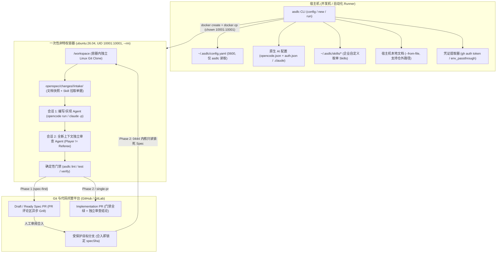

# Autonomous Container Pipeline & Global Governance Design
# 全自动容器流水线与全局治理架构方案

> **状态 (Status)**: Proposed Architecture & Implementation Blueprint  
> **目标版本 (Target Release)**: v1.7.x  
> **适用范围 (Scope)**: 全局配置控制面 (`asdlc config`)、双模式工作流切换 (`spec-first` | `auto`)、多源需求输入 (`intake`)、非特权全栈容器运行时 (`asdlc-runner`) 与状态驱动编排器 (`asdlc run`)

---

## 1. 背景与设计目标

在企业工程团队落地 Agentic SDLC 的过程中，既需要保留**人在需求澄清与关键审批上的决策权**，又需要将确定性门禁之后的重体力环节（Spec 初稿与独立审查、TDD 编码实现、独立代码审查、验收测试与提 PR）放到隔离环境中无人值守执行。当前版本存在三项主要工程瓶颈：

1. **单仓配置与分级心智负担重**：现有流程强依赖启发式 `L0–L3` 风险评估来决定走单 PR 还是双 PR，缺少机器级全局开关，无法在不侵入各业务仓 `.sdlc/policy.yaml` 的前提下统一锁定经典的「强制双 PR（`spec-first`）」灰度模式。
2. **输入源单一**：`asdlc new` 仅接受单条命令行字符串，尚不支持同时传入多份本地设计文档与多个外部需求单（Jira / Confluence / GitHub Issues）。
3. **缺少标准化无头隔离运行环境**：下游阶段依赖开发者的本地交互式 IDE 会话，缺少预装多语言编译环境与 AI 工具链的标准非 Root 容器镜像、零翻译损耗的多厂商模型登录透传，以及无 TTY 场景下的异步澄清机制。

### 核心设计原则
- **人工（IDE）与自动（Container）双轨完全兼容**：Git 分支、PR 状态与 `.openspec.yaml` 仍为唯一状态真相源。人在本地 IDE 与无头容器 `asdlc run --container` 调用的是同一批底层原语，任何阶段均可随时无缝交接。
- **职责解耦，拒绝重复造轮子**：`asdlc` 只管确定性流程门禁与容器编排；AI 模型配置 100% 透传底层 Agent（`opencode` / `claude`）原生配置；企业需求单系统通过可覆盖的 Skill 层接入，不在核心 CLI 硬编码第三方私有 SDK。
- **默认安全且零参数噪音**：非 Root 用户（`UID 10001`）、最小内核权限与实现阶段 Spec 文件内核级只读锁全部作为内部出厂默认基线，不向用户暴露底层安全开关。

---

## 2. 总体架构与交互流程

### 2.1 宿主机编排与隔离容器职责切分



### 2.2 端到端时序（含 Draft PR 评论区异步 Grill 闭环）

```mermaid
sequenceDiagram
  autonumber
  actor Dev as 开发者 / Tech Lead
  participant Host as 宿主机: asdlc run
  participant Box as 隔离容器 (UID 10001)
  participant AgentA as 会话 A (编写/实现)
  participant AgentR as 会话 B (独立审查)
  participant GitPR as GitHub / GitLab PR

  Dev->>Host: asdlc run --from-issue JIRA-345 --from-file ./prd.md --container
  Host->>Box: 创建非 root 容器 + docker cp 注入本地文件、config.yaml、原生 AI 配置与 Skills
  Box->>AgentA: 通过 Skill 拉取 JIRA-345 落盘 intake/，执行 asdlc new --no-grill 并起草 Spec
  alt 存在业务取舍或多文档冲突 ([OPEN] 未决问题)
    AgentA->>GitPR: 创建 Draft Spec PR (标签: asdlc:needs-clarification) 并在评论区发出 Q1..Qn
    Box-->>Host: 干净退出 (status: awaiting_clarification，零容器空转)
    Dev->>GitPR: 直接在 PR 评论区回复决策 (如 "Q1选A，其余按推荐")
    Dev->>Host: asdlc run <changeId> --container
    Host->>Box: 拉取该 PR 分支与最新 PR Comments
    Box->>AgentA: 解析人工回复，回填 clarifications.md 清零 [OPEN]，完善 Spec
  end
  Box->>AgentR: 启动全新进程执行 asdlc-spec-review (无共享对话历史)
  Box->>Box: 执行确定性门禁 asdlc lint <changeId> (强校验无遗留 [OPEN])
  Box->>GitPR: 推送并转为 Ready Spec PR (标签: asdlc:spec-review)，附上审查报告
  Box-->>Host: 销毁容器 (--rm)

  Dev->>GitPR: Tech Lead 审阅并 Merge Spec PR 到 main (锁定 specSha)
  Dev->>Host: asdlc run <changeId> --container
  Host->>Box: 克隆分支，将 proposal.md 与 specs/** 设为 0:0 (0444 内核只读)
  Box->>AgentA: 生成 tasks.md 并执行任务级 TDD 循环实现代码与测试
  Box->>AgentR: 启动全新进程执行 asdlc-impl-review + asdlc test 验收测试
  Box->>Box: 执行 asdlc verify <changeId> (12 项确定性门禁，含 spec-tamper)
  Box->>GitPR: 自动创建 Implementation PR (标签: asdlc:impl-review)
  Box-->>Host: 销毁容器 (--rm)
```

---

## 3. 全局配置控制面与双模式开关 (`asdlc config`)

### 3.1 全局配置与两档 `workflow_mode`
为消除逐个业务仓配置 `.sdlc/policy.yaml` 的负担，引入机器级全局配置 `~/.asdlc/config.yaml`（权限强制 `0600`），所有配置与凭证统一收敛至 `asdlc config` 子命令：

```bash
# 1. 工作流总开关：仅保留经典的强制双 PR 与现有智能分级两种模式
asdlc config set workflow_mode spec-first      # spec-first | auto

# 2. 容器与 Agent 编排参数（可选）
asdlc config set agent.harness opencode        # opencode (默认) | claude
asdlc config set agent.model ""                # 可选：覆盖默认编码模型 (-m provider/model)
asdlc config set agent.review_model ""         # 可选：独立审查会话使用的异构模型
asdlc config set runner.image ""               # 可选：企业内网私有镜像地址覆盖

# 3. 环境变量注入与透传（供企业自定义 Ticket Skills 使用）
asdlc config set env.JIRA_BASE_URL https://jira.corp.com
asdlc config set env.JIRA_API_TOKEN <TOKEN>
asdlc config set runner.env_passthrough "JIRA_*,CONFLUENCE_*"

# 4. 查询与管理（命中 *key/*token/*secret/*password 自动脱敏显示）
asdlc config list [--show-secrets] [--json]
asdlc config get workflow_mode
asdlc config unset env.JIRA_API_TOKEN
```

**两种模式的精确边界**（不单独暴露 `single-pr` 或 `risk_assessment`，风险分级为 `auto` 模式内生机制）：

| `workflow_mode` | 行为定义 |
| :--- | :--- |
| **`spec-first`**（经典强制双 PR） | **不运行 L0–L3 分级评估，不生成 `risk-history.jsonl` 防降级棘轮**。除 `fast_path` 纯文档变更外，所有变更统一严格执行：**Spec PR（`lint` + `spec-review` + 人工合入锁 `specSha`）→ Impl PR（`verify` + `impl-review`）**。适合初期灰度与强管控团队。 |
| **`auto`**（智能自适应分级） | **100% 保持现有机制**。运行内置三向量 L0–L3 风险评估与棘轮防降级：L0/L1 走单 PR（同时包含 Spec 与实现代码），L2/L3 走双 PR。 |

**配置优先级链（由高到低）**：
`CLI 参数` > `环境变量 ASDLC_*` > `单仓 .sdlc/policy.yaml（仅特例仓覆盖）` > **`全局 ~/.asdlc/config.yaml`** > `内置默认值`。

---

### 3.2 AI 引擎配置彻底解耦（75+ Vendor 零翻译直通）

`~/.asdlc/config.yaml` **仅供 `asdlc` CLI 自身读取**，容器内的 AI 工具链绝不解析该文件，也不由 `asdlc` 做厂商字段翻译：

- **`opencode`（默认内置）** 直接读取官方原生 `opencode.json` 与 `auth.json`（完整支持 75+ 模型供应商、AWS Bedrock、GCP Vertex、Azure、火山方舟 Ark、GitHub Copilot OAuth、自定义网关 Header 等全部特性）。
- **`claude`（同时预装可切）** 直接读取官方原生 `~/.claude/settings.json`。

提供三条零心智配置路径（优先级：`~/.asdlc/agent/<harness>/` 专属配置 > 宿主机原生全局配置）：
1. **自动继承宿主机已有配置（默认零操作）**：跨平台识别宿主机已配置好的 OpenCode（Windows `%USERPROFILE%\.config\opencode` / `%LOCALAPPDATA%\opencode`，macOS/Linux `~/.config/opencode` 与 `~/.local/share/opencode/auth.json`）或 Claude 配置，启动容器时通过 `docker cp`（`10001:10001`, `0600`）原样注入。
2. **交互式原生登录向导 `asdlc config login`**：即使宿主机未安装 `opencode`，该命令也会拉起临时交互容器直接运行原生 `opencode auth login`（支持 OAuth 设备码与全厂商列表），并将凭证持久化回宿主机 `~/.asdlc/agent/opencode/`。
3. **团队配置一键导入 `asdlc config agent --file ./team-opencode.json`**：平台团队可将配好内部网关与模型的标准 JSON 一键导入 `~/.asdlc/agent/opencode/opencode.json`，零字段阉割。

---

## 4. 多源需求输入（Intake）与两层 Skill 取单架构

### 4.1 多文件与多 Ticket 快照机制
在 `asdlc new` 与 `asdlc run` 上同时支持**可重复**的 `--from-file` 与 `--from-issue` 参数：

```bash
# 人工 IDE 模式
asdlc new "订单部分退款结算" --from-file ~/Downloads/prd.md --from-file ./api.yaml --from-issue JIRA-345

# 容器全自动模式
asdlc run --from-issue JIRA-345 --from-issue JIRA-346 --from-file ~/Downloads/prd.md --container
```

- **宿主机文件注入（`--from-file`）**：支持仓库外任意宿主机路径。宿主机先校验文件可读（不存在则快速失败报错 `INTAKE_FILE_NOT_FOUND`），在容器模式下通过 `docker cp` 拷入容器临时目录，最终统一归档为 `openspec/changes/<id>/intake/files/<NN>-<filename>` 快照并计算 SHA-256。
- **清单索引（`intake/index.yaml`）**：记录每个文件与需求单的原始引用、快照路径、SHA-256 与抓取状态，保证需求原文后续被外部修改时，本次变更仍可追溯复现。

### 4.2 两层 Skill 取单架构（核心零私有 SDK 耦合）
企业内部的 Jira、Confluence、飞书文档在鉴权网关、自定义验收字段（如 `customfield_xxx`）以及「Jira 描述里跳转关联 Confluence 页面」等场景差异极大。因此不在 `asdlc` Node 核心写死第三方 SDK，而是采用**两层 Skill 机制**：

1. **第一优先级：企业自有 Skills（`~/.asdlc/skills/`）**：
   - 企业可将内部定制的取单 Skill 放入宿主机 `~/.asdlc/skills/`（或仓库 `.agents/skills/`），配合 `asdlc config set env.*` / `runner.env_passthrough` 注入内网凭证。
   - 容器启动时自动将 `~/.asdlc/skills/` 拷入容器并覆盖同名内置 Skill，零代码侵入对接企业内网。
2. **第二优先级：内置标准 `asdlc-intake` Skill（开箱兜底）**：
   - 包内自带 `assets/skills/asdlc-intake/SKILL.md`，覆盖主流 **GitHub Issues / Projects、标准 Jira (Cloud/DC)、Confluence 页面、Linear**。
   - Agent 按 Skill 协议拉取单据正文及关联文档落盘至 `openspec/changes/<id>/intake/issues/`，所有外部拉取内容强制包裹不可信数据围栏（Untrusted Data Fence），防范需求单正文中的 Prompt Injection。

---

## 5. 官方全栈容器镜像与非 Root 安全基线

### 5.1 双层全栈镜像架构（基于 `ubuntu:26.04` LTS）
为确保主流语言项目在容器内可直接编译与运行测试，同时保持每次发版秒级构建，采用双层镜像设计：

1. **底座镜像 `ghcr.io/akjamie/asdlc-base:2026.xx`（`docker/Dockerfile.base`，低频按工具链更新）**：
   - 操作系统：**`ubuntu:26.04` LTS**（多架构 `linux/amd64` + `linux/arm64`）。
   - 预装编译与运行环境：Node.js 22 LTS (`npm`/`pnpm`/`yarn`)、Python 3.12 (`uv`/`pip`/`pytest` 及预编译 `tree-sitter`)、OpenJDK 21 LTS (`maven`/`gradle`)、Go 1.24+、Rust (`cargo`)、C/C++ (`build-essential`/`gcc`/`g++`/`cmake`/`pkg-config`)。
   - 预装基础工具：`git`、`gh`、`glab`、`ripgrep`、`jq`、`curl`。
2. **运行镜像 `ghcr.io/akjamie/asdlc-runner:<pkg.version>`（`docker/Dockerfile.runner`，随版本同步发布）**：
   - 预装同版本 `@akjamie/agentic-sdlc`、`openspec`、`graphifyy` 及全套全局 `.agents/skills`。
   - 预装无头 AI CLI：**`opencode`**（默认）与 **`claude`**（Claude Code）。

### 5.2 版本强绑定与发布管理
- **版本精确对齐**：CLI 默认拉取 `ghcr.io/akjamie/asdlc-runner:${pkg.version}`（绝不使用裸 `:latest`，防止宿主机 CLI 与容器内门禁版本漂移）；支持通过 `asdlc config set runner.image <registry/image:tag>` 指向企业内网镜像库。
- **CI 自动同发**：扩展现有 `.github/workflows/release.yml`（已具备 `packages: write` 权限），在 `npm publish` 同一流水线自动构建推送对应版本的 `asdlc-runner` 镜像；`asdlc upgrade` 在检测到本机安装了 Docker 时自动同步拉取对应版本镜像。

### 5.3 内部默认非 Root 安全基线（不暴露底层安全参数）
容器安全策略作为内部硬编码出厂基线强制生效，不在 CLI 暴露降级开关：
- **严禁 Root 运行**：镜像内建无特权用户 `agent`（`UID 10001:10001`，不安装 `sudo`），运行时强制附加 `--user 10001:10001`、`--cap-drop=ALL`、`--security-opt=no-new-privileges:true`、`--pids-limit=512` 与 `--rm`（同时也满足 `claude -p --dangerously-skip-permissions` 禁止 UID 0 启动的安全要求）。
- **不挂载宿主机工作区或 `~/.ssh`**：容器在内部原生 Linux 文件系统 `/workspace` 独立克隆代码（避免污染本地未提交修改，也彻底规避 Windows NTFS 挂载性能退化与 CRLF 换行符问题）；Git 与 PR 鉴权由宿主机内存提取 `gh auth token` 注入临时环境变量并执行 `gh auth setup-git`。
- **实现阶段内核级只读锁死 Spec**：在进入 Phase 2（`READY_FOR_IMPL`）时，容器内的 `openspec/changes/<id>/proposal.md` 与 `openspec/changes/<id>/specs/**` 归属设为 `0:0`、权限设为 `0444`，使 `UID 10001` 从操作系统文件权限层无法修改或 `chmod` 已批准的 Spec，配合 `asdlc verify` 的 `spec-tamper` 形成双保险。

---

## 6. 状态驱动编排器 (`asdlc run`) 与质量闭环

### 6.1 状态自动路由表
用户无需拼接嵌套命令字符串，只需执行两条直观命令：
- 启动新需求：`asdlc run [requirement] [--from-issue <ref>...] [--from-file <path>...] --container`
- 推进/续跑已有变更：`asdlc run <changeId> --container`

`asdlc run` 根据 Git 分支与目标分支合入状态自动路由：

| 检测到的当前状态 | `workflow_mode: spec-first`（强制双 PR） | `workflow_mode: auto`（L0/L1 单 PR） | `workflow_mode: auto`（L2/L3 双 PR） |
| :--- | :--- | :--- | :--- |
| **1. 全新需求启动** | 起草 Spec → 若有 `[OPEN]` 则开 Draft PR 评论提问并退出；否则新会话跑 `spec-review` → `lint` → 开 Ready Spec PR 并退出等人工合入 | 起草 Spec + TDD 写实现与测试 → 新会话跑独立审查 → `lint` + `verify` → 开 1 个含 Spec+Impl 的单 PR | 同左（`spec-first`） |
| **2. Draft Spec PR (`asdlc:needs-clarification`)** | 读取 PR 最新人工回复 → 清零 `clarifications.md` 中 `[OPEN]` → 完善 Spec → 新会话 `spec-review` → `lint` → 转为 Ready Spec PR | 读取回复补完 Spec 与代码 → `verify` → 转为 Ready PR | 同左（`spec-first`） |
| **3. 未合入 Spec PR 缺独立审查** | 启动全新会话补跑 `asdlc-spec-review` 并回写 PR 评论 | N/A | 启动全新会话补跑 `asdlc-spec-review` |
| **4. Spec 已合入目标分支（`specSha` 已锁定）** | `0444` 只读锁死 Spec → 生成 `tasks.md` + TDD 实现 → 新会话跑 `impl-review` + `asdlc test` → `verify` → 开 Impl PR | 单 PR 已一步完成 | 同左（`spec-first`） |

### 6.2 关键治理不变量补强
1. **角色与会话严格隔离（`Player != Referee`）**：容器内编写/实现会话与 `spec-review`/`impl-review` 审查会话必须作为两个完全独立的无状态进程启动，禁止共享会话 ID 或对话上下文；审查修复循环最多 **3 轮**，超限立即中止并输出诊断报告。
2. **`[OPEN]` 未决问题确定性门禁**：在 `asdlc lint` 中新增确定性检查——只要 `clarifications.md` 的 `## Open questions` 非空或包含 `[OPEN]` 标记，禁止创建或转为 Ready Spec PR。
3. **真实审查溯源（修复 `approve.js` 硬编码文案）**：修正 `src/commands/approve.js` 在缺少 `review.md` 时生成伪造人工六维全 PASS 记录的行为，如实记录实际合入 Commit SHA 与审批来源。

---

## 7. 分阶段落地路线图

为控制每次变更半径并保持主干随时可发布，分 3 个独立迭代推进：

| 迭代 | 交付范围 | 核心验证指标 |
| :--- | :--- | :--- |
| **Iteration 1：全局控制面、多源 Intake 与门禁补强** | 1. `src/commands/config.js` 与 `src/lib/global-config.js`（`~/.asdlc/config.yaml`、`0600` 权限、脱敏、`login`/`agent` 配置管理）<br>2. `workflow_mode: spec-first \| auto` 贯通 `new`、`lint`、`apply`、`pr`、`verify`、`status`<br>3. `asdlc new` 多源 `--from-file` / `--from-issue`、`intake/index.yaml` 与内置 `asdlc-intake` Skill<br>4. `lint` 未决 `[OPEN]` 门禁与 `approve.js` 真实溯源修复 | 存量单测 100% 绿灯；新增 `global-config`、`workflow-mode`、`intake`、`clarification-lint` 单测覆盖全部边界 |
| **Iteration 2：官方 `ubuntu:26.04` 非 Root 镜像与发布流水线** | 1. `docker/Dockerfile.base`（`ubuntu:26.04` 多语言编译链）与 `docker/Dockerfile.runner`（`UID 10001:10001`、预装 `opencode` + `claude` + `asdlc` + `skills`）<br>2. `.github/workflows/release.yml` 集成 GHCR 同版本自动构建推送<br>3. `asdlc upgrade` 联动拉取匹配版本镜像 | 容器以 `10001:10001` 启动并通过 `--cap-drop=ALL` 校验；Node/Python/Java/Go/Rust 及 `opencode`/`claude`/`asdlc` 版本自检通过 |
| **Iteration 3：`asdlc run` 状态机与 PR 异步 Grill 闭环** | 1. `src/commands/run.js` 与 `src/lib/container.js`（`docker cp` 注入、`gh auth token` 提取、`0444` Spec 只读锁）<br>2. 编写与审查双进程独立会话隔离及 3 轮收敛控制<br>3. `asdlc:needs-clarification` Draft PR 评论区问答抓取与自动转 Ready 闭环 | 端到端状态机集成测试覆盖：新需求直出 Spec PR、Draft PR 评论问答续跑、合入后自动产出 Impl PR 及 `auto` 模式单 PR 路径 |

