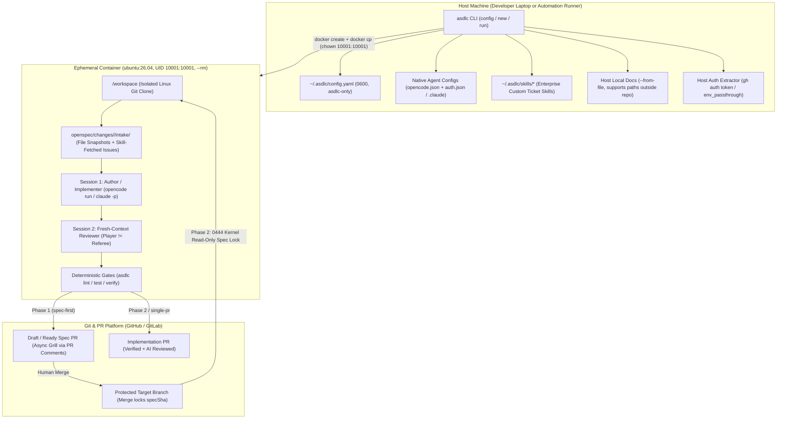

# Autonomous Container Pipeline & Global Governance Solution Proposal
# 全自动容器流水线与全局治理架构方案

> **Bilingual Solution Proposal (Pre-Implementation RFC) / 中英文双语架构方案（待实施设计稿）**  
> **Status / 状态**: Proposed Solution — Not Yet Implemented / 方案设计稿（尚未进入代码实现）  
> **Scope / 范围**: Global configuration (`asdlc config`), dual-mode governance switch (`spec-first` | `auto`), multi-source intake (`--from-file` / `--from-issue`), hardened non-root polyglot runner (`asdlc-runner`), and state-driven autonomous orchestrator (`asdlc run`).

---

## Table of Contents / 目录

- [English Solution Proposal](#english-solution-proposal)
  - [1. Problem Statement & Design Principles](#1-problem-statement--design-principles)
  - [2. End-to-End Architecture & Workflows](#2-end-to-end-architecture--workflows)
  - [3. Global Control Plane & Two-Mode Workflow Switch (`asdlc config`)](#3-global-control-plane--two-mode-workflow-switch-asdlc-config)
  - [4. Multi-Source Intake & Two-Tier Skill Resolution](#4-multi-source-intake--two-tier-skill-resolution)
  - [5. Official `ubuntu:26.04` LTS Image & Hardened Non-Root Baseline](#5-official-ubuntu2604-lts-image--hardened-non-root-baseline)
  - [6. State-Driven Orchestrator (`asdlc run`) & Async PR Grilling](#6-state-driven-orchestrator-asdlc-run--async-pr-grilling)
  - [7. Phased Implementation Roadmap](#7-phased-implementation-roadmap)
- [中文架构方案](#中文架构方案)
  - [1. 背景痛点与核心原则](#1-背景痛点与核心原则)
  - [2. 总体架构与交互流程](#2-总体架构与交互流程)
  - [3. 全局配置控制面与双模式开关 (`asdlc config`)](#3-全局配置控制面与双模式开关-asdlc-config)
  - [4. 多源需求输入（Intake）与两层 Skill 取单架构](#4-多源需求输入intake与两层-skill-取单架构)
  - [5. 官方 `ubuntu:26.04` LTS 全栈镜像与非 Root 安全基线](#5-官方-ubuntu2604-lts-全栈镜像与非-root-安全基线)
  - [6. 状态驱动编排器 (`asdlc run`) 与 Draft PR 异步 Grill 闭环](#6-状态驱动编排器-asdlc-run-与-draft-pr-异步-grill-闭环)
  - [7. 分阶段落地路线图](#7-分阶段落地路线图)

---

# English Solution Proposal

## 1. Problem Statement & Design Principles

Enterprise engineering teams adopting Agentic SDLC need **human judgment on requirement clarification and merge approvals**, while executing deterministic downstream work—spec drafting, independent spec review, TDD implementation, independent implementation review, acceptance testing, and PR creation—unattended inside an isolated runtime. Three practical bottlenecks currently stand in the way:

1. **Per-repository configuration & classification friction**: Workflow routing (`single-pr` vs `spec-first`) is coupled to the heuristic `L0–L3` risk engine without a machine-global switch, making it difficult to enforce predictable classic dual-PR (`spec-first`) governance across repositories without editing `.sdlc/policy.yaml` in every repo.
2. **Single-string requirement intake**: `asdlc new` accepts only a single inline requirement string rather than multiple local design documents and multiple external tickets (Jira, Confluence, GitHub Issues).
3. **Lack of a standardized headless container runtime**: Downstream stages rely on an interactive local IDE session rather than an official polyglot non-root container image with zero-translation multi-vendor LLM auth passthrough and non-TTY asynchronous clarification.

### Core Design Principles
- **Seamless Coexistence of Manual (IDE) and Autonomous (Container) Modes**: Git commits, PR state, and `.openspec.yaml` remain the single source of truth. Interactive IDE sessions and `asdlc run --container` invoke the exact same CLI primitives and can hand off work at any stage.
- **Strict Separation of Concerns (Zero Vendor Schema Translation)**: `~/.asdlc/config.yaml` is read exclusively by `asdlc`; built-in headless AI agents (`opencode` and `claude`) consume their native configuration files (`opencode.json` + `auth.json` across 75+ providers, or `.claude/settings.json`); enterprise issue trackers plug in via overrideable Skills rather than hardcoded proprietary SDKs in `asdlc` core.
- **Secure by Default, Minimal CLI Surface**: Non-root execution (`UID 10001:10001`), dropped Linux capabilities, and kernel-enforced read-only locks (`0444`) on approved specs during implementation are enforced internally as factory defaults without exposing low-level Docker flags on the CLI.

---

## 2. End-to-End Architecture & Workflows

### 2.1 Host Orchestrator vs. Ephemeral Non-Root Container Split



### 2.2 Autonomous Execution Lifecycle (Including Async PR Comment Grilling)

```mermaid
sequenceDiagram
  autonumber
  actor Dev as Developer / Tech Lead
  participant Host as Host: asdlc run
  participant Box as Container (UID 10001)
  participant AgentA as Session A (Author/Impl)
  participant AgentR as Session B (Fresh Reviewer)
  participant GitPR as GitHub / GitLab PR

  Dev->>Host: asdlc run --from-issue JIRA-345 --from-file ./prd.md --container
  Host->>Box: Create non-root container + docker cp intake files, config.yaml, native AI config & skills
  Box->>AgentA: Resolve JIRA-345 via skill -> intake/, run asdlc new --no-grill, draft spec
  alt Unresolved business ambiguity or conflicting docs ([OPEN] questions)
    AgentA->>GitPR: Open Draft Spec PR (label: asdlc:needs-clarification) + post Q1..Qn comment
    Box-->>Host: Exit cleanly (status: awaiting_clarification, zero idle container)
    Dev->>GitPR: Reply to Q1..Qn directly in PR comments
    Dev->>Host: asdlc run <changeId> --container
    Host->>Box: Pull PR branch + latest PR comments
    Box->>AgentA: Ingest human replies, clear [OPEN] in clarifications.md, finalize Spec
  end
  Box->>AgentR: Spawn fresh process for asdlc-spec-review (zero shared history)
  Box->>Box: Run deterministic gate: asdlc lint <changeId> (blocks if any [OPEN] remains)
  Box->>GitPR: Push & mark Ready Spec PR (label: asdlc:spec-review) + attach review summary
  Box-->>Host: Destroy container (--rm)

  Dev->>GitPR: Review & Merge Spec PR into main (locks specSha)
  Dev->>Host: asdlc run <changeId> --container
  Host->>Box: Clone branch, lock proposal.md & specs/** as 0:0 (0444 read-only)
  Box->>AgentA: Author tasks.md + execute task-level TDD loop
  Box->>AgentR: Spawn fresh process for asdlc-impl-review + asdlc test
  Box->>Box: Run asdlc verify <changeId> (all deterministic gates incl. spec-tamper)
  Box->>GitPR: Open Implementation PR (label: asdlc:impl-review)
  Box-->>Host: Destroy container (--rm)
```

---

## 3. Global Control Plane & Two-Mode Workflow Switch (`asdlc config`)

### 3.1 Dual-Interface Control Plane: Interactive Wizard (`asdlc config`) + Scriptable CLI

To avoid the cognitive burden of memorizing dozens of dot-paths while maintaining full CI/scripting compatibility, `asdlc config` provides two complementary interfaces:

#### 1. Interactive Terminal Setup Wizard (`asdlc config` with zero arguments)
Running `asdlc config` without arguments launches an interactive, modular terminal wizard with **early-exit support at every step** (`[Save & Exit]` or `Esc`):

```text
=== Agentic SDLC Global Configuration Wizard ===
Press [Ctrl+C] or choose 'Save & Exit' at any time to finish.

? What would you like to configure? (Use arrow keys)
❯ 1. Workflow Mode (Current: spec-first)
  2. AI Model & Harness (Current: Inherit Host OpenCode)
  3. Git & Pull Request Auth (Current: GitHub via gh CLI)
  4. Issue Tracker Integration (Jira / Confluence)
  ---------------------------------------------------------
  [ Save & Exit ]
```

- **Smart Auto-Detection**:
  - Automatically checks if `gh` is installed and logged in -> Displays `✓ GitHub: Inherited from host 'gh' CLI (user: akjamie)`.
  - Automatically checks if OpenCode is present on the host -> Displays `✓ AI: Found host OpenCode config (~/.config/opencode/opencode.json)`.
- **Modular Sections & Easy Skip**:
  - **Section 1: Workflow Mode** — Pick between `● spec-first (Recommended for new teams: Mandatory Spec PR -> Merge -> Impl PR)` and `○ auto (Adaptive: L0/L1 Single-PR, L2/L3 Dual-PR)`.
  - **Section 2: AI Harness & Model Override** — Options to keep host OpenCode, specify a container-only model override (e.g. `doubao-seed-code`), enter an API key, or import a JSON file.
  - **Section 3: Git & PR Credentials** — Option to inherit host `gh` or provide a custom PAT.
  - **Section 4: External Issue Trackers (Optional)** — Prompt to enter Jira / Confluence base URLs and tokens, or choose `● Skip for now (Configure later or use local files only)`. Token inputs are masked on screen.
- **Atomic Persistence**: On choosing `[Save & Exit]`, updates are written atomically to `~/.asdlc/config.yaml` with mode `0600`.

#### 2. Non-Interactive Scriptable CLI (For CI/CD and Power Users)
For headless automation, scripts, and granular inspection, standard subcommands remain fully available:

```bash
# 1. Global workflow switch: strictly two supported modes
asdlc config set workflow_mode spec-first      # spec-first | auto

# 2. Optional agent & runner orchestration settings
asdlc config set agent.harness opencode        # opencode (default) | claude
asdlc config set agent.model ""                # optional override (-m provider/model)
asdlc config set agent.review_model ""         # optional heterogeneous reviewer model
asdlc config set runner.image ""               # optional internal registry mirror override

# 3. Generic env injection & passthrough for enterprise custom skills
asdlc config set env.JIRA_BASE_URL https://jira.corp.com
asdlc config set env.JIRA_API_TOKEN <TOKEN>
asdlc config set runner.env_passthrough "JIRA_*,CONFLUENCE_*"

# 4. Inspection (keys matching *key/*token/*secret/*password are masked by default)
asdlc config list [--show-secrets] [--json]
asdlc config get workflow_mode
asdlc config unset env.JIRA_API_TOKEN
```

**Exact Boundary of the Two Workflow Modes** (`single-pr` and `risk_assessment` are not exposed as separate global toggles; risk classification belongs exclusively to `auto` mode):

| `workflow_mode` | Governance Behavior |
| :--- | :--- |
| **`spec-first`** (Classic Mandatory Dual-PR) | **Skips L0–L3 risk classification and `risk-history.jsonl` ratchets.** Every change (outside `fast_path` pure documentation) follows the deterministic two-PR pipeline: **Spec PR (`lint` + `spec-review` + human merge locking `specSha`) → Impl PR (`verify` + `impl-review`)**. Recommended for initial team rollouts. |
| **`auto`** (Adaptive Risk-Tiered) | **100% preserves current behavior.** Runs the three-vector L0–L3 risk assessment and anti-downgrade ratchet: L0/L1 changes route to `single-pr` (co-locating spec and implementation in one PR), while L2/L3 changes route to `spec-first`. |

**Precedence Chain (Highest → Lowest)**:
`CLI Flags` > `Environment Variables (ASDLC_*)` > `Repo .sdlc/policy.yaml (optional override)` > **`Global ~/.asdlc/config.yaml`** > `Built-in Default`.

### 3.2 Enterprise & User-Grade AI Configuration Strategy (Zero Schema Loss)

`~/.asdlc/config.yaml` is **never parsed directly by the built-in AI harness**. Instead, the system treats AI configuration with an industry-grade **Immutable File Selection + CLI Flag Override model** (avoiding fragile JSON deep-merging):

1. **How Configuration Files Are Selected (Zero Deep-Merge)**:
   - In production, deep-merging multi-vendor JSON configurations can overwrite mutual provider options, break custom headers, or corrupt array structures.
   - **Resolution Policy**: `asdlc` selects the base configuration file as a **whole atomic unit** (no partial field stitching):
     - **Primary Base**: `~/.asdlc/agent/opencode/opencode.json` (if the user or team imported an explicit container template via `asdlc config agent --file`).
     - **Fallback Base**: The developer's native host configuration `%USERPROFILE%\.config\opencode\opencode.json` (Windows) or `~/.config/opencode/opencode.json` (macOS/Linux) and matching `auth.json`.
     - **Fallback Zero-State**: If neither exists, `asdlc` writes a minimal valid single-provider configuration generated from `asdlc config set agent.provider` and `agent.api_key`.

2. **How Container-Specific Models Are Overridden (Runtime CLI Flag `-m`)**:
   - If a developer uses `anthropic/claude-sonnet-4-5` on their host but wants the container pipeline to run a dedicated model (e.g. `doubao-seed-code` or an internal high-throughput endpoint), **`asdlc` never mutates the underlying `opencode.json` file**.
   - Instead, setting `asdlc config set agent.model <model>` passes the override directly to the OpenCode invocation via its official runtime argument:
     ```bash
     opencode run -m "provider/model" "<prompt>"
     ```
   - According to OpenCode specifications, CLI `-m <provider/model>` naturally takes precedence over the `"model"` property in `opencode.json`.
   - **Heterogeneous Review Model**: Independent reviews similarly execute in a separate process using `opencode run -m <agent.review_model> "<prompt>"`.
   - **Result**: Complete multi-provider settings, proxies, and custom headers are preserved 100% intact from the base configuration, while the active model is cleanly overridden for container execution without touching host files.

3. **Pure Data-Driven Staging via Standard Bridge Network (No `--net=host` Dependency)**:
   - Corporate CIS benchmarks and container runtimes (such as Docker Desktop on Windows/macOS with WSL2/Hyper-V) restrict or disable `--net=host`.
   - The orchestrator completely avoids running interactive browser-based login containers. All credential assembly happens locally in host Node.js process memory.
   - Credentials (`auth.json`) and configuration (`opencode.json`) are injected via `docker cp` directly into the container's `/home/agent/.local/share/opencode/auth.json` and `/home/agent/.config/opencode/opencode.json` with strict mode `0600` and ownership `10001:10001`.
   - The container operates on a standard isolated Docker bridge network, fully compliant with enterprise bastion and container security policies.

4. **Supported Onboarding Modes**:
   - **Mode A: Seamless Host Inheritance**: Automatically discovers host `%USERPROFILE%\.config\opencode\opencode.json` (Windows) or `~/.config/opencode/opencode.json` (macOS/Linux) and matching `auth.json`, copying them into the container without manual steps.
   - **Mode B: Key-Based CLI Quickset**:
     ```bash
     asdlc config set agent.provider "anthropic"
     asdlc config set agent.api_key "sk-ant-xxx"
     asdlc config set agent.base_url "https://api.corp.com/v1" # optional private gateway
     ```
     Host `asdlc run` formats standard `opencode.json` and `auth.json` in memory and pushes them into the container.
   - **Mode C: Enterprise Standard Template Import**:
     ```bash
     asdlc config agent --file ./enterprise-opencode.json
     ```
     Stores the team-vetted JSON verbatim under `~/.asdlc/agent/opencode/opencode.json`, overriding host local defaults for all container runs.

---

## 4. Multi-Source Intake & Two-Tier Skill Resolution

### 4.1 Repeatable `--from-file` and `--from-issue` Snapshotting
Both `asdlc new` and `asdlc run` accept repeatable `--from-file` and `--from-issue` arguments:

```bash
# Interactive IDE workflow
asdlc new "Partial order refund settlement" --from-file ~/Downloads/prd.md --from-file ./api.yaml --from-issue JIRA-345

# Autonomous container workflow
asdlc run --from-issue JIRA-345 --from-issue JIRA-346 --from-file ~/Downloads/prd.md --container
```

- **Host File Staging (`--from-file`)**: Supports arbitrary host paths outside the repository. Validated on the host (failing fast with `INTAKE_FILE_NOT_FOUND` if missing), copied into the container via `docker cp`, and snapshotted under `openspec/changes/<id>/intake/files/<NN>-<filename>` with SHA-256 digests in `intake/index.yaml`.
- **Two-Tier Skill Ticket Resolution (`--from-issue`)**: Because enterprise trackers vary widely in SSO gateways, custom acceptance criteria fields (`customfield_xxx`), and linked Confluence/wiki pages, `asdlc` core avoids hardcoded tracker SDKs:
  1. **Tier 1 — Enterprise Custom Skills (`~/.asdlc/skills/`)**: Automatically copied into the container and prioritized over bundled skills, paired with `env.*` / `runner.env_passthrough`.
  2. **Tier 2 — Bundled `asdlc-intake` Skill (Fallback)**: Ships `assets/skills/asdlc-intake/SKILL.md` supporting GitHub Issues/Projects, standard Jira (Cloud/DC), and Confluence pages. All fetched external text is wrapped in untrusted-data fences to mitigate prompt injection.

---

## 5. Official `ubuntu:26.04` LTS Image & Hardened Non-Root Baseline

### 5.1 Two-Layer Polyglot Runner Image
1. **Base Layer `ghcr.io/akjamie/asdlc-base:2026.xx` (`docker/Dockerfile.base`, rebuilt on toolchain updates)**:
   - OS: **`ubuntu:26.04` LTS** (`linux/amd64` + `linux/arm64`).
   - Toolchains: Node.js 22 LTS (`npm`/`pnpm`/`yarn`), Python 3.12 (`uv`/`pip`/`pytest` + prebuilt `tree-sitter`), OpenJDK 21 LTS (`maven`/`gradle`), Go 1.24+, Rust (`cargo`), C/C++ (`build-essential`/`gcc`/`g++`/`cmake`/`pkg-config`), `git`, `gh`, `glab`, `ripgrep`, `jq`, `curl`.
2. **Runner Layer `ghcr.io/akjamie/asdlc-runner:<pkg.version>` (`docker/Dockerfile.runner`, co-published per release)**:
   - Pre-installs version-matched `@akjamie/agentic-sdlc`, `openspec`, `graphifyy`, global `.agents/skills`, **`opencode`** (default), and **`claude`**.
   - **Version Pinning & CI Release**: `asdlc` defaults to `ghcr.io/akjamie/asdlc-runner:${pkg.version}` (never bare `:latest`), built and pushed automatically in `.github/workflows/release.yml` alongside `npm publish`, and synced on `asdlc upgrade`.

### 5.2 Internal Non-Exposed Security Baseline
Enforced internally on every container launch without exposing CLI flags to weaken them:
- **Strict Non-Root Execution**: Dedicated unprivileged user `agent` (`UID 10001:10001`, no `sudo`), `--user 10001:10001`, `--cap-drop=ALL`, `--security-opt=no-new-privileges:true`, `--pids-limit=512`, and `--rm` (also satisfying `claude -p --dangerously-skip-permissions`, which rejects `UID 0`).
- **Isolated `/workspace` Clone (No Host Repo `-v` Mount)**: Clones into container-native Linux `/workspace` to avoid host workspace pollution, Windows NTFS mount slowdowns, and CRLF issues; Git/PR auth uses ephemeral `gh auth token` extraction from the host + `gh auth setup-git`.
- **Kernel-Level Read-Only Spec Lock (`0444`)**: During Phase 2 (`READY_FOR_IMPL`), `proposal.md` and `specs/**` are owned by `0:0` with mode `0444`, blocking unauthorized writes at the OS filesystem layer alongside `asdlc verify`'s `spec-tamper` check.

---

## 6. State-Driven Orchestrator (`asdlc run`) & Async PR Grilling

### 6.1 Deterministic State Routing
- New change: `asdlc run [requirement] [--from-issue <ref>...] [--from-file <path>...] --container`
- Advance/resume change: `asdlc run <changeId> --container`

| Detected State | `workflow_mode: spec-first` (Mandatory Dual-PR) | `workflow_mode: auto` (L0/L1 Single-PR) | `workflow_mode: auto` (L2/L3 Dual-PR) |
| :--- | :--- | :--- | :--- |
| **1. New Change** | Draft Spec → If `[OPEN]`: Draft PR + comment & exit; Else: fresh `spec-review` → `lint` → Ready Spec PR & stop for merge | Draft Spec + TDD Impl → fresh review → `lint` + `verify` → open 1 Single PR (Spec + Impl) | Same as `spec-first` |
| **2. Draft Spec PR (`asdlc:needs-clarification`)** | Read human PR comment replies → clear `[OPEN]` → finalize Spec → fresh `spec-review` → `lint` → mark PR Ready | Read replies → finish Spec + Impl → `verify` → mark PR Ready | Same as `spec-first` |
| **3. Open Spec PR missing review** | Spawn fresh session for `asdlc-spec-review` & post PR comment | N/A | Spawn fresh session for `asdlc-spec-review` |
| **4. Spec Merged on Target Branch (`specSha` locked)** | Lock Spec `0444` → author `tasks.md` + TDD Impl → fresh `impl-review` + `asdlc test` → `verify` → open Impl PR | Completed in Single PR | Same as `spec-first` |

### 6.2 Governance Hardening
1. **`Player != Referee` Process Isolation**: Author/Implementer and Reviewer always execute as separate fresh processes with zero shared transcript, bounded by a **3-round** convergence cap.
2. **Deterministic `[OPEN]` Clarification Gate**: `asdlc lint` blocks Ready Spec PRs whenever `clarifications.md` has non-empty `## Open questions` or `[OPEN]` markers.
3. **Truthful Approval Provenance**: Updates `src/commands/approve.js` so `review.md` records actual merge SHA and approver provenance rather than synthetic six-dimension human PASS scores when no prior `review.md` exists.

---

## 7. Phased Implementation Roadmap

| Iteration | Scope | Verification Gate |
| :--- | :--- | :--- |
| **Iteration 1: Global Config, Multi-Source Intake & Lint Gates** | 1. `asdlc config` (`~/.asdlc/config.yaml`, `0600`, secret masking, `login`/`agent`)<br>2. `workflow_mode: spec-first \| auto` wired across `new`, `lint`, `apply`, `pr`, `verify`, `status`<br>3. Repeatable `--from-file` / `--from-issue`, `intake/index.yaml`, and bundled `asdlc-intake` skill<br>4. `[OPEN]` gate in `lint` and truthful provenance in `approve.js` | 100% existing tests green + unit/integration suites for `global-config`, `workflow-mode`, `intake`, and `clarification-lint` |
| **Iteration 2: Official `ubuntu:26.04` Non-Root Image & Release Pipeline** | 1. `docker/Dockerfile.base` & `docker/Dockerfile.runner` (`UID 10001:10001`, polyglot toolchains, `opencode` + `claude` + `asdlc` + `skills`)<br>2. Version-pinned GHCR build/push in `.github/workflows/release.yml`<br>3. Optional image sync in `asdlc upgrade` | Container runs as `10001:10001` with `--cap-drop=ALL`; polyglot compilers and `opencode`/`claude`/`asdlc` self-checks pass |
| **Iteration 3: `asdlc run` State Machine & Async PR Grilling** | 1. `src/commands/run.js` & `src/lib/container.js` (`docker cp` staging, `gh auth token`, `0444` Spec lock)<br>2. Dual-process `Player != Referee` isolation & 3-round cap<br>3. `asdlc:needs-clarification` Draft PR comment round-trip | End-to-end state-machine tests covering Spec PR creation, Draft PR comment Q&A resume, post-merge Impl PR, and `auto` Single-PR flow |

---
---

# 中文架构方案

## 1. 背景痛点与核心原则

在企业工程团队落地 Agentic SDLC 时，既需要保留**人在需求澄清与关键合入审批上的决策权**，又需要将确定性门禁之后的执行环节（Spec 起草与独立审查、TDD 编码实现、独立代码审查、验收测试与创建 PR）放入隔离运行环境中自动完成。当前存在三项核心瓶颈：

1. **单仓配置与分级心智负担重**：现有流程强绑定启发式 `L0–L3` 风险评估来决定单/双 PR，缺少机器级全局开关，无法在不修改每个业务仓 `.sdlc/policy.yaml` 的情况下统一锁定经典的「强制双 PR（`spec-first`）」模式。
2. **输入源单一**：`asdlc new` 仅支持单条文本参数，不支持同时传入多份本地文档与多个外部需求单（Jira / Confluence / GitHub Issues）。
3. **缺少标准化非特权全栈容器运行时**：下游环节依赖本地交互式 IDE 会话，缺少内置主流编译工具链与无头 AI 工具的官方非 Root 容器镜像、75+ 模型供应商零翻译登录透传，以及无终端交互下的异步澄清闭环。

### 核心设计原则
- **人工（IDE）与自动（Container）双轨完全兼容**：Git 分支、PR 状态与 `.openspec.yaml` 保持唯一状态真相源。本地 IDE 会话与 `asdlc run --container` 调用完全相同的底层命令，任何阶段均可随时人工接手或交回容器。
- **职责彻底解耦，零配置翻译损耗**：`~/.asdlc/config.yaml` 仅供 `asdlc` 自身读取；内置 AI（`opencode` / `claude`）100% 读取各自官方原生配置；外部需求单通过可覆盖的 Skill 层接入，不在核心 CLI 硬编码私有 SDK。
- **出厂默认安全，隐藏底层参数噪音**：非 Root 用户（`UID 10001:10001`）、剥离内核 Capability 与实现阶段 Spec 文件内核级只读锁（`0444`）全部作为内部默认安全基线，不在 CLI 暴露底层安全参数。

---

## 2. 总体架构与交互流程

*(架构组件图与异步 PR Grill 时序图见上方英文部分第 2 节图表，中英文共享同一套拓扑与状态流转设计。)*

核心职责切分：
- **宿主机（`asdlc run`）**：负责读取 `~/.asdlc/config.yaml`、校验并 `docker cp` 宿主机 `--from-file` 文档、跨平台提取宿主机已有原生 AI 凭证与 `gh auth token`、注入企业自定义 `~/.asdlc/skills/`，并管理一次性非特权容器生命周期。
- **隔离容器（`UID 10001:10001`）**：在容器原生 Linux `/workspace` 内独立克隆仓库，通过 Skill 拉取外部需求单落盘 `intake/`，以**两个完全独立的进程会话**分别执行「编写/实现」与「独立审查（`Player != Referee`）」，通过确定性门禁后推送分支并创建/更新 PR，退出即销毁（`--rm`）。

---

## 3. 全局配置控制面与双模式开关 (`asdlc config`)

### 3.1 双模控制面：交互式配置向导 (`asdlc config`) + 脚本化 CLI

为避免开发者记忆繁琐的命令行点分路径，同时保证 CI/CD 脚本的确定性调用，`asdlc config` 提供了两种互补交互模式：

#### 1. 终端交互式引导向导（无参数执行 `asdlc config`）
开发者直接输入 `asdlc config` 即启动交互式向导，支持**每一步随时按 `[Save & Exit]` 或 `Esc` 保存退出**：

```text
=== Agentic SDLC Global Configuration Wizard ===
Press [Ctrl+C] or choose 'Save & Exit' at any time to finish.

? What would you like to configure? (Use arrow keys)
❯ 1. Workflow Mode (Current: spec-first)
  2. AI Model & Harness (Current: Inherit Host OpenCode)
  3. Git & Pull Request Auth (Current: GitHub via gh CLI)
  4. Issue Tracker Integration (Jira / Confluence)
  ---------------------------------------------------------
  [ Save & Exit ]
```

- **宿主环境智能感知**：
  - 自动检测本地 `gh` CLI 登录态 -> 提示 `✓ GitHub: Inherited from host 'gh' CLI (user: akjamie)`，回车直接复用。
  - 自动检测本地 OpenCode 配置文件 -> 提示 `✓ AI: Found host OpenCode config (~/.config/opencode/opencode.json)`。
- **模块化步骤，选填项随时跳过**：
  - **模块 1：工作流模式** — 单选 `● spec-first (推荐新团队: 强制 Spec PR -> 人工合入 -> Impl PR)` 或 `○ auto (自适应分级)`。
  - **模块 2：AI 引擎与容器模型覆盖** — 可选直接复用宿主配置、为容器设置专属模型（如 `doubao-seed-code`）、快捷录入 API Key，或导入团队标准 JSON。
  - **模块 3：Git & PR 凭证** — 继承宿主 `gh` 或提供自定义 Token。
  - **模块 4：外部需求单配置（选填）** — 支持录入 Jira / Confluence URL 与 Token，或直接选择 `● 暂不配置 (后续配置或仅使用本地文件)`。敏感 Token 输入全程掩码打码。
- **原子化落盘**：随时选择 `[Save & Exit]`，配置以 `0600` 权限安全写入 `~/.asdlc/config.yaml`。

#### 2. 非交互脚本化 CLI（面向自动化脚本与 CI/CD）
针对无人值守部署与脚本编写，保留全部标准子命令：

引入机器级全局配置 `~/.asdlc/config.yaml`（权限强制 `0600`），所有配置项统一收敛至 `asdlc config`（不单设 `asdlc auth`；命中 `*key/*token/*secret/*password` 在 `list` 时自动脱敏）：

- **`workflow_mode` 仅保留两档**（不暴露单独的 `single-pr` 或 `risk_assessment`，风险分级是 `auto` 模式内生机制）：
  - **`spec-first`（经典强制双 PR）**：**完全跳过 L0–L3 分级评估与 `risk-history.jsonl` 防降级棘轮**。除 `fast_path` 纯文档变更外，所有变更统一执行：**Spec PR（`lint` + `spec-review` + 人工合入锁 `specSha`）→ Impl PR（`verify` + `impl-review`）**。
  - **`auto`（现有自适应分级）**：**100% 保持现有机制**。运行内置 L0–L3 风险评估与防降级校验，L0/L1 走单 PR（同时含 Spec 与代码），L2/L3 走双 PR。
- **优先级链**：`CLI 参数` > `环境变量 ASDLC_*` > `单仓 .sdlc/policy.yaml（仅特例覆盖）` > **`全局 ~/.asdlc/config.yaml`** > `内置默认值`。

### 3.2 行业级与用户级 AI 配置设计（整文件原子继承 + CLI 参数覆盖）

`~/.asdlc/config.yaml` **不给内置 AI 直接解析**。系统站在行业级平台规范与实际用户习惯的角度，设计了**整文件原子选择 + 运行时命令行参数覆盖模型（坚决杜绝脆弱的 JSON 深度拼积木）**：

1. **基础文件原子级选择（零 Deep Merge 隐患）**：
   - 在生产实践中，多厂商复杂 JSON 深度合并极易冲掉嵌套数组、覆盖同名但认证方式不同的 Provider。
   - **基础源确定策略**：宿主机将基础配置作为**不可变原子单元**选择（整份读取，不拆碎字段）：
     - **第一优先**：`~/.asdlc/agent/opencode/opencode.json`（若通过 `asdlc config agent --file` 导入过团队专属模板）。
     - **第二优先**：宿主机原生已有的 `%USERPROFILE%\.config\opencode\opencode.json`（Windows）或 `~/.config/opencode/opencode.json`（macOS/Linux）及对应的 `auth.json`。
     - **第三兜底**：两边均无时，由 `asdlc` 根据 `asdlc config set agent.provider` / `agent.api_key` 在内存生成一份最小合法配置。

2. **容器差异化模型覆盖：走官方原生 CLI 参数 `-m`（零文件修改）**：
   - 开发者本地日常习惯用 `anthropic/claude-sonnet-4-5`，但希望容器自动化流水线使用企业高吞吐模型 `doubao-seed-code`。
   - **实现机制**：`asdlc` **绝不去修改底层的 `opencode.json`**，而是将 `asdlc config set agent.model <model>` 直接转换为 OpenCode 官方命令行参数：
     ```bash
     opencode run -m "provider/model" "<prompt>"
     ```
   - **根据 OpenCode 官方规范**：命令行传入的 `-m <provider/model>` 优先级天然高于 `opencode.json` 里的 `"model"` 属性。
   - **异构独立审查模型**：审查阶段同样通过独立进程启动 `opencode run -m <agent.review_model> "<prompt>"`。
   - **收益**：底层复杂的 75+ 供应商连接、内网私有代理、自定义 Header 100% 完整继承，而活动模型被干净利落地在运行时单次覆盖，**绝不污染或篡改开发者宿主机的本地 OpenCode 配置文件**！

3. **纯数据流注入（零 `--net=host` 依赖，适配企业 CIS 合规）**：
   - 彻底废弃在容器内跑交互式网页登录的设计，避免因 `--net=host` 在企业堡垒机被禁用、或在 Windows/macOS WSL2 虚拟机网络下无法回调宿主机浏览器而导致死锁。
   - 认证数据全流程在宿主机内存组装，通过 `docker cp` 单向注入容器文件系统，权限锁定为 `10001:10001`、`0600`。容器运行在标准 Docker bridge 隔离网络下，完美符合企业 CIS 容器安全规范。

4. **三种接入模式**：
   - **模式 A（宿主机无缝继承）**：自动跨平台识别宿主机 `%USERPROFILE%\.config\opencode\opencode.json`（Windows）或 `~/.config/opencode/opencode.json`（macOS/Linux）及对应的 `auth.json`，直接注入容器使用。
   - **模式 B（命令行快速配置）**：
     ```bash
     asdlc config set agent.provider "anthropic"
     asdlc config set agent.api_key "sk-ant-xxx"
     asdlc config set agent.base_url "https://api.corp.com/v1" # 可选内部网关
     ```
     宿主机在内存中组装标准合法 JSON 并注入容器。
   - **模式 C（企业标准模板导入）**：
     ```bash
     asdlc config agent --file ./enterprise-opencode.json
     ```
     原封不动存入 `~/.asdlc/agent/opencode/opencode.json`，供所有容器流水线作为专属配置执行。

---

## 4. 多源需求输入（Intake）与两层 Skill 取单架构

1. **多文件与多单据快照**：`asdlc new` 与 `asdlc run` 均支持可重复的 `--from-file <path>`（支持宿主机仓外路径，`docker cp` 拷入容器）与 `--from-issue <ref>`，统一归档至 `openspec/changes/<id>/intake/` 并生成带 SHA-256 校验的 `intake/index.yaml`。
2. **两层 Skill 取单（核心零第三方 SDK 耦合）**：
   - **第一优先级（企业自定义 `~/.asdlc/skills/`）**：配合 `env.*` 与 `runner.env_passthrough` 注入内网凭证，容器启动时自动拷入并覆盖同名内置 Skill，灵活适配企业私有 Jira 字段与内网鉴权。
   - **第二优先级（内置 `asdlc-intake` 标准 Skill 兜底）**：自带标准取单指引，支持 GitHub Issues/Projects、Jira (Cloud/DC)、以及关联 Confluence 页面顺藤摸瓜读取，所有外部文本强制包裹不可信数据围栏防范 Prompt Injection。

---

## 5. 官方 `ubuntu:26.04` LTS 全栈镜像与非 Root 安全基线

1. **双层镜像与版本强绑定**：
   - **底层 `asdlc-base:2026.xx`**：基于最新 **`ubuntu:26.04` LTS**（`linux/amd64` + `linux/arm64`），预装 Node 22、Python 3.12 + `uv`（含预编译 `tree-sitter`）、JDK 21 (`maven`/`gradle`)、Go、Rust、C/C++ 编译链及 `git`/`gh`/`glab`/`ripgrep`/`jq`。
   - **上层 `asdlc-runner:<pkg.version>`**：预装同版本 `asdlc`、`openspec`、`graphifyy`、全局 `.agents/skills` 以及 **`opencode`（默认）** 和 **`claude`**。在 `.github/workflows/release.yml` 中随 npm 发版同步构建推送，默认精确锁定 `${pkg.version}` 标签（不用裸 `:latest`），`asdlc upgrade` 自动联动拉取。
2. **内部硬编码安全基线（不暴露降级开关）**：
   - 固定非特权用户 `agent`（`UID 10001:10001`，无 `sudo`），内部默认附加 `--user 10001:10001`、`--cap-drop=ALL`、`--security-opt=no-new-privileges:true`、`--pids-limit=512`、`--rm`。
   - 不 `-v` 挂载宿主机工作区或 `~/.ssh`；实现阶段将容器内 `proposal.md` 与 `specs/**` 置为 `0:0`（`0444` 只读），从内核层物理封锁篡改。

---

## 6. 状态驱动编排器 (`asdlc run`) 与 Draft PR 异步 Grill 闭环

1. **简洁状态驱动入口**：
   - 新需求启动：`asdlc run [requirement] [--from-issue <ref>...] [--from-file <path>...] --container`
   - 已有变更推进/续跑：`asdlc run <changeId> --container`
2. **Draft Spec PR 评论区异步问答闭环**：
   - 无头容器遇到必须人工拍板的业务分叉或多文档矛盾时，在 `clarifications.md` 记录带推荐方案的 `[OPEN]` 问题，自动创建带 `asdlc:needs-clarification` 标签的 **Draft Spec PR** 并在评论区发出问题后立即退出。
   - 人在 PR 评论区直接回复后，再次执行 `asdlc run <changeId> --container` 自动抓取评论清零 `[OPEN]`、执行独立会话 `spec-review` 与 `asdlc lint`（新增 `[OPEN]` 未清零强拦截门禁），并将 PR 转为 Ready for Review。
3. **独立会话隔离与真实审批溯源**：
   - 编写/实现与审查强制拆分为独立进程执行（`Player != Referee`），支持配置 `agent.review_model` 异构审查模型，修复循环上限 3 轮。
   - 修复 `approve.js` 在无 `review.md` 时生成硬编码人工全 PASS 模板的问题，如实记录合入 SHA 与审批来源。

---

## 7. 分阶段落地路线图

1. **Iteration 1（全局控制面、多源 Intake 与门禁补强）**：交付 `asdlc config`（`~/.asdlc/config.yaml`、`0600` 权限与脱敏、`login`/`agent`）、`workflow_mode: spec-first | auto` 全链路贯通、`asdlc new` 多源 `--from-file`/`--from-issue` 与内置 `asdlc-intake` Skill、`lint` 的 `[OPEN]` 阻塞门禁及 `approve.js` 溯源修正。
2. **Iteration 2（官方 `ubuntu:26.04` 非 Root 镜像与发布流水线）**：交付 `docker/Dockerfile.base` 与 `docker/Dockerfile.runner`（`UID 10001:10001`）、`release.yml` GHCR 同版本发布及 `asdlc upgrade` 镜像同步。
3. **Iteration 3（`asdlc run` 状态机与 PR 异步 Grill 闭环）**：交付 `src/commands/run.js` 与容器驱动（`docker cp`、`gh auth token`、`0444` Spec 只读锁）、双会话隔离审查与 Draft PR 评论问答续跑闭环。
