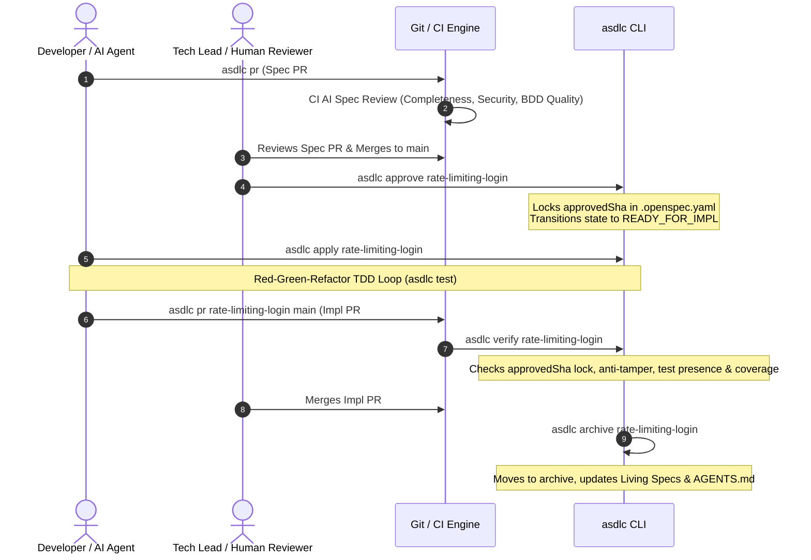

# Getting Started with Agentic SDLC (30-Minute Onboarding)

> **Welcome to Agentic SDLC (`asdlc`).**  
> This hands-on, zero-to-hero tutorial guides you through your very first spec-driven change in **30 minutes**.  
> You will install the CLI, initialize a repository, scaffold a feature, settle design decisions with AI grilling, validate the spec through deterministic quality gates, and open your first Spec PR.

---

## ⏱️ Timeline & Journey Overview

```
 [Min 0–5]               [Min 5–10]             [Min 10–15]             [Min 15–20]            [Min 20–25]            [Min 25–30]
 ┌───────────────┐       ┌───────────────┐      ┌───────────────┐       ┌──────────────┐       ┌──────────────┐       ┌──────────────┐
 │ Prerequisites │  ──▶  │  asdlc init   │ ──▶  │   asdlc new   │  ──▶  │  Grilling &  │  ──▶  │  asdlc lint  │  ──▶  │   asdlc pr   │
 │   & Doctor    │       │  Repository   │      │   Scaffold    │       │  Spec Design │       │ Quality Gate │       │   Spec PR    │
 └───────────────┘       └───────────────┘      └───────────────┘       └──────────────┘       └──────────────┘       └──────────────┘
```

| Phase | Time Window | Focus | Next Command |
|---|---|---|---|
| **Phase 0** | 00:00 – 05:00 | Environment health & global CLI installation | `asdlc init` |
| **Phase 1** | 05:00 – 10:00 | Initialize repository & configure governance | `asdlc new "<intent>"` |
| **Phase 2** | 10:00 – 15:00 | Scaffold change & extract codebase AST context | Conversational grilling |
| **Phase 3** | 15:00 – 20:00 | Settle design trade-offs & author BDD specs | `asdlc lint <ID>` |
| **Phase 4** | 20:00 – 25:00 | Enforce deterministic R0–R8 quality gates | `asdlc pr <ID> <target>` |
| **Phase 5** | 25:00 – 30:00 | Open Spec PR & navigate the lifecycle state | `asdlc status <ID>` |

---

## 🚀 Phase 0: Prerequisites & Installation (00:00 – 05:00)

### 1. Verify Prerequisites
Make sure your environment meets the minimum version requirements:
- **Node.js**: `>= 20.19.0` (check with `node -v`)
- **Git**: `>= 2.30.0` configured with `user.name` and `user.email`
- **Supported AI Agent**: Claude Code, Cursor, GitHub Copilot, Google Antigravity, OpenCode, Pi, Windsurf, or Gemini CLI.

### 2. Install `asdlc` Globally
Install the package via npm:

```bash
npm install -g @akjamie/agentic-sdlc
```

*(Alternatively, you can run any command on-demand using `npx @akjamie/agentic-sdlc <command>`)*.

### 3. Verify Health with `asdlc doctor`
Run the environment health probe:

```bash
asdlc doctor
```

**Expected Output:**
```text
  [PASS] node-version
        v20.19.0 (>= 20.19.0 required)
  [PASS] git
        git version 2.44.0
  [PASS] openspec
        @openspec/cli detected
  [PASS] git-repo
        active git repository confirmed
  [PASS] toolchain
        all governance binaries present

doctor: healthy (0 warnings, 0 errors)
```

> [!TIP]
> If any checks fail, run `asdlc doctor --fix` to automatically repair missing dependencies, configuration drifts, or Git hooks.

▶ **Next Command:** `asdlc init`

---

## 🛠️ Phase 1: Initialize Your Repository (05:00 – 10:00)

Navigate to your existing project root (or a fresh Git repo) and run `asdlc init`:

```bash
cd my-project
asdlc init
```

**Expected Output:**
```text
asdlc init: configuring repository for Agentic SDLC...
✓ initialized OpenSpec engine (.openspec/)
✓ generated governance policy (.sdlc/policy.yaml)
✓ compiled code knowledge graph (Graphify AST: 142 nodes, 318 edges)
✓ installed Git governance hooks (.githooks/)
✓ discovered AI tools: claude, cursor, antigravity, github-copilot
✓ deployed 18 bundled skills across detected tool roots
✓ installed 10 canonical slash commands (/asdlc-*)
✓ updated AGENTS.md system routing and architectural hubs

Initialization complete! Your repository is now governed by Agentic SDLC.
```

### What `asdlc init` Scaffolds:
1. **`.openspec/`**: The spec engine runtime managing change folders, versions, and schemas.
2. **`.sdlc/policy.yaml`**: The enterprise governance policy defining risk boundaries (L0–L3), required approvers, and lint rules.
3. **`AGENTS.md`**: The AI agent instruction contract that exposes system routing, stage entrypoints, and the repository's architectural hubs (god nodes).
4. **`.githooks/`**: Pre-commit and pre-push hooks preventing unverified code or modified locked specs from slipping into Git history.
5. **AI Tool Integration**: Automatically registers `/asdlc-*` slash commands in `.claude/`, `.cursor/`, `.github/prompts/`, `.agents/`, and other detected IDE folders.

▶ **Next Command:** `asdlc new "<your-requirement>"`

---

## 📝 Phase 2: Scaffold Your First Spec (10:00 – 15:00)

In Agentic SDLC, **every feature, bug fix, or refactor begins with natural language intent**.

Copy and paste this realistic production requirement:

```bash
asdlc new "Add sliding-window rate limiting to /api/auth/login endpoint in Redis"
```

**Expected Output:**
```text
asdlc: deriving change slug from intent...
✓ slug derived: rate-limiting-login
✓ querying codebase knowledge graph for relevant architectural hubs...
  - authController.js (inbound: 12, outbound: 8)
  - redisClient.js (inbound: 24, outbound: 3)
✓ created change directory: openspec/changes/rate-limiting-login/
✓ assigned governance level: L2 (Structural API/Security change -> Spec-First Dual-PR)
✓ scaffolded .openspec.yaml (stage: 1-new, level: L2)
✓ generated explore.md (architectural grounding & dependency context)
✓ seeded clarifications.md (decision frontier template)

[ASDLC PROTOCOL: IMMEDIATE ACTION REQUIRED FOR AGENT]
  ▶ Ground yourself in `explore.md` and research codebase facts first.
  ▶ Settle design trade-offs in `clarifications.md` BEFORE writing specs.
  ▶ Run `asdlc lint rate-limiting-login` once authored.
```

### Tour of the Generated Change Directory:
Look inside `openspec/changes/rate-limiting-login/`:
- **`.openspec.yaml`**: Tracks the change metadata, lifecycle state (`stage: 1-new`), and risk tier (`level: L2`).
- **`explore.md`**: Auto-generated architectural context. It highlights the modules affected, existing dependencies, and call graphs so the AI never hallucinates non-existent code paths.
- **`clarifications.md`**: The pre-seeded design frontier containing material design forks that must be settled before authoring specs.

▶ **Next Command:** Interactive Grilling (Stage 2)

---

## 🧠 Phase 3: AI Grilling & Settling Design Decisions (15:00 – 20:00)

> [!IMPORTANT]
> **Anti-Fatigue Grilling Rule:**  
> The agent must research codebase facts from `explore.md` and repository code on its own. It **must never** ask humans about facts it can discover itself. Grilling is reserved exclusively for **business trade-offs, architecture forks, and boundary policies**.

### Step 1: The Grilling Dialogue
In your AI assistant chat (or via `/asdlc-new`), prompt your agent:

> *"Review explore.md for `rate-limiting-login` and grill me on the key design decisions."*

The agent presents the decision frontier with clear **recommended defaults**:

```text
Decision Frontier for 'rate-limiting-login':

Q1: What window duration and limit threshold should we enforce?
    (Recommended) 5 failed attempts per 60-second sliding window per IP.
    Option B: 10 attempts per 5-minute fixed window.

Q2: When rate limit is exceeded, what HTTP status and response payload should be returned?
    (Recommended) HTTP 429 Too Many Requests with RFC 7807 Problem Details JSON + 'Retry-After' header.
    Option B: HTTP 403 Forbidden with generic error string.

Q3: What failure mode should apply if Redis is temporarily unreachable?
    (Recommended) Fail-open with structured error log to avoid blocking legitimate user logins during outages.
    Option B: Fail-closed (block logins until Redis recovers).
```

### Step 2: Settle `clarifications.md`
You reply:
> *"Accept recommended defaults for Q1, Q2, and Q3."*

The decisions are recorded into `openspec/changes/rate-limiting-login/clarifications.md`:

```markdown
# Clarifications & Design Decisions

### Q1: Rate limit window and threshold
- **Decision**: 5 attempts per 60-second sliding window keyed by client IP.
- **Rationale**: Mitigates brute-force credential stuffing without disrupting human typos.

### Q2: HTTP 429 payload and headers
- **Decision**: RFC 7807 JSON schema (`application/problem+json`) with standard `Retry-After: <seconds>` header.
- **Rationale**: Aligns with enterprise REST API guidelines (`api-design` standard).

### Q3: Redis outage fallback
- **Decision**: Fail-open with warning telemetry log.
- **Rationale**: Uptime priority prevents cascade outages for authentication.
```

### Step 3: Author the Specification Files
With `clarifications.md` settled, your agent creates three key files inside `openspec/changes/rate-limiting-login/`:

1. **`proposal.md`**: High-level problem statement, user capabilities, and operational limits.
2. **`specs/rate-limiting/spec.md`**: Formal BDD specification complying with deterministic lint rules (R0–R8):

```markdown
# Capability: Auth Login Rate Limiting

## Purpose
Provides sliding-window rate limiting for the /api/auth/login endpoint in Redis to protect user authentication against credential stuffing and brute-force attacks.

## ADDED Requirements

### Requirement: Sliding-Window Rate Limiting
The system SHALL limit client login attempts using a 60-second sliding window keyed by client IP and return RFC 7807 problem details when exhausted.

#### Scenario: Request within allowed rate limit
- **GIVEN** client IP "192.0.2.1" has made 2 requests in the last 60 seconds
- **WHEN** the client submits a POST request to "/api/auth/login"
- **THEN** the request proceeds to authentication
- **AND** the HTTP response status is not 429

#### Scenario: Request exceeding rate limit is throttled
- **GIVEN** client IP "192.0.2.1" has made 5 requests in the last 60 seconds
- **WHEN** the client submits a 6th POST request to "/api/auth/login"
- **THEN** the HTTP response status is 429 Too Many Requests
- **AND** the Retry-After header indicates remaining seconds in window

**Acceptance criteria**
- [ ] AC1: Allows requests under limit to proceed without HTTP 429 (test: test/rateLimit.test.js)
- [ ] AC2: Throttles 6th request with HTTP 429 and Retry-After header (test: test/rateLimit.test.js)

## Test Strategy
- **Unit Testing**: Sliding-window counting and Redis TTL expiry logic in `test/rateLimit.test.js`.
- **Integration Testing**: End-to-end `/api/auth/login` rate limiting middleware tests with mocked Redis client.
```

3. **`tasks.md`**: Atomic, test-driven implementation checklist:
```markdown
# Implementation Tasks

- [ ] 1. Add unit test for Redis sliding-window counter in `test/rateLimit.test.js`
- [ ] 2. Implement `checkRateLimit(ip)` middleware in `src/middleware/rateLimit.js`
- [ ] 3. Integrate middleware into `/api/auth/login` route in `src/routes/auth.js`
- [ ] 4. Add integration test verifying HTTP 429 and `Retry-After` header
```

▶ **Next Command:** `asdlc lint rate-limiting-login`

---

## 🔍 Phase 4: Pre-PR Quality Gate with `asdlc lint` (20:00 – 25:00)

Before opening a pull request, run `asdlc lint` to test your spec against deterministic governance rules (R0–R8):

```bash
asdlc lint rate-limiting-login
```

**Expected Output:**
```text
asdlc lint: validating change 'rate-limiting-login'...

  [PASS] artifacts
        proposal.md, clarifications.md, tasks.md, specs/ present
  [PASS] clarifications-settled
        0 unsettled decision forks remaining
  [PASS] spec delta: specs/rate-limiting/spec.md
        0 blocker(s), 0 advisory finding(s)
  [PASS] openspec-validate
        strict validation passed

lint: passed (0 blockers, 0 warnings)
Next command: asdlc pr rate-limiting-login main
```

### What if a Rule Fails?
Suppose `spec.md` was missing acceptance criteria mappings. The linter would immediately block with an actionable rule code:

```text
  [FAIL] R5-ac: "Sliding-Window Rate Limiting" has no Acceptance criteria (AC<n>)
  [FAIL] R6-ac-test: "AC1" has no (test: <path>) mapping

lint: failed (2 blockers, 0 warnings)
Fix: ensure all requirements define ACs mapped to test paths: - [ ] AC1: description (test: path/to/test)
```
Simply edit `clarifications.md` to settle the decision and re-run `asdlc lint rate-limiting-login`.

> [!TIP]
> For a full list of rules, passing/failing code snippets, and remediation steps, see the [Spec Format Reference](./spec-format.md).

▶ **Next Command:** `asdlc pr rate-limiting-login main`

---

## 🚀 Phase 5: Publish the Spec PR & Lifecycle Navigation (25:00 – 30:00)

### 1. Open the Spec PR
With a green lint check, run `asdlc pr`:

```bash
asdlc pr rate-limiting-login main
```

**Expected Output:**
```text
asdlc pr: preparing pull request for 'rate-limiting-login'...
✓ pre-flight verification passed (asdlc lint: 0 errors)
✓ created git branch: spec/rate-limiting-login
✓ pushed branch to origin
✓ opened Pull Request on GitHub:
  URL: https://github.com/my-org/my-project/pull/42
  Title: spec(rate-limiting-login): Add sliding-window rate limiting to /api/auth/login
  Labels: asdlc:spec-review, governance:L2
✓ CI workflow triggered: AI Spec Review agent dispatched
```

### 2. Check Where You Stand with `asdlc status`
Any time you want to see where a change is in its lifecycle, run:

```bash
asdlc status rate-limiting-login
```

**Expected Output:**
```text
Change: rate-limiting-login
Title:  Add sliding-window rate limiting to /api/auth/login endpoint in Redis
Level:  L2 (Spec-First Dual-PR)

  [✔] Stage 1: new        Scaffolded change and AST explore.md
  [✔] Stage 2: grill      Settled clarifications.md & authored specs
  [✔] Stage 3: lint       Passed deterministic R0–R8 gates
  [▶] Stage 4: approve    Awaiting human Tech Lead approval & PR merge
  [ ] Stage 5: apply      Locked until approvedSha is generated
  [ ] Stage 6: verify     12-point quality gate
  [ ] Stage 7: archive    Merge to living specs

Current State: SPEC_PR_OPEN (PR #42)
Next Command:  asdlc approve rate-limiting-login (once PR #42 is reviewed & approved)
```

### 3. Portfolio View
Need an overview of all active work across your entire team? Run `asdlc status` with no arguments:

```bash
asdlc status
```

```text
Active Changes (2 in-flight):
  • rate-limiting-login   [L2] Stage: 4-approve (SPEC_PR_OPEN)  Next: asdlc approve
  • export-csv-reports    [L1] Stage: 5-apply   (IN_PROGRESS)   Next: asdlc test

Run 'asdlc status <ID>' for detailed stage diagnostics.
```

---

## 🏁 What Happens Next? (The Remaining Journey)

You have completed the spec authoring journey! Here is what happens next in the dual-track lifecycle:



1. **Stage 4 (Approve)**:  
   Once the Spec PR is approved, the Tech Lead (or CI) runs:
   ```bash
   asdlc approve rate-limiting-login
   ```
   This captures the commit hash as the cryptographic `approvedSha` and locks the spec files against unauthorized modification.

2. **Stage 5 (Apply)**:  
   Implementation begins! Run:
   ```bash
   asdlc apply rate-limiting-login
   ```
   Follow the strict Red-Green-Refactor TDD loop using `asdlc test` to implement the tasks.

3. **Stage 6 (Verify)**:  
   Run all 12 quality gates (path-limited SHA check, anti-tamper check, test presence, BDD linters):
   ```bash
   asdlc verify rate-limiting-login
   ```

4. **Stage 7 (Archive)**:  
   Once the implementation is merged, archive the change:
   ```bash
   asdlc archive rate-limiting-login
   ```
   This promotes the delta into your project's permanent `openspec/specs/` living specifications and refreshes `AGENTS.md`.

---

## 📚 Related Documentation & Resources

- **[Spec Format Reference (`spec-format.md`)](./spec-format.md)**: In-depth worked examples of R0–R8 pass/fail criteria and troubleshooting.
- **[CLI Command Reference (`usage.md`)](./usage.md)**: Complete parameter guide, flags, and exit codes for all commands.
- **[System Architecture (`about.md`)](./about.md)**: Whitepaper on L0–L3 Adaptive Governance and the Neuro-Symbolic Risk Engine.
- **[Environment Doctor (`doctor.md`)](./doctor.md)**: Diagnostics and automated `--fix` remediation for system health.
- **[Glossary (`glossary.md`)](./glossary.md)**: Standard terminology (`approvedSha`, God Node, Living Spec).
