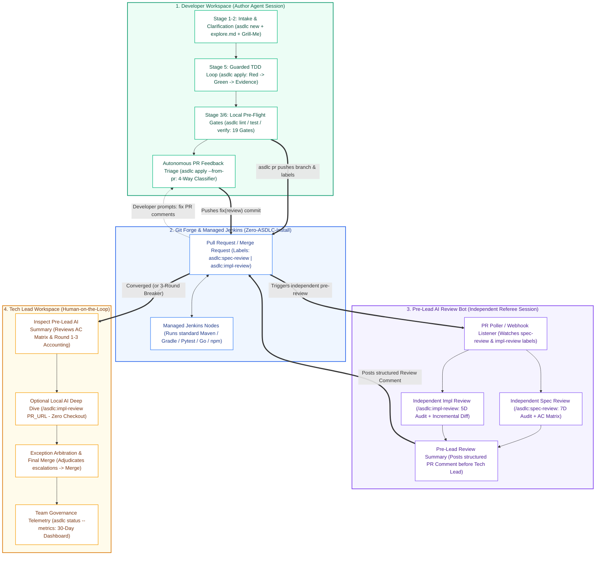
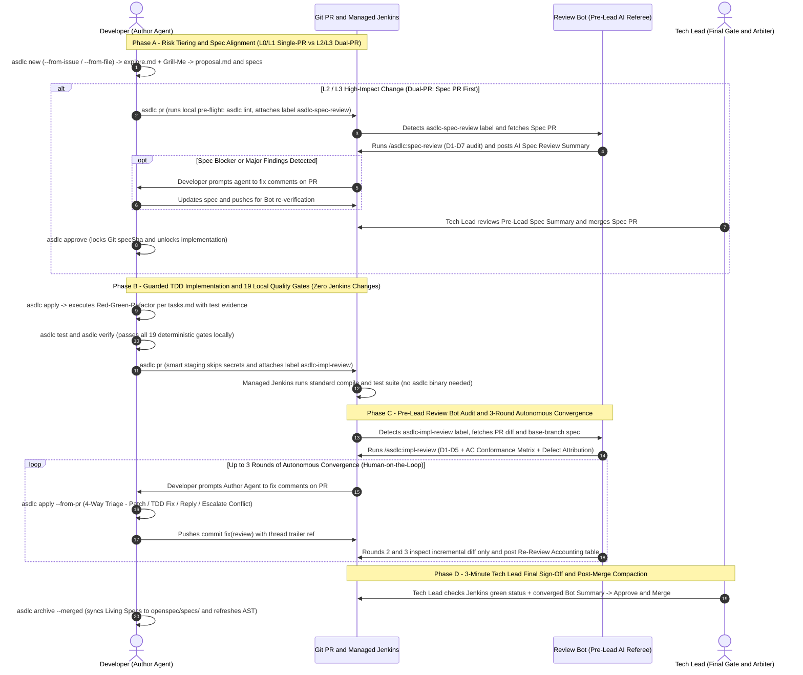
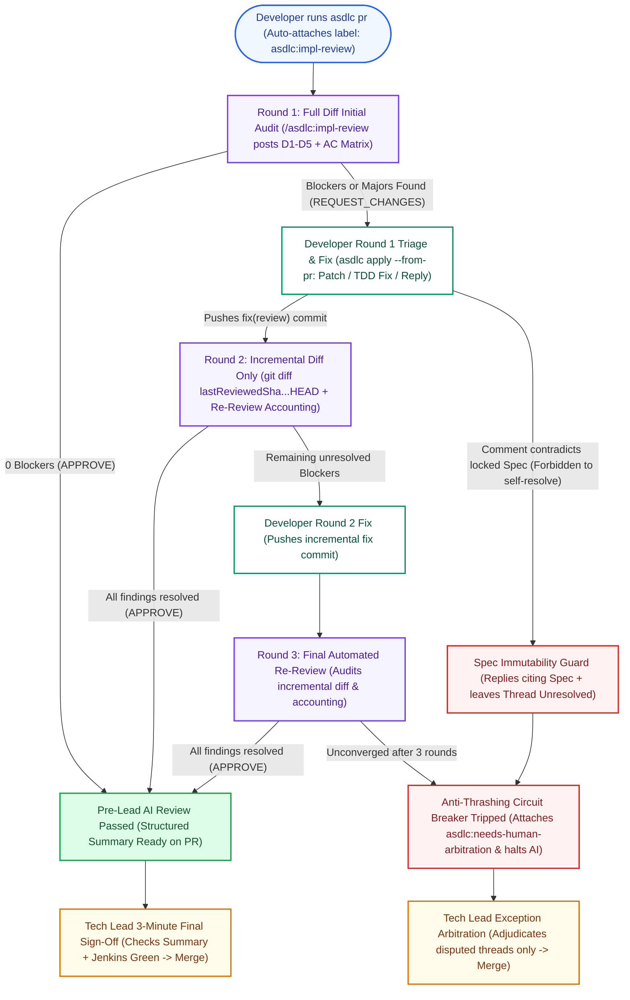

# Enterprise Operating Model & Collaboration Playbook

> **Core Architecture: Three-Party Isolated Agent Sessions (Developer · Pre-Lead Review Bot · Tech Lead) + Zero-Intrusion Managed Jenkins**  
> Without modifying locked-down corporate Jenkins build nodes, `agentic-sdlc` enforces **19 local pre-flight quality gates**, **pre-lead independent AI Review Bot audits**, and a **3-round autonomous convergence protocol**. It guarantees **Player ≠ Referee** session isolation while compressing human Tech Lead review effort from hours to minutes.

---

## 🧭 1. Why This Operating Model?

Enterprise engineering teams deploying autonomous coding agents face three practical constraints:

1. **Locked-Down CI Build Nodes (Managed Jenkins)**: Corporate Jenkins agents are centrally provisioned by infrastructure teams. Application teams rarely have `root` privileges to run `npm install -g` or install custom global CLI binaries on Jenkins workers.
2. **Tech Lead Review Bandwidth Bottleneck**: AI agents generate code 10x faster than humans can read it. Routing raw, unvetted PRs directly to Tech Leads turns senior engineers into human linters and creates a massive delivery bottleneck.
3. **Shared-Context Verification Bias (`Player == Referee`)**: When the same AI session that writes the code also reviews the code, it inherits its own blind spots and assumptions, failing to catch contract drift or missing edge cases.

**The `agentic-sdlc` Solution**: Distribute governance gates and AI reviews across **three physically isolated agent sessions**, allowing managed Jenkins nodes to focus strictly on traditional builds, unit tests, and artifact packaging.

---

## 🏛️ 2. System Topology: Four-Party Isolation & Collaboration



---

## 🔄 3. End-to-End Collaboration Sequence

The sequence below illustrates how the **Developer (Author Agent)**, **Review Bot (Pre-Lead AI Referee)**, **Managed Jenkins**, and **Tech Lead** coordinate across the full lifecycle:



---

## 👥 4. Role-Based Standard Operating Procedures (SOPs)

### 4.1 👨‍💻 Role 1: Developer + Author Agent

Developers run `asdlc` locally inside their IDE (Claude Code, Cursor, Antigravity, OpenCode). **Every deterministic gate is enforced before code ever leaves the developer's machine.**

| Lifecycle Step | Developer Prompt / Command | Underlying CLI & Governance Guarantees |
| :--- | :--- | :--- |
| **1. Start Feature** | `/asdlc:new "idempotent refund API" --from-issue PROJ-102` | Snapshots Jira/GitHub ticket in `<untrusted-external-ticket>` fence, queries Graphify AST into `explore.md`, assigns `L0–L3`, and runs `grill-me` to settle `clarifications.md`. |
| **2. Open Spec PR**<br>*(L2/L3 only)* | `/asdlc:pr` or `asdlc pr <ID>` | Runs `asdlc lint` pre-flight (11 BDD/AC gates). On pass, pushes branch, creates Spec PR, and attaches `asdlc:spec-review`. |
| **3. TDD Execution** | `/asdlc:apply <ID>` | **L0/L1** unlocks immediately; **L2/L3** verifies `approvedSha` on `main` first. Executes Red-Green-Refactor loop per `tasks.md` with captured test logs. |
| **4. Open Impl PR** | `/asdlc:pr` or `asdlc pr <ID>` | Runs `asdlc verify <ID>` pre-flight (**19 gates**: including `anti-test-weakening` and `spec-tamper`). Smart-stages safe files, opens PR, and attaches `asdlc:impl-review`. |
| **5. Fix PR Comments** | Prompt agent:<br>**`"fix comments on PR #44"`** | Invokes `asdlc apply <ID> --from-pr 44`. Fetches unresolved threads via GraphQL, applies 4-way semantic triage, commits fixes with `(ref: #PRRT_...)` trailers, and replies. |

---

### 4.2 🤖 Role 2: Pre-Lead AI Review Bot (Independent Referee)

The Review Bot acts as an **automated, independent gatekeeper** running in a separate agent session or worker container. It evaluates PRs and posts a comprehensive review summary **before the human Tech Lead steps in**.

#### Three Core Pillars of the Review Bot:
1. **Label-Driven Auto-Routing**:
   - PRs labeled `asdlc:spec-review` trigger [`/asdlc:spec-review <PR_NUMBER>`](../assets/skills/asdlc-spec-review/SKILL.md).
   - PRs labeled `asdlc:impl-review` trigger [`/asdlc:impl-review <PR_NUMBER>`](../assets/skills/asdlc-impl-review/SKILL.md).
2. **Trusted Base-Branch Grounding & Defect Attribution (`REVIEW.md`)**:
   - Always reads approved specs and repository `REVIEW.md` rules from `origin/<baseBranch>` (never from the untrusted PR `HEAD`).
   - **Strict Defect Attribution**: Bugs introduced by the PR are flagged as `🔴 [Blocker: Introduced]` (blocks merge). Legacy issues in touched files are logged as `⚪ [Tech Debt: Pre-existing]` (**never blocks the PR**).
3. **Incremental Re-Review & 3-Round Accounting (`Diff-Only Re-Review`)**:
   - On Rounds 2 and 3, the bot extracts `lastReviewedSha` from its previous comment and inspects **only the incremental diff (`git diff lastReviewedSha...HEAD`)**, preventing nitpick thrashing on already-approved lines.
   - Renders a **`🔄 Re-Review Accounting`** table tracking each finding ID (`R1-#1`, `R1-#2`) to resolution.



---

### 4.3 👨‍⚖️ Role 3: Tech Lead (Architecture Gatekeeper & Arbiter)

This operating model frees Tech Leads from tedious line-by-line syntax and boilerplate checking:

1. **Standard Converged Flow (90%+ of PRs) — 3-Minute Sign-Off**:
   - By the time the Tech Lead opens the PR, the Review Bot and Developer have already converged over 1–2 rounds and reached `✅ APPROVE`.
   - The Tech Lead scans the **AC Conformance Matrix**, verifies the **Re-Review Accounting** table, checks that Jenkins build/tests are green, and clicks **Approve & Merge**.
2. **Interactive Deep-Dive Flow — Standalone Local AI Co-Reviewer**:
   - For critical `L2/L3` architectural changes, the Tech Lead can run an interactive review session on their own machine **without even checking out the developer's branch**:
     ```text
     review PR https://github.com/org/repo/pull/44
     ```
   - `asdlc-impl-review` supports **Standalone PR-Only Mode**, pulling the remote PR diff and base-branch spec directly into the Tech Lead's agent session.
3. **Exception Arbitration Flow (<10% of PRs) — Handling `asdlc:needs-human-arbitration`**:
   - When a PR carries the `asdlc:needs-human-arbitration` label (either because 3 automated rounds did not converge or a review comment contradicted an approved spec), the Tech Lead reads the concise synthesis report and makes the final call on the 1–2 disputed items.

---

### 4.4 🏗️ Role 4: Managed Jenkins Nodes (Zero-Install Compatibility)

Why does this workflow succeed even when corporate Jenkins nodes prohibit installing `asdlc`? Because **governance and build execution are cleanly decoupled**:

| Verification Responsibility | Executed By | Why Managed Jenkins Doesn't Need `asdlc` Installed |
| :--- | :--- | :--- |
| **19 Deterministic SDLC Gates**<br>(`spec-tamper`, `anti-test-weakening`, `tdd-evidence`, `level-integrity`, etc.) | **Developer Local (`asdlc pr` Pre-flight)**<br>+ **Review Bot Session** | `asdlc pr` refuses to push or open a PR unless `asdlc lint` (for Spec PRs) or `asdlc verify` (for Impl PRs) exits `0` locally. |
| **Player ≠ Referee Independent Audit**<br>(7D Spec Review + 5D Impl Review + AC Matrix) | **Pre-Lead AI Review Bot** | Runs in a dedicated agent session/worker outside Jenkins, fetching PR diffs via Git APIs and posting structured Markdown comments. |
| **Compilation, Packaging, Integration Suites & SonarQube** | **Managed Corporate Jenkins Nodes** | Jenkins runs standard `mvn test`, `pytest`, `go test`, or `npm test` using its existing enterprise images and reports commit status back to the PR. **Zero Jenkins reconfiguration required.** |

---

## 🛠️ 5. Four-Way Semantic PR Triage Protocol (How the Author Agent Fixes Comments)

When a developer prompts `"fix comments on PR #<N>"` (invoking `asdlc apply <ID> --from-pr <N>`), the Triage Engine ([`src/lib/triage.js`](../src/lib/triage.js)) deterministically classifies every unaddressed human or bot thread into four categories:

| Category | Detection Signal | Autonomous Author Agent Action | Mutates Code? | Auto-Resolves Thread? |
| :---: | :--- | :--- | :---: | :---: |
| **Category B**<br>`SUGGESTION_BLOCK` | Contains a GitHub ```` ```suggestion ```` diff block | Applies exact line-range replacement in memory, runs tests, and commits with `fix(review): ... (ref: #ThreadID)` | ✅ Yes | ✅ Yes (replies with Commit SHA) |
| **Category A**<br>`ACTION_REQUIRED` | Contains defect keywords, imperative requests, or mixed signals (`"LGTM, but fix X"`) | Enters TDD loop to add test assertions and fix code, passes `asdlc verify`, and commits with `(ref: #ThreadID)` | ✅ Yes | ✅ Yes (replies with Commit SHA) |
| **Category C**<br>`INFORMATIONAL_QUESTION` | Architectural or rationale inquiry (`"Why did we use X here?"`) | Formulates a technical explanation grounded in `design.md` and replies directly to the thread | ❌ **No** (zero code mutation) | ❌ **No** (left open for reviewer confirmation) |
| **Category D**<br>`NON_ACTIONABLE` | Pure praise or acknowledgment (`"LGTM"`, `"Nice work!"`, `"👍"`) | Safely ignored to prevent empty noise commits | ❌ No | — |
| **⚠️ Constitutional Guard**<br>`SPEC_CONFLICT` | Requested change **contradicts the locked (`specSha`) specification** | **Strictly forbidden from editing locked specs or self-resolving!**<br>Replies quoting the exact spec section, leaves thread open, and attaches `asdlc:needs-human-arbitration` | ❌ **No** | 🚫 **Forbidden** (`Player ≠ Referee` invariant) |

---

## 📊 6. Team Velocity & Governance Observability (`asdlc status --metrics`)

Every gate evaluation, local retry, PR triage round, and lifecycle transition is tracked without any external database or telemetry daemon (combining git-ignored local friction logs in `.sdlc/events.jsonl` with permanent Git archive provenance in `openspec/changes/archive/`).

Tech Leads and Product Owners can run the metrics dashboard on any repository clone:

```bash
asdlc status --metrics
```

```text
======================= 🏛️ ASDLC HARNESS OBSERVABILITY =======================
📅 Data Source: Git Archive History (Last 30 Days, 24 changes tracked)

1. 🚦 Gate Friction Leaderboard (Local .sdlc/ Retries)
   Rank | Gate                  | Stage  | Fails | Top Failure Pattern
   --------------------------------------------------------------------------
    #1  | anti-test-weakening   | verify | 18    | deleted test (12), @Disabled (6)
    #2  | clarifications        | lint   | 9     | unresolved [OPEN] questions
    #3  | human-gate (staleSha) | verify | 4     | reviewedSha != HEAD commit

2. 🔄 Autonomous PR Convergence (3-Round Cap)
   • Round 1 Pass (Zero rework)    : 65% (15 PRs)
   • Round 2 Pass (Converged Rd 2) : 25% (6 PRs)
   • Round 3 Pass (Converged Rd 3) : 8%  (2 PRs)
   • Human Escalated (>3 rounds)   : 2%  (1 PR: feat-refund-channels)

3. ⏱️ Stage Lead Time (P50 / P90 via Git Provenance)
   • Stage new -> approve (Spec Phase): 14m / 45m
   • Stage apply -> verify (TDD Phase): 8m / 22m

4. 🛡️ Risk Tier Breakdown
   • L0 (Docs/Internal): 5 | L1 (Normal): 12 | L2 (High): 6 | L3 (Critical): 1
=============================================================================
```

---

## 🔗 Related Documentation

- ⏱️ **[30-Minute Getting Started Guide (getting-started.md)](./getting-started.md)**: Step-by-step hands-on tutorial from zero install to your first governed PR.
- 📐 **[Spec Format & Lint Reference (spec-format.md)](./spec-format.md)**: Complete guide to R0–R8 lint rules, BDD scenarios, and testable acceptance criteria.
- 🔬 **[Harness Observability & Autonomous PR Triage RFC (harness-observability-and-triage-design.md)](./harness-observability-and-triage-design.md)**: Technical design behind the two-tier telemetry model and 3-round circuit breaker.
- ⌨️ **[CLI Command Reference (usage.md)](./usage.md)**: Full flag, option, and exit code reference for all `asdlc` commands.
