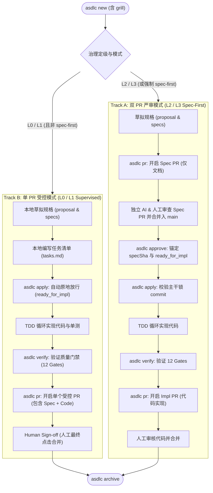

# Single-PR Workflow Approval Decoupling & DX Hardening Proposal
# 单 PR 模式（L0/L1 受控）审批解耦与研发体验加固方案

> **Status / 状态**: Proposal & Technical Specification (**v1.1 — PE/TL Reviewed, see §9**) / 已评审并修订
> **Scope / 范围**: `src/commands/status.js`、`src/commands/approve.js`、`src/commands/apply.js`、`src/commands/verify.js`、`src/lib/agents.js`、`.agents/skills/**`、`AGENTS.md`
> **Audience / 受众**: Principal Engineer (PE) / Tech Lead (TL) / Tech Product Owner (TPO) / 业务研发团队
> **Related / 关联**: [risk-detection-hardening.md](./risk-detection-hardening.md)、[architecture.md](./architecture.md)、[usage.md](./usage.md)

---

## 目录

1. [背景与问题界定](#1-背景与问题界定)
2. [根本原因剖析（为什么会提示用户-approve）](#2-根本原因剖析为什么会提示用户-approve)
3. [核心设计原则（tl--pe-双重视角）](#3-核心设计原则tl--pe-双重视角)
4. [双轨生命周期模型（two-track-lifecycle）](#4-双轨生命周期模型two-track-lifecycle)
5. [技术整改方案（代码与命令层）](#5-技术整改方案代码与命令层)
   - 5.1 `asdlc status` 状态真实化呈现
   - 5.2 `asdlc approve` 幂等自适应与单 PR 原地标记
   - 5.3 `asdlc apply` 单 PR 静默流转与前置校验优化
   - 5.4 `AGENTS.md` 与 Agent Prompt 双轨分流说明
6. [边界与非目标（防反噬红线）](#6-边界与非目标防反噬红线)
7. [验收标准与测试用例规划](#7-验收标准与测试用例规划)
8. [实施计划与发版节奏](#8-实施计划与发版节奏)

---

## 1. 背景与问题界定

在企业级研发实践中，同一个业务需求（如“全栈依赖现代化升级”）在不同微服务仓库下，经 Agentic SDLC 拓扑评估得出了精准的差异化定级：
- `rag-chatbot`（核心 RAG 后端）：**L2 (Spec-First)** — 触碰了具有 22 个入向引用的核心 AST 枢纽 `conversation_history_helper.py`；
- `rag-chatbot-ui`（前端 SPA）：**L2 (Spec-First)** — 触碰了具有 35 个引用的全局网络枢纽 `api.js`；
- `rag-chatbot-doc-preprocess`（离线预处理流水线）：**L1 (Supervised Single PR)** — 属于管道式脚本，无高入度 God Node。

对于定级为 **L1 (Supervised Single PR)** 的 `rag-chatbot-doc-preprocess`，开发人员反馈了一个关键体验问题：
> *“既然是 Single PR 模式，为什么终端还是提示我需要去 approve 这个 change？开发完全看不明白：没有提 Spec PR，我去哪里 approve？到底要不要 approve？”*

这暴露了系统在**双 PR 严格治理模式**向**单 PR 敏捷模式**扩展时，生命周期状态机与用户提示层未完全解耦的体验断层。

---

## 2. 根本原因剖析（为什么会提示用户 approve？）

经过对代码调用栈与交互链路的逆向分析，造成用户困惑的核心症结有三处：

### 2.1 泛化 7 步法心智惯性 vs. 单 PR 模式分流缺失
在现有的 `AGENTS.md`、CLI 引导和 Agent 技能提示词中，系统一律灌输线性的经典 7 步法：
```text
new (含 grill 访谈) -> lint (+ Spec PR) -> approve -> apply -> verify -> archive
```
> **勘误（v1.1）**：grill 是 `asdlc new` 的内嵌环节（同一交互回合内完成并落盘 `clarifications.md`），不是独立阶段，v1.0 把它单列为第 2 步是错误的。现有 `src/lib/agents.js` 的 `ROUTING_BLOCK` 标题写 "7 stages"，却同时把 `grill` 列为第 2 项（标注 "embedded in Stage 2"），编号与实际命令序列不一致，应一并修正（见 §5.4）：以命令为准，`new` 内含 grill，下游阶段编号顺延。
- **对于 L2/L3 (Spec-First)**：Stage 3 提 Spec PR，合并后执行 Stage 4 `asdlc approve <ID>` 锁定 `specSha`，合情合理；
- **对于 L0/L1 (Single-PR)**：规格与代码合并在**同一个 PR**提交。在写完 spec 之后，**根本不存在一个前置的 Spec PR 供人类去合并**。但开发人员或宿主 AI Agent 按照流程图走到第 4 步，就会下意识停下来，向人类询问：“*请先批准（approve）规格，或者运行 `asdlc approve`*”。

### 2.2 `asdlc status` 的虚假打勾（Phantom Approval）
在 `src/commands/status.js` 中，历史实现如下：
```javascript
const stage = [
  ['1 explore (draft)', has('explore.md')],
  ['2 proposal.md', has('proposal.md')],
  ['2 spec delta', specFiles.length > 0],
  ['3 spec approved on ' + branch, isSinglePr ? true : Boolean(approvedSha)],
  ['4 tasks complete', unchecked === 0],
];
```
在单 PR 模式下，系统为了让流程不报错，直接在 Stage 3 返回了 `true`。于是终端赫然打印出：
```text
[x] 3 spec approved on origin/main
```
**开发人员的困惑**：“我刚刚才在本地写完 `proposal.md`，根本没向远程 `origin/main` 提过任何东西，系统凭什么说已经 `approved on origin/main` 了？这是不是 bug？”

### 2.3 `asdlc approve` 命令缺乏对 Single-PR 的容错与就地承接
如果开发者按照提示手动执行 `asdlc approve <ID>`，`src/commands/approve.js` 会通过 Git 检查 HEAD 或主干上是否有合并提交。在单 PR 场景下，由于主干上根本没有该变更的提交，命令可能抛错或者给出无关的下一步指引，使得用户陷入“不批不能写代码，批了又报错”的死锁感知。

---

## 3. 核心设计原则（TL + PE 双重视角）

1. **PE 原则：最小摩擦法则（Least Friction Principle）**
   - 单 PR 模式的立项使命就是为中低风险改动（L0/L1）降噪减负。任何要求单 PR 开发者进行“仪式性操作”（如无意义的命令审批、伪造的主干检查）的设计都是坏架构。
2. **PE 原则：真实性原则（Truth in Tooling）**
   - 工具输出的每行状态必须与物理现实 100% 对应。绝不能在终端对人类谎称“已在 origin/main 批准”，而应坦诚告知“单 PR 模式：规格与代码合并在最终 PR 统一审批”。
3. **TL 原则：双轨生命周期合流（Two-Track Lifecycle Alignment）**
   - 治理框架必须清晰划分出两套标准轨迹：
     - **Track A (Dual-PR / Spec-First)**：重度合规，双重审计，严控审批。
     - **Track B (Single-PR / Supervised)**：轻量敏捷，一次提交，终审把关。
   - 状态机、CLI 输出、AI Agent 引导文案必须根据当前定级自动适配，绝不在 Track B 中暴露 Track A 的专用阻断关卡。
4. **TL 原则：宽容与幂等（Postel's Law: Robustness Principle）**
   - “对自己要严，对别人要宽”。如果用户或 Agent 在单 PR 模式下误执行了 `asdlc approve`，系统绝不报错，而是**幂等原地标记为 `ready_for_impl` 并输出友善说明**，确保流水线不中断。

---

## 4. 双轨生命周期模型（Two-Track Lifecycle）



---

## 5. 技术整改方案（代码与命令层）

### 5.1 `asdlc status` 状态真实化呈现
修改 `src/commands/status.js`：
根据 `isSinglePr` 条件动态调整 Stage 3 文本与 `next` 动作建议：

```javascript
// 现状：
['3 spec approved on ' + branch, isSinglePr ? true : Boolean(approvedSha)]

// 整改后：
const stage3Label = isSinglePr
  ? '3 spec approval (co-located in single PR)'
  : `3 spec approved on ${branch}`;

const stage = [
  ['1 explore (draft)', has('explore.md')],
  ['2 proposal.md', has('proposal.md')],
  ['2 spec delta', specFiles.length > 0],
  [stage3Label, isSinglePr ? true : Boolean(approvedSha)],
  ['4 tasks complete', unchecked === 0],
];
```

**Next 引导逻辑优化**：
当处于单 PR 模式且处于编写阶段时，明确指引开发直接进入 TDD 流程：
```javascript
if (isSinglePr) {
  if (!has('tasks.md')) {
    next = `author tasks.md, then run: asdlc apply ${changeId}`;
  } else if (unchecked !== 0) {
    next = `run: asdlc apply ${changeId}, then complete tasks in tasks.md`;
  } else {
    next = `run: asdlc verify ${changeId} && asdlc pr ${changeId} ${branch}`;
  }
}
```

### 5.2 `asdlc approve` 幂等自适应与单 PR 原地标记
修改 `src/commands/approve.js`：
在命令入口处识别当前变更是否属于 Single-PR 模式。

- **逻辑分支（v1.1，已按 §9 评审修订，以此为准）**：
  1. 通过共享 helper `resolveTopology()`（§9 R3）判定 `isSinglePr`，**必须基于 `readEffectiveLevel`（含历史最高等级与 tamper 检测）**，而非仅读 `.openspec.yaml` 声明的 `level`；
  2. 仅当「**显式传入 `changeId`** 且 `isSinglePr === true`」时进入单 PR 分支（无 `changeId` 的 post-merge hook 自动探测路径保持原行为，不得触发）：
     - 无需在 Git 主干上寻找合并提交；
     - ~~取 HEAD 作为名义 `specSha`~~ → **不写 `specSha`、不打 `approved/<ID>` tag、不自动 commit**（避免与 verify 的 `approved-spec` 校验冲突，避免伪造审计锚点）；
     - 仅幂等地置 `status: ready_for_impl`（与 `apply` 复用同一函数）；
     - ~~在 `review.md` 记录就地确认块~~ → **严禁写入/改写 `review.md`**；
     - 输出友好日志（并提示最终 PR 仍需人工 Approve）：
       ```text
       ✓ <slug>: Single-PR mode (L1) - spec approval is co-located with implementation PR.
       ✓ marked status=ready_for_impl in-place (no separate Spec PR required).
       ℹ final approval = human Approve on the single PR (NOT waived).
       ```
     - 退出码返回 `0`。

这样即使开发者或 Agent“手滑”敲了 `asdlc approve`，不仅不会挂掉，反而能顺理成章地推进到下一步。

### 5.3 `asdlc apply` 单 PR 静默流转与前置校验优化
`src/commands/apply.js` 目前已有原地升档为 `ready_for_impl` 的逻辑，但缺乏友好的控制台输出：
```javascript
if (isSinglePr) {
  if (meta.status !== 'ready_for_impl' && exists(metaPath)) {
    // 自动置为 ready_for_impl
  }
  log.ok(`${slug}: governance level is ${effectiveLevel} (Single PR mode: direct local implementation permitted)`);
}
```
**增强点**：
当 `isSinglePr` 自动将变更置为 `ready_for_impl` 时，明确输出一行提示：
```text
✓ <slug>: marked status=ready_for_impl (spec approval waived for Single-PR)
```
让开发者清楚知道系统已经帮其完成了准入手续。

### 5.4 `AGENTS.md` 与 Agent Prompt 双轨分流说明
修改 `src/lib/agents.js` 中的标准模板，并在 `asdlc init` / `asdlc doctor --fix` 时刷新：

```markdown
<!-- asdlc:routing -->
## Agentic SDLC — Two-Track Execution Flow

Everything runs through `asdlc`. Check current level and mode with `asdlc status <ID>`.

### 📌 Track A: High-Risk & Core Modules (L2/L3 or spec-first)
Dual-PR lifecycle with cryptographic intent lock:
1. `asdlc new "<intent>"` (scaffold + explore + **grill-me interview embedded**, settle `clarifications.md`, then author proposal/specs) -> 
2. `asdlc lint <ID>` -> 3. `asdlc pr <ID> <target>` (Spec PR) -> 4. Human merge & `asdlc approve <ID>` -> 
5. `asdlc apply <ID>` (TDD loop) -> 6. `asdlc verify <ID>` -> 7. `asdlc pr <ID> <target>` (Impl PR) -> 8. `asdlc archive <ID>`.

### ⚡ Track B: Bounded & Routine Modules (L0/L1 under supervised/auto)
Fast-path Single-PR lifecycle (Spec & code in one PR, human confirms at merge):
1. `asdlc new "<intent>"` (grill-me interview embedded) -> 2. Draft `specs/` & `tasks.md` -> 
3. `asdlc apply <ID>` (directly starts TDD loop; **separate Spec PR + `approve` are waived**) -> 
4. `asdlc verify <ID>` -> 5. `asdlc pr <ID> <target>` (Single PR; human Approve at merge is still required under supervised) -> 6. `asdlc archive <ID>`.
```

---

## 6. 边界与非目标（防反噬红线）

为确保改动的安全性，明确以下**禁止事项（Non-Goals）**：

1. **严禁在单 PR 模式下绕过最终的人工审批门禁**：
   - 规格阶段豁免单独 PR，绝不代表上线不用人审！
   - 在 `supervised` 模式下，代码和规格合并后的单一 PR，**依然强制要求人类 Tech Lead 在 GitHub/GitLab 上点击 Approve 才能合并**（`auto_approval: disabled`）。
   - **`asdlc approve` 在单 PR 下绝不得写入 `review.md` 的 `## Verdict APPROVE`**（见 §9 R1：`verify.js` 的 `human-gate` 以此为通过依据，写入即等于伪造人类审批）。
2. **严禁允许高风险（L2/L3）冒充单 PR**：
   - 只有通过 `v1/v2/v3` 评估且无安全违规、无 God Node 触碰的 L0/L1 变更，才能享受免前置 approve 待遇；
   - 一旦在实现阶段触碰了架构枢纽或凭证（触发 `ESCALATED_IN_IMPL`），系统必须立即转回 Dual-PR 轨道。

---

## 7. 验收标准与测试用例规划

新增针对单 PR 审批解耦的专项集成测试 `test/single-pr-approval.test.js`：

| 用例编号 | 测试场景 | 预期断言 |
| :--- | :--- | :--- |
| **TC-SP-01** | 在 L1 单 PR 变更下运行 `asdlc status` | Stage 3 显示 `(co-located in single PR)`，绝不可出现 `approved on origin/main`。 |
| **TC-SP-02** | 在 L1 单 PR 变更下未合入 main 直接运行 `asdlc approve <ID>` | 命令以 `0` 成功退出，原地将 `.openspec.yaml` 置为 `ready_for_impl`，输出单 PR 说明日志。 |
| **TC-SP-03** | 在 L1 单 PR 变更下未执行 approve 直接运行 `asdlc apply <ID>` | Apply guard 顺利放行，不阻断 TDD 执行，自动补全 `ready_for_impl`。 |
| **TC-SP-04** | 在 L2 双 PR 变更下未合入 main 运行 `asdlc approve <ID>` | 严格保持原有防御行为：报错阻断，提示必须等待 Spec PR 合并入主干。 |
| **TC-SP-05** | 在 L1 单 PR 变更下运行 `asdlc verify` 与 `asdlc pr` | 全流程顺利闭环，生成的 PR 正确挂载 `asdlc:impl-review` 标签与 Supervised 单 PR Banner。 |
| **TC-SP-06** | L1 单 PR 下 `asdlc approve <ID>` 之后 | `review.md` **无** `Verdict APPROVE`、`.openspec.yaml` **无** `specSha`、**无** `approved/*` tag、**无**新 commit；`verify` 的 `human-gate` 仍为未通过（需人工）。 |
| **TC-SP-07** | 声明 L1 但历史最高 L2（`ESCALATED_IN_IMPL`/被篡改降级）后 `approve` | 不走单 PR 分支；按 Track A 阻断（或 `LEVEL_TAMPERED`）。 |
| **TC-SP-08** | `workflowMode: spec-first`（meta）或 `--mode spec-first` / repo policy floor=spec-first 的 L1 变更运行 `approve`/`status` | 保持 Track A 全部原行为与文案，不出现 co-located 字样。 |
| **TC-SP-09** | `--mode auto` 的 L0/L1 变更运行 `status`/`approve`/`apply` | 与 supervised 同拓扑；且 `auto` 下 verify `human-gate`/auto-merge 行为**零变化**（快照对比）。 |
| **TC-SP-10** | 无 `changeId` 的 post-merge hook 路径 `mergeChange()` | 行为与 v1.9.0 逐字节一致（含 tag、review.md 戳、commit）。 |
| **TC-SP-11** | `status --json` / portfolio 在 L2/L3 与 spec-first 下 | 输出 schema 与文案与基线快照完全一致。 |

---

## 8. 实施计划与发版节奏

本方案属于纯粹的 **DX 体验优化与容错加固**，不涉及架构破坏性重构：
1. **代码改动量**：约 60-80 行轻量逻辑（涉及 `status.js`、`approve.js`、`apply.js`、`agents.js`）；
2. **测试验证**：补充 5 个专项测试用例，确保 196 个存量单测 100% 保持通过；
3. **版本规划**：作为核心补丁，合并发布为 **`v1.9.1`**。


---

## 9. PE / TL 评审结论与补充（v1.1）

> 评审基线：对照 `src/commands/{status,approve,apply,verify,pr}.js`、`src/lib/{config,level,prtype}.js` 当前实现逐项核对。
> 结论：**根因诊断成立，方向正确；但 v1.0 §5.2 存在 1 个 P0 治理绕过风险与若干影响面遗漏，已在上文修订。其余按下列补充后可批准实施。**

### 9.1 评审发现

| # | 级别 | 发现 | 处理 |
| :-- | :-- | :-- | :-- |
| **R1** | **P0** | v1.0 §5.2 要求 `approve` 在单 PR 下往 `review.md` 写入就地确认块。`approve.js` 的 `ensureApprovedReview` 会写 `## Verdict APPROVE`，而 `verify.js`（约 L347-350）的 `human-gate` 正是以该字样判定“本地 lead review 已完成”。开发者/Agent 手滑一次 `approve` 就会**自我签发人工审批，绕过 supervised 的人工门禁**，与 §6 红线直接矛盾。 | §5.2 已改：单 PR 下 `approve` **不触碰 review.md**；新增 TC-SP-06。 |
| **R2** | P0 | v1.0 用“声明的 `level`”判单 PR。`apply`/`verify` 使用 `readEffectiveLevel`（含历史最高等级、`LEVEL_TAMPERED`）。若 `approve` 仅读声明值，已升级到 L2 但 meta 被改回 L1 的变更可借 `approve` 绕过 Track A。 | `approve`/`status` 必须复用 `readEffectiveLevel`；新增 TC-SP-07。 |
| **R3** | P1 | `isSinglePr` 判定在 `status.js`(×2)、`apply.js`、`verify.js`、`pr.js`、`risk.js` 各自复制，且判据不一致（`status`/`pr` 用正则读 meta，`verify` 用解析器，`risk.js` 仅看 level、不看模式）。再在 `approve.js` 复制第 7 份，会继续漂移。 | 抽取 `lib/level.js#resolveTopology({repoRoot, slug, baseRef, cliMode}) -> { isSinglePr, effectiveLevel, mode, reason }`，**先在 `approve` 与 `status` 新增使用；`apply/verify/pr` 的迁移放入独立后续 PR（保持本补丁最小，不动其行为）**。 |
| **R4** | P1 | `approve` 当前**没有 `--mode` 选项**，无法与其他命令一致地解析 CLI/Env/Repo/Global 优先级；repo policy floor=`spec-first` 时单 PR 判定会与 `apply` 不一致。 | `approve` 增加 `--mode`，经 `resolveWorkflowMode` 统一解析，保证 floor 单调性（`ILLEGAL_MODE_DOWNGRADE`）。 |
| **R5** | P1 | `mergeChange()` 同时被“显式 `approve <ID>`”与“无参数 post-merge hook”使用。单 PR 分支若放在函数入口，会改变 hook 路径行为。 | 仅在 `changeId` 显式传入且判定为单 PR 时短路；hook 路径零改动（TC-SP-10）。 |
| **R6** | P1 | v1.0 §5.1 把本应只读的 `status` 的 Stage 3 仍硬编码 `true`，仅换了文案，“Phantom Approval”实质未消除（`[x]` 仍显示已完成）。 | 单 PR 下以第三态呈现：`[~] 3 spec approval (co-located in single PR; human sign-off at merge)`；`--json` 中 `ok` 保持 `true` 以兼容消费者，并**新增**字段 `mode: "single-pr"`、`approvalTrack: "colocated"`（只增不改）。 |
| **R7** | P2 | v1.0 §5.1 的 `next` 代码块会整体替换现有 `next` 链，但现有 L63-L65 已处理单 PR 分支；重复改写有回归风险，且 `portfolio`（`statusPortfolio`）使用另一套 `next` 文案，未纳入方案。 | 仅**追加**“缺 tasks.md → author tasks.md”一档；portfolio 的单 PR 阶段名保持不变（已正确不含 approve）。 |
| **R8** | P2 | v1.0 §5.3 `apply` 提示文案“spec approval waived”措辞不准：waived 的是**前置 Spec PR**，不是人工审批。 | 改为 `✓ <slug>: marked status=ready_for_impl (no separate Spec PR in Single-PR mode; human sign-off happens on the final PR)`。仅在**实际发生状态变更**时输出，幂等重跑不重复刷屏。 |
| **R9** | P2 | §5.4 的 Track B 标题写“L0/L1 under supervised/auto”，但 `auto` 与 `supervised` 在 apply/verify 的人工门禁语义不同（`auto` 下 L0/L1 可 auto-merge）。统一写“Stage 4 waived”会让 Agent 在 `auto` 外的场景误以为全程免审。 | 文案拆分：Track B 注明“spec PR 与 approve 被豁免；`supervised` 仍需人工在最终 PR 点击 Approve，`auto` 按 policy”。同时 `.agents/skills/**`（asdlc-approve / asdlc-apply 等）须同步加入“单 PR 下无需 approve”的分流说明，否则 Agent 仍按旧 7 步走。 |
| **R10** | P2 | 版本与度量：§8 称“60-80 行、196 存量单测”；纳入 R1-R9 后实际约 120-160 行 + 新 helper；测试数字需以 CI 实测为准。 | 更新 §8。 |

### 9.2 对其他工作流模式的影响矩阵（强制不变量）

| 场景 | status | approve | apply | verify / pr | 本补丁影响 |
| :-- | :-- | :-- | :-- | :-- | :-- |
| **spec-first**（任意级别，含 L0/L1 被 policy floor/`--mode`/meta 强制） | 文案不变 | 原逻辑（需 Spec PR 合并） | 原 guard | 不改 | **零变化**（TC-SP-04/08/11） |
| **L2 / L3**（任意模式） | 不变 | 原逻辑 | 原 guard | 不改 | **零变化** |
| **auto**（L0/L1） | 仅 Stage 3 文案 | 单 PR 友好短路（同 supervised，不写 review.md） | 仅追加提示 | 不改（auto-merge 语义保留） | 仅 DX 文案；门禁**零变化**（TC-SP-09） |
| **supervised**（L0/L1）— 报告问题所在 | 文案/第三态 | 友好短路 | 追加提示 | 不改 | 目标变更 |
| post-merge hook（无 changeId） | — | 原逻辑 | — | — | **零变化**（TC-SP-10） |
| 升级后（`ESCALATED_IN_IMPL`） | 按有效等级 | 不走单 PR 分支 | 原升级路径 | 原 risk-escape | **零变化**（TC-SP-07） |

**实现纪律**：所有新分支必须以 `isSinglePr === true` 为**唯一**入口；`false` 路径不得有任何代码移动、重排或文案改动。PR 评审时以 `git diff` 验证 `else` 分支零 diff。

### 9.3 新增决策与风险记录

- **决策 D1**：`approve` 在单 PR 下是“**信息性幂等 no-op + 状态对齐**”，而非“审批”。审批语义只属于 Track A 的 PR 合并 + `specSha` 锁定。
- **决策 D2**：不引入新的 mode（`validateWorkflowMode` 明确拒绝 `single-pr`），保持“单 PR 是内部拓扑而非可配置模式”的既有设计。
- **风险 Rk1**：`status --json` 为外部可能消费的契约 → 只增字段不改字段。
- **风险 Rk2**：Agent 提示词刷新依赖 `asdlc doctor --fix`；存量仓库未刷新前仍展示旧 7 步 → 在 `usage.md`/发版说明中注明升级动作，并让 `status` 的 `next` 在单 PR 下明确写出“无需 approve”，作为不依赖提示词刷新的兜底。
- **回滚**：纯增量、无数据迁移；回滚即还原 commit，`.openspec.yaml` 已写入的 `status: ready_for_impl` 与 `apply` 既有行为一致，无残留。

### 9.4 修订后的实施清单（Definition of Done）

1. `lib/level.js` 新增 `resolveTopology()`（含单测），仅 `approve`/`status` 接入。
2. `approve.js`：`--mode`；显式 `changeId` + 单 PR → 短路（不写 specSha/tag/review.md/commit）。
3. `status.js`：Stage 3 第三态 + JSON 增量字段 + `next` 追加档。
4. `apply.js`：仅状态变更时输出修正文案（R8）。
5. `agents.js` 模板 + `.agents/skills/asdlc-{approve,apply,new}/SKILL.md` 双轨分流（R9）。
6. 测试 TC-SP-01~11 + 现有全量单测通过；对 spec-first / L2 / auto / hook 路径添加**基线快照回归**。
7. 版本 `v1.9.1`，发版说明含 `doctor --fix` 升级提示。

### 9.5 评审结论

**有条件批准（Approve with changes）**：落实 R1、R2、R4、R5（阻断项）后可实施；R3、R6-R10 为同 PR 内必须完成的加固项，`apply/verify/pr` 的 helper 迁移为后续独立 PR。

### 9.6 实施后二轮评审加固（v1.9.1 发版前）
- **P0 Track A 防御补全**：`approve <ID>` 在 `topology.tampered` 时直接 `fail(LEVEL_TAMPERED)`；在 Track A（非 Single-PR 且显式传入 `changeId`）下校验目标分支上是否存在 Spec 合并提交，缺失则 `fail(SPEC_NOT_MERGED)` 阻断，消除“未合入主干即可在本地盖章 `Verdict APPROVE`”的旁路。
- **P1 公共分支探测与状态不倒退**：抽取 `lib/git.js#resolveDefaultBranch()` 统一 `apply`/`approve`/`status` 与 `resolveTopology` 的基线分支解析（兼容 `master` / 无 remote 仓库）；Single-PR `approve` 仅在草稿/预实现状态（`draft`/`spec_review`/未设置）置为 `ready_for_impl`，对 `archived` 等后续状态保持不变；并补充提示“最终等级以 `asdlc apply` 重评估为准”。
- **P2 一致性**：`status` 对未定级变更统一展示 `unlevelled`（与 Dual-PR 判定一致），历史篡改/升级场景展示 `effectiveLevel`。
